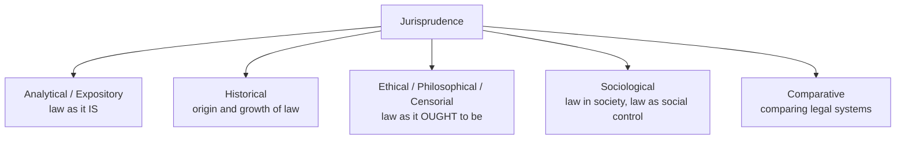

# Paper I · Jurisprudence – I (K-1001) · Unit 1
## Introduction: Definition, Nature and Scope of Jurisprudence; Importance of Its Study

> **Last updated:** 2026-10-27 (IST) · **Law stated as on:** 2026-10-27 · **Branch:** `paper/01-jurisprudence`
> **Verify before exam:** case citations in §6 (see checklist at the end).
> **Syllabus line (official):** *Introduction: Definition, Nature and Scope of Jurisprudence, Importance of the Study of Jurisprudence*

**How this unit is examined.** Expect one of: (a) "Define jurisprudence and discuss its nature and scope" (long), (b) "Discuss the importance/utility of studying jurisprudence" (long or short), (c) a short note on a definition, on a kind of jurisprudence, or on the relation between jurisprudence and another discipline. Definitions (with the thinker's name and book) are the highest-value items: examiners reward a correct name with a correct definition.

---

## 1. Background: where the word comes from

- **Etymology.** Latin *juris* (of law) + *prudentia* (knowledge, skill, foresight) → *jurisprudentia*: **knowledge of law, or skill in law.**
- **Roman root.** The jurist **Ulpian** (Digest 1.1.10.2) described *jurisprudentia* as the knowledge of things divine and human, the science of the just and the unjust. For the Romans the *jurisprudentes* were the learned jurists whose opinions (*responsa*) shaped Roman law.
- **Early modern usage.** In English the word came to mean the study of law as a discipline. **Jeremy Bentham** (*Of Laws in General*; *An Introduction to the Principles of Morals and Legislation*, 1789) gave the word its modern analytical shape and divided it into expository and censorial branches. **John Austin** (*The Province of Jurisprudence Determined*, 1832) fixed its subject-matter as positive law.
- **Indian root.** Indian legal thought long predates the English term. *Dharmashastra* (Manu, Yajnavalkya, Narada, Brihaspati) and Kautilya's *Arthashastra* discuss the nature of *dharma*, law, sanction (*danda*), custom (*achara*) and adjudication (*vyavahara*). Modern Indian jurisprudence is a blend of this inheritance and the English analytical tradition adopted through colonial courts.

---

## 2. Definitions of jurisprudence

| Thinker / source | Definition (in substance) | Point to note |
|---|---|---|
| **Ulpian** (Roman jurist) | Knowledge of things divine and human; the science of the just and the unjust | Widest, ancient meaning; includes ethics and religion |
| **John Austin** | The philosophy of positive law; concerned with laws "properly so called", i.e. laws set by a political superior | Narrows the subject to what the law **is**, not what it **ought to be** |
| **Sir John Salmond** | The science of the first principles of the civil law | "Civil law" = the law of the land administered by courts. Salmond's *Jurisprudence* is the standard Indian recommendation |
| **T.E. Holland** | The formal science of positive law | "Formal" = concerned with form and structure of law, not its content |
| **John Chipman Gray** | The science of law: the statement and systematic arrangement of the rules followed by courts, and the principles lying behind them | Court-centred; compare American Realism (Unit 6) |
| **Roscoe Pound** | The science of law, using "law" in the juridical sense: the body of principles recognised and enforced by public and regular tribunals | Pound also sees law as a tool of social engineering (Unit 5) |
| **G.W. Keeton** | The study and systematic arrangement of the general principles of law | |
| **Julius Stone** | "The lawyer's extroversion": the lawyer's gaze turned outward to the social and intellectual setting of law | Shows jurisprudence is *outward-looking*, drawing on other disciplines |
| **R.W.M. Dias** | Essentially legal theory: the study of the nature of law and of the ideas and methods lawyers use | Matches the title of the CCSU paper, "Legal Theory" |
| **Friedmann** | Legal theory as the reflection of the changing role of law in society (*Legal Theory*; *Law in a Changing Society*) | Both are on the recommended list |

**Exam tip.** Quote **three** definitions (Ulpian for origin, Austin or Salmond for the classical view, Pound or Stone for the modern view), then give your own synthesis: *jurisprudence is the systematic, theoretical and critical study of law, its concepts, sources, purposes and social effects.*

---

## 3. Nature of jurisprudence

1. **It is a theoretical, general study of law.** It does not study one statute (that is *particular* or "dogmatic" law); it asks what law *is*, why it binds, and how its basic ideas (right, duty, liability, ownership, possession, personality) work.
2. **Is it a "science"?** Yes in the broad sense of an organised, systematic body of knowledge with its own method; but unlike the natural sciences it cannot be tested by repeatable experiment and its conclusions are contested between schools. It is best called a **social science** and a **normative discipline**.
3. **It is both descriptive and critical.** Analytical jurisprudence describes law as it is; ethical/philosophical jurisprudence evaluates law against justice; sociological jurisprudence studies law in operation.
4. **It is dynamic.** Its theories respond to their age: natural law (religion, reason), positivism (the rise of the sovereign state), historical school (romantic nationalism), sociological school (industrial society), realism (judicial lawmaking), Marxism (class conflict).
5. **It is interdisciplinary.** It borrows from philosophy, ethics, history, sociology, economics, politics and psychology.
6. **It is "the grammar of law" and the "philosophy of law" in practice**, because it supplies the vocabulary and the reasoning on which statutes and judgments are built.

---

## 4. Kinds (branches) of jurisprudence

### 4.1 Salmond's classification
Salmond divided the subject into three parts:
- **Legal exposition (analytical jurisprudence):** analysing the contents and concepts of an existing legal system.
- **Legal history (historical jurisprudence):** how a legal system and its concepts came to be.
- **Science of legislation (ethical jurisprudence):** the ends law should serve and how law ought to be made.

### 4.2 Bentham's classification
- **Expositorial jurisprudence:** what the law is.
- **Censorial jurisprudence:** what the law ought to be, judged by the principle of utility ("the greatest happiness of the greatest number").

### 4.3 Austin's classification
- **General jurisprudence:** principles common to all mature legal systems (the "philosophy" of positive law).
- **Particular jurisprudence:** the science of a particular, actual system of law (e.g. Indian or English law).

### 4.4 Modern classification (as taught in Indian universities)
| Type | Question asked | Main figures |
|---|---|---|
| Analytical | What is law? What are its concepts? | Bentham, Austin, Kelsen, Hart, Salmond |
| Historical | How did law develop? | Savigny, Maine |
| Philosophical / Ethical | What should law be? Is an unjust law law? | Aquinas, Grotius, Kant, Stammler, Fuller |
| Sociological | What does law do in society? | Ehrlich, Jhering, Pound, Duguit |
| Realist | What do courts actually do? | Holmes, Gray, Llewellyn, Frank |
| Economic / Critical | Whose interests does law serve? | Marx, Engels; Posner (law and economics) |

---

## 5. Scope of jurisprudence

Jurisprudence has no single fixed boundary. Its scope is usually described under these heads:

1. **Nature, definition and purpose of law**, including the relation between law and morality, law and justice, law and sovereignty.
2. **Sources of law**: legislation, precedent, custom, equity, juristic writings.
3. **Fundamental legal concepts**: rights and duties, ownership and possession, legal personality, liability, obligation, property, title, acts and intention.
4. **Justice and the administration of justice**: theories of justice and of punishment.
5. **Legal reasoning and interpretation**: how rules are found, read and applied.
6. **The schools of jurisprudence** (Units 2–7 of this paper).
7. **Relationship with other disciplines**: see the table below.

### Jurisprudence and other disciplines

| Discipline | Relationship |
|---|---|
| **Sociology** | Law is a social institution; sociological jurisprudence studies its social effects (Ehrlich's "living law", Pound's social engineering). Sociology describes society as a whole; jurisprudence studies law, which is only one aspect. |
| **Ethics / morality** | Both regulate conduct. Law is backed by state sanction and concerns external conduct; morality rests on conscience and covers inner motive. Natural law merges them; positivism separates them (Hart–Fuller debate). |
| **History** | Law cannot be understood apart from its past (Savigny, Maine). |
| **Political science** | Sovereignty, the state and constitution link jurisprudence to political theory (Austin's sovereign; Hobbes, Locke, Rousseau). |
| **Economics** | Economic conditions shape law (Marx); law shapes markets (property, contract). Modern law-and-economics tests law by efficiency. |
| **Psychology** | Intention, motive, punishment and judicial behaviour (Jerome Frank). |
| **Anthropology** | Early law, custom, kinship (Maine's patriarchal theory; Llewellyn and Hoebel's study of Cheyenne law). |

---

## 6. Importance (utility) of studying jurisprudence

1. **Foundation for all other law subjects.** Contract, tort, crime and constitutional law all rest on concepts (right, duty, liability, intention) that jurisprudence explains.
2. **Sharpens legal reasoning.** Jurisprudence trains the student to analyse concepts, spot hidden assumptions and argue from principle.
3. **Aids interpretation of statutes and the Constitution.** Choices between literal, purposive and rights-based readings are jurisprudential choices.
4. **Guides judges in law-making.** Judges in India openly use theory. Examples:
   - *Kesavananda Bharati v. State of Kerala* (1973) 4 SCC 225: the basic-structure doctrine is built on a view that Parliament's amending power cannot destroy the Constitution's identity (natural-law colouring).
   - *A.K. Gopalan v. State of Madras*, AIR 1950 SC 27 (positivist reading of "procedure established by law") versus *Maneka Gandhi v. Union of India* (1978) 1 SCC 248 (procedure must be just, fair and reasonable). Same text, different jurisprudence.
   - *ADM Jabalpur v. Shivkant Shukla* (1976) 2 SCC 521 (positivist: no remedy when Art. 21 was suspended in the Emergency), overruled by *K.S. Puttaswamy v. Union of India* (2017) 10 SCC 1 (life and liberty are natural rights that pre-exist the Constitution).
   - *Vishaka v. State of Rajasthan* (1997) 6 SCC 241: Court laid down guidelines to fill a legislative gap (realist/sociological approach).
   - *Navtej Singh Johar v. Union of India* (2018) 10 SCC 1: constitutional morality over popular morality.
5. **Aids legislators and law reform.** Law Commission reports, codification and decriminalisation debates (e.g. the move from the IPC to the BNS) draw on Bentham's codification idea and on Hart-style arguments about the limits of criminal law.
6. **Helps compare legal systems** and understand why different societies have different laws.
7. **Links law to justice and society.** It stops the lawyer from treating law as a mere set of technical rules.
8. **Strengthens the legal profession.** Advocates, judges and teachers who understand theory argue and decide better.
9. **Prepares for new problems.** Questions on artificial intelligence, data privacy and environmental rights are being answered by extending old jurisprudential ideas (rights, personality, harm, state power).

---

## 7. Law, morality and justice (frequently attached to this unit)

- **Salmond's definition of law:** the body of principles recognised and applied by the State in the administration of justice.
- **Law v. morality**

| Basis | Law | Morality |
|---|---|---|
| Enforced by | State, through courts | Conscience, society, religion |
| Concerned with | External conduct | External and internal (motive) |
| Sanction | Definite, physical | Indefinite, social disapproval |
| Certainty | Written, precise | Often vague |
| Change | By legislation or judicial decision | Slow, by social attitude |

- **Positivists** (Austin, Kelsen, Hart) say the *existence* of law does not depend on its moral merit. **Natural-law thinkers** say a rule that is gravely unjust loses the character of law.
- **Law and justice.** Justice is the aim; law is the instrument. Aristotle's distributive and corrective justice; Rawls's justice as fairness; Indian Constitution's Preamble ("justice, social, economic and political").

---

## 8. Quick-revision box

- *Jurisprudentia* = knowledge of law. Ulpian: divine and human things; just and unjust.
- Austin: positive law. Salmond: first principles of civil law. Holland: formal science of positive law. Gray: rules followed by courts. Pound: principles recognised by tribunals. Stone: lawyer's extroversion. Dias: legal theory.
- Salmond's three branches: analytical, historical, ethical. Bentham: expositorial and censorial. Austin: general and particular.
- Nature: theoretical, general, interdisciplinary, normative and descriptive, dynamic.
- Importance: foundation, reasoning, interpretation, judicial law-making, law reform, comparison, social awareness.
- Indian illustrations: *Gopalan* → *Maneka Gandhi*; *ADM Jabalpur* → *Puttaswamy*; *Kesavananda*; *Vishaka*; *Navtej*.

**Examiner keywords:** jurisprudentia, positive law, first principles, legal theory, general v. particular, expositorial v. censorial, interdisciplinary, sovereign, sanction, social engineering.

---

## 9. Question bank (model answers)

*Mark bands below are indicative. If your paper pattern differs (see `docs/01-gaps-and-open-questions.md`, item A1), shorten or expand accordingly.*

### Long answers (10–15 marks)

**Q1. Define jurisprudence. Discuss its nature and scope.**

**Introduction.** The word jurisprudence comes from the Latin *juris prudentia*, meaning knowledge or skill in law. It is the discipline that studies law at the level of general principles rather than the detail of any one statute.

**Definitions.** Ulpian called it the knowledge of things divine and human and the science of the just and the unjust. Austin treated it as the philosophy of positive law. Salmond defined it as the science of the first principles of the civil law. Holland called it the formal science of positive law. Gray stressed the rules followed by courts and the principles behind them. Pound described it as the science of law in the juridical sense. Julius Stone called it the lawyer's extroversion. Dias treats it as legal theory.

**Nature.** (i) It is a general and theoretical study of law. (ii) It is a social science, systematic but not experimental. (iii) It is both descriptive (what law is) and critical (what law ought to be). (iv) It is interdisciplinary, drawing on ethics, history, sociology, economics and politics. (v) It is dynamic, with each school answering the needs of its age.

**Scope.** It covers the nature and definition of law; sources of law; fundamental concepts (rights, duties, ownership, possession, personality, liability); justice and administration of justice; legal reasoning and interpretation; and the schools of thought (natural, analytical, historical, sociological, realist, economic). Its kinds are analytical, historical, ethical (Salmond), expositorial and censorial (Bentham), general and particular (Austin).

**Relationship with other disciplines.** (Insert one or two lines each for sociology, ethics, history and economics from §5.)

**Indian illustration.** *Gopalan* and *Maneka Gandhi* show how one constitutional phrase produced two judgments because of two jurisprudential views.

**Conclusion.** Jurisprudence has no rigid boundary; it is the theoretical backbone of law, and its value lies in explaining why law is what it is and what it should become.

---

**Q2. "Jurisprudence is the eye of law." Discuss the importance of the study of jurisprudence.**
*(Use §6. Open with the quotation as a way of saying that jurisprudence lets the lawyer see the purpose and structure behind rules. Give 6–8 numbered points, each with a one-line illustration, then the Indian cases, then a short conclusion on law reform and emerging issues.)*

---

**Q3. Explain the different kinds of jurisprudence according to Salmond, Bentham and Austin.**
*(Use §4. Present as a three-column table, then explain analytical, historical and ethical jurisprudence with one example each, and end with the modern classification including sociological and realist approaches.)*

---

**Q4. Discuss the relationship between jurisprudence and other social sciences.**
*(Use the §5 table. Give the strongest weight to sociology, ethics and history; add economics and political science; end by quoting Stone's "lawyer's extroversion".)*

---

### Short notes (5 marks)

1. **Origin and meaning of "jurisprudence."** *Juris* + *prudentia*; Ulpian's definition; shift from Roman usage to Bentham/Austin.
2. **Salmond's definition of jurisprudence** and criticism that "civil law" is ambiguous and that the definition is too narrow, ignoring law's social purpose.
3. **Austin's definition and province of jurisprudence.** Positive law only; excludes natural law and morality from the study.
4. **General and particular jurisprudence (Austin).**
5. **Expositorial and censorial jurisprudence (Bentham).**
6. **Is jurisprudence a science?**
7. **Jurisprudence and sociology.**
8. **Law and morality** (use the table in §7).
9. **Utility of jurisprudence to judges and legislators** (use *Maneka Gandhi*, *Puttaswamy*, *Vishaka*).

### Very short answers (2 marks)

| Question | Answer |
|---|---|
| Meaning of *jurisprudentia*? | Knowledge of or skill in law (Latin *juris* + *prudentia*). |
| Who defined jurisprudence as "the formal science of positive law"? | T.E. Holland. |
| Who called jurisprudence the "lawyer's extroversion"? | Julius Stone. |
| Name Salmond's three branches. | Legal exposition (analytical), legal history (historical), science of legislation (ethical). |
| Who divided jurisprudence into expositorial and censorial? | Jeremy Bentham. |
| What did Austin mean by "particular jurisprudence"? | The science of an actual system of law, such as Indian law. |
| Name Austin's major work on jurisprudence. | *The Province of Jurisprudence Determined* (1832). |
| Who is the author of *Law in a Changing Society*? | W. Friedmann. |
| What is the difference between law and morality in one line? | Law is enforced by the State for external conduct; morality rests on conscience and social opinion. |
| Is jurisprudence a natural science? | No; it is a systematic social science without experimental method. |

---

## 10. Verification checklist (do before the exam)

- [ ] *Kesavananda Bharati* (1973) 4 SCC 225 / AIR 1973 SC 1461
- [ ] *A.K. Gopalan* AIR 1950 SC 27
- [ ] *Maneka Gandhi* (1978) 1 SCC 248 / AIR 1978 SC 597
- [ ] *ADM Jabalpur* (1976) 2 SCC 521 / AIR 1976 SC 1207
- [ ] *K.S. Puttaswamy (Privacy)* (2017) 10 SCC 1
- [ ] *Vishaka* (1997) 6 SCC 241
- [ ] *Navtej Singh Johar* (2018) 10 SCC 1
- [ ] Definitions: check wording against your prescribed textbook (Salmond; Mahajan; Dias). Minor wording differences between editions are normal; the *substance* above is standard.
