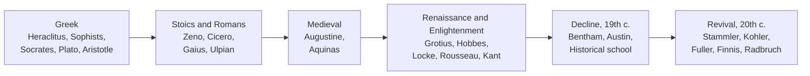

# Paper I · Jurisprudence – I (K-1001) · Unit 2
## Natural Law School: Classical Natural Law; Revival of Natural Law — Rudolf Stammler and Kohler

> **Last updated:** 2026-10-27 (IST) · **Law stated as on:** 2026-10-27 · **Branch:** `paper/01-jurisprudence`
> **Verify before exam:** case citations in §6 and §7 (checklist at the end).
> **Syllabus line (official):** *Natural Law School: Classical Natural Law, Revival of Natural Law: Rudolf Stammler and Kohler*

**How this unit is examined.** Typical questions: (a) trace the evolution of natural law from the Greeks to the modern revival (long); (b) explain Stammler's and/or Kohler's contribution (long or short); (c) critically evaluate natural law and its relevance today (long); (d) short notes on Aquinas, Grotius, Locke, Fuller, or "natural law with variable content". Always **name the thinker, the book, the century and the core idea**; link to at least one Indian case.

---

## 1. The central idea in one paragraph

Natural law holds that above the law made by human rulers (positive law) there is a **higher law**: derived from nature, reason, God or the moral order of the universe; **universal** (same for all people), **discoverable by human reason**, and the **standard against which human law is judged**. Where a human rule violates it badly, the rule is, in the strong version, **not truly law** (*lex iniusta non est lex*). Natural law therefore **connects law and morality**, which is exactly what positivism (Unit 3) denies.

---

## 2. Background and evolution

### 2.1 Greek period
- **Heraclitus**: a universal *logos* (reason) governs the cosmos and human law should follow it.
- **Sophists**: distinguished **nature (*physis*) from convention (*nomos*)**. Some (e.g. Thrasymachus in Plato's *Republic*) said justice is merely the interest of the stronger. This relativism provoked the first natural-law replies.
- **Socrates and Plato**: true justice is an unchanging ideal discovered by reason; actual laws are imperfect copies (*Republic*, *Laws*).
- **Aristotle** (*Nicomachean Ethics*, Book V; *Rhetoric*): distinguished **natural justice** (same force everywhere) from **legal/conventional justice**; also **distributive** and **corrective** justice. Aristotle also defended slavery as "natural": a standing example of how natural law can be bent to defend injustice.

### 2.2 Stoics and Romans
- **Stoics** (Zeno, Chrysippus; later Epictetus, Marcus Aurelius): the universe is ruled by divine reason; every human shares in it; hence a **universal law** binds all humanity.
- **Cicero** (*De Re Publica*): true law is right reason in agreement with nature, universal and unchanging, and no human legislator can validly repeal it.
- **Roman jurists**: *Gaius* separated *jus civile* (law of one state), *jus gentium* (law common to all peoples) and *jus naturale*; **Ulpian** described natural law as what nature teaches all living creatures. Roman praetors used *jus gentium/naturale* to **expand and humanise** the rigid *jus civile*, a practical use of natural law.

### 2.3 Medieval period (Christian natural law)
- **St Augustine** (*City of God*): the eternal law of God stands above earthly law; an unjust law is hardly law at all.
- **St Thomas Aquinas** (*Summa Theologiae*, I-II, Qq. 90–97): the high point of classical natural law. He defined **law as an ordinance of reason for the common good, made by one who has care of the community, and promulgated.** He distinguished **four kinds of law**:

| Kind | Meaning |
|---|---|
| **Lex aeterna** (eternal law) | God's rational plan governing the whole universe |
| **Lex divina** (divine law) | God's revealed law (scripture) |
| **Lex naturalis** (natural law) | Humanity's rational participation in the eternal law; its first precept: do good and avoid evil |
| **Lex humana** (human/positive law) | Rules made by rulers, derived from natural law either as conclusions or as specific determinations |

  An unjust human law, one contrary to natural law, is not law but a **perversion of law** and does not bind in conscience (except where disobedience would cause scandal or disorder).

### 2.4 Renaissance, Reformation and the social contract
- **Hugo Grotius** (*De Jure Belli ac Pacis*, 1625): "father of international law". Natural law is a dictate of right reason and would hold **even if there were no God**. This secularised the doctrine. Source of both international law and individual rights.
- **Thomas Hobbes** (*Leviathan*, 1651): life in the state of nature is "solitary, poor, nasty, brutish, and short"; the laws of nature are rational rules of self-preservation; people contract to submit to an absolute sovereign. Natural law here **supports** strong government.
- **John Locke** (*Second Treatise of Government*, 1689): in the state of nature people hold **natural rights to life, liberty and property**; government exists by consent to protect them; if it betrays the trust, people may resist. Locke's ideas run through the American Declaration of Independence (1776) and later bills of rights.
- **Jean-Jacques Rousseau** (*The Social Contract*, 1762): sovereignty lies in the **general will**; law is the expression of the general will.
- **Immanuel Kant**: the **categorical imperative**: act only on a maxim you could will to be a universal law; law is the set of conditions under which one person's freedom can coexist with everyone else's.
- **Blackstone** (*Commentaries*): human laws contrary to the law of nature have no validity; English common-law treatment of natural law as a source of rights.
- **Political results:** American Declaration of Independence (1776), French Declaration of the Rights of Man and of the Citizen (1789): natural law turned into **charters of rights**.

### 2.5 Decline (late 18th to 19th century)
- **Bentham** called natural rights "simple nonsense… nonsense upon stilts" (*Anarchical Fallacies*) and replaced them with utility.
- **David Hume's** distinction between "is" and "ought": one cannot derive moral conclusions from facts of nature.
- **Austin** and the **analytical positivists** separated law from morals; the **Historical School** (Savigny, Maine) treated law as the product of national history, not of abstract reason; **Marxism** treated "natural rights" as bourgeois ideology.

### 2.6 Revival (20th century)
**Why it returned:** (1) the horrors of totalitarianism, the Second World War and the Holocaust showed that "law is law" could serve evil; (2) the **Nuremberg Trials** (1945–46) rejected the defence of obeying lawful orders (Charter of the International Military Tribunal, Art. 8) and tried leaders for "crimes against humanity"; (3) the **Universal Declaration of Human Rights** (1948) spoke of inherent dignity and inalienable rights; (4) positivism was felt to be too thin to guide judges and legislators.

---

## 3. The revival thinkers named in the syllabus

### 3.1 Rudolf Stammler (1856–1938) — "natural law with a variable content"

- **Work:** *The Theory of Just Law* (*Die Lehre von dem richtigen Rechte*, 1902).
- **Starting point.** Stammler is a **neo-Kantian**. He accepts that the **content** of law changes with time and place (so there is no fixed, eternal code), but insists there is a **universal formal method** for testing whether any law is just.
- **Formula:** *natural law with a variable content.* The **idea of justice is constant**; the **concrete rules** vary with social conditions.
- **Concept and idea of law.** The *concept* of law is a formal definition: law is *binding, inviolable, sovereign willing* that regulates social life. The *idea* of law is **justice**, measured by a social ideal.
- **The social ideal:** *"a community of free-willing men"*: a society where each person can pursue their own freely chosen ends while respecting the equal claim of others.
- **Four principles of just law** (the practical test):

| Group | Principle |
|---|---|
| **Principles of Respect** | (1) A person's will must not be subjected to the **arbitrary wishes of another**. (2) Every legal demand must be such that the person bound can **remain his own fellow-man**, i.e. never be treated as a mere object of another's will. |
| **Principles of Participation** | (3) A person legally bound must not be **arbitrarily excluded** from the community. (4) A power of exclusion may be granted only so that the excluded person is **still treated as a fellow-man**. |

- **Significance.** Stammler gave natural law a **method rather than a code**, making it workable in modern secular states. He influenced the idea that law must be judged by an ideal of social cooperation and respect for persons.
- **Criticism.** (a) The ideal is **purely formal**; it does not tell a judge how to decide a specific hard case (Pound and others). (b) "Community of free-willing men" is vague. (c) It underplays the force of social interests and of historical growth.

### 3.2 Josef Kohler (1849–1919) — law as a product and servant of civilisation

- **Work:** *Philosophy of Law* (*Lehrbuch der Rechtsphilosophie*, 1909; English trans. 1914). A **neo-Hegelian**, also a leading comparative lawyer and ethnologist of law.
- **Core idea.** Law is a **product of civilisation** and its function is to **preserve and promote civilisation**: to develop human powers to the fullest. Therefore law must **change as civilisation changes**.
- **"Jurisprudence of civilisation."** Each age and people has its own law fitted to its stage of cultural development; there is no timeless natural law, but there is a **relative natural law** for each stage.
- **Method.** Judges and jurists should interpret rules in light of the **needs of the civilisation** of the time, a more flexible, dynamic reading than strict logic.
- **Criticism.** (a) "Civilisation" is vague and risks assuming one culture's progress is the measure for all. (b) It gives little concrete guidance. (c) It borders on the historical and sociological schools and has no independent test of justice.

### 3.3 Stammler v. Kohler (comparison)

| Basis | Stammler | Kohler |
|---|---|---|
| Philosophical root | Neo-Kantian (formal reason) | Neo-Hegelian (historical development of spirit) |
| What is constant? | The **idea of justice** (formal test) | The **aim of civilisation** (promoting culture) |
| What varies? | Content of law | Law itself, with each stage of civilisation |
| Test for law | Four principles of respect and participation | Whether law advances civilisation |
| Strength | Gives a usable formal criterion | Flexible; sensitive to social change |
| Weakness | Too formal, no content | Too vague, culturally biased |
| Shared theme | Both reject **eternal fixed** natural law; both accept **change** while keeping a higher standard |

---

## 4. Other modern natural-law voices (add for depth; not named in syllabus)

- **Gustav Radbruch** (the *Radbruch formula*, 1946): positive law prevails even if unjust, **unless the injustice reaches an intolerable degree**, in which case the statute must yield to justice. Used by German courts after 1945 and again after reunification in the cases of the Berlin Wall border guards (and endorsed by the European Court of Human Rights Grand Chamber in *Streletz, Kessler and Krenz v. Germany*, 2001).
- **Lon L. Fuller** (*The Morality of Law*, 1964): **procedural / "inner" morality of law**. Law only works if it meets **eight requirements (desiderata)**; failure in any one produces something that is not properly law:
  1. Generality (rules, not ad hoc commands) · 2. Promulgation (publicity) · 3. Non-retroactivity · 4. Clarity · 5. Non-contradiction · 6. Possibility of compliance · 7. Constancy over time · 8. Congruence between official action and declared rule.
- **The Hart–Fuller debate** (*Harvard Law Review*, vol. 71, 1958): Hart (positivism, pp. 593ff) v. Fuller (reply, pp. 630ff). The test case was the **post-war German "grudge informer" case**: a woman denounced her husband under a Nazi-era statute for insulting Hitler; after the war a German court (Bamberg, 1949) convicted her, holding the statute so contrary to the conscience of decent people that it could not be law. Hart said it was better to admit the statute was law but too evil to obey (or to punish by an openly retrospective law); Fuller said the Nazi system had failed the inner morality of law, so legal validity was doubtful.
- **H.L.A. Hart's "minimum content of natural law"**: because of five basic facts (human vulnerability, approximate equality, limited altruism, limited resources, limited understanding and strength of will), any viable legal system will contain rules protecting person, property and promises. A positivist concession to natural law.
- **John Finnis** (*Natural Law and Natural Rights*, 1980): revives Aquinas through a list of **basic goods** (life, knowledge, play, aesthetic experience, sociability, practical reasonableness, religion) that all reasonable people value.
- **Ronald Dworkin** (*Taking Rights Seriously*, 1977): law includes **moral principles**, not just rules (*Riggs v. Palmer*, 115 NY 506 (1889): a murderer cannot inherit from his victim's will, though the statute did not say so).
- **John Rawls** (*A Theory of Justice*, 1971): justice as fairness, chosen behind the "veil of ignorance".

---

## 5. Natural law in India

- **Dharma** as an analogue: in the Dharmashastra tradition, *dharma* (as expressed in *Smriti*, *Sadachara*, reason) binds even the king; the ruler is subject to *dharma* (*Rajadharma*). *Rta* (cosmic order) is often compared to the Stoic *logos*.
- **Constitutional echoes.** The Preamble's ideals of justice, liberty, equality and fraternity; Part III treated as **rights that are inherent**, not mere grants; judicial review as a guard against law that violates them.
- **Natural justice** (the procedural face of natural law): *nemo judex in causa sua* (no one should be a judge in their own cause) and *audi alteram partem* (hear the other side).

---

## 6. Case law (Indian, with natural-law connection)

| Case | Citation | Principle | Natural-law link |
|---|---|---|---|
| **Shankari Prasad v. Union of India** | AIR 1951 SC 458 | Parliament may amend fundamental rights under Art. 368 | Positivist: amending power unlimited |
| **I.C. Golaknath v. State of Punjab** | AIR 1967 SC 1643 | Parliament cannot amend Part III; fundamental rights are "transcendental" | Strong natural-rights language; overruled in *Kesavananda* |
| **Kesavananda Bharati v. State of Kerala** | (1973) 4 SCC 225; AIR 1973 SC 1461 | Parliament can amend but **cannot destroy the basic structure** | Core Indian example of higher-law limits on power (13 judges) |
| **Indira Nehru Gandhi v. Raj Narain** | 1975 Supp SCC 1; AIR 1975 SC 2299 | Free and fair elections, rule of law are basic structure | Basic structure applied against an amendment |
| **Minerva Mills v. Union of India** | (1980) 3 SCC 625 | Limited amending power is itself basic structure; balance of Parts III and IV | Reinforces higher-law limits |
| **I.R. Coelho v. State of Tamil Nadu** | (2007) 2 SCC 1 | Ninth Schedule laws can be tested against basic structure | Extends higher-law review |
| **A.K. Gopalan v. State of Madras** | AIR 1950 SC 27 | "Procedure established by law" means any procedure enacted by the legislature | **Positivist** counter-example |
| **Maneka Gandhi v. Union of India** | (1978) 1 SCC 248; AIR 1978 SC 597 | Procedure under Art. 21 must be **just, fair and reasonable** | Brings natural justice into Art. 21 |
| **A.K. Kraipak v. Union of India** | (1969) 2 SCC 262; AIR 1970 SC 150 | Rules of natural justice apply to administrative action | Procedural natural law |
| **ADM Jabalpur v. Shivkant Shukla** | (1976) 2 SCC 521; AIR 1976 SC 1207 | During Emergency no court may enforce Art. 21 | Positivist low point |
| **K.S. Puttaswamy v. Union of India** | (2017) 10 SCC 1 | Right to privacy is fundamental; overruled *ADM Jabalpur* | Life and liberty as inalienable natural rights |
| **Olga Tellis v. Bombay Municipal Corporation** | (1985) 3 SCC 545 | Right to livelihood is part of Art. 21 | Natural right to life given content |

**Foreign touchstones:** *Riggs v. Palmer* (NY, 1889); Nuremberg Trials (1945–46); the German "grudge informer" case (Bamberg, 1949).

---

## 7. Criticism of natural law

1. **Vagueness and lack of agreed content.** "Nature", "reason" and "God's will" have meant different things to different thinkers.
2. **Open to abuse.** It has been used to defend slavery (Aristotle), absolutism (Hobbes) and revolution (Locke): the same label supports opposite conclusions.
3. **Confuses "is" and "ought"** (Hume, Kelsen, Austin).
4. **Unscientific and unverifiable.** No method for proving what natural law *is*.
5. **Danger of subjectivity.** Judges may substitute personal morality for law (the objection to some "activist" decisions).
6. **Ignores historical and social variety** (Savigny, Maine, sociological school).
7. **Strengths (to balance your answer):** supplies a moral basis for law; underpins human rights and international criminal law; justifies civil resistance to tyranny; guides interpretation and law reform; gives judges a language to check abuse of power (basic structure; natural justice).

---

## 8. Natural law v. positivism

| Basis | Natural law | Legal positivism |
|---|---|---|
| Law and morals | Necessarily connected | Separate |
| Validity of unjust law | Doubtful/void (strong version) | Valid if properly enacted |
| Source of law | Reason, nature, God | Sovereign / social facts / basic norm |
| Question asked | What **ought** law to be? | What **is** law? |
| Representative thinkers | Aquinas, Grotius, Locke, Stammler, Fuller | Bentham, Austin, Kelsen, Hart |
| Indian cases | *Kesavananda*, *Maneka Gandhi*, *Puttaswamy* | *Gopalan*, *ADM Jabalpur*, *Shankari Prasad* |

---

## 9. Current relevance and recent developments

- **Human rights law** (UDHR 1948; ICCPR; ICESCR) treats rights as inherent to every person, a natural-law idea in modern form.
- **Constitutional review** across the world uses higher-law reasoning (basic structure in India; "unamendable" provisions in other constitutions).
- **International criminal law** (Nuremberg; Rome Statute of the ICC, 1998) rests on the proposition that some acts are wrongs regardless of local law.
- **India's recent rights jurisprudence** (*Puttaswamy*, *Navtej Singh Johar*, *Joseph Shine*) repeatedly invokes **dignity** and **constitutional morality** as the measure of validity, a modern echo of natural law.
- **Caution for the exam:** do not claim that Indian courts have formally adopted "natural law" as a doctrine. They apply the Constitution; natural-law ideas **influence** how rights and the basic structure are read.

---

## 10. Quick-revision box

- **Natural law** = higher, universal, rational law; *lex iniusta non est lex*.
- **Chain:** Greek (Aristotle: natural v. legal justice) → Stoics/Cicero → Romans (*jus naturale/gentium*) → Augustine → **Aquinas (four laws)** → **Grotius (secular; *etiamsi daremus*)** → Hobbes / **Locke (life, liberty, property)** / Rousseau / Kant → decline (Bentham "nonsense upon stilts") → **revival (Stammler, Kohler, Radbruch, Fuller, Finnis)**.
- **Stammler:** natural law with variable content; social ideal = community of free-willing men; principles of **respect** and **participation**. **Kohler:** law serves civilisation; jurisprudence of civilisation.
- **Fuller:** eight desiderata. **Hart:** minimum content; Hart-Fuller debate (71 Harv LR 593, 630; grudge informer).
- **Indian:** *Golaknath* → *Kesavananda* (basic structure) → *Minerva Mills* → *Coelho*; *Gopalan* → *Maneka Gandhi*; *ADM Jabalpur* → *Puttaswamy*.

**Examiner keywords:** higher law, right reason, *lex aeterna / divina / naturalis / humana*, social contract, state of nature, inalienable rights, variable content, social ideal, civilisation, inner morality, basic structure, natural justice.

---

## 11. Question bank (model answers)

*Mark bands are indicative; adjust once the paper pattern is confirmed (`docs/01-gaps-and-open-questions.md`, A1).*

### Long answers (10–15 marks)

**Q1. Explain the natural law school. Trace its development from the Greek period to the modern revival.**

**Introduction.** Natural law is the oldest school of legal thought. It claims that human law must conform to a higher, universal and rational standard.
**Body.**
1. *Greek:* Sophists' nature v. convention; Plato's ideal justice; Aristotle's natural and legal justice.
2. *Stoics and Romans:* universal reason; Cicero; *jus naturale* and *jus gentium* used by Roman praetors to humanise the *jus civile*.
3. *Medieval:* Augustine's eternal law; Aquinas's four-fold classification (eternal, divine, natural, human) and the rule that an unjust law is a perversion of law.
4. *Renaissance and Enlightenment:* Grotius secularised natural law; Hobbes, Locke and Rousseau built social-contract theories; Kant's categorical imperative; revolutions produced bills of rights.
5. *Decline:* Bentham, Austin, Hume, historical school and Marx rejected it.
6. *Revival:* post-1900 revival in reaction to formalism and later to totalitarianism: Stammler's variable-content natural law, Kohler's civilisation theory, Radbruch's formula, Fuller's inner morality, Finnis, Dworkin.
7. *India:* *Kesavananda*, *Maneka Gandhi*, *Puttaswamy*.

**Criticism and conclusion.** (Summarise §7.) Natural law's lasting value is as a moral check on power and a foundation for human rights.

---

**Q2. Discuss the contributions of Rudolf Stammler and Josef Kohler to the revival of natural law.**
*(Use §3. Structure: why revival was needed → Stammler (concept v. idea of law; variable content; social ideal; four principles; criticism) → Kohler (law and civilisation; relative natural law; criticism) → comparison table → conclusion that both rescued natural law from fixed dogma by tying it to change.)*

---

**Q3. Critically examine the natural law theory. Is it relevant in modern times?**
*(Use §7 and §9. Give the criticisms, then the strengths, then modern relevance with human rights, Nuremberg, basic structure and *Puttaswamy*. Take a balanced position.)*

---

**Q4. Distinguish between natural law and positivism. Discuss the Hart–Fuller debate.**
*(Use §8 and §4. Include the grudge-informer case and the eight desiderata.)*

---

**Q5. Discuss the influence of natural law on Indian constitutional development.**
*(Use §5 and §6. Pair each natural-law/positivist case: *Gopalan* → *Maneka Gandhi*; *ADM Jabalpur* → *Puttaswamy*; *Golaknath* → *Kesavananda* → *Minerva Mills*.)*

---

### Short notes (5 marks)

1. **Aquinas's four kinds of law.** (§2.3 table.)
2. **Grotius and the secularisation of natural law.**
3. **Locke's natural rights and the social contract.**
4. **Stammler's "natural law with variable content."**
5. **Stammler's principles of respect and participation.**
6. **Kohler's jurisprudence of civilisation.**
7. **Fuller's eight desiderata (inner morality of law).**
8. **Hart's minimum content of natural law.**
9. **Natural justice** (*nemo judex*, *audi alteram partem*; *Kraipak*, *Maneka Gandhi*).
10. **Basic structure doctrine as a natural-law idea** (*Kesavananda*).

### Very short answers (2 marks)

| Question | Answer |
|---|---|
| Who said an unjust law is a perversion of law? | St Thomas Aquinas. |
| Name the four kinds of law in Aquinas. | *Lex aeterna*, *lex divina*, *lex naturalis*, *lex humana*. |
| Who is "father of international law"? | Hugo Grotius (*De Jure Belli ac Pacis*, 1625). |
| Which natural rights did Locke emphasise? | Life, liberty and property. |
| Who wrote *The Theory of Just Law*? | Rudolf Stammler (1902). |
| What is Stammler's social ideal? | A community of free-willing men. |
| Name Stammler's two groups of principles. | Principles of respect and principles of participation. |
| Who wrote *Philosophy of Law* (1909) and the idea of "jurisprudence of civilisation"? | Josef Kohler. |
| Who wrote *The Morality of Law*? | Lon L. Fuller (1964). |
| How many desiderata did Fuller list? | Eight. |
| Which Indian case established the basic structure doctrine? | *Kesavananda Bharati v. State of Kerala* (1973). |
| Which case overruled *ADM Jabalpur*? | *K.S. Puttaswamy v. Union of India* (2017). |
| What does *audi alteram partem* mean? | Hear the other side. |

---

## 12. Verification checklist (do before the exam)

- [ ] *Shankari Prasad* AIR 1951 SC 458 · *Golaknath* AIR 1967 SC 1643
- [ ] *Kesavananda Bharati* (1973) 4 SCC 225 · *Indira Nehru Gandhi v. Raj Narain* 1975 Supp SCC 1
- [ ] *Minerva Mills* (1980) 3 SCC 625 · *I.R. Coelho* (2007) 2 SCC 1
- [ ] *Gopalan* AIR 1950 SC 27 · *Maneka Gandhi* (1978) 1 SCC 248 · *Kraipak* (1969) 2 SCC 262
- [ ] *ADM Jabalpur* (1976) 2 SCC 521 · *Puttaswamy* (2017) 10 SCC 1 · *Olga Tellis* (1985) 3 SCC 545
- [ ] Hart-Fuller: 71 Harvard Law Review 593 and 630 (1958) · *Riggs v. Palmer*, 115 NY 506 (1889)
- [ ] Stammler's and Kohler's titles and dates against your textbook (translated titles vary by edition)
