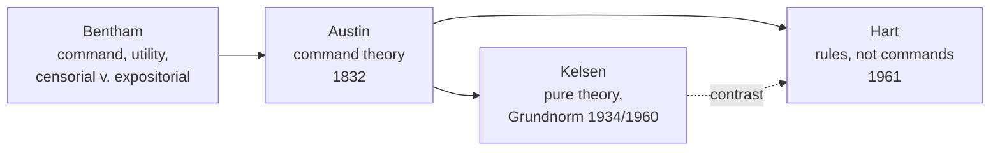
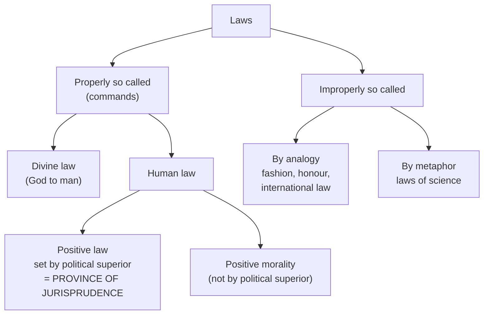
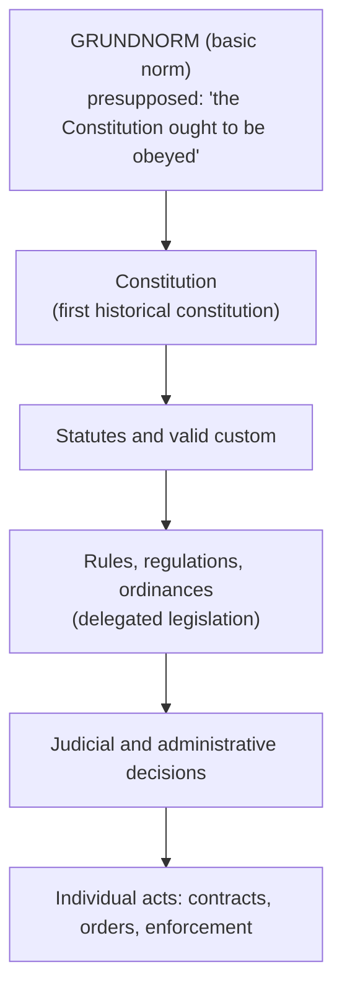
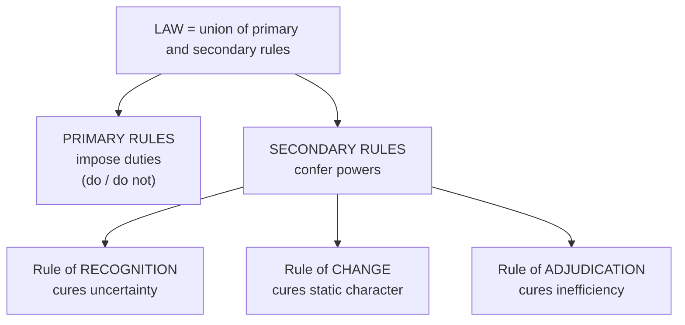

# Paper I · Jurisprudence – I (K-1001) · Unit 3
## Analytical School: John Austin, Hans Kelsen and H.L.A. Hart

> **Last updated:** 2026-10-28 (IST) · **Law stated as on:** 2026-10-27 · **Branch:** `paper/01-jurisprudence`
> **Verify before exam:** case citations in §8 (checklist at the end).
> **Syllabus line (official):** *Analytical School: John Austin, Hans Kelsen, And H.L.A. Hart*

**How this unit has been examined (December 2022–2025).** 16 of the 52 previous questions came from this unit:

- Dec 2025 Q2 (4): How Kelsen was influenced by Austin? → [A-41](question-bank/section-a-part-2-unit-3.md#a-41)
- Dec 2025 Q3 (4): What is the meaning of Legal Positivism? → [A-33](question-bank/section-a-part-2-unit-3.md#a-33)
- Dec 2025 Q7 (10): Is it correct to say that Pure Theory of Law has left dry bones of law, deprived of flesh and blood, which give them… → [B-15](question-bank/section-b-part-2-unit-3.md#b-15)
- Dec 2024 Q3 (4): Ground Norm → [A-42](question-bank/section-a-part-2-unit-3.md#a-42)
- Dec 2024 Q4 (4): Contribution of Bentham → [A-34](question-bank/section-a-part-2-unit-3.md#a-34)
- Dec 2024 Q8 (10): According to Hart rules are concerned not with what happens but with what is to be done? → [B-16](question-bank/section-b-part-2-unit-3.md#b-16)
- Dec 2024 Q11 (20): Describe Hans Kelsen's Pure theory of Law. → [C-10](question-bank/section-c-part-2-unit-3.md#c-10)
- Dec 2024 Q13 (20): Describe the salient features of analytical school of Jurisprudence. Distinguish between analytical and historical sc… → [C-12](question-bank/section-c-part-2-unit-3.md#c-12)
- Dec 2023 Q2 (4): Bentham → [A-34](question-bank/section-a-part-2-unit-3.md#a-34)
- Dec 2023 Q7 (10): What is difference between Austin and Kelson [Kelsen] as Jurists? → [B-14](question-bank/section-b-part-2-unit-3.md#b-14)
- Dec 2023 Q10 (20): "Jurisprudence is the philosophy of Positive Law." (Austin) Discuss it. → [C-09](question-bank/section-c-part-2-unit-3.md#c-09)
- Dec 2023 Q13 (20): Discuss Kelson's [Kelsen's] Pure Theory of Law. → [C-10](question-bank/section-c-part-2-unit-3.md#c-10)
- Dec 2022 Q1 (4): Sanction. → [A-35](question-bank/section-a-part-2-unit-3.md#a-35)
- Dec 2022 Q4 (4): Bentham. → [A-34](question-bank/section-a-part-2-unit-3.md#a-34)
- Dec 2022 Q5 (4): Does international law is law according to Austin? → [A-36](question-bank/section-a-part-2-unit-3.md#a-36)
- Dec 2022 Q10 (20): Critically examine the statement that "Law is the command of the sovereign" and state whether this concept applies to… → [C-08](question-bank/section-c-part-2-unit-3.md#c-08)

*Source: the transcribed papers in [`docs/past-papers/paper-1-jurisprudence.md`](../../docs/past-papers/paper-1-jurisprudence.md). Unit assignment is by the main topic of the question. The paragraph that stood here earlier was a guess made before I had the papers. Topic frequency across all units is in the [question-bank README](question-bank/README.md#frequency).*

---

## 1. Background: what is "analytical positivism"?

**Positivism** says that law is **"posited"**: laid down by human authority. It is a matter of **social fact**, not moral merit. The Analytical School studies the **structure and concepts of existing (positive) law** by analysis, separating it from what the law *ought* to be.

**Core claims**
1. Law is a command, norm or rule created by human beings, not discovered in nature or morality.
2. **The separation thesis:** the existence of law and its moral merit are different questions. Austin: *"The existence of law is one thing; its merit and demerit another."*
3. Legal concepts (right, duty, liability, sanction) can be analysed on their own terms.

**Why it arose.** The rise of the sovereign nation-state and large-scale legislation; reaction to the vagueness of natural law; the scientific temper of the 19th century; the codification movement.

**Precursors**
- **Thomas Hobbes:** law is the command of the sovereign (*Leviathan*, 1651).
- **Jeremy Bentham (1748–1832)**, the **father of analytical positivism**: *An Introduction to the Principles of Morals and Legislation* (1789); *Of Laws in General* (written c. 1782, first published 1945 as *The Limits of Jurisprudence Defined*). Law is an assemblage of signs declaring the will of the sovereign in a state. He separated **expositorial** from **censorial** jurisprudence and judged law by **utility**.

---

# PART A — JOHN AUSTIN (1790–1859)

**Works:** *The Province of Jurisprudence Determined* (1832); *Lectures on Jurisprudence* (published after his death, 1863). First Professor of Jurisprudence at University College London (1826).

## A.1 The province of jurisprudence

Austin limited jurisprudence to **positive law**: law set by a political superior to political inferiors. He classified "laws" as follows:

| Category | Examples | Treatment |
|---|---|---|
| **Laws properly so called: (1) Divine law** | Laws set by God to humans | Outside the province of jurisprudence |
| **Laws properly so called: (2) Positive law** | Statutes, orders of the sovereign; subordinate legislation under the sovereign's authority; rights-based orders by private persons (e.g. a guardian over a ward) | **The only subject of jurisprudence** |
| **Positive morality** (laws set by men not as political superiors) | Rules of a club, rules of honour, fashion | Not law proper |
| **Laws improperly so called: by analogy** | Rules of fashion, honour; **International law** (Austin: "positive international morality"); constitutional law (no determinate legal superior over the sovereign) | Not positive law |
| **Laws improperly so called: by metaphor** | Laws of gravity, of nature | Not law |

## A.2 The command theory

> **Law = the command of the sovereign, backed by a sanction.**

Elements:
1. **Command:** a wish expressed by a determinate person, communicated to others, with an evil (threat) attached if disobeyed.
2. **Duty:** the person commanded is under a duty to obey (duty is the correlative of command).
3. **Sanction:** the evil that may follow disobedience; the *power and the will* to inflict it is what makes a wish a command.
4. **Sovereign:** the source of the command (below).
5. **Generality:** a **law** commands a *course of conduct* (general); an **occasional or particular command** (e.g. "Close that window now") is not law.

## A.3 The sovereign

> If a **determinate human superior**, not in a habit of obedience to a like superior, receives **habitual obedience from the bulk of a given society**, that superior is **sovereign** in that society, and the society (including the superior) is a society political and independent.

Features of sovereignty in Austin:
1. **Determinate:** a person or definite body of persons.
2. **Habitual obedience** by the bulk of society.
3. **Does not himself obey any other like superior** (independence).
4. **Indivisible**: one sovereign in each society.
5. **Illimitable (legally unlimited):** a "legally limited sovereign" is a contradiction in terms; limits on the sovereign are only moral/political.
6. In a democracy the sovereign is the **electorate together with the legislature** (in England: the Crown, the Lords and the electors of the Commons).

**Custom and judge-made law.** Austin treated custom and precedent as law only when the sovereign **adopts** them: judges enforce them with the sovereign's **tacit command** ("what the sovereign permits, he commands").

## A.4 Law and morals: Austin's separation thesis
Law may be unjust or immoral yet remain law. The test of whether law *ought* to be obeyed is **utility** (he was a utilitarian), a question for the **science of legislation**, not jurisprudence.

## A.5 Criticism of Austin

1. **Custom:** much law (especially in early societies and in India) existed before any sovereign and operates without being "commanded". Maine pointed to the powerful Sikh ruler Ranjit Singh, who made hardly any laws while society lived by custom. Savigny's *Volksgeist* attack (Unit 4).
2. **International law** is denied the status of "law" although states treat it as binding.
3. **Constitutional law** is made "positive morality", although it is the highest law of a state.
4. **Not all laws are commands.** Rules **conferring powers** (making a contract, a will, a marriage) do not order anyone; they are **enabling** (Hart).
5. **Sanction is not the only reason for obedience.** People obey from habit, respect, fear of social disapproval, or conviction.
6. **Sovereign is hard to locate** in a **federal** state or where the constitution distributes power (USA, India). The Indian Parliament is **not** legally illimitable: the Constitution and the **basic structure** limit it (*Kesavananda Bharati*).
7. **Continuity problem:** habit of obedience cannot explain why law continues unchanged when a ruler dies or is replaced (Hart's Rex I / Rex II example).
8. **Neglects the judge and the community.** The law-making role of courts (precedent; Art. 141 in India) is not fitted into the command model.
9. **Ignores justice and morality entirely**, though in practice laws gain authority from perceived fairness.
10. **Cannot explain laws binding the lawmaker** (e.g. a legislature bound by "manner and form" rules).

**Merits (for balance).** Clarity and precision; the clear separation of law from morals; emphasis on enforcement; it fits the **statute law of a modern state** well, and its legislation-centred, codifying outlook matches the Benthamite style of the colonial Indian codes (e.g. Macaulay's Penal Code).

**In the Indian setting.** Colonial legislation (orders of the Governor-General in Council under the British Parliament) fitted the command model well; the **post-1950 Constitution does not**, because no person or body is legally unlimited.

---

# PART B — HANS KELSEN (1881–1973): THE PURE THEORY OF LAW

**Works:** *Pure Theory of Law* (1st ed. 1934; 2nd ed. 1960; English translation by Max Knight, 1967); *General Theory of Law and State* (1945); *General Theory of Norms* (published posthumously, 1979). Kelsen was the principal drafter of the **Austrian Constitution of 1920**, which created a **Constitutional Court**, the model for later "Kelsenian" constitutional courts.

## B.1 Why "pure"?
Kelsen wanted a **science of law** free from **politics, ethics, sociology, psychology and natural science**. Law should be studied **as it is** (in terms of its own **norms**), not as it ought to be morally. A pure theory:
1. Excludes **natural law** and **morality**.
2. Excludes **sociological** and **psychological** explanations.
3. Is **normative**, not **explanatory**: it studies norms, not facts.

## B.2 "Is" and "Ought" (*Sein* and *Sollen*)
- Natural science deals with the **"is"** (causal laws: if A, then B **will** follow).
- Legal science deals with the **"ought"** (norms: if A, then B **ought** to follow).
- **Norm:** a rule stating that some behaviour **ought** to take place. A legal norm is typically: *"If a person commits theft, a sanction ought to be applied."*

## B.3 Law as a coercive order
For Kelsen, law is a **specific social technique** which attaches **sanctions** to certain conduct. The **primary norm** directs an official to apply a sanction; the **secondary norm** (the "duty") is implied. Compare Austin: where Austin saw a command addressed to the subject, Kelsen sees a norm addressed to the **official**.

## B.4 Hierarchy of norms (*Stufenbau*)
A norm is valid because it was created **in the way authorised by a higher norm**, not because of its content.

**Indian illustration** of the same chain: **Constitution** → **statutes** (Parliament / State Legislatures) → **delegated legislation** (rules, regulations, notifications) → **orders, decrees, contracts**. Judicial review under Art. 13 and Arts. 32/226 is the mechanism that checks each lower layer against the higher.

## B.5 The Grundnorm (basic norm)
1. The **highest norm** in a legal system, from which all others derive validity.
2. It is **not enacted**, **not itself a positive norm**; it is a **presupposition** of juristic thought (a *transcendental-logical* condition in Kantian terms): *"the historically first constitution ought to be obeyed."*
3. **Validity v. efficacy.** A legal order must be **by and large effective** to be valid. A Grundnorm is presupposed only for a **system that is on the whole obeyed**.
4. **Revolution and change.** When a revolution or coup **succeeds** and the new order becomes effective, a **new Grundnorm** is presupposed. Kelsen's view of this created the **Dosso** controversy (§8).
5. Kelsen later (in *General Theory of Norms*) described the Grundnorm as a **fiction** in Vaihinger's "as if" sense, which critics seized upon.

## B.6 Other features
- **Dynamic, not static, legal order:** norms are valid because of the **mode of creation**, not logical derivation from content (as in moral systems).
- **State and law identical:** the state is the personification of the legal order; rejects the dualism of state and law and denies sovereignty above law.
- **Monism in international law:** domestic and international law form **one** system; Kelsen preferred the **primacy of international law**. Unlike Austin, he treats international law as **true law** (sanctions: reprisals, war).
- **Legal person** is not a natural entity but a **point of attribution** of norms.
- **Interpretation:** a norm is a **frame** with several possible meanings; choosing among them is an act of **will**, not pure cognition.

## B.7 Criticism of Kelsen
1. **Grundnorm is vague and fiction-like.** Hard to identify in an unwritten, federal or evolving constitution.
2. **Efficacy contradicts "purity".** Validity depends in the end on a **fact** (that the order is effective), so the theory is not as pure as claimed (Hart treats the rule of recognition as a social fact).
3. **Too formal and abstract.** Excludes justice, morality and social reality, so it cannot tell us whether a law is just.
4. **Dosso risk.** The theory has been used to legitimise **coups** (see *State v. Dosso*).
5. **Cannot choose between rival regimes** in a contested transition.
6. **Judicial discretion** is under-explained.
7. **Ignores principles** (Dworkin) and the **sociological dimension** of law.

**Merits.** Clarity; explanation of the **unity and validity** of a legal system; the **hierarchy of norms** supports **judicial review** and the constitutional-court model; explains continuity and revolution; helps in understanding delegated legislation and federalism.

---

# PART C — H.L.A. HART (1907–1992): THE CONCEPT OF LAW

**Works:** *The Concept of Law* (1961; 2nd ed. 1994 with a *Postscript*); *Law, Liberty and Morality* (1963); *Punishment and Responsibility* (1968). Professor of Jurisprudence at Oxford 1952–68.

## C.1 Hart's attack on Austin

1. **The gunman model.** Austin's law is like a gunman's order ("your money or your life"). Hart: this explains being **obliged** (forced by threat) but not **having an obligation** (a duty accepted as a standard).
2. **Not all laws are orders.** Power-conferring rules on contracts, wills, marriage and the Constitution are **not** orders backed by threats.
3. **Continuity.** Habit cannot explain the **continuing** and **persisting** authority of law across changes of ruler (**Rex I → Rex II**: on Rex I's death there is no habit of obedience to Rex II, yet the law-making power is already his).
4. **Self-binding legislators.** The sovereign is often bound by law, which the command model cannot explain.
5. **Custom** and **international law** are ignored or denied.
6. **Habits v. rules.** A *habit* is mere convergent behaviour; a *rule* has an **internal aspect**: people regard it as a **standard** and criticise deviations.

## C.2 Hart's own theory: the union of primary and secondary rules

A **simple society** has only **primary rules** (duties to do or avoid acts). It suffers three defects, each cured by one **secondary rule**:

| Defect of primary rules alone | Cure: secondary rule | Function |
|---|---|---|
| **Uncertainty** (which rules count?) | **Rule of Recognition** | Identifies authoritative rules of the system |
| **Static character** (no way to change) | **Rule of Change** | Empowers individuals/bodies to make, alter, repeal rules |
| **Inefficiency** (no authoritative decision on breach) | **Rule of Adjudication** | Empowers courts to decide breaches and apply sanctions |

> Hart called this union **"the key to the science of jurisprudence"**.

## C.3 The rule of recognition
- The **ultimate criterion of validity** in a legal system (e.g. "what the Queen in Parliament enacts is law" in the UK; in India, the Constitution and the practice of officials who accept it).
- It is a **social rule** that **exists as a fact**: it is shown by the **practice of officials** (judges, administrators) who **accept it from the internal point of view**. We do not ask whether it is *valid*; we ask whether it *exists*.
- **Difference from Kelsen's Grundnorm:** Grundnorm is **presupposed**; the rule of recognition is an **empirical social fact**.

## C.4 The internal and external points of view
- **External:** an observer who notes regularities and threats (what Austin saw).
- **Internal:** a participant who accepts the rule as a **standard of criticism and justification**. Law cannot be understood without the internal point of view.

## C.5 Open texture and judicial discretion
- Every general rule has a **core of settled meaning** and a **penumbra of doubt** ("open texture"). Hart's example: *"No vehicles in the park"* clearly bans cars but is uncertain for bicycles or toy cars.
- In the penumbra the judge exercises **discretion**, i.e. makes law within limits. This is Hart's **middle path** between **formalism** (judges only apply rules) and **rule-scepticism** (American Realism: law is what judges do).

## C.6 Minimum content of natural law
Hart concedes that, given five facts about human beings (**vulnerability, approximate equality, limited altruism, limited resources, limited understanding and strength of will**), any workable legal system will contain basic rules on violence, property and promises. This is a **"soft" concession** to natural law without denying the separation thesis.

## C.7 Hart's major debates (frequently tested)

| Debate | Opponent | Issue | Outcome / relevance |
|---|---|---|---|
| **Hart–Fuller** (71 Harv LR 593, 630, 1958) | Lon Fuller | Must a morally evil statute be treated as law? (Nazi "grudge informer" case) | Hart: law, but too evil to obey; Fuller: failure of inner morality undermines legality |
| **Hart–Devlin** (1957–63) | Lord Devlin | May the state criminalise private immorality? (Wolfenden Report 1957; Devlin's 1959 lecture; Hart's *Law, Liberty and Morality*) | Hart (following Mill's harm principle): no. Devlin: society may protect its shared morality. Reflected in *Shaw v. DPP* [1962] AC 220 and the later decriminalisation debates |
| **Hart–Dworkin** | Ronald Dworkin | Do judges have **strong discretion**, or must they apply **moral principles** to reach right answers? | Hart's *Postscript* defends **soft (inclusive) positivism**: the rule of recognition may incorporate moral criteria |

**Indian echo of Hart–Devlin:** *Naz Foundation v. Govt. of NCT of Delhi* (2009) → *Suresh Kumar Koushal v. Naz Foundation* (2014) → *Navtej Singh Johar v. Union of India* (2018), where the Supreme Court preferred **constitutional morality** to **social morality** in decriminalising consensual same-sex acts between adults (a Hartian "harm principle" outcome).

## C.8 Criticism of Hart
1. **Dworkin:** the model of rules ignores **principles and policies**; judges do not have strong discretion.
2. **Natural-law critics (Fuller, Finnis):** the strict separation of law and morals is false.
3. **Rule of recognition** can be vague in complex or divided systems.
4. **Marxist/critical critics:** ignores **power** and class interest.
5. **Raz** (sources thesis) says Hart's soft positivism concedes too much; **realists** say he exaggerates rule-governance.
6. **Sanction:** Hart treats sanctions as a **natural necessity**, not a definitional feature, but critics say this undervalues coercion.

**Merits.** Gave positivism a rigorous, realistic base; explained **obligation** and **validity**; reconciled rules with judicial discretion; remains the **mainstream** positivist account.

---

## 8. Case law

| Case | Citation | Principle | Theory link |
|---|---|---|---|
| **State v. Dosso** | PLD 1958 SC 533 (Pakistan) | A **successful revolution** is a law-creating fact; the 1956 Constitution lost validity (Chief Justice Munir used Kelsen) | Kelsen's Grundnorm; efficacy |
| **Asma Jilani v. Government of the Punjab** | PLD 1972 SC 139 (Pakistan) | Overruled *Dosso*: Kelsen was misapplied; a usurper cannot be legitimate | Limits of Kelsen's theory |
| **Uganda v. Commissioner of Prisons, ex p. Matovu** | [1966] EA 514 | After the 1966 abrogation, the new order was accepted as effective | Kelsen: efficacy and revolution |
| **Madzimbamuto v. Lardner-Burke** | [1969] 1 AC 645 (PC) | Privy Council refused to treat the 1965 Rhodesian (UDI) regime as lawful | Validity v. efficacy |
| **Pickin v. British Railways Board** | [1974] AC 765 (HL) | Courts will not question whether Parliament was misled in passing an Act | Austin: legislative sovereignty |
| **R (Jackson) v. Attorney General** | [2006] 1 AC 262 | Dicta that parliamentary sovereignty is a common-law construct and not necessarily absolute | Challenge to Austin's illimitable sovereign |
| **Shaw v. DPP** | [1962] AC 220 | Conspiracy to corrupt public morals recognised | Hart–Devlin debate |
| **A.K. Gopalan v. State of Madras** | AIR 1950 SC 27 | "Law" in Art. 21 = enacted law; no reading in of natural justice | Austinian/positivist reading |
| **ADM Jabalpur v. Shivkant Shukla** | (1976) 2 SCC 521; AIR 1976 SC 1207 | No remedy for detention when Art. 21 enforcement suspended | Positivism taken to extreme; overruled in *Puttaswamy* (2017) 10 SCC 1 |
| **Kesavananda Bharati v. State of Kerala** | (1973) 4 SCC 225 | Parliament's power to amend is limited by basic structure | Contradicts Austin's illimitable sovereign |
| **Navtej Singh Johar v. Union of India** | (2018) 10 SCC 1 | Consensual same-sex conduct is protected; constitutional morality prevails | Hart–Devlin; harm principle |
| **Riggs v. Palmer** | 115 NY 506 (1889) | Murderer cannot inherit under victim's will | Dworkin's critique of Hart (principles) |

---

## 9. Comparison: Austin, Kelsen and Hart

| Basis | Austin | Kelsen | Hart |
|---|---|---|---|
| **What is law?** | Command of sovereign backed by sanction | Hierarchy of norms; coercive order | Union of primary and secondary rules |
| **Basis of validity** | Source: the sovereign | Higher norm, ending in **Grundnorm** | **Rule of recognition** (social fact) |
| **Role of sanction** | Essential | Essential (law is a coercive order) | Not definitional; a natural necessity |
| **Sovereign** | Central, illimitable | Rejected; state = legal order | Not needed |
| **Morality** | Separate (utility is the test of "ought") | Excluded ("pure") | Separate, but minimum content of natural law admitted |
| **International law** | Not law (positive morality) | Law (monism) | Law, though a "primitive" system |
| **Strength** | Clarity; fits statute | Logical unity of system; judicial review | Explains obligation, discretion, officials' practice |
| **Weakness** | Custom, power-conferring rules, federalism | Fiction-like Grundnorm; too formal | Dworkin's principles; vague rule of recognition |

---

## 10. Current relevance and recent developments

- **Legislation-centred law-making** (Bharatiya Nyaya Sanhita, 2023; Digital Personal Data Protection Act, 2023) reflects the Austinian view that the state formulates law by enactment.
- **Constitutional courts** and judicial review of statutes reflect Kelsen's hierarchy of norms.
- **Interpretation disputes** (literal, purposive, "constitutional morality") are modern forms of the Hart–Fuller and Hart–Dworkin debates.
- **Emerging question:** whether rules produced by algorithms or private platforms can be "law". Under Hart's test they would not be law unless recognised by the rule of recognition.
- **Caution for the exam:** do not call India's basic structure "the Grundnorm" as if the Court had said so. That is an academic suggestion, not a judicial holding.

---

## 11. Quick-revision box

- **Bentham → Austin → Kelsen → Hart.**
- **Austin:** law = command + sovereign + sanction; sovereign: determinate, habitual obedience, independent, indivisible, illimitable; province: positive law; international and constitutional law = positive morality.
- **Austin's flaws:** custom, international law, power-conferring rules, federal sovereignty, sanction as motive, continuity.
- **Kelsen:** pure theory; *Sein/Sollen*; norm; *Stufenbau*; **Grundnorm**; validity v. efficacy; state = legal order; monism. Flaws: fiction, formal, *Dosso*.
- **Hart:** gunman; obliged v. obligation; primary + secondary rules; recognition, change, adjudication; internal point of view; open texture; minimum content; debates with Fuller, Devlin, Dworkin.

**Examiner keywords:** positive law, command, sanction, habit of obedience, determinate superior, illimitable, *Stufenbau*, Grundnorm, efficacy, norm, primary and secondary rules, rule of recognition, internal point of view, open texture, penumbra.

---

## 12. Question bank (model answers)

> **The model answers for this unit are in the [`question-bank/`](question-bank/README.md) folder**, written for the real CCSU pattern (confirmed on all 20 papers, Dec 2022–2025): Section A, 4 marks, ≤ 75 words; Section B, 10 marks, ≤ 200 words; Section C, 20 marks, "in detail". The three-tier outlines (10–15, 5 and 2 marks) that stood here earlier were guesses made before I had the papers, and have been removed. Every rubric in the bank is my own; the university publishes no marking scheme. Thinkers and cases: [`jurists-and-cases-digest.md`](question-bank/jurists-and-cases-digest.md) (cases for this unit: 12–21). Mock papers: [1](question-bank/mock-exam-1.md), [2](question-bank/mock-exam-2.md), [3](question-bank/mock-exam-3.md).

**Section C (20 marks)**

- [C-08](question-bank/section-c-part-2-unit-3.md#c-08) "Law is the command of the sovereign." Examine critically and say whether the concept applies to the Indian judicial system *(set Dec 2022 Q10)*
- [C-09](question-bank/section-c-part-2-unit-3.md#c-09) "Jurisprudence is the philosophy of positive law." (Austin) Discuss *(set Dec 2023 Q10)*
- [C-10](question-bank/section-c-part-2-unit-3.md#c-10) Hans Kelsen's Pure Theory of Law *(set Dec 2024 Q11; Dec 2023 Q13)*
- [C-11](question-bank/section-c-part-2-unit-3.md#c-11) H.L.A. Hart's *The Concept of Law*: primary and secondary rules, the rule of recognition and Hart's debates
- [C-12](question-bank/section-c-part-2-unit-3.md#c-12) Salient features of the analytical school; distinguish between the analytical and historical schools *(set Dec 2024 Q13)*
- [C-24](question-bank/section-c-part-4-units-6-7-cross.md#c-24) Law and morality: their relation in natural law, positivism and modern debates, with Indian illustrations

**Section B (10 marks)**

- [B-12](question-bank/section-b-part-1-units-1-2.md#b-12) Fuller's inner morality of law and the Hart–Fuller debate
- [B-14](question-bank/section-b-part-2-unit-3.md#b-14) What is the difference between Austin and Kelsen as jurists? *(set Dec 2023 Q7)*
- [B-15](question-bank/section-b-part-2-unit-3.md#b-15) Is it correct to say that the Pure Theory of Law has left only the dry bones of law, deprived of flesh and blood? Explain *(set Dec 2025 Q7)*
- [B-16](question-bank/section-b-part-2-unit-3.md#b-16) "According to Hart, rules are concerned not with what happens but with what is to be done." Explain *(set Dec 2024 Q8)*
- [B-17](question-bank/section-b-part-2-unit-3.md#b-17) Austin's theory of sovereignty
- [B-18](question-bank/section-b-part-2-unit-3.md#b-18) Kelsen's Grundnorm (basic norm)
- [B-19](question-bank/section-b-part-2-unit-3.md#b-19) Jeremy Bentham's contribution to jurisprudence
- [B-20](question-bank/section-b-part-2-unit-3.md#b-20) Hart's primary and secondary rules
- [B-21](question-bank/section-b-part-2-unit-3.md#b-21) Is international law "law"? The views of Austin, Kelsen and Hart
- [B-22](question-bank/section-b-part-2-unit-3.md#b-22) Sanction: its meaning and role in law
- [B-23](question-bank/section-b-part-2-unit-3.md#b-23) Kelsen's theory and revolution: *Dosso*, *Asma Jilani* and *Matovu*
- [B-24](question-bank/section-b-part-2-unit-3.md#b-24) Hart's internal point of view and open texture

**Section A (4 marks), 24 answers**

- [A-33](question-bank/section-a-part-2-unit-3.md#a-33) Meaning of legal positivism *(set Dec 2025 Q3)*
- [A-34](question-bank/section-a-part-2-unit-3.md#a-34) Contribution of Bentham *(set Dec 2024 Q4; Dec 2023 Q2; Dec 2022 Q4)*
- [A-35](question-bank/section-a-part-2-unit-3.md#a-35) Sanction *(set Dec 2022 Q1)*
- [A-36](question-bank/section-a-part-2-unit-3.md#a-36) Is international law law, according to Austin? *(set Dec 2022 Q5)*
- [A-37](question-bank/section-a-part-2-unit-3.md#a-37) Command (Austin)
- [A-38](question-bank/section-a-part-2-unit-3.md#a-38) Sovereign (Austin)
- [A-39](question-bank/section-a-part-2-unit-3.md#a-39) Austin's classification of laws
- [A-40](question-bank/section-a-part-2-unit-3.md#a-40) Positive morality (Austin)
- [A-41](question-bank/section-a-part-2-unit-3.md#a-41) How was Kelsen influenced by Austin? *(set Dec 2025 Q2)*
- [A-42](question-bank/section-a-part-2-unit-3.md#a-42) Ground norm (Grundnorm) *(set Dec 2024 Q3)*
- [A-43](question-bank/section-a-part-2-unit-3.md#a-43) Pure theory of law
- [A-44](question-bank/section-a-part-2-unit-3.md#a-44) Hierarchy of norms (*Stufenbau*)
- [A-45](question-bank/section-a-part-2-unit-3.md#a-45) *Sein* and *Sollen* ("is" and "ought")
- [A-46](question-bank/section-a-part-2-unit-3.md#a-46) Validity and efficacy (Kelsen)
- [A-47](question-bank/section-a-part-2-unit-3.md#a-47) *State v. Dosso
- [A-48](question-bank/section-a-part-2-unit-3.md#a-48) Primary and secondary rules (Hart)
- [A-49](question-bank/section-a-part-2-unit-3.md#a-49) Rule of recognition
- [A-50](question-bank/section-a-part-2-unit-3.md#a-50) Internal point of view
- [A-51](question-bank/section-a-part-2-unit-3.md#a-51) Open texture of law
- [A-52](question-bank/section-a-part-2-unit-3.md#a-52) Minimum content of natural law (Hart)
- [A-53](question-bank/section-a-part-2-unit-3.md#a-53) Hart–Fuller debate
- [A-54](question-bank/section-a-part-2-unit-3.md#a-54) Hart–Devlin debate
- [A-55](question-bank/section-a-part-2-unit-3.md#a-55) Hart–Dworkin debate
- [A-56](question-bank/section-a-part-2-unit-3.md#a-56) The gunman situation (obliged and obligation)

**Across all units:** [C-23](question-bank/section-c-part-4-units-6-7-cross.md#c-23) Compare the main schools of jurisprudence: natural law, analytical, historical, sociological, realist and Marxist; [C-24](question-bank/section-c-part-4-units-6-7-cross.md#c-24) Law and morality: their relation in natural law, positivism and modern debates, with Indian illustrations

---

## 13. Verification checklist (do before the exam)

- [ ] *Dosso* PLD 1958 SC 533 · *Asma Jilani* PLD 1972 SC 139 · *Matovu* [1966] EA 514 · *Madzimbamuto* [1969] 1 AC 645
- [ ] *Pickin* [1974] AC 765 · *R (Jackson)* [2006] 1 AC 262 · *Shaw v. DPP* [1962] AC 220
- [ ] *Gopalan* AIR 1950 SC 27 · *ADM Jabalpur* (1976) 2 SCC 521 · *Kesavananda* (1973) 4 SCC 225 · *Navtej* (2018) 10 SCC 1 · *Koushal* (2014) 1 SCC 1 · *Naz Foundation* 160 DLT 277 (Del HC, 2009)
- [ ] Hart-Fuller: 71 Harv L Rev 593 and 630 (1958)
- [ ] Wording of Austin's sovereign definition against your textbook (lecture VI)
- [ ] Hart's own phrasing about the union of primary and secondary rules (*Concept of Law*, ch. V)
