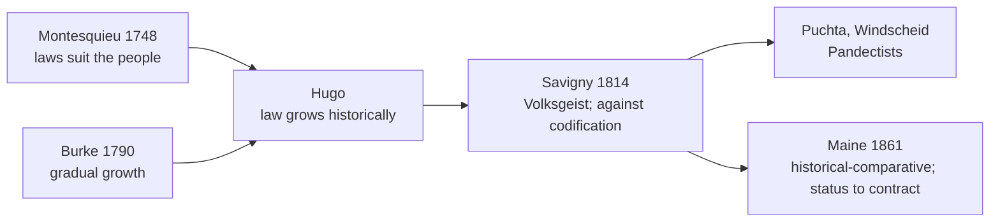
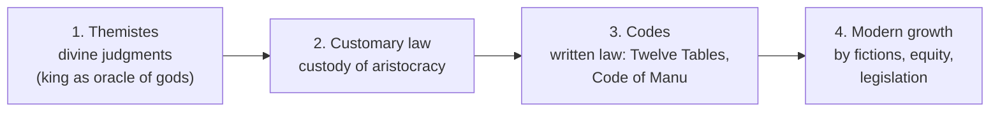

# Paper I · Jurisprudence – I (K-1001) · Unit 4
## Historical School: Frederick Karl von Savigny and Sir Henry Sumner Maine

> **Last updated:** 2026-10-27 (IST) · **Law stated as on:** 2026-10-27 · **Branch:** `paper/01-jurisprudence`
> **Verify before exam:** case citations in §7 and the "current developments" in §9 (checklist at the end).
> **Syllabus line (official):** *Historical School: Frederick Karl Von Savigny, Sir Henry Sumner Maine*

**How this unit is examined.** Typical questions: (a) Savigny's theory of *Volksgeist* with criticism (long); (b) Maine's contribution: stages of legal development, status to contract, patriarchal theory (long); (c) comparison of Savigny and Maine, or evaluation of the Historical School (long); (d) custom as a source of law with Indian cases (long or short); (e) short notes on *Volksgeist*, Thibaut–Savigny controversy, legal fictions, "status to contract". Examiners reward the **exact phrase "from status to contract"**, the **three instrumentalities (fictions, equity, legislation)** and the **named works with dates**.

---

## 1. Background

**Why the Historical School arose (early 19th century)**
1. **Reaction against natural law and abstract reason.** The 18th-century Enlightenment and the French Revolution believed that universal reason could produce ideal laws. Historical thinkers replied that law is a **product of a people's history**, not of abstract reason.
2. **Napoleonic Code (1804).** Imposed across Europe, it provoked German national feeling and a debate on whether Germany should adopt a single code.
3. **German romanticism and nationalism.** Interest in language, folklore, custom and national character.
4. **Precursors:**
   - **Montesquieu** (*The Spirit of the Laws*, 1748): laws are shaped by climate, geography, religion, customs and commerce, so they must be suited to the particular people for whom they are made.
   - **Edmund Burke** (*Reflections on the Revolution in France*, 1790): society is a partnership between the dead, the living and the unborn; reform should be gradual.
   - **Gustav Hugo** (1764–1844): founder-figure of the school; law is not made by the will of a legislator but grows historically; positive law must be studied historically.
5. **The Thibaut–Savigny controversy (1814).** A.F.J. **Thibaut** published *On the Necessity of a General Civil Law for Germany* urging a unified German civil code on rational lines. Savigny replied with ***Of the Vocation of Our Age for Legislation and Jurisprudence*** (1814): Germany was **not ready**, because it lacked the historical legal science; a premature code would **freeze** law. This pamphlet is the **manifesto of the Historical School**.

---

## 2. Friedrich Carl von Savigny (1779–1861)

**Life and works.** German jurist; Professor at Berlin; later Prussian minister for legislative revision. Works: ***Of the Vocation of Our Age for Legislation and Jurisprudence*** (1814); ***History of Roman Law in the Middle Ages*** (1815–31); ***System of Modern Roman Law*** (*System des heutigen römischen Rechts*, 1840–49). He founded, with Eichhorn and Göschen, the *Journal for Historical Jurisprudence* (1815).

### 2.1 Central propositions

1. **Law is the product of the *Volksgeist* (spirit / common consciousness of the people).**
   - Like **language**, law is not invented by any legislator; it **grows organically and unconsciously** out of the life, customs and shared convictions of a people.
   - Law "grows with the growth and strengthens with the strength of the people, and finally dies away as the nation loses its nationality."
2. **Law is national, not universal.** Each people has its own law, shaped by its own history. There is no single ideal code for all peoples.
3. **Law is found, not made.** The legislator's role is to **discover and declare** what already lives in the national consciousness.
4. **Stages of growth.** (a) Law begins as **custom** in popular consciousness; (b) as society matures, **jurists** become the *representatives* of that consciousness and develop **technical (juristic) law**; (c) **legislation** comes last, as a refinement of already-formed law.
5. **Opposition to codification.** A code made without adequate historical legal science would be defective and would arrest natural development; Savigny wanted first a **historical study of Roman and Germanic law**, then, perhaps later, a code.
6. **Role of the jurist.** The jurist is a **technical representative** of the *Volksgeist*; legal science (*Rechtswissenschaft*) must study the historical development of institutions. This produced the **Pandectist** tradition (Puchta, Windscheid), which later supplied the intellectual foundation of the **German Civil Code (BGB, in force 1900)**, ironically the very code Savigny resisted.

### 2.2 Law and language analogy
Law and language both: (i) arise from the common life of a people; (ii) develop gradually and unconsciously; (iii) are specific to each nation; (iv) change slowly and cannot be manufactured by decree.

### 2.3 Criticism of Savigny

1. ***Volksgeist* is vague and mystical.** Whose spirit? A diverse society has many groups with conflicting practices; the concept ignores class and conflict.
2. **Undervalues legislation.** In modern societies law is largely **deliberately made** to reform and plan (social legislation, labour codes, consumer law, economic regulation). Law does not always wait for slow custom.
3. **Over-glorifies custom.** Many customs are **unjust** (sati, untouchability, child marriage in India) and need to be changed by law, not preserved.
4. **Historical inconsistency.** Savigny championed **Roman law**, which Germany had *received* from abroad. The reception shows that law is often **borrowed**, contradicting the pure *Volksgeist* idea.
5. **Conservative.** The theory favours the status quo and gives no standard for reform; it is open to defence of feudal privilege.
6. **Successful codification.** The **BGB (1900)**, the Swiss Civil Code (1907) and the **Indian Contract Act 1872 / Indian Penal Code 1860** show that well-drafted codes can work.
7. **Neglects the judge's creative role and the influence of foreign legal ideas.**
8. **Ignores law as social engineering** (Pound, Unit 5): law may be a conscious tool.

### 2.4 Merits
- Brought a **historical perspective** and revived respect for **custom**.
- Emphasised that law must be **rooted in social life**; paved the way for **sociological jurisprudence** (Ehrlich's "living law").
- Produced the **historical method** in legal scholarship and comparative law.

---

## 3. Sir Henry James Sumner Maine (1822–1888)

**Life.** English jurist and historian. Regius Professor of Civil Law at Cambridge (1847); **Law Member of the Governor-General's Council in India (1862–69)**, during which legislation such as the **Indian Succession Act, 1865** was enacted; Vice-Chancellor of the University of Calcutta; later Corpus Professor of Jurisprudence at Oxford (1869). **Works:** ***Ancient Law*** (1861); ***Village Communities in the East and West*** (1871); ***Early History of Institutions*** (1875); ***Dissertations on Early Law and Custom*** (1883); ***Popular Government*** (1885); ***International Law*** (1888).

**Method.** The **historical-comparative** method: study Roman, Hindu, Hebrew, Celtic and Germanic law side by side to find the **laws of development** common to progressing societies.

### 3.1 Stages in the growth of law

1. **Themistes:** in the earliest period judgments were believed to be inspired by the gods (in Homer, the king's *themistes*). There was no "law", only isolated, divinely inspired decisions.
2. **Customary law:** the judgments harden into **custom**, kept and applied by a privileged class (priestly or aristocratic).
3. **Codes:** with the spread of writing, custom is **written down** to curb the monopoly of the aristocracy (the Roman **Twelve Tables**, the Greek codes, the **Code of Manu**).
4. **Progress through three instrumentalities:** once codes become fixed, law is brought into harmony with changing society by:
   - **Legal fictions:** an assumption, not open to challenge, that something is true that is not (e.g. **adoption** treated as natural birth; the English fiction in ejectment actions *John Doe v. Richard Roe*).
   - **Equity:** a body of principles claiming a higher justice and standing alongside the civil law (the **Roman praetor's edict**; the **English Court of Chancery**).
   - **Legislation:** conscious law-making by a recognised body, the final and most powerful instrument.

### 3.2 Static and progressive societies
Maine said that **most societies are "stationary"**: after the code stage their law stagnates (he cited the Hindu and other Eastern societies). Only a few **"progressive" societies** (chiefly the Western European) continued to develop law through fictions, equity and legislation. This distinction is now widely criticised as **Eurocentric**.

### 3.3 From Status to Contract
> *"The movement of the progressive societies has hitherto been a movement **from Status to Contract**."* (*Ancient Law*, ch. V)

- **Status:** a person's rights and duties are **fixed by birth** or position in a group (family, caste, slavery, tribal rank); the **family**, not the individual, is the unit of law.
- **Contract:** rights and duties arise from the **free agreement of individuals**; the **individual** becomes the unit.
- **Pattern:** the *patria potestas* of the Roman father weakens; slavery declines; women and sons gain legal capacity; ownership becomes individual; contract and will-making grow. This is the central thesis for which Maine is best known.

**Criticism of the status-to-contract thesis**
1. **Reversal.** Modern welfare states are moving **from contract back to status** (W. Friedmann's reading): the law protects **classes** such as employees, tenants, consumers and women through minimum wages, rent control, the Consumer Protection Act 2019, labour codes, reservations. A person's position increasingly depends on **status** again.
2. **Status never disappeared.** Marriage, citizenship and legal capacity remain status-based.
3. **Freedom of contract is often illusory** (standard form contracts), so "contract" is not always free.

**Indian illustrations.** Caste and joint-family status in classical Hindu society; the abolition of status privileges by **Art. 15** (no discrimination), **Art. 17** (abolition of untouchability), **Art. 23** (forced labour); the **Indian Contract Act 1872** based on free consent. Modern protective laws (consumer, labour, rent) show the **return to status**.

### 3.4 Patriarchal theory
Maine held that the **earliest unit of society was the patriarchal family**, under the eldest male ascendant with absolute power over members. Larger groups (house, clan, tribe, state) grew by **extension of the family**. Kinship through males (**agnatic**) was the original bond.
- **Criticism:** **McLennan** (*Primitive Marriage*, 1865) and **Morgan** (*Ancient Society*, 1877) argued that early societies were **matriarchal/promiscuous** with descent through the mother; later anthropology shows **diverse** early forms, so Maine's theory, based on Roman, Hindu and Hebrew evidence, is too narrow.

### 3.5 Village communities
In *Village Communities in the East and West* (1871) Maine studied the **Indian village community** as a body of related families holding land jointly and administering justice by custom, a surviving picture of early institutions. This became a foundation of **legal anthropology**, though later research showed the Indian village was less static and egalitarian than he supposed.

### 3.6 Maine on Austin
Maine criticised Austin's command theory by pointing out that in **early and Eastern societies** custom, not command, governed. He remarked that even Ranjit Singh, a very powerful ruler, hardly made laws, so the "sovereign command" model did not explain Indian reality (see Unit 3).

### 3.7 Criticism of Maine
1. **Narrow evidence:** relied mainly on Roman, Hindu and Hebrew sources.
2. **Stages are not universal;** many societies did not pass through *themistes*, custom and codes in that order.
3. **Patriarchal theory** challenged by anthropological findings.
4. **Eurocentric** classification of "static" and "progressive" societies.
5. **Status → contract** is not a straight line (reversal in welfare state).
6. **Underplays economic and social factors** and the **conscious** role of legislation.

### 3.8 Merits
- Founded **comparative legal history** and influenced **anthropology and sociology of law**.
- Showed how **fictions, equity and legislation** reconcile law with change.
- A powerful, memorable thesis on the evolution of personal freedom.
- His work in India gave the **historical method** a practical use in colonial law reform and codification.

---

## 4. Savigny v. Maine

| Basis | Savigny | Maine |
|---|---|---|
| Country / tradition | German; Roman and Germanic law | English; comparative (Roman, Hindu, Celtic, Hebrew) |
| Main idea | *Volksgeist*: law grows from the people's consciousness | Law evolves through **stages**; **status → contract** |
| Source of law | Custom first; jurists next; legislation last | Themistes → custom → codes → fictions, equity, legislation |
| View of codification | Opposed (premature) | Treats codes as a **normal stage**; himself helped Indian codification |
| Law and society | Law is **national and unique** | Law shows **common stages** across societies |
| Method | Historical | **Historical-comparative** |
| Common ground | Law is organic and historical; both reject natural law's abstract reason and Austin's command theory |

---

## 5. Custom as a source of law (a linked, frequently asked topic)

**Meaning.** A rule of conduct, observed continuously and for a long time by a community, which has acquired the force of law.

**Essentials of a valid custom** (as settled by courts):
1. **Antiquity**: immemorial usage (in English law, since 1189; in India, a long period, with no fixed date).
2. **Continuity**: uninterrupted.
3. **Certainty**: definite and clear.
4. **Reasonableness**: not absurd or unjust.
5. **Peaceable enjoyment**: not by force, secrecy or permission.
6. **Obligatory force**: observed as binding, not as optional.
7. **Conformity with law and morality**: not opposed to statute, public policy or morality.
8. **Proof**: must be proved by evidence (except where already judicially noticed).

**Constitutional position.** **Art. 13(3)(a)** defines "law" to include **custom or usage having the force of law**, so customs are tested against fundamental rights.

**Statutory position (example).** **Hindu Marriage Act, 1955, s. 3(a)** defines "custom and usage" (a rule continuously and uniformly observed for a long time, certain, reasonable and not opposed to public policy, and, if applicable only to a family, not discontinued).

**Key cases on custom**

| Case | Citation | Point |
|---|---|---|
| **Collector of Madura v. Moottoo Ramalinga Sathupathy** | (1868) 12 MIA 397 | Clear proof of usage outweighs the written text of the law |
| **Ramalakshmi Ammal v. Sivanatha Perumal Sethuraya Thevar** | (1872) 14 MIA 570 | What is proved to be custom is to be taken as law |
| **Hurpurshad v. Sheo Dayal** | (1876) 3 IA 259 | Essentials of a valid custom: antiquity, certainty, reasonableness; strict proof |

---

## 6. The Historical School in India

- **Customary and personal laws.** Hindu and Muslim personal laws and tribal customs show law rooted in community tradition.
- **Codification despite historical resistance.** Indian law is heavily codified (Contract Act 1872, IPC 1860 → BNS 2023, Evidence Act → BSA 2023), proving that codification and respect for custom can coexist.
- **Custom v. constitutional rights.** Courts now test custom against Part III.
- **Reform against custom.** Statutes such as the **Commission of Sati (Prevention) Act, 1987** and **Art. 17** (abolition of untouchability) override harmful custom. This is the practical answer to Savigny's "law grows by itself".

---

## 7. Case law: custom, history and reform

| Case | Citation | Principle | Link to the school |
|---|---|---|---|
| **Collector of Madura v. Moottoo Ramalinga Sathupathy** | (1868) 12 MIA 397 | Proved custom prevails over the text | Custom as law (Savigny) |
| **Hurpurshad v. Sheo Dayal** | (1876) 3 IA 259 | Tests of valid custom | Custom |
| **Ramalakshmi Ammal v. Sivanatha Perumal** | (1872) 14 MIA 570 | Custom as law | Custom |
| **Mohd. Ahmed Khan v. Shah Bano Begum** | (1985) 2 SCC 556 | Maintenance under s. 125 CrPC overrides personal-law custom; urged a Uniform Civil Code | Custom v. statutory reform |
| **Sarla Mudgal v. Union of India** | (1995) 3 SCC 635 | Conversion for a second marriage does not dissolve the first; Art. 44 | Personal law and reform |
| **Shayara Bano v. Union of India** | (2017) 9 SCC 1 | Instant triple talaq set aside as unconstitutional | Custom tested against Art. 14 |
| **Indian Young Lawyers Association v. State of Kerala (Sabarimala)** | (2018) 8 SCC 1 | Exclusion of women aged 10–50 from Sabarimala held unconstitutional | Custom v. equality; essential religious practices |
| **Animal Welfare Board of India v. Union of India (Jallikattu)** | Constitution Bench, 18 May 2023 | Upheld Tamil Nadu's amendment permitting Jallikattu as part of cultural tradition; left cruelty policing to the legislature and executive | Custom v. welfare legislation |
| **Navtej Singh Johar v. Union of India** | (2018) 10 SCC 1 | Constitutional morality prevails over social morality | Limits of "popular consciousness" |

---

## 8. Criticism of the Historical School as a whole

1. Gives no **criterion** to tell good customs from bad.
2. **Under-rates conscious legislation** and judicial law-making.
3. **Conservative** and nationalistic.
4. *Volksgeist* is **unscientific**; no way to measure it.
5. Ignores **economic** and **class** forces (Marx).
6. Cannot explain **borrowed** law (Roman law in Germany; English law in India).
7. Dismissed by **positivists** (law is command) and **natural-law** thinkers (law should be reasoned).

**Lasting contribution:** the lesson that **law cannot be understood or reformed without its history and social roots**.

---

## 9. Current relevance and recent developments

- **Uniform Civil Code (Art. 44).** The debate between uniform law and community custom is a modern version of the Savigny–Thibaut argument. **Uttarakhand** enacted a UCC in 2024 and became the **first state to bring it into force, on 27 January 2025**. *Verify the present position before the exam.*
- **Custom v. welfare law.** The **Jallikattu** decision (18 May 2023) upheld a state law protecting a traditional practice.
- **Sabarimala reference (essential religious practices).** The nine-judge Constitution Bench heard the reference for 16 days and **reserved its judgment on 14 May 2026**; reports in August 2026 said the Chief Justice indicated a verdict around early October 2026. **I could not confirm whether judgment has been pronounced as of 27 October 2026**: check LiveLaw / the Supreme Court website before writing about it in an exam.
- **Codification continues.** The shift from IPC to BNS (2024) shows legislation, not slow custom, as the main engine of change today, which supports Maine's "legislation" stage over Savigny's *Volksgeist*.
- **Caution for the exam:** treat the Sabarimala reference as *pending* unless you have confirmed a pronounced judgment.

---

## 10. Quick-revision box

- **Historical School:** reaction to natural law and codification; Montesquieu, Burke, **Hugo** → **Savigny** → Maine.
- **Savigny:** *Of the Vocation of Our Age* (1814); *Volksgeist*; law grows like language; custom → jurists → legislation; opposed Thibaut's code; later BGB 1900.
- **Maine:** *Ancient Law* (1861); stages: **Themistes → custom → codes → fictions, equity, legislation**; static v. progressive societies; **status to contract**; patriarchal theory (McLennan opposed); village communities; Law Member in India 1862–69.
- **Criticism:** vague *Volksgeist*; undervalues legislation; good v. bad custom; narrow evidence; reversal to status.
- **India:** Art. 13(3)(a); custom essentials; *Collector of Madura*; *Hurpurshad*; *Shayara Bano*; UCC debate.

**Examiner keywords:** *Volksgeist*, organic growth, law is found not made, Thibaut, codification, Pandectists, themistes, customary law, codes, legal fictions, equity, legislation, status to contract, patriarchal theory, village community, static and progressive societies.

---

## 11. Question bank (model answers)

*Mark bands indicative; confirm your paper pattern (`docs/01-gaps-and-open-questions.md`, A1).*

### Long answers (10–15 marks)

**Q1. Explain the Historical School of jurisprudence. Discuss Savigny's contribution and offer a critical evaluation.**
**Introduction:** The Historical School arose in early 19th-century Germany as a reaction to natural-law rationalism and to the Napoleonic Code.
**Body:** (1) Precursors: Montesquieu, Burke, Hugo. (2) Thibaut–Savigny controversy (1814). (3) Savigny's *Volksgeist*, law as language, law found not made, three stages (custom → juristic law → legislation), opposition to codification. (4) The Pandectists and the BGB.
**Criticism:** §2.3 and §8. **Indian link:** Art. 13(3)(a); custom essentials; reform against custom (sati; untouchability).
**Conclusion:** The school's insight that law has historical roots is permanent, but its distrust of legislation is not workable in a modern state.

---

**Q2. Discuss Maine's contribution to the Historical School. Explain "from status to contract".**
**Body:** (1) Works and method. (2) Four stages: themistes, custom, codes, fictions/equity/legislation. (3) Static v. progressive societies. (4) Status to contract, with Roman and Indian examples. (5) Patriarchal theory and McLennan's reply. (6) Village communities.
**Criticism:** §3.7; the reversal from contract to status (Friedmann; consumer and labour law).
**Conclusion:** Maine's thesis is a classic but must be read as a trend, not a universal law.

---

**Q3. Compare the theories of Savigny and Maine.**
*(Use the §4 table; add a short paragraph on their shared opposition to natural law and to Austin.)*

---

**Q4. What is custom? Discuss its essentials as a source of law and its place in Indian law.**
*(Use §5 and §7. Include Art. 13(3)(a), Hindu Marriage Act s. 3(a), *Hurpurshad*, *Collector of Madura*, *Shayara Bano*, *Sabarimala*, and the Jallikattu decision.)*

---

**Q5. "Law is not made but found." Critically examine in the light of the Historical School.**
*(Use §2.1, §2.3, §8. Argue that modern law is mostly legislated; custom still matters; give the Indian examples of reform against custom.)*

---

**Q6. Evaluate the relevance of the Historical School in modern India.**
*(Use §6 and §9: UCC debate, custom v. constitutional rights, codification, Sabarimala reference, Jallikattu.)*

---

### Short notes (5 marks)

1. ***Volksgeist*.**
2. **Thibaut–Savigny controversy.**
3. **Savigny's view on codification.**
4. **Law and language (Savigny).**
5. **Maine's stages of legal development.**
6. **Legal fictions, equity and legislation (Maine).**
7. **"From status to contract."**
8. **Maine's patriarchal theory.**
9. **Static and progressive societies.**
10. **Village communities (Maine).**
11. **Essentials of a valid custom.**
12. **Criticism of the Historical School.**

### Very short answers (2 marks)

| Question | Answer |
|---|---|
| Who founded the Historical School? | Savigny, with Gustav Hugo as precursor. |
| Name Savigny's manifesto. | *Of the Vocation of Our Age for Legislation and Jurisprudence* (1814). |
| What is *Volksgeist*? | The common spirit or consciousness of a people, from which law grows. |
| Who proposed a general German civil code in 1814? | A.F.J. Thibaut. |
| Name Maine's best-known book and year. | *Ancient Law* (1861). |
| Name Maine's three instrumentalities of legal progress. | Legal fictions, equity and legislation. |
| What does *themistes* mean in Maine's theory? | Divinely inspired judgments of early kings. |
| Who criticised Maine's patriarchal theory? | McLennan and Morgan. |
| Which Article defines "law" to include custom? | Art. 13(3)(a), Constitution of India. |
| Name one case laying down the essentials of custom. | *Hurpurshad v. Sheo Dayal* (1876) 3 IA 259. |
| In which years was Maine Law Member in India? | 1862–69. |

---

## 12. Verification checklist (do before the exam)

- [ ] *Collector of Madura* (1868) 12 MIA 397 · *Ramalakshmi Ammal* (1872) 14 MIA 570 · *Hurpurshad* (1876) 3 IA 259
- [ ] *Shah Bano* (1985) 2 SCC 556 · *Sarla Mudgal* (1995) 3 SCC 635 · *Shayara Bano* (2017) 9 SCC 1
- [ ] *Sabarimala (IYLA)* (2018) 8 SCC 1 · **status of the nine-judge reference** (reserved 14 May 2026; confirm whether pronounced)
- [ ] *Jallikattu* Constitution Bench decision, 18 May 2023 (obtain the citation from SCC Online)
- [ ] Uttarakhand UCC: in force 27 January 2025; check later developments
- [ ] Quotations from Savigny and Maine against your textbook's translation (wording varies between translations)
- [ ] Hindu Marriage Act, 1955, s. 3(a); Constitution, Art. 13(3)(a)
