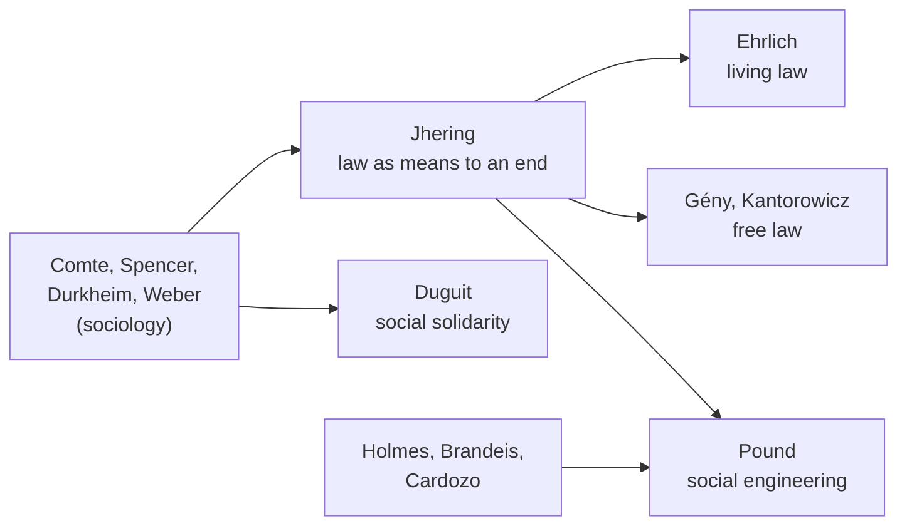
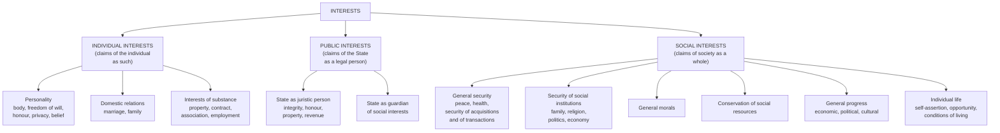

# Paper I · Jurisprudence – I (K-1001) · Unit 5
## Sociological School: Background and Characteristics; Roscoe Pound; Leon Duguit

> **Last updated:** 2026-10-27 (IST) · **Law stated as on:** 2026-10-27 · **Branch:** `paper/01-jurisprudence`
> **Verify before exam:** case citations in §8 and the recent decisions in §10 (checklist at the end).
> **Syllabus line (official):** *Sociological School: Background and Characteristics, Roscoe Pound, Leon Dugit*

**How this unit is examined.** Typical questions: (a) background and characteristics of the Sociological School (long); (b) Roscoe Pound's social engineering and classification of interests (long, very frequent); (c) Duguit's social solidarity and "property as a social function" (long or short); (d) critical evaluation, or comparison with Analytical and Historical schools; (e) short notes on *living law*, *jural postulates*, *law in action v. law in books*, *social solidarity*. **Draw Pound's interests chart**; it earns marks quickly. Link every theory to **Indian social-justice cases** (PIL, M.C. Mehta, Vishaka).

---

## 1. Background

**Why the school arose (late 19th to early 20th century)**
1. **Industrialisation and social conflict.** Factories, urban poverty, labour unrest and new risks (railways, machinery) showed that the law of individual rights and free contract did not fit social needs.
2. **Dissatisfaction with earlier schools.** The **Analytical** school treated law as a closed system of commands; the **Historical** school looked to the past and distrusted legislation; **Natural law** was vague. None asked what law **does** in society.
3. **Rise of sociology.**
   - **Auguste Comte** (1798–1857): coined "sociology"; society studied scientifically (positivism).
   - **Herbert Spencer** (*Social Statics*, 1851): society as an organism; "survival of the fittest"; the **law of equal freedom**.
   - **Émile Durkheim** (*The Division of Labour in Society*, 1893): **social solidarity**: *mechanical* (similarity, in simple societies) and *organic* (interdependence through division of labour, in modern societies); law is the visible index of solidarity (repressive law ↔ mechanical; restitutive law ↔ organic). *The Rules of Sociological Method* (1895): "social facts".
   - **Max Weber** (*Economy and Society*): types of legal authority and **formal rationality** of modern law.
4. **Precursors within law**
   - **Rudolf von Jhering** (1818–1892).
   - **Eugen Ehrlich** (1862–1922).
   - **François Gény** and the **Free Law Movement** (Kantorowicz): judges should find law by "free scientific research" where statutes are silent.
   - **Oliver Wendell Holmes Jr.**: *"The life of the law has not been logic: it has been experience"* (*The Common Law*, 1881).
   - **Louis Brandeis**: the **"Brandeis brief"** in *Muller v. Oregon*, 208 US 412 (1908) used statistics and social data to defend a labour law.
   - **Benjamin Cardozo** (*The Nature of the Judicial Process*, 1921): judges should weigh social welfare.

---

## 2. Characteristics of the Sociological School

Pound's programme of sociological jurisprudence (*The Scope and Purpose of Sociological Jurisprudence*, 1911–12) had six points:
1. Study of the **actual social effects** of legal institutions and doctrines.
2. **Sociological study** as a preparation for law-making.
3. Study of the **means of making legal rules effective**.
4. Study of **juridical method** (how courts reason).
5. **Sociological legal history**: how law and society have affected each other.
6. Importance of a **reasonable and just solution of individual cases** (individualisation of justice).

**General characteristics**
- Law is a **social phenomenon**, to be studied through its **function and effect**, not only its form.
- Emphasis on **law in action** over **law in books**.
- Law is an instrument of **social control** and **social change**.
- Prefers **interests and social purposes** to abstract rights.
- **Interdisciplinary**: law with sociology, economics, psychology.
- **Empirical** in spirit (facts, statistics, social surveys).
- **Pragmatic** and reform-minded.

**Sociological jurisprudence v. sociology of law.** *Sociological jurisprudence* (Pound) is jurisprudence informed by social facts, aiming at law reform; the *sociology of law* (Ehrlich, Weber) is a descriptive social science of law as a social phenomenon.

---

## 3. Precursors in brief

### 3.1 Rudolf von Jhering (1818–1892)
- **Works:** *Der Kampf ums Recht* (*The Struggle for Law*, 1872); *Der Zweck im Recht* (*Law as a Means to an End*, 1877–83).
- **Law has a purpose.** Law is not just will or custom; it is a **means to a social end**.
- **Definition:** law is the sum of the conditions of social life, in the widest sense, secured by the State through external compulsion.
- **Interests.** Rights are **legally protected interests**; law balances individual and social interests (**social utilitarianism**).
- **Struggle for law.** It is the **duty** of a person to assert their legal rights; the vindication of rights serves society.

### 3.2 Eugen Ehrlich (1862–1922)
- **Work:** *Fundamental Principles of the Sociology of Law* (1913); studied the customary law of Bukovina.
- **Living law.** Ehrlich said the centre of gravity of legal development lies **not in legislation, juristic science or judicial decision, but in society itself**. The **living law** is the law that actually governs social life (in families, associations, business, villages), distinct from **state law** (rules for decisions in courts).
- **Implication:** officials and courts should understand and respect the living law.
- **Indian echo:** *Lok Adalats* (Legal Services Authorities Act, 1987) and village *panchayat* dispute resolution reflect "living law".

### 3.3 Free Law Movement
**Gény** (*Méthode d'interprétation*, 1899: "free scientific research") and **Kantorowicz** (*The Battle for Legal Science*, 1906): judges may fill gaps by seeking social purpose, not just by logical deduction.

---

# PART A — ROSCOE POUND (1870–1964)

**Life and works.** American jurist; Dean of Harvard Law School (1916–36). Works: *Law in Books and Law in Action* (44 American Law Review 12, 1910); *The Scope and Purpose of Sociological Jurisprudence* (24–25 Harvard Law Review, 1911–12); *Interpretations of Legal History* (1923); *Introduction to the Philosophy of Law* (1922); *Social Control Through Law* (1942); *Jurisprudence* (5 vols, 1959).

## A.1 Law as social engineering
- Pound saw law as a **social institution** for satisfying **social wants**: the claims and demands of civilised life: **giving effect to as much as possible with the least friction and waste**.
- The jurist and judge are like **engineers**: they design the legal structure so that competing demands are **adjusted** as efficiently as possible.
- **Social engineering** means: (i) study the **social facts** and conflicts; (ii) **identify** the interests involved; (iii) **balance** them; (iv) **shape** rules and institutions to secure the result.

## A.2 Theory of interests
**Interest** = a claim, demand or desire which people, individually or in groups, seek to satisfy and which must therefore be considered in arranging relations.

**Four steps for the law**
1. **Recognise** the interests.
2. **Define the limits** within which they will be given legal effect.
3. **Secure** them within those limits.
4. **Weigh/evaluate** them (by the **jural postulates** of the civilisation) when they conflict.

### Pound's classification of interests

**Mnemonic:** I-P-S (Individual, Public, Social); social interests: **S**ecurity, **I**nstitutions, **M**orals, **R**esources, **P**rogress, **L**ife → "SIMRPL".

## A.3 Jural postulates
Assumptions that a civilised society makes about what people may expect of each other; law should secure them. Pound's postulates (for his time):
1. People must be able to assume that **others will not commit intentional aggression** upon them.
2. They must be able to **control, for beneficial purposes, what they have discovered, created or acquired** (property).
3. They must be able to assume that those with whom they deal will act in **good faith**.
4. They must be able to assume that those who act will exercise **due care** (reasonable care) to avoid injury.
5. They must be able to assume that those who **keep things likely to escape and cause damage** will keep them within proper bounds (cf. *Rylands v. Fletcher*).

These postulates are **relative** to time and place: they change with civilisation.

## A.4 Law in books v. law in action
Pound (1910) criticised **mechanical jurisprudence**: courts applying rules logically without regard to results. He demanded that the **law in action**, i.e. the actual working and effects of rules, be the test. The gap between the two should be reduced by legal reform and by judges' awareness of social facts.

## A.5 Stages of legal development (Pound)
1. **Primitive law** (custom and blood feud);
2. **Strict law** (formal rules);
3. **Equity and natural law** (moral standards enter);
4. **Maturity of law** (equality and certainty);
5. **Socialisation of law** (law turns to social interests and welfare).

## A.6 Law and social control
Law is the **most highly developed form of social control** (with morality, religion, education). Its task is to maintain and improve civilised society.

## A.7 Criticism of Pound
1. **Classification of interests is arbitrary and overlapping:** the same interest can be put in different groups (Julius Stone: they are the *same* interest seen from different angles).
2. **No scale of values:** he offers no firm test for deciding which interest prevails when they conflict; "jural postulates" are tied to American society of his time.
3. **"Engineering" suggests manipulation** and an elite of engineers; law is not simply a tool.
4. **Culturally limited:** reflects early 20th-century American conditions.
5. **"Interest" is vague.**
6. **Not enough empirical work:** realists said he talked about social facts without systematically studying them.
7. **Blurs law and policy** (positivist objection).

**Merits.** Made law **dynamic** and **purposive**; bridged law and social science; supplied a framework for **balancing interests** (still used in constitutional adjudication as **proportionality**); influenced **welfare legislation** and judicial activism.

---

# PART B — LEON DUGUIT (1859–1928)

**Life and works.** French jurist and professor at Bordeaux. Works: *Le droit social, le droit individuel et la transformation de l'État* (1908); *Traité de droit constitutionnel* (1911); *Les transformations générales du droit privé depuis le Code Napoléon* (1912); *Les transformations du droit public* (1913; English translation *Law in the Modern State*, 1919).

## B.1 Law rests on social solidarity
- Starting point: **social fact**: humans live in society and are **interdependent** (borrowing from Durkheim).
- **Two kinds of solidarity:** (i) by **similarity** (people share needs and ideas) and (ii) by **division of labour** (people exchange services).
- **Objective law (*droit objectif*)** is the rule of conduct that arises from this social solidarity; it is **a fact**, not a command of the State and not an abstract natural right.
- A rule is law when the community feels that **violating it is a breach of social solidarity** and that **social reaction** (not only State force) may be applied.

## B.2 Rejection of sovereignty and the State's will
- Duguit denied that the State is a **sovereign legal person with a will** above the law; "sovereignty" is a metaphysical fiction.
- The State is simply **the strongest group of individuals** in society. Its power is **limited by objective law**.
- The State's authority is justified **only so far as it serves social solidarity**.

## B.3 Rejection of individual rights
- Individuals have **no natural or subjective rights** to assert against society; they have **duties**: each person has a **social function** to perform, contributing to social solidarity.
- What are called "rights" are only **powers to perform social functions**.

## B.4 Property as a social function
- Property is **not an absolute right**; it is a **social function**. The owner holds property for the benefit of society and must use it productively and consistently with social needs; if not, the law may interfere.
- This idea pre-figures the constitutional treatment of property in India: **Arts. 39(b)–(c)** (distribution of material resources to subserve the common good), the removal of property as a **fundamental right** by the **44th Amendment (1978)** and its retention as a constitutional right in **Art. 300A**.

## B.5 Public service (*service public*)
- The State is not a ruler but a **cooperative of public services** that exist to promote solidarity (transport, education, justice, security).
- This became a pillar of **French administrative law** and the **welfare state**: public power exists to provide **services** to the community.

## B.6 Criticism of Duguit
1. **"Social solidarity" is vague and subjective;** it cannot supply precise rules or resolve conflicts.
2. **Denial of rights is impractical and dangerous:** a theory based on duties and social functions could justify **collectivism and State control** over the individual.
3. **Confuses "is" and "ought"** (Kelsen; Hart): treating the law as a *social fact* does not explain why it **binds**.
4. **Underrates the State and legislation:** modern law cannot do without sovereign authority and statutes.
5. **No test** to say whether a given law promotes solidarity.
6. **Underestimates conflict, power and class interest** (Marxist critique).
7. **Hard to square with a developed constitutional system of enforceable fundamental rights.**

**Merits.** Shifted attention from the State's **will** to **social need**; weakened absolutism; gave the **welfare state** a legal basis; influenced administrative law, **social function of property**, and the idea of **duties** (cf. **Art. 51A**, fundamental duties).

---

## 4. Comparison table: Jhering, Ehrlich, Pound, Duguit

| Basis | Jhering | Ehrlich | Pound | Duguit |
|---|---|---|---|---|
| **Key idea** | Law is a means to a social end | **Living law** in society | Law as **social engineering** | **Social solidarity** |
| **Unit of analysis** | Interests, purposes | Social associations | **Interests** (individual, public, social) | Social function and duty |
| **View of State** | Law enforced by State | State law is only part of law | State as a legal person balancing interests | State limited by objective law; serves the public |
| **Rights** | Legally protected interests | Rights arise in social life | Interests recognised by law | Denied; only duties and functions |
| **Role of judge** | Purposive | Find and apply living law | Balance interests, individualise justice | Apply objective law of solidarity |
| **Weakness** | Utilitarian; vague purposes | Hard to identify living law | No scale of values | Vague; dangerous to liberty |

## 5. Sociological v. Analytical v. Historical

| Basis | Analytical | Historical | Sociological |
|---|---|---|---|
| **Focus** | Law as it is (command, norm) | Law's origin and growth | Law's **function** and effect |
| **Method** | Analysis | History | Social facts / interests |
| **Source of law** | Sovereign | Custom, *Volksgeist* | Society's needs |
| **Role of legislation** | Central | Secondary | A tool of social engineering |
| **Idea of law** | Command / norm | Organic growth | Social control |
| **Typical thinkers** | Austin, Kelsen, Hart | Savigny, Maine | Ehrlich, Pound, Duguit |

---

## 6. The sociological approach in the Indian Constitution

The Constitution is itself an instrument of **social engineering**:
- **Preamble:** social, economic and political **justice**.
- **Part IV (Directive Principles):** Arts. 38, 39, 41, 43, 46, directing the State toward **welfare** and the reduction of inequality.
- **Equality provisions:** Art. 15(4)–(6), Art. 16(4), Art. 17 (untouchability abolished).
- **Land reform and abolition of zamindari** (First Amendment; Ninth Schedule).
- **Statutory social engineering:** Dowry Prohibition Act 1961; Protection of Civil Rights Act 1955; Right to Education Act 2009; Right to Information Act 2005; MGNREGA 2005; Sexual Harassment of Women at Workplace Act 2013.

---

## 7. Judicial examples: Indian "sociological" jurisprudence

| Case | Citation | Principle | Link |
|---|---|---|---|
| **Hussainara Khatoon v. Home Secretary, Bihar** | (1980) 1 SCC 81 | Right to speedy trial is part of Art. 21; release of undertrials | Law in action v. books (Pound) |
| **S.P. Gupta v. Union of India** | AIR 1982 SC 149; 1981 Supp SCC 87 | Liberalised locus standi; "public interest" litigation | Social interests |
| **People's Union for Democratic Rights v. Union of India (Asiad Workers)** | (1982) 3 SCC 235 | Payment below minimum wages is forced labour under Art. 23 | Social engineering; Duguit's social function |
| **Bandhua Mukti Morcha v. Union of India** | (1984) 3 SCC 161 | Directions to identify and rehabilitate bonded labourers | Social interests; PIL |
| **Olga Tellis v. Bombay Municipal Corporation** | (1985) 3 SCC 545 | Right to livelihood is part of Art. 21; pavement dwellers | Interests of individual life |
| **M.C. Mehta v. Union of India (Oleum gas leak)** | (1987) 1 SCC 395 | **Absolute liability** for hazardous industry, no *Rylands v. Fletcher* exceptions | Law reshaped to meet industrial risk (Pound's jural postulate 5) |
| **Vishaka v. State of Rajasthan** | (1997) 6 SCC 241 | Court laid down binding guidelines on sexual harassment until legislation | Judge as social engineer |
| **Indra Sawhney v. Union of India** | 1992 Supp (3) SCC 217 | Reservation for backward classes; 50% ceiling; creamy layer | Balancing social interests |
| **M.C. Mehta v. Kamal Nath** | (1997) 1 SCC 388 | **Public trust doctrine**: natural resources held in trust for the public | Property as social function |
| **Sanjeev Coke Mfg. Co. v. Bharat Coking Coal Ltd.** | (1983) 1 SCC 147 | Wide reading of Art. 39(b)–(c) and Art. 31C | Duguit-like social function of property |
| **Property Owners Association v. State of Maharashtra** | Nine-judge Constitution Bench, 5 November 2024 | Privately owned resources **can** be "material resources of the community" under Art. 39(b) in some circumstances, but **not every** private resource automatically is | Modern limit on the "social function" view |

---

## 8. Criticism of the Sociological School as a whole

1. **Lack of clear criteria** for choosing between competing social interests.
2. **Vagueness** of *society*, *interest*, *solidarity*.
3. **Risk of subordinating the individual** to society.
4. **Weak on legal validity:** does not explain why a rule is *law*.
5. **Conservative or manipulable:** the "needs of society" can justify existing power.
6. **Too eclectic** and not fully empirical.
7. **Foreign-context bias:** Pound's postulates reflect American society.

**Lasting contribution:** the modern approach to **PIL**, **proportionality**, **impact-based** law-making, and the understanding that law is an **instrument of social change**.

---

## 9. Quick-revision box

- **Background:** reaction to Analytical and Historical schools; sociology (Comte, Spencer, Durkheim, Weber); Jhering, Ehrlich, Gény/Free Law, Holmes, Brandeis, Cardozo.
- **Characteristics:** function over form; law in action; social control; interests; interdisciplinary; empirical; reform.
- **Pound:** social engineering; **interests** (individual / public / social, with social interests: security, institutions, morals, resources, progress, individual life); jural postulates; law in books v. action; stages (primitive → socialisation).
- **Duguit:** social solidarity (similarity, division of labour); *droit objectif*; no sovereignty; no rights, only functions; **property as a social function**; **public service**.
- **Criticism:** no scale of values; vague; danger to liberty.
- **India:** PIL; *Hussainara*; *S.P. Gupta*; *PUDR*; *Bandhua Mukti Morcha*; *M.C. Mehta*; *Vishaka*; Arts. 38–39, 15(4), 17; Art. 51A.

**Examiner keywords:** social engineering, interests, jural postulates, living law, social solidarity, public service, social function, law in action, social control, balancing.

---

## 10. Current relevance and recent developments

- **Public interest litigation** remains the Indian embodiment of sociological jurisprudence.
- **Proportionality** (balancing State interest against individual right) is now the standard test in rights cases (*Puttaswamy*, 2017), a modern form of Pound's balancing.
- **Social justice cases in recent years:**
  - ***Janhit Abhiyan v. Union of India*** (decided 7 November 2022): the Supreme Court upheld, by 3:2, the 103rd Constitution Amendment providing 10% reservation for economically weaker sections (verify citation: reported at (2023) 5 SCC 1).
  - ***State of Punjab v. Davinder Singh*** (decided 1 August 2024, 6:1): a seven-judge bench held that sub-classification within Scheduled Castes is permissible, a decision about balancing group interests.
  - ***Property Owners Association v. State of Maharashtra*** (5 November 2024): see §7; a significant modern ruling on the social-function view of property.
- **Evidence-based law-making:** the Brandeis-brief method survives in data-backed submissions and in Law Commission reports.
- **Caution for the exam:** the 2024 decisions above are recent; **cite them with the date** and check the SCC citation before using it in an answer.

---

## 11. Question bank (model answers)

*Mark bands indicative; confirm your paper pattern (`docs/01-gaps-and-open-questions.md`, A1).*

### Long answers (10–15 marks)

**Q1. Explain the background and characteristics of the Sociological School of jurisprudence.**
**Introduction:** The Sociological School views law as a social institution to be studied by its effects on society.
**Body:** (1) Background: industrialisation; dissatisfaction with Analytical and Historical schools; rise of sociology (Comte, Spencer, Durkheim, Weber). (2) Precursors: Jhering, Ehrlich, Gény, Holmes, Brandeis, Cardozo. (3) Characteristics: Pound's six-point programme, plus the general features in §2. (4) Distinction from the sociology of law.
**Indian link:** PIL, *Hussainara Khatoon*, *Vishaka*.
**Conclusion:** The school made law responsive to social facts.

---

**Q2. Discuss Roscoe Pound's theory of social engineering and his classification of interests.**
**Introduction:** Pound described law as social engineering.
**Body:** (1) Meaning of social engineering. (2) Theory of interests; four steps. (3) Classification (draw the chart): individual, public, social. (4) Jural postulates. (5) Law in books v. law in action. (6) Stages of legal development.
**Cases:** *M.C. Mehta* (Oleum), *Vishaka*, *Olga Tellis*, *PUDR*.
**Criticism:** §A.7.
**Conclusion:** Pound's value lies in his balancing method rather than in a fixed list of interests.

---

**Q3. Explain Duguit's theory of social solidarity. Why did he reject individual rights?**
**Body:** (1) Social solidarity (similarity; division of labour). (2) Objective law. (3) Rejection of sovereignty. (4) Rights replaced by social functions. (5) Property as a social function. (6) Public service.
**Indian link:** Arts. 39(b)–(c), 300A, 51A; *Sanjeev Coke*; *Property Owners Association* (2024).
**Criticism:** §B.6.

---

**Q4. Compare the Sociological School with the Analytical and Historical Schools.**
*(Use the §5 table, then explain each row in two lines, and conclude that the Sociological School complements rather than replaces the others.)*

---

**Q5. Critically evaluate the Sociological School and its relevance in India.**
*(Use §8 and §6–§7. Give the Indian social-justice cases and the recent decisions in §10.)*

---

**Q6. "Law is an instrument of social change." Discuss with reference to Indian experience.**
*(Use Pound, the Constitution as social engineering (§6), PIL cases (§7), and legislative examples. Close with the caution that law alone cannot change society without implementation.)*

---

### Short notes (5 marks)

1. **Characteristics of sociological jurisprudence (Pound's six points).**
2. **Jhering: law as a means to an end.**
3. **Ehrlich's living law.**
4. **Free Law Movement.**
5. **Law as social engineering.**
6. **Pound's classification of interests.**
7. **Jural postulates.**
8. **Law in books and law in action.**
9. **Duguit's social solidarity.**
10. **Property as a social function.**
11. **Public service theory (Duguit).**
12. **PIL as sociological jurisprudence.**

### Very short answers (2 marks)

| Question | Answer |
|---|---|
| Who coined the term "sociology"? | Auguste Comte. |
| Who wrote *Law as a Means to an End*? | Rudolf von Jhering. |
| Who developed the concept of "living law"? | Eugen Ehrlich. |
| What are the three categories of interests in Pound? | Individual, public and social. |
| Name Pound's famous article of 1910. | *Law in Books and Law in Action*. |
| What did Pound say law is? | Social engineering. |
| What is Duguit's central idea? | Social solidarity (law rests on interdependence of people). |
| Did Duguit accept individual rights? | No; only social functions and duties. |
| Which Article reflects "property as social function"? | Art. 39(b)–(c) (and Art. 300A on property). |
| What is the Brandeis brief? | A legal argument using social and economic data, in *Muller v. Oregon* (1908). |
| Name the Indian case on absolute liability. | *M.C. Mehta v. Union of India* (Oleum gas leak, 1987). |

---

## 12. Verification checklist (do before the exam)

- [ ] *Hussainara Khatoon* (1980) 1 SCC 81 · *S.P. Gupta* AIR 1982 SC 149 · *PUDR* (1982) 3 SCC 235 · *Bandhua Mukti Morcha* (1984) 3 SCC 161
- [ ] *Olga Tellis* (1985) 3 SCC 545 · *M.C. Mehta (Oleum)* (1987) 1 SCC 395 · *Vishaka* (1997) 6 SCC 241 · *Kamal Nath* (1997) 1 SCC 388
- [ ] *Indra Sawhney* 1992 Supp (3) SCC 217 · *Sanjeev Coke* (1983) 1 SCC 147
- [ ] *Janhit Abhiyan* (W.P.(C) 55/2019, 7 Nov 2022, 3:2): confirm the SCC citation, believed to be (2023) 5 SCC 1
- [ ] *Davinder Singh*: 2024 INSC 562 (1 Aug 2024, 6:1); add the SCC reference if your textbook uses it
- [ ] *Property Owners Association* (W.P.(C) 934/1992, 5 Nov 2024): obtain the SCC citation; reported as an 8:1 majority on the main question with Dhulia J. dissenting, so check the split on each issue
- [ ] *Muller v. Oregon*, 208 US 412 (1908)
- [ ] Pound's six-point programme and the list of social interests against your textbook (lists vary slightly between editions)
- [ ] Titles of Duguit's works (translations vary)
