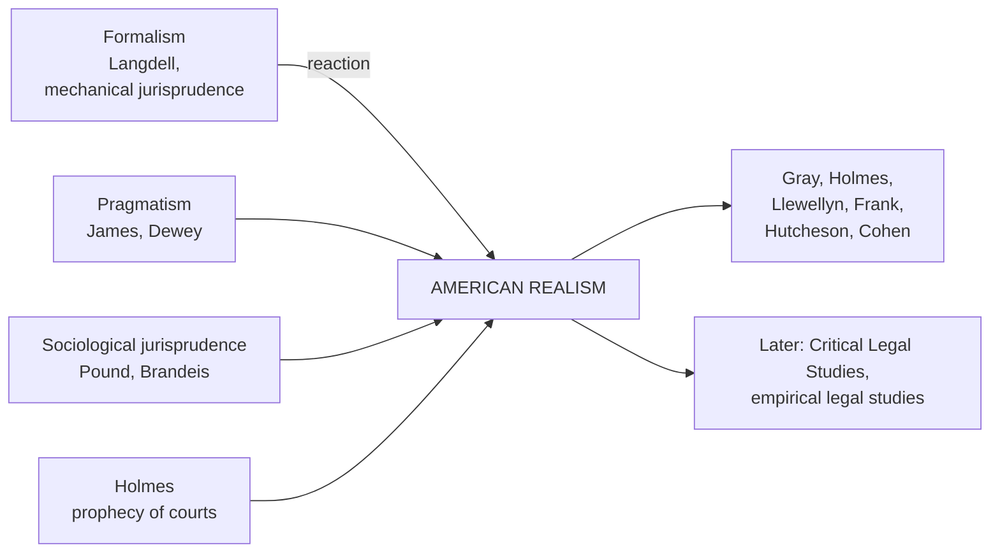

# Paper I · Jurisprudence – I (K-1001) · Unit 6
## American Modern Realism

> **Last updated:** 2026-10-28 (IST) · **Law stated as on:** 2026-10-27 · **Branch:** `paper/01-jurisprudence`
> **Verify before exam:** case citations in §8 and quotations in §3 (checklist at the end).
> **Syllabus line (official):** *American Modern Realism*

**How this unit has been examined (December 2022–2025).** 4 of the 52 previous questions came from this unit:

- Dec 2025 Q8 (10): "The prophecies of what the courts will do in fact, and nothing more pretentious, are what I mean by the Law." Discus… → [B-38](question-bank/section-b-part-4-units-6-7.md#b-38)
- Dec 2024 Q9 (20): American modern realism is a combination of the analytical positivists and sociological approaches. Comment. → [C-20](question-bank/section-c-part-4-units-6-7-cross.md#c-20)
- Dec 2023 Q12 (20): Write detailed essay on 'Realist Movement' of jurisprudence. → [C-19](question-bank/section-c-part-4-units-6-7-cross.md#c-19)
- Dec 2022 Q2 (4): Justice Holmes. → [A-88](question-bank/section-a-part-4-units-6-7.md#a-88)

*Source: the transcribed papers in [`docs/past-papers/paper-1-jurisprudence.md`](../../docs/past-papers/paper-1-jurisprudence.md). Unit assignment is by the main topic of the question. The paragraph that stood here earlier was a guess made before I had the papers. Topic frequency across all units is in the [question-bank README](question-bank/README.md#frequency).*

---

## 1. Background

**Why Realism arose (c. 1900–1940)**
1. **Reaction to formalism ("mechanical jurisprudence").** Late-19th-century American law, influenced by **Christopher Columbus Langdell's** case method at Harvard and by a belief in logic, treated law as a closed system from which results followed by deduction. Courts used this approach to strike down social legislation (*Lochner v. New York*, 198 US 45 (1905), striking a maximum-hours law for bakers).
2. **Pragmatism.** The philosophy of **William James** and **John Dewey** judged ideas by their **practical consequences**.
3. **Sociological jurisprudence.** Pound's call to study **law in action** (Unit 5).
4. **Holmes's influence.** His writings made "what courts actually do" the focus.
5. **Social upheaval.** The Great Depression and the **New Deal** showed that law had to answer social and economic needs, and that judges' policy views mattered.
6. **Behavioural sciences.** Psychology (Freud) and social science encouraged the study of **how judges actually decide**.

**A "movement", not a "school".** Llewellyn himself insisted there was **no school** of realists, only a **shared method and set of attitudes**. The movement's centres were **Columbia** (Llewellyn, Cook, Moore) and **Yale** (Corbin, Arnold, Cohen, Clark, Frank).

---

## 2. Llewellyn's "nine points" and the general characteristics

In *Some Realism About Realism* (44 Harvard Law Review 1222, 1931) Karl Llewellyn listed what the realists **shared**:
1. **Law is in flux** and judicial creation of law is a constant fact.
2. **Law is a means to social ends**, not an end in itself.
3. **Society changes faster than law**, so law must always be re-examined for fit.
4. A **temporary separation of "is" and "ought"** for purposes of study (describe first, evaluate later).
5. **Distrust of traditional legal rules and concepts** as descriptions of what courts or people actually do.
6. **Distrust of the theory** that traditional rule-formulations are the **main cause** of court decisions.
7. **Grouping cases and legal situations into narrower categories** than the traditional ones.
8. **Evaluating any part of law by its effects.**
9. A **sustained, programmatic attack** on legal problems along these lines.

**General characteristics (summary for answers)**
- Focus on **what judges and officials actually do**, not what the books say.
- **Rule-scepticism:** rules do not fully determine decisions.
- **Judicial behaviour** is shaped by **personality, background, social attitudes and facts**.
- Law is **uncertain and changing**, a flux.
- **Empirical, functional** study of law's effects.
- **Anti-formalist:** logic alone cannot decide cases.
- **Law as a means** to social purposes.

---

## 3. The main exponents

### 3.1 Oliver Wendell Holmes Jr. (1841–1935)
Justice of the US Supreme Court (1902–32); the intellectual father of American Realism.

**Key works:** *The Common Law* (1881); *The Path of the Law* (10 Harvard Law Review 457, 1897).

1. **Experience, not logic.** *"The life of the law has not been logic: it has been experience."* The felt necessities of the time, prevalent moral and political theories, public policy and even the prejudices of judges have mattered more than syllogisms in shaping legal rules.
2. **Prediction theory of law.** *"The prophecies of what the courts will do in fact, and nothing more pretentious, are what I mean by the law."* For Holmes, law is a **prediction of what courts will decide**.
3. **The "bad man" theory.** To understand the law, look at it from the standpoint of a **bad man**, who cares only about the **material consequences** (damages, imprisonment) that the law will bring, not about morality or the logic of rules. This separates law from morals for the purpose of analysis.
4. **Dissent in *Lochner v. New York*** (198 US 45, 1905): the Constitution *"does not enact Mr. Herbert Spencer's Social Statics"*; judges should not read their economic philosophy into the Constitution.
5. **Dissent in *Southern Pacific Co. v. Jensen*** (244 US 205, 1917): the common law is **not "a brooding omnipresence in the sky"**; it is the articulate voice of some sovereign, i.e. made by judges.

### 3.2 John Chipman Gray (1839–1915)
Harvard professor, a forerunner of Realism. **Work:** *The Nature and Sources of the Law* (1909).

1. **Law is what the courts decide.** The law of a State is composed of the **rules which the courts lay down** for the determination of legal rights and duties.
2. **Statutes are sources, not law.** A statute does not become law until **a court interprets and applies it**. The statute is a *source* of law, like precedent, custom, and expert opinion. In practice, **all law is judge-made law** (he approved Bishop Hoadly's dictum that whoever has absolute authority to interpret a law is the true lawgiver, not the person who first wrote it).
3. **Judges find and make law.** Even where a rule exists, the judge's reading gives it effect.

### 3.3 Karl N. Llewellyn (1893–1962)
Columbia professor; chief reporter of the **Uniform Commercial Code**. **Works:** *The Bramble Bush* (1930); *Some Realism About Realism* (1931); *The Cheyenne Way* (1941, with E.A. Hoebel); *The Common Law Tradition: Deciding Appeals* (1960).

1. **Law is what officials do.** In *The Bramble Bush* Llewellyn said that what **officials do about disputes** is the law itself.
2. **Paper rules v. real rules.** "Paper rules" are what the books say; "real rules" are what courts and officials **actually do**.
3. **Rule-scepticism.** Rules do not by themselves produce decisions; judges' conduct must be studied.
4. **Law-jobs theory** (*The Cheyenne Way*): every group needs law to perform certain **jobs**: (i) clear up **trouble cases**; (ii) **prevent** trouble by channelling conduct; (iii) **allocate authority** and decision procedures; (iv) give **direction and incentive** to the group; (v) provide **"juristic method"**, the craft and skill of handling law.
5. **Situation sense** and the **Grand Style v. Formal Style** (1960): judges at their best decide by **"situation sense"** (the type of the situation and its policy) and reason **openly from purpose** (Grand Style), rather than by narrow logic (Formal Style). In his later work Llewellyn conceded that **rules and precedent do constrain judges**, so legal outcomes are reasonably predictable.

### 3.4 Jerome Frank (1889–1957)
Judge of the US Court of Appeals (2nd Circuit). **Works:** *Law and the Modern Mind* (1930); *Courts on Trial* (1949).

1. **Fact-scepticism.** Frank held that the real uncertainty of law lies at the **trial level**: not in the rules but in the **facts**: witnesses are unreliable, juries unpredictable, and the judge's own **personality, biases and "hunch"** influence what facts are found. Rule-sceptics (Llewellyn) doubt the rules; **fact-sceptics** (Frank) doubt the facts.
2. **The "basic myth" of legal certainty.** Frank said that the longing for fixed law is a **childish wish for a father-figure** (a psychoanalytic explanation), and that **certainty in law is a myth**.
3. **Actual law and probable law.** *Actual law* is a **past decision** in a particular case; *probable law* is a **guess** about future decisions. Before judgment there is no actual law on the matter.
4. **Reform proposals.** Better fact-finding, training judges in psychology and social science, open acknowledgement of judicial discretion.

### 3.5 Others
- **Joseph Hutcheson** ("The Judgment Intuitive: The Function of the 'Hunch' in Judicial Decision", 1929): judges often reach conclusions by **intuition** and then justify them with reasons.
- **Felix Cohen** ("Transcendental Nonsense and the Functional Approach", 1935): attacked abstract legal concepts as empty without reference to real effects.
- **Underhill Moore, Walter Wheeler Cook:** empirical studies of legal behaviour.
- **Thurman Arnold** (*Symbols of Government*, 1935): law as myth and ritual.

### 3.6 Scandinavian Realism (distinct)
A parallel European movement: **Axel Hägerström**, **Karl Olivecrona** (*Law as Fact*), **A.V. Lundstedt**, **Alf Ross** (*On Law and Justice*, 1953). They reject metaphysical notions (rights, duties, "validity") and treat law as **psychological and social fact**: **Ross** defined valid law as the rules that judges will actually apply and feel bound by. Scandinavian Realism is **psychological**; American Realism is **behavioural/predictive**.

---

## 4. Realism v. other schools

| Basis | Analytical (Austin/Hart) | Sociological (Pound) | American Realism |
|---|---|---|---|
| **What is law?** | Command / rules | Instrument of social engineering | What courts and officials **actually do** |
| **Focus** | Rules and concepts | Interests and social effects | **Judicial behaviour and facts** |
| **View of rules** | Rules decide | Rules to be adjusted to society | Rules do **not** by themselves decide (rule-scepticism) |
| **Role of judge** | Applies law (or discretion in penumbra: Hart) | Balances interests | **Makes** law; personality matters |
| **Law and morals** | Separate | Linked through social ends | Separate **for study** ("is" v. "ought") |
| **Method** | Analysis | Social facts | Empirical, predictive |
| **Weakness** | Ignores social reality | No scale of values | Overstates uncertainty; circular |

**Realism and sociological jurisprudence.** Realists extended Pound's "law in action" but were more sceptical and focused on the **judge** rather than the **social interests**. Pound himself criticised the realists for exaggerating judicial subjectivity.

**Realism and the declaratory theory.** The older (Blackstonian) view that judges only **declare** existing law is rejected: judges **make** law.

---

## 5. Hart's critique of Realism (*The Concept of Law*, ch. VII)

1. **Rule-scepticism is untenable:** most cases are decided under clear rules; courts and citizens treat rules as **standards**, not as mere predictions.
2. **The prediction theory cannot explain the judge's own position:** a judge cannot "predict" his own decision; he **applies** a rule he accepts (the **internal point of view**).
3. **Circularity:** if law is what courts decide, **what rule do the courts follow** in deciding? Courts need a rule of recognition.
4. **The legal system presupposes rules to identify the courts** and their powers.
5. **Middle path:** Hart's **open texture** and penumbra explain why discretion exists without making everything uncertain.

---

## 6. Criticism of Realism

1. **Overstates uncertainty.** Most legal disputes are routine and predictable; rules do constrain judges.
2. **Law reduced to prediction.** This is useless to the judge himself and the citizen who needs to know what the law *requires* (Hart).
3. **Circular:** "law is what judges decide" without explaining the basis on which they decide.
4. **Neglects legislation and constitutional text**, which clearly are law.
5. **Excessive emphasis on judges' personality** threatens the **rule of law** and certainty.
6. **No normative guidance:** the "is/ought" split leaves unanswered what judges **should** do.
7. **Weak empirical basis;** psychoanalytic claims (Frank) were speculative.
8. **Internal disagreement:** Llewellyn (rule-sceptic) v. Frank (fact-sceptic); later Llewellyn softened.
9. **Focuses on appellate courts and the American common-law system;** less suited to codified systems.

**Merits (for balance).** Exposed the real role of **judicial discretion**, **policy** and **social context**; made law **purposive and effects-oriented**; encouraged **empirical legal research**; shaped **legal education** (social science in law school) and **New Deal** jurisprudence; Llewellyn's work shaped the **UCC**; forerunner of **law and economics** and **Critical Legal Studies**.

---

## 7. Realism in India

India's legal system gives many illustrations that **judges make law**:
- **Art. 141:** law declared by the Supreme Court is binding on all courts.
- **Art. 142:** the Court may pass any order necessary to do "complete justice".
- **Judge-made doctrines:** basic structure; Art. 21 expanded to include livelihood, privacy, dignity, clean environment; absolute liability; public trust; continuing mandamus.
- **Gap-filling by the Court:** *Vishaka* (guidelines on sexual harassment until the 2013 Act).
- **Judicial appointments:** the **collegium system** was created by judicial interpretation of the word "consultation" in Arts. 124 and 217 (*Second Judges Case*, 1993; *Third Judges Case*, 1998), and the NJAC amendment was struck down in the *Fourth Judges Case* (2015), a strong "judges make law" illustration.
- **Prospective overruling** in *Golaknath* (1967) was borrowed from American practice (*Linkletter v. Walker*, 381 US 618 (1965)).
- **Judicial philosophies:** judges such as **Krishna Iyer**, **Bhagwati**, **Y.V. Chandrachud** shaped constitutional law through their social views. Courts have also faced the **judicial activism v. overreach** debate.

---

## 8. Case law

| Case | Citation | Principle | Link to Realism |
|---|---|---|---|
| **Lochner v. New York** | 198 US 45 (1905) | Maximum-hours law struck down; Holmes dissented | Formalism v. social reality |
| **Southern Pacific Co. v. Jensen** | 244 US 205 (1917) | Holmes's dissent: common law not a "brooding omnipresence" | Judges make law |
| **Muller v. Oregon** | 208 US 412 (1908) | Brandeis brief used social data | Precursor of realist method |
| **Marbury v. Madison** | 5 US (1 Cranch) 137 (1803) | Judicial review: "It is emphatically the province and duty of the judicial department to say what the law is" | Court as ultimate law-declarer |
| **Plessy v. Ferguson / Brown v. Board of Education** | 163 US 537 (1896) / 347 US 483 (1954) | Same constitutional text read differently across eras | Social context shapes interpretation |
| **Kesavananda Bharati v. State of Kerala** | (1973) 4 SCC 225 | Basic-structure doctrine, a judge-created limit | Creative judicial law-making |
| **I.C. Golaknath v. State of Punjab** | AIR 1967 SC 1643 | Prospective overruling adopted | Judicial innovation |
| **Maneka Gandhi v. Union of India** | (1978) 1 SCC 248 | Art. 21 reinterpreted: procedure must be fair | Policy-sensitive reading |
| **M.C. Mehta v. Union of India (Oleum)** | (1987) 1 SCC 395 | Absolute liability created by the Court | Court-made rule for social need |
| **Vishaka v. State of Rajasthan** | (1997) 6 SCC 241 | Guidelines laid down under Arts. 32 and 141 | Judge as legislator |
| **Supreme Court Advocates-on-Record Association v. Union of India** | (1993) 4 SCC 441; (2016) 5 SCC 1 | Collegium created (1993); NJAC struck down (2015, reported 2016) | Judges making law about judges |
| **Union of India v. Raghubir Singh** | (1989) 2 SCC 754; AIR 1989 SC 1933 | Role and limits of precedent; creative role of the Supreme Court | Law-making by courts |

---

## 9. Current relevance and recent developments

- **Predictive analytics.** Holmes's "prophecy" is now practical: legal-analytics tools forecast outcomes from case data.
- **Empirical legal studies in India:** the **National Judicial Data Grid** and studies of pendency, bench composition and decision patterns reflect the realist instinct to study courts as they actually function.
- **Judicial appointments and activism debates** continue to turn on whether judges make or find law.
- **Heirs of Realism:** **Critical Legal Studies** (law as politics), **law and economics** and **feminist and critical-race approaches** extend the realist suspicion of neutral rules.
- **Caution for the exam:** do not call the Indian Supreme Court "realist" as a formal doctrine. The point is that its practice illustrates realist claims about judge-made law.

---

## 10. Quick-revision box

- **Background:** reaction to formalism (Langdell; *Lochner*); pragmatism; Pound; Depression and New Deal; Columbia and Yale; Llewellyn's **nine points** (1931).
- **Holmes:** law = **prophecy of what courts will do**; **bad man**; **experience not logic**; *Lochner* dissent; *Jensen* dissent.
- **Gray:** law = rules **courts** lay down; **statute is a source, not law**; all law is judge-made.
- **Llewellyn:** law is what **officials do**; **paper rules v. real rules**; **law-jobs**; **Grand Style**; UCC.
- **Frank:** **fact-scepticism**; **myth of certainty**; **actual v. probable law**; *Law and the Modern Mind* (1930).
- **Criticism:** overstates uncertainty; circular; Hart's internal point of view; neglects legislation.
- **India:** Arts. 141–142; basic structure; *Vishaka*; collegium; *Golaknath* (prospective overruling).

**Examiner keywords:** rule-scepticism, fact-scepticism, prediction, bad man, paper rules, real rules, law-jobs, situation sense, judicial behaviour, flux, formalism, mechanical jurisprudence, actual law, probable law.

---

## 11. Question bank (model answers)

> **The model answers for this unit are in the [`question-bank/`](question-bank/README.md) folder**, written for the real CCSU pattern (confirmed on all 20 papers, Dec 2022–2025): Section A, 4 marks, ≤ 75 words; Section B, 10 marks, ≤ 200 words; Section C, 20 marks, "in detail". The three-tier outlines (10–15, 5 and 2 marks) that stood here earlier were guesses made before I had the papers, and have been removed. Every rubric in the bank is my own; the university publishes no marking scheme. Thinkers and cases: [`jurists-and-cases-digest.md`](question-bank/jurists-and-cases-digest.md) (cases for this unit: 41–43). Mock papers: [1](question-bank/mock-exam-1.md), [2](question-bank/mock-exam-2.md), [3](question-bank/mock-exam-3.md).

**Section C (20 marks)**

- [C-19](question-bank/section-c-part-4-units-6-7-cross.md#c-19) Write a detailed essay on the Realist movement of jurisprudence *(set Dec 2023 Q12)*
- [C-20](question-bank/section-c-part-4-units-6-7-cross.md#c-20) "American modern realism is a combination of the analytical positivists and sociological approaches." Comment *(set Dec 2024 Q9)*

**Section B (10 marks)**

- [B-38](question-bank/section-b-part-4-units-6-7.md#b-38) "The prophecies of what the courts will do in fact, and nothing more pretentious, are what I mean by the Law." Discuss *(set Dec 2025 Q8)*
- [B-39](question-bank/section-b-part-4-units-6-7.md#b-39) John Chipman Gray: law as what the courts lay down
- [B-40](question-bank/section-b-part-4-units-6-7.md#b-40) Llewellyn and Frank: rule-scepticism and fact-scepticism
- [B-41](question-bank/section-b-part-4-units-6-7.md#b-41) Features of American realism
- [B-42](question-bank/section-b-part-4-units-6-7.md#b-42) American realism: criticism and contribution
- [B-43](question-bank/section-b-part-4-units-6-7.md#b-43) Realism and the Indian judiciary: judges as law-makers

**Section A (4 marks), 13 answers**

- [A-88](question-bank/section-a-part-4-units-6-7.md#a-88) Justice Holmes *(set Dec 2022 Q2)*
- [A-89](question-bank/section-a-part-4-units-6-7.md#a-89) Prediction theory of law
- [A-90](question-bank/section-a-part-4-units-6-7.md#a-90) The "bad man" theory
- [A-91](question-bank/section-a-part-4-units-6-7.md#a-91) "The life of the law has not been logic: it has been experience"
- [A-92](question-bank/section-a-part-4-units-6-7.md#a-92) Gray's view of law
- [A-93](question-bank/section-a-part-4-units-6-7.md#a-93) Llewellyn
- [A-94](question-bank/section-a-part-4-units-6-7.md#a-94) Jerome Frank
- [A-95](question-bank/section-a-part-4-units-6-7.md#a-95) Rule-sceptics and fact-sceptics
- [A-96](question-bank/section-a-part-4-units-6-7.md#a-96) Features of American realism
- [A-97](question-bank/section-a-part-4-units-6-7.md#a-97) American and Scandinavian realism
- [A-98](question-bank/section-a-part-4-units-6-7.md#a-98) Criticism of realism
- [A-99](question-bank/section-a-part-4-units-6-7.md#a-99) Realism in India
- [A-100](question-bank/section-a-part-4-units-6-7.md#a-100) Realism and sociological jurisprudence: difference

**Across all units:** [C-23](question-bank/section-c-part-4-units-6-7-cross.md#c-23) Compare the main schools of jurisprudence: natural law, analytical, historical, sociological, realist and Marxist; [C-24](question-bank/section-c-part-4-units-6-7-cross.md#c-24) Law and morality: their relation in natural law, positivism and modern debates, with Indian illustrations

---

## 12. Verification checklist (do before the exam)

- [ ] *Lochner* 198 US 45 (1905) · *Muller v. Oregon* 208 US 412 (1908) · *Southern Pacific v. Jensen* 244 US 205 (1917) (Holmes dissent) · *Linkletter v. Walker* 381 US 618 (1965)
- [ ] Holmes: *The Path of the Law*, 10 Harv L Rev 457 (1897) · *The Common Law* (1881) · quotations against your textbook
- [ ] Llewellyn: 44 Harv L Rev 1222 (1931) (nine points) · law-jobs from *The Cheyenne Way* (1941)
- [ ] Gray: *The Nature and Sources of the Law* (1909); Hoadly dictum wording
- [ ] *Kesavananda* (1973) 4 SCC 225 · *Golaknath* AIR 1967 SC 1643 · *Maneka Gandhi* (1978) 1 SCC 248 · *Oleum* (1987) 1 SCC 395 · *Vishaka* (1997) 6 SCC 241
- [ ] *SCAORA (Second Judges)* (1993) 4 SCC 441 · *NJAC (Fourth Judges)* (2016) 5 SCC 1 · *Raghubir Singh* (1989) 2 SCC 754
