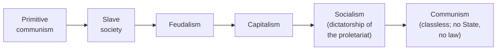
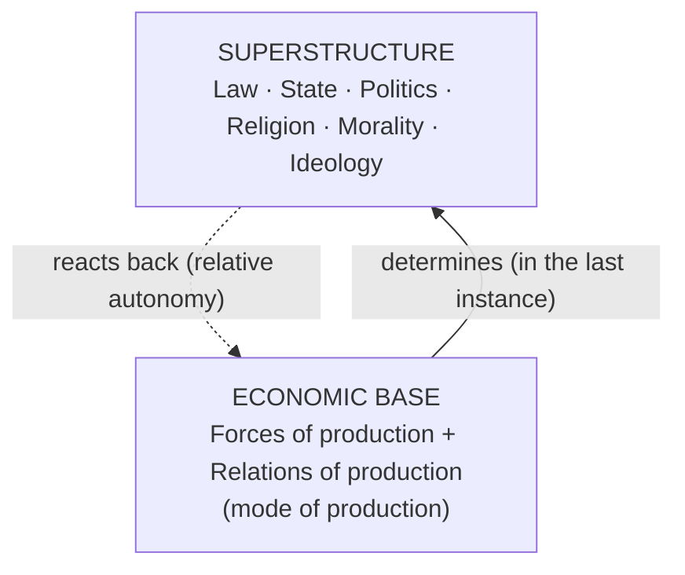

# Paper I · Jurisprudence – I (K-1001) · Unit 7
## Economic Approach to Law: The Marxist Economic Approach

> **Last updated:** 2026-10-28 (IST) · **Law stated as on:** 2026-10-27 · **Branch:** `paper/01-jurisprudence`
> **Verify before exam:** case citations in §8 and recent developments in §10 (checklist at the end).
> **Syllabus line (official):** *Economic Approach of Law: Marxist Economic Approach on Law*

**How this unit has been examined (December 2022–2025).** 2 of the 52 previous questions came from this unit:

- Dec 2025 Q1 (4): Write the economic definition of Law given by Karl Marx. → [A-101](question-bank/section-a-part-4-units-6-7.md#a-101)
- Dec 2022 Q11 (20): Write an essay on economic approach to law. → [C-21](question-bank/section-c-part-4-units-6-7-cross.md#c-21)

*Source: the transcribed papers in [`docs/past-papers/paper-1-jurisprudence.md`](../../docs/past-papers/paper-1-jurisprudence.md). Unit assignment is by the main topic of the question. The paragraph that stood here earlier was a guess made before I had the papers. Topic frequency across all units is in the [question-bank README](question-bank/README.md#frequency).*

---

## 1. Background

**Why an economic approach to law arose (19th century)**
1. **Industrial Revolution and capitalism:** factories, urban working class, extreme inequality, child labour, long hours; the law of *free contract* and *absolute property* seemed to protect the strong.
2. **Classical political economy:** Adam Smith (*The Wealth of Nations*, 1776), David Ricardo (labour theory of value).
3. **Utopian socialists:** Saint-Simon, Fourier, Owen.
4. **Hegel's dialectic**, turned by Marx from "idealism" to "materialism" (Marx said he found Hegel standing on his head and set him on his feet).
5. **Revolutions of 1848** and the rise of workers' movements.

**Karl Marx (1818–1883) and Friedrich Engels (1820–1895).** Marx had a legal education and began as a critic of Prussian law (articles on the Rhineland Diet's law on the theft of wood, 1842). **Key works:**

| Work | Year | Why it matters for law |
|---|---|---|
| *On the Jewish Question* | 1843 | Critique of "rights of man" as rights of the egoistic individual of bourgeois society |
| *The German Ideology* (with Engels) | 1845–46 | Statement of historical materialism; law as part of ideology |
| *The Communist Manifesto* (with Engels) | 1848 | "Your jurisprudence is but the will of your class made into a law for all" |
| *A Contribution to the Critique of Political Economy* (Preface) | 1859 | Classic statement of **base and superstructure** |
| *Das Kapital*, Vol. I | 1867 | Analysis of capitalist production, labour contract and exploitation |
| *Critique of the Gotha Programme* | 1875 | "Bourgeois right"; stages of communist society |
| Engels, *Anti-Dühring* | 1878 | The State "withers away" |
| Engels, *The Origin of the Family, Private Property and the State* | 1884 | State and law arose with private property and class division |
| Engels' letters to Bloch and Schmidt | 1890 | **Relative autonomy** of the superstructure |

> **Note:** Marx did not write a systematic "theory of law". Marxist legal theory is **reconstructed** from these writings and later developed by Lenin, Pashukanis, Vyshinsky, Gramsci, Althusser and others.

---

## 2. Core ideas of Marxism relevant to law

### 2.1 Dialectical materialism
- **Dialectic:** change comes through the **conflict of opposites** (thesis → antithesis → synthesis).
- **Materialism:** **material conditions** (how people produce their living), not ideas, drive history.

### 2.2 Historical materialism: the economic interpretation of history
History is the history of changing **modes of production**:

Each stage ends when the **forces of production** (technology, labour) outgrow the **relations of production** (ownership, class relations), producing revolution.

### 2.3 Base and superstructure

- The **economic structure** of society is the real foundation, on which a **legal and political superstructure** rises.
- **Law belongs to the superstructure:** it **reflects and protects** the economic base. Change the base and the law changes.
- **Engels' qualification (1890):** the economy is decisive only **"in the last instance"**; law, politics and ideas have **relative autonomy** and can influence the base.

### 2.4 Class struggle
> *"The history of all hitherto existing society is the history of class struggles."* (*Communist Manifesto*)

Society divides into **classes** by relation to the means of production: in capitalism, the **bourgeoisie** (owners) and the **proletariat** (wage-labourers). Their interests conflict.

### 2.5 Law as an instrument of class domination
1. **Law is the will of the ruling class** made binding on all; its content is determined by the economic conditions of that class (*Manifesto*).
2. The **State** is the machinery of the ruling class: the executive of the modern State is a committee for managing the common affairs of the bourgeoisie (*Manifesto*).
3. **Property law, contract law, criminal law and procedure** protect the owners: property and capitalist exchange appear as "natural rights".
4. **Formal equality hides substantive inequality:** a worker is "free" to contract but must sell labour to live; "equality before the law" benefits those who can afford to use it.
5. **Law as ideology:** law presents class rule as neutral, universal justice, making exploitation appear legitimate and so securing consent.
6. **Critique of rights** (*On the Jewish Question*): "rights of man" are the rights of the **egoistic member of civil society**, separated from community.

### 2.6 Law in the transition and its withering away
1. **Capitalism → socialism:** the workers seize power; a **dictatorship of the proletariat** uses law and the State against the old ruling class (a transitional "bourgeois right" remains: equal standard applied to unequal people).
2. **Higher communism:** with abundance and **no classes**, there is no need for coercion; **the State withers away** (Engels) and with it **law**, replaced by administration of things and voluntary cooperation. The principle becomes: *from each according to ability, to each according to needs* (*Critique of the Gotha Programme*).

---

## 3. Later Marxist developments

| Thinker | Contribution |
|---|---|
| **Lenin** (*The State and Revolution*, 1917) | State = machine of class oppression; must be "smashed" and replaced by a proletarian State, which then withers away. |
| **Evgeny Pashukanis** (*The General Theory of Law and Marxism*, 1924) | **Commodity-exchange theory:** the legal form (equal legal subjects, rights, contract) arises from the exchange of commodities in capitalism; as commodity exchange disappears, **law itself will wither**. Purged and executed in 1937 under Stalin. |
| **Andrey Vyshinsky** | Stalinist doctrine: law is the **will of the ruling class expressed in legislation**; **"socialist legality"** serves the Party-State. |
| **Antonio Gramsci** | **Hegemony:** ruling class rules also by **consent**, shaped through culture and law. |
| **Louis Althusser** | Law as an **Ideological State Apparatus**, with relative autonomy. |
| **E.P. Thompson** (*Whigs and Hunters*, 1975) | Law is not only class instrument; **rule of law is "an unqualified human good"**: it restrains rulers too. |
| **Critical Legal Studies** | Law is indeterminate and political; heirs of Marxist and realist critiques. |

---

## 4. Economic approach beyond Marx: law and economics (short comparison)

| Basis | Marxist approach | Law and economics (Chicago school) |
|---|---|---|
| **Key thinkers** | Marx, Engels, Lenin, Pashukanis | Coase, Calabresi, Posner |
| **Main question** | Whose class interest does law serve? | Does law promote **efficiency**? |
| **Law's role** | Instrument of class domination (ideology) | Instrument for allocating resources efficiently |
| **View of capitalism** | To be overthrown | Taken as the framework; markets are efficient allocators |
| **Key ideas** | Base/superstructure; class struggle; withering away | **Coase theorem** (with zero transaction costs, bargaining gives an efficient outcome whatever the initial legal rule); cost-benefit; **Hand formula** (negligence if burden B < probability P × loss L, from *United States v. Carroll Towing Co.*, 159 F.2d 169 (2d Cir. 1947)); wealth maximisation |
| **Main works** | *Manifesto*, *Capital* | Coase, "The Problem of Social Cost" (1960); Calabresi, *The Costs of Accidents* (1970); Posner, *Economic Analysis of Law* (1973) |
| **Criticism** | Determinism; failed predictions | Ignores distributive justice and values; assumes rational actors |

---

## 5. Criticism of the Marxist theory of law

1. **Economic determinism / reductionism.** Law is shaped by religion, culture, politics and morality, not by the economy alone; and law also **shapes** the economy (property, contract, company law).
2. **Law is not only a class tool.** Labour laws, factory laws, welfare and consumer legislation protect the weak; the **rule of law** restrains rulers (Thompson).
3. **Failed prediction.** The State and law did **not** wither away in socialist states; they expanded, and **"socialist legality"** often served the Party.
4. **Ignores universal functions of law:** criminal law, family law, procedure, and dispute settlement exist in all societies and serve common needs.
5. **Class is not the only source of conflict:** gender, caste, race and religion matter (important in India).
6. **Stages of history are not universal** and the scheme is Eurocentric.
7. **Underestimates the autonomy of legal reasoning and institutions.**
8. **Unfalsifiable:** "the will of the ruling class" can explain any law.
9. **Rights have value:** dismissing rights as "bourgeois" overlooks that they protect individuals against the State (including socialist States).

**Merits (for balance).**
- Exposes **economic inequality** behind **formal legal equality**.
- Shows the link between **law and power**.
- Helped shape **labour and welfare legislation**, **sociology of law** and **Critical Legal Studies**.
- Explains the **ideological role** of law.
- Influenced **socialist and welfare constitutions**, including India's **Directive Principles**.

---

## 6. The Marxist approach and India

- **Preamble:** "socialist" (added by the **42nd Amendment, 1976**) and the ideal of "**social, economic and political justice**".
- **Directive Principles:** Art. 38(2) (reduce inequalities); Art. 39(b)–(c) (common good; prevention of concentration of wealth); Art. 39(d) (equal pay for equal work); Arts. 41, 43, 43A (work, living wage, workers' participation).
- **Land and property reform:** abolition of **zamindari** (First Amendment, 1951; Ninth Schedule); ceiling laws; **bank nationalisation** (1969), **privy purses** abolition (1971); **44th Amendment (1978)** removing property from fundamental rights (Art. 300A).
- **Labour law:** historically the Minimum Wages Act 1948 and the Industrial Disputes Act 1947, which have now been **replaced** by the Code on Wages, 2019 and the Industrial Relations Code, 2020 (full effect from **21 November 2025**; see §10). The Bonded Labour System (Abolition) Act, 1976 continues.
- **Indian "socialism" is not Marxist.** India follows a **mixed economy and welfare-State** model: the Supreme Court has said socialism in India means economic and social justice and **does not restrict private enterprise** (*Dr. Balram Singh v. Union of India*, 25 November 2024).

---

## 7. How the Indian Supreme Court has used the economic approach

- **Directive Principles read into fundamental rights** to promote economic justice (*Randhir Singh*, *D.S. Nakara*).
- **Property:** *R.C. Cooper* (bank nationalisation), *Kesavananda*, *Minerva Mills* (balance of Parts III and IV is basic structure), *Ranganatha Reddy* and *Sanjeev Coke* (wide reading of Art. 39(b)–(c)), and the narrower reading adopted in *Property Owners Association* (2024).
- **Workers:** *PUDR* (Asiad), *Bandhua Mukti Morcha*.
- **Economic liberalisation:** *Delhi Science Forum* and *BALCO* (the Court upheld privatisation and disinvestment as policy; "socialism" is not rigid).

---

## 8. Case law

| Case | Citation | Principle | Link to the economic approach |
|---|---|---|---|
| **R.C. Cooper v. Union of India (Bank Nationalisation)** | (1970) 1 SCC 248 | Bank nationalisation law invalid for compensation defect (later overcome by amendment) | Property v. state economic policy |
| **Kesavananda Bharati v. State of Kerala** | (1973) 4 SCC 225 | Parliament can amend property rights but not basic structure | Limit on economic restructuring |
| **State of Karnataka v. Ranganatha Reddy** | (1977) 4 SCC 471 | Art. 39(b): Krishna Iyer J.'s wide view that "material resources of the community" include private resources | Social function of property |
| **Minerva Mills v. Union of India** | (1980) 3 SCC 625 | Harmony of Fundamental Rights and Directive Principles is basic structure; Art. 31C's extension struck down | Economic justice v. individual rights |
| **Randhir Singh v. Union of India** | (1982) 1 SCC 618 | "Equal pay for equal work" read into Arts. 14, 16 with Art. 39(d) | Directive Principles as workers' rights |
| **PUDR v. Union of India (Asiad Workers)** | (1982) 3 SCC 235 | Non-payment of minimum wage = forced labour (Art. 23) | Exploitation of labour |
| **Sanjeev Coke Mfg. Co. v. Bharat Coking Coal Ltd.** | (1983) 1 SCC 147 | Art. 39(b)–(c) liberally interpreted; coal-mine nationalisation law upheld under Art. 31C as it survived *Minerva Mills* | Socialist reading of the Constitution |
| **D.S. Nakara v. Union of India** | (1983) 1 SCC 305 | Pension classification struck down; socialist, welfare State goals | "Socialist" Preamble in action |
| **Bandhua Mukti Morcha v. Union of India** | (1984) 3 SCC 161 | Bonded labour; State must enforce | Class exploitation |
| **Delhi Science Forum v. Union of India** | (1996) 2 SCC 405 | Telecom liberalisation upheld; socialism is not rigid | Mixed economy |
| **BALCO Employees' Union v. Union of India** | (2002) 2 SCC 333 | Disinvestment is policy; courts will not interfere | Limits of judicial economics |
| **Property Owners Association v. State of Maharashtra** | Nine-judge bench, 5 Nov 2024 | Private resources can, but do not automatically, count as "material resources of the community" (Art. 39(b)) | Modern limit on the redistributive reading |
| **Dr. Balram Singh v. Union of India** | Decided 25 Nov 2024 (CJI Khanna and Sanjay Kumar J.) | "Socialist" (and "secular") in Preamble upheld; socialism = economic and social justice, no bar to private enterprise | Indian, non-Marxist socialism |

---

## 9. Comparison: Marxist approach v. Natural, Analytical and Sociological schools

| Basis | Natural law | Analytical | Sociological | **Marxist** |
|---|---|---|---|---|
| **Law is** | Higher moral order | Command / rule | Social control through interests | **Instrument of class power, shaped by economic base** |
| **Source** | Reason, God | Sovereign | Society | **Economic base / ruling class** |
| **Law and morals** | United | Separate | Linked via social ends | Morality also class-determined |
| **Future of law** | Permanent | Permanent | Permanent, reforming | **Will wither away in communism** |
| **Method** | Reason | Analysis | Social facts | **Dialectical and historical materialism** |

---

## 10. Current relevance and recent developments

- **New Labour Codes (in force).** The four Labour Codes (Code on Wages, 2019; Industrial Relations Code, 2020; Code on Social Security, 2020; Occupational Safety, Health and Working Conditions Code, 2020) **came into full force on 21 November 2025**, consolidating **29** central labour laws. They are central to debates on **labour rights v. flexibility**, i.e. the Marxist question of whose interests labour law serves. *(Some provisions of the Wages and Social Security Codes had earlier dates; confirm the current rules and state-level notifications.)*
- **The Preamble's "socialist".** *Dr. Balram Singh* (25 Nov 2024) held that Parliament's power to amend extends to the Preamble and that Indian socialism means welfare and economic justice without restraint on private enterprise.
- **Article 39(b) and private property.** *Property Owners Association* (5 Nov 2024) is the modern authority on the redistributive reading of the Constitution.
- **Inequality, platform and gig work:** debates on whether platform workers are "employees" revive the Marxist concern with **formal freedom of contract v. real bargaining power** (the Code on Social Security, 2020 recognises gig and platform workers).
- **Caution for the exam:** do not call the Indian Constitution "Marxist". It is a **liberal-democratic, welfare-oriented** constitution that borrows some socialist ideas. Cite the date and bench for the 2024 decisions, and verify citations.

---

## 11. Quick-revision box

- **Marx and Engels:** *Manifesto* (1848), *Critique of Political Economy* (1859), *Capital* (1867), *Gotha Programme* (1875); Engels: *Origin of the Family, Private Property and the State* (1884).
- **Method:** dialectical and **historical materialism**; stages from primitive communism to communism.
- **Base and superstructure:** economic base determines (in the last instance) law, State, politics, ideology; **relative autonomy** (Engels, 1890).
- **Law:** will of the ruling class; instrument of class domination; ideology of formal equality; property and contract protect owners.
- **Future:** dictatorship of the proletariat → **State and law wither away** in classless communism; "from each according to ability, to each according to need".
- **Later:** Lenin; **Pashukanis (commodity-exchange form)**; Vyshinsky; Gramsci (hegemony); Althusser; Thompson (rule of law "unqualified human good").
- **Criticism:** determinism; law not only class tool; failed withering away; ignores caste/gender; unfalsifiable.
- **India:** Preamble "socialist"; Arts. 38, 39, 41, 43; *Minerva Mills*; *Sanjeev Coke*; *Balram Singh* (2024); Labour Codes (21 Nov 2025).

**Examiner keywords:** dialectical materialism, historical materialism, mode of production, forces and relations of production, base, superstructure, class struggle, bourgeoisie, proletariat, ideology, dictatorship of the proletariat, withering away, relative autonomy, commodity-exchange theory.

---

## 12. Question bank (model answers)

> **The model answers for this unit are in the [`question-bank/`](question-bank/README.md) folder**, written for the real CCSU pattern (confirmed on all 20 papers, Dec 2022–2025): Section A, 4 marks, ≤ 75 words; Section B, 10 marks, ≤ 200 words; Section C, 20 marks, "in detail". The three-tier outlines (10–15, 5 and 2 marks) that stood here earlier were guesses made before I had the papers, and have been removed. Every rubric in the bank is my own; the university publishes no marking scheme. Thinkers and cases: [`jurists-and-cases-digest.md`](question-bank/jurists-and-cases-digest.md) (cases for this unit: 44–50). Mock papers: [1](question-bank/mock-exam-1.md), [2](question-bank/mock-exam-2.md), [3](question-bank/mock-exam-3.md).

**Section C (20 marks)**

- [C-21](question-bank/section-c-part-4-units-6-7-cross.md#c-21) The Marxist approach to law: base and superstructure, class struggle, law as the will of the ruling class, and the withering away of law *(set Dec 2022 Q11)*
- [C-22](question-bank/section-c-part-4-units-6-7-cross.md#c-22) The economic approach to law beyond Marx: law and economics, with a critical assessment of both approaches *(set Dec 2022 Q11)*

**Section B (10 marks)**

- [B-44](question-bank/section-b-part-4-units-6-7.md#b-44) Marx's economic approach to law: base and superstructure
- [B-45](question-bank/section-b-part-4-units-6-7.md#b-45) Law as an instrument of class rule and its withering away (Marxist view)
- [B-46](question-bank/section-b-part-4-units-6-7.md#b-46) Criticism of the Marxist theory of law
- [B-47](question-bank/section-b-part-4-units-6-7.md#b-47) Law and economics: Coase, Calabresi and Posner
- [B-48](question-bank/section-b-part-4-units-6-7.md#b-48) Lenin and Pashukanis: the later Marxist theory of State and law

**Section A (4 marks), 10 answers**

- [A-101](question-bank/section-a-part-4-units-6-7.md#a-101) Marx's economic definition of law *(set Dec 2025 Q1)*
- [A-102](question-bank/section-a-part-4-units-6-7.md#a-102) Base and superstructure
- [A-103](question-bank/section-a-part-4-units-6-7.md#a-103) Law as an instrument of class rule
- [A-104](question-bank/section-a-part-4-units-6-7.md#a-104) Withering away of the State and law
- [A-105](question-bank/section-a-part-4-units-6-7.md#a-105) Engels' contribution
- [A-106](question-bank/section-a-part-4-units-6-7.md#a-106) Lenin on the State
- [A-107](question-bank/section-a-part-4-units-6-7.md#a-107) Pashukanis
- [A-108](question-bank/section-a-part-4-units-6-7.md#a-108) Criticism of the Marxist theory of law
- [A-109](question-bank/section-a-part-4-units-6-7.md#a-109) Law and economics: Posner
- [A-110](question-bank/section-a-part-4-units-6-7.md#a-110) Coase theorem

**Across all units:** [C-23](question-bank/section-c-part-4-units-6-7-cross.md#c-23) Compare the main schools of jurisprudence: natural law, analytical, historical, sociological, realist and Marxist; [C-24](question-bank/section-c-part-4-units-6-7-cross.md#c-24) Law and morality: their relation in natural law, positivism and modern debates, with Indian illustrations

---

## 13. Verification checklist (do before the exam)

- [ ] Quotations from the *Manifesto* (class struggle; "will of your class"; executive of the bourgeoisie) against your textbook
- [ ] *R.C. Cooper* (1970) 1 SCC 248 · *Ranganatha Reddy* (1977) 4 SCC 471 · *Minerva Mills* (1980) 3 SCC 625 · *Randhir Singh* (1982) 1 SCC 618
- [ ] *Sanjeev Coke* (1983) 1 SCC 147 · *D.S. Nakara* (1983) 1 SCC 305 · *Delhi Science Forum* (1996) 2 SCC 405 · *BALCO* (2002) 2 SCC 333
- [ ] *Property Owners Association* (W.P.(C) 934/1992, 5 Nov 2024): obtain the SCC citation; reported as an 8:1 majority on the main question with Dhulia J. dissenting, so check the split on each issue
- [ ] *Dr. Balram Singh* (25 Nov 2024): obtain the SCC citation
- [ ] Labour Codes: confirm current rules and state notifications (full effect 21 Nov 2025)
- [ ] *United States v. Carroll Towing Co.*, 159 F.2d 169 (2d Cir. 1947) · Coase (1960) · Calabresi (1970) · Posner (1973)
