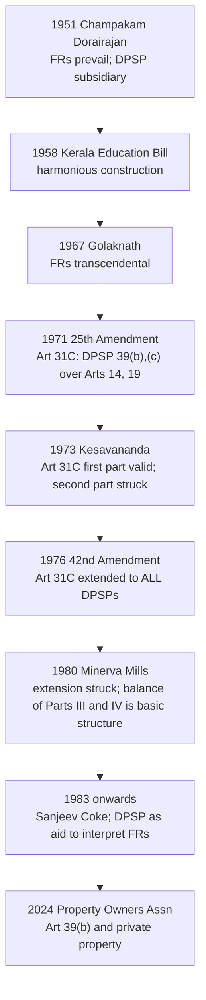

# Paper II · Constitutional Law of India – I (K-1002) · Unit 13
## Directive Principles of State Policy — Importance and Relationship with Fundamental Rights

> **Last updated:** 2026-10-28 (IST) · **Law stated as on:** 2026-10-28 · **Branch:** `paper/02-constitutional-law`
> **Verify before exam:** the State UCC laws (Gujarat and Assam passed in 2026; assent/commencement not verified), *Property Owners Association* (Nov 2024) citation, and citations marked *verify* (checklist at the end).
> **Syllabus line (official):** *Directive Principles of State Policy: importance and relationship with Fundamental Rights*

**How this unit is examined.** Typical questions: (a) "Discuss the relationship between Fundamental Rights and Directive Principles" (long, **the most frequent**); (b) "What is the importance of DPSPs? Are they justiciable?" (long); (c) "Classify the DPSPs" (short or long); (d) "Uniform Civil Code: Art. 44" (short or long); (e) short notes on *Art. 31C*, *Minerva Mills*, *Art. 39(b) and (c)*, *equal pay for equal work*, *Art. 39A*, *Art. 48*, *Art. 51*. **Structure: meaning and source → classification → nature (Art. 37) → relationship with FRs in chronological order (*Champakam* → *Kesavananda* → *Minerva Mills*) → implementation → criticism.**

---

## 1. Background

- **Part IV (Arts. 36–51).** Directives are instructions to the **State** (Art. 12 definition applies, Art. 36) to guide legislation and administration.
- **Sources:** (i) the **Irish Constitution (1937)**, whose Directive Principles of Social Policy inspired Part IV; (ii) the **Instrument of Instructions** in the Government of India Act, 1935 (directions to the Governor-General and Governors); (iii) the **Objectives Resolution** (1946) and the Karachi Resolution (1931) of the Indian National Congress; (iv) Gandhian ideas (panchayats, prohibition, cottage industries) and socialist ideas of the time.
- **Ambedkar** (CAD, 19 Nov 1948): the Directive Principles are like the Instrument of Instructions; the intention is that "both the legislature and the executive should not merely pay lip service to these principles but … they should be made the basis of all executive and legislative action" *(quote paraphrased from memory; verify before use)*.
- **Philosophy:** to establish a **welfare State** and **social and economic democracy** to complement the **political democracy** secured by Part III.
- **Granville Austin:** the FRs and DPSPs are "the conscience of the Constitution" and together form its "core" (quoted in *Minerva Mills*).

---

## 2. Nature: Article 37

> **Art. 37.** *The provisions contained in this Part shall **not be enforceable by any court**, but the principles therein laid down are nevertheless **fundamental in the governance of the country** and it shall be the **duty of the State to apply these principles in making laws**.*

- **Non-justiciable**, but **not optional**: a law may be challenged under Part III only; but courts use DPSPs to **interpret** Fundamental Rights and statutes and to **uphold** laws as reasonable.
- **Art. 36:** "State" has the same meaning as in Part III.

| Basis | Fundamental Rights (Part III) | DPSPs (Part IV) |
|---|---|---|
| Nature | **Negative** limits on State power (mostly) | **Positive** duties; aims for State action |
| Enforceability | **Justiciable** (Arts. 32, 226) | **Non-justiciable** (Art. 37) |
| Source | US Bill of Rights | Irish Constitution |
| Objective | **Political democracy**, individual liberty | **Social and economic democracy**, welfare State |
| Beneficiary | **Individuals** | **Society** as a whole |
| Legislation required | Self-executing (mostly) | Needs legislation to implement |
| Status | Law is void if it violates FRs (Art. 13) | A law violating DPSP is not void |
| Suspension | Possible (Art. 359) except Arts. 20, 21 | N/A |

---

## 3. Classification and content of DPSPs

*(The three-fold classification is an academic device, not found in the text.)*

| Category | Articles | Content |
|---|---|---|
| **Socialistic** | 38, 39, 39A, 41, 42, 43, 43A, 47 | Social order to promote welfare (38; **38(2)** added by 44th Amendment: minimise inequalities of income, status, facilities); **39** (a) adequate means of livelihood; (b) distribution of material resources to subserve the common good; (c) no concentration of wealth; (d) **equal pay for equal work for men and women**; (e) health and strength of workers and tender age of children not abused; (f) opportunities for children to develop in a healthy manner (substituted by the 42nd Amendment); **39A** equal justice and **free legal aid** (42nd); **41** right to work, education and public assistance; **42** just and humane conditions of work and **maternity relief**; **43** living wage; **43A** participation of workers in management (42nd); **47** nutrition, standard of living, public health, **prohibition of intoxicating drinks** |
| **Gandhian** | 40, 43, 43B, 46, 47, 48 | **40** village panchayats; **43** cottage industries; **43B** co-operative societies (97th Amendment, 2011); **46** educational and economic interests of Scheduled Castes, Scheduled Tribes and weaker sections; **47** prohibition; **48** organisation of agriculture and animal husbandry, **ban on slaughter of cows, calves and other milch and draught cattle** |
| **Liberal-intellectual** | 44, 45, 48, 48A, 49, 50, 51 | **44** **Uniform Civil Code**; **45** early childhood care and education below six (86th Amendment, 2002); **48A** protection of environment, forests and wildlife (42nd); **49** protection of monuments and places of national importance; **50** **separation of judiciary from executive**; **51** promotion of international peace and security |

**Amendments to Part IV:** 42nd (1976): 39(f), 39A, 43A, 48A · 44th (1978): 38(2) · 86th (2002): Art. 45 substituted (with Art. 21A and 51A(k)) · 97th (2011): Art. 43B.

---

## 4. Relationship with Fundamental Rights: the evolution

### 4.1 Stage 1: FRs supreme
- ***State of Madras v. Champakam Dorairajan*** AIR 1951 SC 226: Art. 37 makes DPSP non-enforceable; **the Directive Principles must conform to and run as subsidiary to the chapter on Fundamental Rights**. The communal G.O. was struck down. → The First Amendment inserted Art. 15(4).

### 4.2 Stage 2: harmonious construction
- ***In re Kerala Education Bill, 1957*** AIR 1958 SC 956: the Court should try to **harmonise** both Parts; the Directives may be used to determine the extent of a Fundamental Right.
- ***Golaknath v. State of Punjab*** AIR 1967 SC 1643: FRs are "transcendental"; Parliament cannot take away FRs to implement DPSPs (overruled in *Kesavananda*).
- ***State of Kerala v. N.M. Thomas*** (1976) 2 SCC 310: DPSPs and FRs are **supplementary**; reservation is a facet of equality, supported by Art. 46.
- ***Pathumma v. State of Kerala*** (1978) 2 SCC 1: DPSPs help to interpret the Constitution and laws *(verify)*.

### 4.3 Stage 3: Art. 31C and the basic structure
- **25th Amendment (1971)** inserted **Art. 31C**: laws giving effect to **Art. 39(b) and (c)** cannot be challenged for violating Arts. 14, 19 or 31; the second part barred judicial review where the law contained a declaration.
- ***Kesavananda Bharati v. State of Kerala*** (1973) 4 SCC 225: the first part of Art. 31C upheld; the "no judicial review" part **struck**; both Parts III and IV are **fundamental**, complementary, and the Constitution must be read as an integrated whole.
- **42nd Amendment (1976)**: extended Art. 31C to **all** DPSPs (Part IV), subject to the declaration, giving Part IV primacy over Arts. 14, 19, 31.
- ***Minerva Mills Ltd. v. Union of India*** (1980) 3 SCC 625: **s. 4 of the 42nd Amendment struck down** (extension of Art. 31C to all DPSPs); *"The Indian Constitution is founded on the bedrock of the balance between Parts III and IV. To give absolute primacy to one over the other is to disturb the harmony of the Constitution."* *"Fundamental Rights and Directive Principles are the 'conscience of the Constitution'"* (Chandrachud CJ). The **balance** of Parts III and IV is part of the **basic structure**. Art. 31C survives only to the extent upheld in *Kesavananda* (for Art. 39(b) and (c)) *(wording from memory; verify)*.
- ***Sanjeev Coke Manufacturing Co. v. Bharat Coking Coal Ltd.*** (1983) 1 SCC 147: upheld the Coking Coal Mines (Nationalisation) Act, 1972 under Art. 31C as a law furthering Art. 39(b) and (c).
- ***Waman Rao v. Union of India*** (1981) 2 SCC 362: Art. 31C as amended in 1971 valid; prospective cut-off of 24 April 1973 (Unit 3).

### 4.4 Stage 4: DPSPs as an aid to rights (post-1980)
The Court read DPSPs into Art. 21 and Art. 14 to make them enforceable indirectly:

| DPSP | Fundamental Right | Case |
|---|---|---|
| Art. 39(d) equal pay for equal work | Arts. 14, 16 | ***Randhir Singh v. Union of India*** (1982) 1 SCC 618; *State of Punjab v. Jagjit Singh* (2017) 1 SCC 148 (temporary employees) |
| Art. 39A free legal aid | Art. 21 | *Hussainara Khatoon* (1980); *M.H. Hoskot* (1978); Legal Services Authorities Act, 1987 |
| Arts. 41, 45 education | Art. 21 → Art. 21A | *Mohini Jain* (1992); *Unni Krishnan* (1993) |
| Art. 41, 43 livelihood | Art. 21 | *Olga Tellis* (1985) |
| Art. 47 health | Art. 21 | *Paschim Banga Khet Mazdoor Samity* (1996) |
| Art. 48A environment | Art. 21 | *M.C. Mehta* series; *Subhash Kumar* (1991) |
| Art. 42 maternity benefit | Art. 21 | *Municipal Corporation of Delhi v. Female Workers (Muster Roll)* (2000) 3 SCC 224 *(verify)* |
| Art. 46 weaker sections | Arts. 15(4), 16(4) | *Indra Sawhney* (1992) |

### 4.5 Art. 39(b) and the "material resources of the community"
- ***State of Karnataka v. Ranganatha Reddy*** (1977) 4 SCC 471 (Krishna Iyer J. minority view: private resources are included), followed in ***Sanjeev Coke*** (1983).
- ***Property Owners Association v. State of Maharashtra*** (decided **5 Nov 2024**; nine judges; **7:1:1**; CJI Chandrachud): **not every private resource** is a "material resource of the community" under Art. 39(b); the State may treat private resources as such only on a **case-by-case** basis having regard to the nature, scarcity, impact on the public good and concentration; the observations of Krishna Iyer J. in *Ranganatha Reddy* (and *Sanjeev Coke*) endorsing the wide view were not accepted. *(Citation: verify. The underlying challenge to Chapter VIII-A of the Maharashtra Housing and Area Development Act, 1976 was, as I understand it, sent back to a regular bench; verify.)*

---

## 5. Implementation: DPSPs in action

| Directive | Implementing law / measure |
|---|---|
| Art. 40 village panchayats | **73rd and 74th Amendments** (1992): Parts IX and IXA |
| Art. 39(d) equal pay | Equal Remuneration Act, 1976 → **Code on Wages, 2019** |
| Art. 39A legal aid | **Legal Services Authorities Act, 1987**; NALSA |
| Art. 41 right to work | **MGNREGA, 2005** |
| Art. 42 maternity relief | **Maternity Benefit Act, 1961** (amended 2017: 26 weeks) |
| Art. 43 living wage | Minimum Wages Act → Code on Wages |
| Art. 43B co-operatives | 97th Amendment (2011) (Art. 19(1)(c), Part IXB; parts of the Amendment were struck by the Supreme Court in *Union of India v. Rajendra N. Shah*, (2021) 6 SCC 667, relating to State co-operative societies *(verify)*) |
| Art. 45 early childhood; Art. 21A | RTE Act, 2009; NEP 2020 foundational stage |
| Art. 46 weaker sections | Reservation laws; SC/ST (Prevention of Atrocities) Act, 1989 |
| Art. 47 nutrition and health | **National Food Security Act, 2013**; prohibition laws in some States |
| Art. 48 cattle | State anti-cow-slaughter laws; *Hanif Quareshi* (1958); *State of Gujarat v. Mirzapur Moti Kureshi Kassab Jamat* (2005) 8 SCC 534 (seven judges: a total ban on slaughter of cows and progeny is valid) |
| Art. 48A environment | Wildlife (Protection) Act, 1972; Environment (Protection) Act, 1986; Forest Conservation Act; Art. 51A(g) |
| Art. 49 monuments | Ancient Monuments and Archaeological Sites and Remains Act, 1958 |
| Art. 50 separation of judiciary | Criminal Procedure Code, 1973 separated the Judicial Magistracy from the Executive |
| Art. 51 international peace | Foreign policy; Art. 253; Protection of Human Rights Act, 1993 |

---

## 6. Uniform Civil Code (Art. 44)

> **Art. 44.** *The State shall endeavour to secure for the citizens a **uniform civil code** throughout the territory of India.*

- **Constituent Assembly:** strong debate; Muslim members opposed compulsion; Ambedkar said it was desirable but could be introduced gradually; placed as a Directive.
- **Cases:**
  - ***Mohd. Ahmed Khan v. Shah Bano Begum*** (1985) 2 SCC 556: maintenance for a divorced Muslim wife under CrPC s. 125; the Court regretted that Art. 44 remained a dead letter. Parliament responded with the **Muslim Women (Protection of Rights on Divorce) Act, 1986**.
  - ***Sarla Mudgal v. Union of India*** (1995) 3 SCC 635: conversion to Islam to contract a second marriage does not dissolve the first; Court urged a UCC.
  - ***John Vallamattom v. Union of India*** (2003) 6 SCC 611: s. 118 of the Indian Succession Act (restriction on bequests to religious trusts by Christians) struck down; again urged a UCC.
  - ***Jose Paulo Coutinho v. Maria Luiza Valentina Pereira*** (2019) 20 SCC 85: praised the **Goa Civil Code** as an example of a uniform code *(verify)*.
  - ***Shayara Bano*** (2017) (Unit 10).
- **Law Commission:** the 21st Law Commission (Aug 2018 consultation paper) said a UCC is "neither necessary nor desirable at this stage"; the 22nd Law Commission invited public views in June 2023.
- **State laws:** **Uttarakhand** Uniform Civil Code Act, 2024 (assent March 2024; brought into force on **27 January 2025**); **Gujarat** Uniform Civil Code Bill, 2026 (passed by the Assembly on **24 March 2026**); **Assam** Uniform Civil Code Bill, 2026 (passed by the Assembly in **late May 2026**). Reported features include monogamy, registration of marriages, registration of live-in relationships, and exemption for Scheduled Tribes. *(Assent and commencement of the Gujarat and Assam laws not verified; check before writing.)*
- **Arguments for:** national integration, gender justice, one law for all. **Against:** religious freedom (Art. 25), minority identity, diversity of customs, premature without consensus.

---

## 7. Criticism and importance

### 7.1 Criticism
1. **Non-justiciable:** K.T. Shah's remark that they are "a cheque on a bank payable when the resources of the bank permit" *(attributed; verify)*; T.T. Krishnamachari called Part IV "a veritable dustbin of sentiments" *(attributed; verify)*; K.C. Wheare: "manifesto of aims and aspirations".
2. **Illogical arrangement**, lack of priority and some directives (e.g., prohibition, cow protection) are contested.
3. **Conflict with FRs** (Art. 31C controversies).
4. **Resource constraints** and weak political will.

### 7.2 Importance
1. **Guide for legislation and administration:** the State must apply them (Art. 37).
2. **Yardstick** for judging government performance (the manifesto of a welfare State).
3. **Aid to interpretation** of the Constitution and statutes; used to expand Art. 21.
4. **Supplement** to FRs: bring social and economic justice (*Kesavananda*, *Minerva Mills*).
5. **Basis** of many welfare laws (MGNREGA, NFSA, RTE, panchayati raj).
6. **Moral and political pressure** on governments; public opinion.

---

## 8. Current relevance and recent developments

- **UCC:** Uttarakhand law in force since 27 Jan 2025; Gujarat and Assam laws passed in 2026. Challenges based on Arts. 14, 21, 25 and privacy (registration of live-in relationships) are likely; check the pending petitions.
- **Property Owners Association (Nov 2024):** narrowed Art. 39(b) as a basis for State takeover of private resources.
- **Welfare delivery:** MGNREGA and NFSA; Labour Codes (Nov 2025) as partial fulfilment of Arts. 39, 41–43.
- **Caution for the exam:** do not say DPSPs are "enforceable". They are not enforceable by courts, but they are "fundamental in governance" and are applied indirectly through Part III.

---

## 9. Quick-revision box

- **Part IV: Arts. 36–51. Art. 36** (State); **Art. 37** (non-enforceable but fundamental in governance).
- **Classification:** Socialistic (38, 39, 39A, 41–43A, 47) · Gandhian (40, 43, 43B, 46, 47, 48) · Liberal-intellectual (44, 45, 48A, 49, 50, 51).
- **Amendments:** 42nd (39(f), 39A, 43A, 48A) · 44th (38(2)) · 86th (45) · 97th (43B).
- **Relationship:** *Champakam* (1951: FRs prevail) → *Kerala Education Bill* (1958: harmony) → *Golaknath* (1967) → Art. 31C (25th Am.) → *Kesavananda* (1973) → 42nd Am. → ***Minerva Mills* (1980: balance is basic structure)** → *Sanjeev Coke* (1983).
- **Art. 39(b)**: *Property Owners Association* (5 Nov 2024; not all private resources).
- **UCC (Art. 44):** *Shah Bano* (1985) · *Sarla Mudgal* (1995) · *John Vallamattom* (2003) · Goa Code · Uttarakhand Act (in force 27 Jan 2025) · Gujarat and Assam (2026).
- **Art. 48:** *Hanif Quareshi* (1958); *Mirzapur Moti Kureshi* (2005).

**Examiner keywords:** welfare State, non-justiciable, social and economic democracy, harmonious construction, conscience of the Constitution, balance, Art. 31C, basic structure, material resources of the community, uniform civil code.

---

## 10. Question bank (model answers)

*Mark bands indicative; confirm your paper pattern (`docs/01-gaps-and-open-questions.md`, A1).*

### Long answers (10–15 marks)

**Q1. Discuss the relationship between Fundamental Rights and Directive Principles of State Policy. Which prevails?**
**Introduction:** Parts III and IV: two parts of one scheme; the Constitution does not state which prevails.
**Body:** (1) Differences (table §2). (2) *Champakam* (FRs prevail). (3) *Kerala Education Bill*, *N.M. Thomas* (harmony). (4) Art. 31C and *Kesavananda*. (5) 42nd Amendment and *Minerva Mills* (balance is basic structure). (6) *Sanjeev Coke*. (7) DPSPs as an aid to Art. 21 (table §4.4). (8) *Property Owners Association* (2024).
**Conclusion:** the present position is one of balance and harmony: FRs prevail in conflict, but DPSPs guide the interpretation and legislation.

---

**Q2. "Directive Principles are not enforceable but are fundamental in the governance of the country." Discuss their importance.**
*(Use §2 and §7.2; add examples of implementation, §5.)*

---

**Q3. Classify the Directive Principles and explain the main ones.**
*(Use §3 table.)*

---

**Q4. Discuss Art. 44 and the debate on a Uniform Civil Code in India.**
*(Use §6: cases, Law Commission, State laws, arguments.)*

---

**Q5. Discuss the significance of Art. 31C and *Minerva Mills v. Union of India*.**
*(Use §4.3 and the mermaid chart.)*

---

### Short notes (5 marks)

1. **Art. 37.**
2. **Gandhian principles in Part IV.**
3. **Socialistic principles in Part IV.**
4. **Art. 39(b) and (c).**
5. **Equal pay for equal work.**
6. **Art. 39A and free legal aid.**
7. **Art. 40 and panchayati raj.**
8. **Art. 44: Uniform Civil Code.**
9. **Art. 45 and Art. 21A.**
10. **Art. 48 and cow slaughter.**
11. **Art. 50: separation of the judiciary from the executive.**
12. **Art. 51: international peace.**
13. **Minerva Mills (1980).**

### Very short answers (2 marks)

| Question | Answer |
|---|---|
| Which Part contains the DPSPs? | Part IV (Arts. 36–51). |
| From which Constitution were the DPSPs borrowed? | The Irish Constitution (1937). |
| Are DPSPs enforceable by courts? | No (Art. 37). |
| Which Article provides for the Uniform Civil Code? | Art. 44. |
| Which Amendment added Art. 39A? | The 42nd Amendment, 1976. |
| Which Article provides for the separation of the judiciary from the executive? | Art. 50. |
| Who described DPSPs as the "conscience of the Constitution"? | Granville Austin; adopted in *Minerva Mills*. |
| Which case held that harmony between Parts III and IV is a basic feature? | *Minerva Mills v. Union of India* (1980). |
| Which Amendment added Art. 43B? | The 97th Amendment, 2011. |
| Which case enforced "equal pay for equal work" through Arts. 14 and 39(d)? | *Randhir Singh v. Union of India* (1982). |

---

## 11. Verification checklist (do before the exam)

- [ ] *Champakam* AIR 1951 SC 226 · *Kerala Education Bill* AIR 1958 SC 956 · *Golaknath* AIR 1967 SC 1643 · *Kesavananda* (1973) 4 SCC 225 · *N.M. Thomas* (1976) 2 SCC 310 · *Pathumma* (1978) 2 SCC 1
- [ ] *Minerva Mills* (1980) 3 SCC 625 (quotes) · *Waman Rao* (1981) 2 SCC 362 · *Sanjeev Coke* (1983) 1 SCC 147 · *Ranganatha Reddy* (1977) 4 SCC 471
- [ ] **Property Owners Association v. State of Maharashtra (5 Nov 2024)**: citation and the 7:1:1 split
- [ ] *Randhir Singh* (1982) 1 SCC 618 · *Jagjit Singh* (2017) 1 SCC 148 · *MCD v. Female Workers* (2000) 3 SCC 224
- [ ] *Hanif Quareshi* AIR 1958 SC 731 · *Mirzapur Moti Kureshi* (2005) 8 SCC 534
- [ ] *Shah Bano* (1985) 2 SCC 556 · *Sarla Mudgal* (1995) 3 SCC 635 · *John Vallamattom* (2003) 6 SCC 611 · *Jose Paulo Coutinho* (2019) 20 SCC 85
- [ ] Uttarakhand UCC Act, 2024 (in force 27 Jan 2025) · **Gujarat and Assam UCC Bills 2026: assent and commencement** · 21st and 22nd Law Commission positions
- [ ] *Rajendra N. Shah* (2021) 6 SCC 667 (97th Amendment) · MGNREGA, NFSA, Maternity Benefit Act amendments
- [ ] Quotes: Ambedkar (19 Nov 1948); K.T. Shah; T.T. Krishnamachari; K.C. Wheare; Austin
