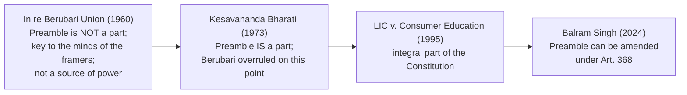

# Paper II · Constitutional Law of India – I (K-1002) · Unit 2
## Preamble of the Constitution

> **Last updated:** 2026-10-28 (IST) · **Law stated as on:** 2026-10-28 · **Branch:** `paper/02-constitutional-law`
> **Verify before exam:** case citations marked *verify*, and the 2024 *Balram Singh* decision (checklist at the end).
> **Syllabus line (official):** *Preamble of the Constitution*

**How this unit is examined.** Typical questions: (a) "Is the Preamble a part of the Constitution? Can it be amended?" (long, very frequent: *Berubari* → *Kesavananda* → *Balram Singh*); (b) "Discuss the ideals/objectives contained in the Preamble" (long); (c) "Explain the words *socialist* and *secular*" (long or short); (d) short notes on *We, the People*, *sovereign*, *republic*, *fraternity and dignity*, *Preamble as aid to interpretation*. **Quote the Preamble's opening and key words** (it is short) and give at least four cases.

---

## 1. Text of the Preamble (as amended)

> **WE, THE PEOPLE OF INDIA,** having solemnly resolved to constitute India into a **SOVEREIGN SOCIALIST SECULAR DEMOCRATIC REPUBLIC** and to secure to all its citizens:
> **JUSTICE,** social, economic and political;
> **LIBERTY** of thought, expression, belief, faith and worship;
> **EQUALITY** of status and of opportunity;
> and to promote among them all
> **FRATERNITY** assuring the dignity of the individual and the unity and integrity of the Nation;
> **IN OUR CONSTITUENT ASSEMBLY** this twenty-sixth day of November, 1949, do **HEREBY ADOPT, ENACT AND GIVE TO OURSELVES THIS CONSTITUTION.**

**The only amendment so far:** the **42nd Amendment Act, 1976** added the words **"Socialist"** and **"Secular"** and changed "unity of the Nation" to **"unity and integrity of the Nation"**.

---

## 2. Background

1. **Objectives Resolution.** Moved by **Jawaharlal Nehru** on **13 December 1946** and adopted on **22 January 1947**. It declared India an "Independent Sovereign Republic" and promised justice, equality and freedom. The Preamble is a refined version of it.
2. **Other influences.** American Preamble ("We the People"); the French ideals of *liberté, égalité, fraternité*; the 1931 Karachi Resolution; Gandhian ideas of *swaraj* and *sarvodaya*; the Irish Constitution (whose Preamble speaks of the dignity and freedom of the individual).
3. **Adopted last.** The Constituent Assembly took up the Preamble **after** the rest of the Constitution (adopted **17 October 1949**), so that it would fit the finished text.
4. **Proposals to add "socialist" and "secular."** **K.T. Shah** moved amendments (November 1948) to describe India as "Secular, Federal, Socialist Union of States". They were **rejected**. Dr. Ambedkar's reply was that the Constitution should not prescribe a particular social organisation, since "what should be the policy of the State… must be decided by the people themselves", and that the Directive Principles already carried the socialist direction. On secularism, the members considered it to be implied in the Fundamental Rights (Arts. 25–28). *(Use as a background point; the 2024 judgment in §6 refers to this history.)*
5. **Constitution Day.** 26 November is observed as *Samvidhan Divas* (declared 2015).

---

## 3. Analysis of the Preamble's words

### 3.1 "We, the People of India"
- **Source of authority:** the Constitution derives its power from the **people**, not from Parliament, the British Parliament or the States. It is the principle of **popular sovereignty**.
- **Criticism:** the Constituent Assembly was **not directly elected** (indirect election by provincial legislatures under the Cabinet Mission Plan, with limited franchise); so the phrase is partly a declaration of principle rather than a literal fact.
- **Judicial approach:** the phrase signals that the Constitution is the "will of the people"; hence it is supreme.

### 3.2 "Sovereign"
- India is **free of external control**; internally, power flows from the Constitution.
- Membership of the Commonwealth (India accepted the British Monarch only as "Head of the Commonwealth") and of the United Nations does not impair sovereignty.
- Sovereignty of the **people** is exercised through institutions limited by the Constitution; Parliament is **not** a sovereign body in the Austinian sense (*Kesavananda*).

### 3.3 "Socialist" (inserted 1976)
- **Meaning:** Indian socialism is **democratic socialism**, a welfare-State approach: reduce inequalities of income and status (Art. 38), prevent concentration of wealth (Art. 39(c)), ensure adequate livelihood and equal pay for equal work (Art. 39(a), (d)).
- **Not Marxist:** it does not require nationalisation of all means of production and is compatible with a mixed economy (see Paper I, Unit 7).
- **Cases:**
  - ***D.S. Nakara v. Union of India*** (1983) 1 SCC 305: the principal aim of a **socialist State** is to eliminate inequality in income, status and standards of life; the Court used the Preamble to strike down arbitrary classification among pensioners.
  - ***Samatha v. State of Andhra Pradesh*** (1997) 8 SCC 191: socialist ideals support the protection of tribal land.
  - ***Dr. Balram Singh v. Union of India*** (decided **25 November 2024**; CJI Sanjiv Khanna and Sanjay Kumar J.): "socialism" in India represents **economic and social justice** and a **welfare State**; it does not restrict private enterprise or the right to carry on business under Art. 19(1)(g).

### 3.4 "Secular" (inserted 1976)
- **Meaning:** the State has **no official religion**, treats all religions **equally** (*sarva dharma sama bhava*), and neither favours nor discriminates on the basis of religion. Unlike the French *laïcité* (strict separation) or the American "wall of separation", Indian secularism allows **State assistance and regulation** to correct social evils.
- **Textual basis even before 1976:** Arts. 14, 15, 16, 25–28.
- **Cases:**
  - ***Kesavananda Bharati*** (1973): secularism is part of the **basic structure**.
  - ***S.R. Bommai v. Union of India*** (1994) 3 SCC 1: secularism is a **basic feature**; the State must maintain neutrality; politics mixed with religion is unconstitutional; a State government acting against secularism can be dismissed under Art. 356.
  - ***Ismail Faruqui v. Union of India*** (1994) 6 SCC 360: Indian secularism is "positive secularism", tolerant of all faiths.
  - ***Aruna Roy v. Union of India*** (2002) 7 SCC 368: teaching of values drawn from all religions is consistent with secularism; religious education versus the study of religions.
  - ***Dr. Balram Singh*** (2024): upheld the word "secular" in the Preamble; observed that secularism is part of the basic structure and that the framers' text already reflected a secular ethos.

### 3.5 "Democratic"
- Government derives authority from the **will of the people**, expressed through **free and fair elections** and **universal adult franchise** (Art. 326).
- **Cases:** ***Indira Nehru Gandhi v. Raj Narain*** (1975) Supp SCC 1 (free and fair elections are basic structure); ***Union of India v. Association for Democratic Reforms*** (2002) 5 SCC 294 and ***PUCL v. Union of India*** (2003) 4 SCC 399 (voters' right to know about candidates under Art. 19(1)(a)); ***Association for Democratic Reforms v. Union of India*** (judgment of **15 February 2024**) (electoral bonds scheme struck down as violating the voter's right to information under Art. 19(1)(a); five-judge bench, unanimous).
- Democracy covers **political equality**, accountability, rule of law, and also **social and economic democracy** (Ambedkar's warning in the Assembly: political equality without social and economic equality would be "a life of contradictions").

### 3.6 "Republic"
- The head of State is **elected, not hereditary** (Arts. 54–55); no one holds a public office by birth. Contrast the British monarchy.

### 3.7 Justice: social, economic and political
- **Social justice:** end discrimination (Arts. 15, 16, 17); **economic justice:** Arts. 38, 39, 41, 43; **political justice:** adult franchise, equal political rights.
- The Court uses it to read Art. 14 and Art. 21 expansively (*Maneka Gandhi*; *Olga Tellis*; *Indra Sawhney*).

### 3.8 Liberty of thought, expression, belief, faith and worship
- Realised by Arts. 19(1)(a), 25–28; **note that the Preamble speaks of liberty, not of unlimited licence**; restrictions are imposed in Art. 19(2) and Art. 25.

### 3.9 Equality of status and of opportunity
- Arts. 14–18. The Preamble speaks of **substantive** equality.

### 3.10 Fraternity assuring the dignity of the individual and the unity and integrity of the Nation
- **Fraternity** bonds people into a single community; Ambedkar treated it as the essential foundation of democracy and warned in his concluding speech (25 Nov 1949) that without fraternity, equality and liberty would be "no deeper than coats of paint". *(Check the exact wording in the Constituent Assembly Debates before quoting.)*
- **Dignity:** the Preamble ties fraternity to "the dignity of the individual". Dignity is a guiding principle of Art. 21 (*Francis Coralie Mullin v. Administrator, Union Territory of Delhi*, (1981) 1 SCC 608: right to live with human dignity), and of *Puttaswamy* (2017) and *Navtej Singh Johar* (2018).
- **"Unity and integrity"** (1976): the 42nd Amendment emphasised territorial integrity; it also underlies the **Fundamental Duty** in Art. 51A(c).

---

## 4. Is the Preamble a part of the Constitution?

| Case | Citation | Holding |
|---|---|---|
| **In re Berubari Union and Exchange of Enclaves** (Reference under Art. 143) | AIR 1960 SC 845 | Preamble is **not** a part of the Constitution. It is a **key to open the minds of the makers**, shows the general purposes, but is **not a source of power** to Parliament or a **limitation** on its powers |
| **Kesavananda Bharati v. State of Kerala** | (1973) 4 SCC 225 | Preamble **is a part** of the Constitution; *Berubari* does not hold the field on this point. The Preamble contains the **basic features**; it may be used to interpret ambiguous provisions and to identify the basic structure; it can be **amended**, but not so as to destroy the basic structure |
| **Indira Nehru Gandhi v. Raj Narain** | (1975) Supp SCC 1 | Democracy and free elections are basic structure |
| **Minerva Mills v. Union of India** | (1980) 3 SCC 625 | Preamble's ideals (balance between rights and directives) considered in the basic structure |
| **LIC of India v. Consumer Education and Research Centre** | (1995) 5 SCC 482 | **Preamble is an integral part of the Constitution**; the Constitution must be read in light of its objectives |
| **S.R. Bommai v. Union of India** | (1994) 3 SCC 1 | Secularism from the Preamble |
| **Dr. Balram Singh v. Union of India** | Decided 25 Nov 2024 | Parliament's amending power under Art. 368 **extends to the Preamble**; the date of adoption (26 Nov 1949) does not limit it; challenge to the 1976 insertion, brought nearly 44 years later, was dismissed |

**Settled position:** the Preamble is part of the Constitution; it is **not enforceable** in itself; it **cannot override** express provisions; it can be **amended** under Art. 368 subject to the basic structure.

### Uses of the Preamble
1. **Aid to interpretation** where words are ambiguous.
2. **Source of the basic structure** (*Kesavananda*).
3. Reveals the **objectives** and the **source** of authority.
4. Cannot **confer** or **limit** express powers (*Berubari*).

---

## 5. Amendability of the Preamble (summary)

- **Before 1973:** the *Berubari* view implied that the Preamble, not being a part, was outside Art. 368. 
- ***Kesavananda*:** because the Preamble is a part, it may be amended, but the **basic features it embodies** cannot be destroyed.
- **1976:** the 42nd Amendment amended it for the first time.
- ***Dr. Balram Singh* (25 Nov 2024):** Writ petitions by Dr. Balram Singh (with Subramanian Swamy and Ashwini Upadhyay) argued that the Preamble, being adopted on 26 Nov 1949, cannot be changed to add words with retrospective effect. The Court **dismissed** them, holding that Parliament's power under Art. 368 covers the Preamble, that the argument of retrospectivity fails, that the insertions were consistent with the Constitution's ethos, and that there was no justification for reopening after about 44 years. *(Read the judgment; the quoted points here are from press reports.)*

---

## 6. Criticism of the Preamble

1. **Not enforceable;** it cannot create rights.
2. **Terms are vague** ("socialist", "secular"), left to the courts.
3. **"We, the People"** is a legal fiction since the Assembly was not directly elected.
4. **42nd Amendment additions** were made during the Emergency, and critics argue they were politically motivated; the Supreme Court's 2024 decision has settled their validity.
5. **No mention of "federal" or "welfare".**
6. **Mixture of ideals** (liberty v. equality; secularism v. religious freedom) may conflict.

**Defence:** the Preamble is a concise statement of the Constitution's philosophy and a living interpretative guide.

---

## 7. Preamble: comparative note

| Constitution | Preamble feature |
|---|---|
| **USA** | "We the People"; "establish Justice, insure domestic Tranquility…": part of the Constitution but not a source of power |
| **Ireland** | Invokes the Holy Trinity; refers to dignity and freedom of the individual |
| **India** | Secular; lists justice, liberty, equality, fraternity; adopted and amended; used for the basic structure |

---

## 8. Current relevance and recent developments

- **Judicial use:** the Preamble remains a standard citation in rights cases (e.g., *Puttaswamy*, *Navtej Singh Johar*) for dignity, liberty and constitutional morality.
- **2024 settlement:** *Balram Singh* confirms Parliament's power to amend the Preamble and the validity of "socialist" and "secular".
- **Civics:** reading the Preamble in schools and on Constitution Day.
- **Caution for the exam:** do not say the Preamble is "not a part of the Constitution" without adding that *Berubari* was overruled on that point by *Kesavananda*.

---

## 9. Quick-revision box

- **Text:** WE, THE PEOPLE… Sovereign, Socialist, Secular, Democratic Republic; Justice, Liberty, Equality, Fraternity; dignity; unity and integrity; adopted 26 Nov 1949.
- **42nd Amendment (1976):** added Socialist, Secular, Integrity. **Only amendment.**
- **Berubari (1960):** not a part. **Kesavananda (1973):** a part; amendable subject to basic structure. **LIC (1995):** integral part. **Balram Singh (2024):** amendable; 1976 words valid.
- **Secularism:** *Bommai*; positive secularism; basic structure. **Socialism:** *Nakara*; *Balram Singh* (welfare, not anti-private enterprise).
- **Origins:** Objectives Resolution 13 Dec 1946 (adopted 22 Jan 1947); Preamble adopted last (17 Oct 1949).
- **Uses:** interpretation aid; basic structure; not a source of power; not enforceable.

**Examiner keywords:** key to the minds of the framers, popular sovereignty, democratic socialism, positive secularism, basic structure, Objectives Resolution, justice (social, economic, political), fraternity, dignity.

---

## 10. Question bank (model answers)

*Mark bands indicative; confirm your paper pattern (`docs/01-gaps-and-open-questions.md`, A1).*

### Long answers (10–15 marks)

**Q1. Is the Preamble a part of the Constitution? Can it be amended? Discuss with the help of decided cases.**
**Introduction:** The Preamble states the Constitution's source, objectives and character.
**Body:** (1) *Berubari* (1960): not a part; key to the framers' minds. (2) *Kesavananda* (1973): part; Preamble reveals basic structure; amendable subject to basic structure. (3) *LIC v. CERC* (1995): integral part. (4) 42nd Amendment (1976): only amendment. (5) *Balram Singh* (2024): Art. 368 reaches the Preamble.
**Role:** aid to interpretation; not a source of power; not enforceable.
**Conclusion:** the Preamble is part of the Constitution and can be amended consistent with its basic features.

---

**Q2. Discuss the ideals and objectives embodied in the Preamble.**
*(Use §3: source (We, the People), nature of State (sovereign, socialist, secular, democratic, republic), objectives (justice, liberty, equality, fraternity). Link each to articles: Justice → Arts. 14–18, 38–39; Liberty → 19, 25; Equality → 14–16; Fraternity → 51A.)*

---

**Q3. Explain the terms "socialist" and "secular" in the Preamble. Were they validly inserted?**
*(Use §3.3, §3.4, §5. Cases: *Nakara*, *Bommai*, *Balram Singh*. Conclude with the Indian meaning: welfare and equal respect for all religions.)*

---

**Q4. Discuss the role of the Preamble in the interpretation of the Constitution.**
*(Use §4 "Uses" with cases: *Berubari*, *Kesavananda*, *LIC*, *Bommai*, *Nakara*.)*

---

### Short notes (5 marks)

1. **Objectives Resolution.**
2. **Preamble: "We, the People".**
3. **Sovereign democratic republic.**
4. **Socialism in the Indian Constitution.**
5. **Secularism in the Indian Constitution (*Bommai*).**
6. **Justice, liberty, equality and fraternity.**
7. **Dignity of the individual.**
8. **42nd Amendment and the Preamble.**
9. **Preamble as an aid to interpretation.**
10. **Balram Singh v. Union of India (2024).**

### Very short answers (2 marks)

| Question | Answer |
|---|---|
| When was the Objectives Resolution moved? | 13 December 1946 (by Nehru). |
| Which Amendment altered the Preamble? | The 42nd Amendment, 1976. |
| Which words were added? | "Socialist", "Secular", and "integrity". |
| Which case held the Preamble is not a part of the Constitution? | *In re Berubari Union* (1960). |
| Which case held it is a part? | *Kesavananda Bharati* (1973). |
| Is the Preamble enforceable in a court? | No; it is not a source of power or a direct right. |
| On what date was the Constitution adopted? | 26 November 1949. |
| Which case upheld the 1976 insertions (2024)? | *Dr. Balram Singh v. Union of India*. |
| Which case held secularism to be basic structure? | *S.R. Bommai* (and *Kesavananda*). |

---

## 11. Verification checklist (do before the exam)

- [ ] *Berubari* AIR 1960 SC 845 · *Kesavananda* (1973) 4 SCC 225 · *LIC v. CERC* (1995) 5 SCC 482 · *Bommai* (1994) 3 SCC 1 · *Ismail Faruqui* (1994) 6 SCC 360 · *Aruna Roy* (2002) 7 SCC 368
- [ ] *Nakara* (1983) 1 SCC 305 · *Samatha* (1997) 8 SCC 191 · *Francis Coralie Mullin* (1981) 1 SCC 608
- [ ] Which judge used the phrase "positive secularism" (I attribute it to *Ismail Faruqui*; some books attribute the idea to *Bommai*)
- [ ] *Balram Singh* (25 Nov 2024): obtain the SCC citation; read the paragraphs on retrospectivity and on the meaning of socialism
- [ ] *ADR* (electoral bonds, 15 Feb 2024): five-judge bench, unanimous (verified from the SC Observer summary); obtain the SCC citation
- [ ] Ambedkar's and K.T. Shah's statements against the Constituent Assembly Debates (16, 17 Oct 1949; 15 Nov 1948)
