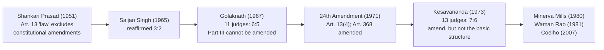

# Paper II · Constitutional Law of India – I (K-1002) · Unit 3
## Fundamental Rights — (a) General: Scheme; Who Can Claim; Against Whom Available; Suspension

> **Last updated:** 2026-10-28 (IST) · **Law stated as on:** 2026-10-28 · **Branch:** `paper/02-constitutional-law`
> **Verify before exam:** case citations marked *verify* (checklist at the end).
> **Syllabus line (official):** *Fundamental Rights: (a) General: Scheme of Fundamental Rights; who can claim Fundamental Rights; against whom they are available; suspension of Fundamental Rights*

**How this unit is examined.** Typical questions: (a) "Define 'State' under Article 12. Are statutory corporations and private bodies included?" (long, the most frequent); (b) "Discuss Article 13 and the doctrines of eclipse, severability and waiver" (long); (c) "Can Fundamental Rights be amended?" (*Shankari Prasad* → *Golaknath* → *Kesavananda*) (long); (d) "Who can claim fundamental rights? Are they available against private persons?" (long or short); (e) "Discuss the suspension of fundamental rights during an Emergency (Arts. 358–359)" (long). Pair each with the right cases.

---

## 1. Background

- **Historical demand for rights:** Magna Carta (1215); English Bill of Rights (1689); American Declaration (1776) and Bill of Rights (1791); French Declaration of the Rights of Man (1789); UDHR (1948).
- **In India:** Constitution of India Bill, 1895 (Home Rule); Annie Besant's Commonwealth of India Bill (1925); **Nehru Report (1928)**; **Karachi Resolution (1931)** (Congress adopted a list of fundamental rights and economic policy); **Sapru Report (1945)**. The Cabinet Mission Plan (1946) required an Advisory Committee on Fundamental Rights.
- **Constituent Assembly machinery:** Advisory Committee on Fundamental Rights, Minorities and Tribal and Excluded Areas under **Sardar Vallabhbhai Patel**, with a Sub-Committee on Fundamental Rights under **J.B. Kripalani**.
- **Significance:** Granville Austin called Parts III and IV together the **"conscience of the Constitution."** Dr. Ambedkar described **Art. 32** as the "heart and soul" of the Constitution.
- **Why they exist:** to protect individuals and minorities against the State; to give effect to the Preamble's liberty, equality and justice; to mark limits on the legislature and executive; to keep democracy meaningful.

---

## 2. Scheme of Part III (Arts. 12–35)

| Group | Articles | Right |
|---|---|---|
| **Definition and supremacy** | 12, 13 | "State"; laws inconsistent with Part III are void |
| **Right to Equality** | 14–18 | Equality before law; non-discrimination; equality of opportunity in public employment; abolition of untouchability; abolition of titles |
| **Right to Freedom** | 19–22 | Six freedoms (19(1)(a)–(g) after the 44th Amendment omitted (f)); protection in respect of conviction (20); life and personal liberty (21); education (21A); arrest and detention (22) |
| **Right against Exploitation** | 23–24 | Traffic in human beings, forced labour; child labour |
| **Right to Freedom of Religion** | 25–28 | |
| **Cultural and Educational Rights** | 29–30 | Minorities |
| **Right to Property** | *(former Arts. 19(1)(f) and 31)* | **Deleted by the 44th Amendment (1978)**; now a constitutional right under **Art. 300A** (Part XII) |
| **Saving of certain laws** | 31A, 31B, 31C | Agrarian reform, Ninth Schedule, Directive Principles |
| **Right to Constitutional Remedies** | 32 | Writs; right to move the Supreme Court |
| **Miscellaneous** | 33, 34, 35 | Armed forces and police; martial law; legislation to give effect to Part III |

**Classification of rights**
- **Negative rights** (restrain the State: Art. 14, 19, 20) and **positive rights** (require State action: Art. 21A, 23).
- **Rights of citizens only:** Arts. 15, 16, 19, 29, 30 (and 15(2) is for "citizens").
- **Rights of citizens and non-citizens ("persons"):** Arts. 14, 20, 21, 21A, 22 (except enemy aliens/preventive detention exceptions), 23, 24, 25–28, 32.
- **Rights against State only:** Arts. 14, 15(1), 16, 19, 20, 21 (generally). **Against private individuals as well:** Arts. 15(2), 17, 23, 24 (and Art. 21 in some contexts: see §5).

**How Fundamental Rights differ from other rights:** they are **justiciable** (directly enforceable by Arts. 32 and 226), **superior** (laws that infringe them are void under Art. 13), **not absolute** (subject to reasonable restrictions), and can be amended only within the basic structure.

---

## 3. Who can claim Fundamental Rights?

### 3.1 Citizens and non-citizens
| Right | Available to |
|---|---|
| Arts. 15, 16, 19, 29, 30 | **Citizens** only |
| Arts. 14, 20, 21, 21A, 22, 23, 24, 25–28 | **All persons** (including foreigners; **Art. 22(3)** excludes enemy aliens from preventive-detention safeguards) |

- ***Anwar v. State of J&K*** (1971) 3 SCC 104: Art. 14 and Art. 21 apply to non-citizens too.
- ***National Human Rights Commission v. State of Arunachal Pradesh*** (1996) 1 SCC 742: Chakma refugees; State must protect their **life and liberty** (Art. 21) though they are not citizens.
- ***Hans Muller of Nuremberg v. Superintendent, Presidency Jail*** AIR 1955 SC 367: the Central Government's power under the Foreigners Act to expel a foreigner was upheld; a foreigner has **no fundamental right to reside or settle** in India (Art. 19(1)(e) belongs to citizens).

### 3.2 Corporations and legal persons
- **Art. 14** is available to corporations (they are "persons").
- **Art. 19** applies only to **citizens**; a company is not a citizen: ***State Trading Corporation v. Commercial Tax Officer*** AIR 1963 SC 1811; ***Tata Engineering and Locomotive Co. v. State of Bihar*** AIR 1965 SC 40.
- ***Bennett Coleman & Co. v. Union of India*** (1972) 2 SCC 788: the Court **lifted the veil**: where a law affects the shareholders' own fundamental rights through the company (the newspaper's freedom of speech), shareholders and the company can seek relief.
- **Government companies / foreign nationals:** Courts look at the substance and permit challenges by citizen shareholders.

### 3.3 Other groups
- **Minorities:** Arts. 29, 30 (the group right belongs to a "section of citizens"; to a "minority based on religion or language").
- **Armed forces, police:** Art. 33 allows Parliament to restrict or abrogate rights of members of the armed forces, police, intelligence bureaus (to ensure discipline).
- **Locus standi:** Aggrieved person traditionally; PIL has widened it to persons acting for the poor or in the public interest (*S.P. Gupta*, 1981).

---

## 4. Against whom are Fundamental Rights available? — "State" under Article 12

**Art. 12:** *"In this Part, unless the context otherwise requires, 'the State' includes the Government and Parliament of India and the Government and the Legislature of each of the States and all local or other authorities within the territory of India or under the control of the Government of India."*

### 4.1 The four categories
1. **Government and Parliament of India** (Union executive and legislature).
2. **Government and Legislature of each State.**
3. **Local authorities**: municipalities, panchayats, improvement trusts, Port Trusts, mining boards (as in the General Clauses Act).
4. **"Other authorities"**: the key phrase, expanded by the courts.

### 4.2 Evolution of "other authorities"

| Case | Citation | Test / holding |
|---|---|---|
| **University of Madras v. Santa Bai** | AIR 1954 Mad 67 | *Ejusdem generis*: authorities exercising governmental or sovereign functions only (narrow view, now not followed) |
| **Rajasthan SEB v. Mohan Lal** | AIR 1967 SC 1857 | "Other authorities" includes all constitutional or statutory authorities with power to make rules and regulations having force of law (Rajasthan Electricity Board held to be State). Rejected the *ejusdem generis* limit |
| **Sukhdev Singh v. Bhagatram Sardar Singh Raghuvanshi** | (1975) 1 SCC 421 | Statutory corporations (ONGC, LIC, Industrial Finance Corporation) are "State"; employees can enforce regulations against them. Mathew J. built the idea of **instrumentality of the State** |
| **R.D. Shetty v. International Airport Authority** | (1979) 3 SCC 489 | **Instrumentality or agency test** (Bhagwati J.): financial resources of the State; deep and pervasive control; functional character as governmental; monopoly status; delegation of governmental functions; transfer of a department |
| **Ajay Hasia v. Khalid Mujib Sehravardi** | (1981) 1 SCC 722 | Applied *R.D. Shetty* to a society registered under the Societies Registration Act (Regional Engineering College, Srinagar). Gave a six-fold test (see below) |
| **Sabhajit Tewary v. Union of India** | (1975) 1 SCC 485 | CSIR (a society) held **not** State: it had no statutory power to make rules |
| **Pradeep Kumar Biswas v. Indian Institute of Chemical Biology** | (2002) 5 SCC 111 | Seven-judge bench **overruled** *Sabhajit Tewary*; test = whether the body is **financially, functionally and administratively dominated by or under the control of the Government** ("deep and pervasive"); CSIR held to be State |
| **Zee Telefilms Ltd. v. Union of India** | (2005) 4 SCC 649 | BCCI (a private body) was **not** State, but its public functions may attract writ jurisdiction under Art. 226 |
| **Rupa Ashok Hurra v. Ashok Hurra** | (2002) 4 SCC 388 | **Judiciary**: a judicial order cannot be challenged under Art. 32 as violating fundamental rights; but a **curative petition** exists |
| **Naresh Shridhar Mirajkar v. State of Maharashtra** | AIR 1967 SC 1 | Judicial orders are not subject to Art. 32 |

**Ajay Hasia test (summary):** (1) entire share capital held by Government; (2) State financial assistance meeting almost all expenditure; (3) monopoly status conferred or protected by the State; (4) deep and pervasive State control; (5) functions of public importance closely related to governmental functions; (6) a department of Government transferred to the corporation. *(Mnemonic: Share, Spend, Monopoly, Control, Function, Department.)*

### 4.3 Judiciary
Whether courts are "State" under Art. 12 has two aspects: (i) **administrative/rule-making** functions are State action; (ii) **judicial orders** are not "law" under Art. 13 nor challengeable as violating fundamental rights (*Mirajkar*); but when a court's order breaches fundamental rights, relief may be sought through appeal, review or **curative petition** (*Rupa Ashok Hurra*). ***A.R. Antulay v. R.S. Nayak*** (1988) 2 SCC 602 shows that the Supreme Court can correct its own order where it violates Arts. 14 and 21.

### 4.4 Private bodies: vertical and horizontal application
- **Vertical operation:** rights are in principle enforceable only against the **State** (Art. 12).
- **Exceptions** (direct horizontal effect): **Art. 15(2)** (access to shops, restaurants, wells), **Art. 17** (untouchability), **Art. 23** (forced labour, traffic in human beings), **Art. 24** (child labour in factories and hazardous employment).
- ***People's Union for Democratic Rights v. Union of India*** (1982) 3 SCC 235: Art. 23 is enforceable against private contractors; the State has a positive duty to ensure it.
- ***Vishaka v. State of Rajasthan*** (1997) 6 SCC 241: guidelines against sexual harassment at work, binding on public and private employers.
- ***Kaushal Kishor v. State of Uttar Pradesh*** (2023, Constitution Bench, decided 3 January 2023; **verify citation, believed (2023) 4 SCC 1**): the Court held (by majority) that **Arts. 19 and 21 can be enforced against persons other than the State**, that the State has a **positive duty** to protect these rights, and that **no additional restrictions beyond Art. 19(2)** can be imposed on free speech. (Nagarathna J. wrote separately.)
- **Writs against private bodies:** Art. 226 allows writs "to any person or authority" for enforcing fundamental rights **and other legal rights** where the body performs a **public function** (***Andi Mukta Sadguru v. V.R. Rudani***, (1989) 2 SCC 691; ***K. Krishnamacharyulu v. Sri Venkateswara Hindu College*** (1997) 3 SCC 571).
- **Statutory enforcement:** for private violations, remedies exist in tort, criminal law and special statutes (e.g., the Protection of Civil Rights Act 1955, Bonded Labour System (Abolition) Act 1976).

---

## 5. Article 13: laws inconsistent with Fundamental Rights

| Clause | Content |
|---|---|
| **13(1)** | All **pre-Constitution laws** inconsistent with Part III are void **to the extent of** the inconsistency |
| **13(2)** | The State shall not make any law that takes away or abridges Part III rights; any such law is void to the extent of contravention |
| **13(3)(a)** | "Law" includes any ordinance, order, bye-law, rule, regulation, notification, **custom or usage** having the force of law |
| **13(3)(b)** | "Laws in force" includes laws passed before the Constitution and not repealed |
| **13(4)** | Nothing in Art. 13 shall apply to any **amendment of the Constitution made under Art. 368** (inserted by the 24th Amendment, 1971) |

### 5.1 Doctrine of eclipse
A law inconsistent with a fundamental right is not dead but **overshadowed**; it is **eclipsed** and its enforceability is only suspended. If the inconsistency is removed (e.g., by constitutional amendment), the law **revives** without re-enactment.
- ***Keshav Madhav Menon v. State of Bombay*** AIR 1951 SC 128: pre-Constitution law remains valid for acts done **before** 26 Jan 1950.
- ***Bhikaji Narain Dhakras v. State of M.P.*** AIR 1955 SC 781: the Motor Vehicles (CP & Berar Amendment) Act, 1947 became **inoperative** after the Constitution (Art. 19(1)(g)) but was revived by the 1951 First Amendment; it was not void ab initio.
- ***Deep Chand v. State of U.P.*** AIR 1959 SC 648: **post-constitutional** laws that contravene Part III are **stillborn** (void ab initio); no eclipse.
- ***Mahendra Lal Jaini v. State of U.P.*** AIR 1963 SC 1019: the Court held that eclipse applies to **post-constitution** laws also, as regards **citizens' rights**; the law is void only to the extent of the conflict, and it can revive after removal of the bar.
- ***State of Gujarat v. Ambica Mills*** (1974) 4 SCC 656: eclipse does not apply to non-citizens (a law violating only citizens' rights remains valid against non-citizens).

### 5.2 Doctrine of severability
Only the **offending part** is void if it can be separated from the rest; if the valid and invalid parts are inseparable, the whole Act falls.
- ***A.K. Gopalan v. State of Madras*** AIR 1950 SC 27 (s. 14 of the Preventive Detention Act void; the rest saved).
- ***R.M.D. Chamarbaugwalla v. Union of India*** AIR 1957 SC 628: tests of separability: (i) whether the legislature would have enacted the valid part without the invalid; (ii) whether the two parts are so mixed up that they cannot be separated; (iii) whether the remainder is a complete code; (iv) whether it alters the legislative intent.
- ***State of Bombay v. F.N. Balsara*** AIR 1951 SC 318: applied to the Bombay Prohibition Act.

### 5.3 Doctrine of waiver
Can a person waive a fundamental right? **No.** Fundamental rights are conferred as a matter of **public policy**, and the duty is on the courts to protect them.
- ***Basheshar Nath v. Commissioner of Income Tax*** AIR 1959 SC 149: the leading case. The assessee's consent to settle before the Taxation Investigation Commission did **not waive** his Art. 14 right; fundamental rights rest on public policy and cannot be waived.
- ***Behram Khurshid Pesikaka v. State of Bombay*** AIR 1955 SC 123 also treats fundamental rights as matters of public policy. Whether *every* right (for example, one of a purely personal nature) is non-waivable has been debated, so for an exam state the general rule from *Basheshar Nath*.
- ***Olga Tellis v. Bombay Municipal Corporation*** (1985) 3 SCC 545: there can be **no estoppel against the Constitution**; pavement dwellers' failure to object did not waive Art. 21.

### 5.4 Prospective overruling
***I.C. Golaknath v. State of Punjab*** AIR 1967 SC 1643: the Court held that its ruling (Parliament cannot amend Part III) applied **prospectively**, leaving earlier amendments valid.

### 5.5 Can Fundamental Rights be amended? (Art. 13 and Art. 368)

| Case | Citation | Holding |
|---|---|---|
| **Shankari Prasad Singh Deo v. Union of India** | AIR 1951 SC 458 | Constitutional amendments are not "law" under Art. 13(2); Parliament can amend Part III |
| **Sajjan Singh v. State of Rajasthan** | AIR 1965 SC 845 | Same view (3:2); two judges (Hidayatullah, Mudholkar JJ.) doubted it |
| **I.C. Golaknath v. State of Punjab** | AIR 1967 SC 1643 | An amendment **is** "law" under Art. 13(2); Parliament cannot take away or abridge FRs; prospective overruling |
| **Kesavananda Bharati v. State of Kerala** | (1973) 4 SCC 225 | Overruled *Golaknath*; Parliament can amend any provision **but not the basic structure** (7:6) |
| **Indira Nehru Gandhi v. Raj Narain** | (1975) Supp SCC 1 | Clause 4 of Art. 329A (39th Amendment) struck down: free and fair elections, rule of law, separation of powers are basic structure |
| **Minerva Mills v. Union of India** | (1980) 3 SCC 625 | Limited amending power is itself a basic feature; the balance of Part III and Part IV is basic structure; ss. 4 and 55 of the 42nd Amendment struck down |
| **Waman Rao v. Union of India** | (1981) 2 SCC 362 | Laws placed in the Ninth Schedule **before 24 April 1973** (the date of *Kesavananda*) are not open to basic-structure challenge; those after are |
| **I.R. Coelho v. State of Tamil Nadu** | (2007) 2 SCC 1 | Nine-judge bench: Ninth Schedule laws placed there **after 24 April 1973** can be challenged for violating Part III rights that form part of the basic structure (Arts. 14, 15, 19, 21 and their "essence") |

### 5.6 Basic structure doctrine (summary)
Features recognised by the Supreme Court include supremacy of the Constitution, republican and democratic form, secularism, separation of powers, federalism, unity and integrity, sovereignty, rule of law, judicial review, free and fair elections, the essence of Fundamental Rights and the balance between Parts III and IV. *(The list is not closed; courts add features case by case.)*

---

## 6. Savings of certain laws: Arts. 31A, 31B, 31C

| Article | Inserted | Content | Key cases |
|---|---|---|---|
| **31A** | First Amendment (1951) | Laws for acquisition of estates, management of properties, amalgamation of corporations, extinguishment of rights of managing agents, etc., cannot be challenged under Arts. 14 and 19 | *Shankari Prasad*; *Waman Rao* |
| **31B** | First Amendment (1951) | The **Ninth Schedule**: laws placed in it are immune from challenge for violating Part III | *Coelho* (2007) |
| **31C** | 25th Amendment (1971) (extended by 42nd) | Laws giving effect to **Directive Principles in Art. 39(b) or (c)** cannot be challenged under Arts. 14, 19, 31 | *Kesavananda* (first part valid; judicial review clause struck down); *Minerva Mills* (42nd Amendment's extension to all Directive Principles struck down); *Sanjeev Coke* (1983) |

---

## 7. Suspension of Fundamental Rights during an Emergency

### 7.1 Constitutional provisions
- **Art. 352:** national Emergency can be declared on the grounds of **war, external aggression or armed rebellion** (since the 44th Amendment; "internal disturbance" was removed).
- **Art. 358:** while a Proclamation of Emergency is in operation **on the grounds of war or external aggression**, the freedoms under **Art. 19 are automatically suspended**; they are not suspended in an "armed rebellion" Emergency (44th Amendment).
- **Art. 359:** the President may by order **suspend the right to move any court** for enforcement of such Part III rights as he specifies. Since the 44th Amendment, **Arts. 20 and 21 cannot be suspended**.
- **Arts. 33, 34, 35:** restrict rights for armed forces; allow Parliament to indemnify acts done during martial law.
- **Art. 19(2)–(6):** reasonable restrictions in normal times.
- **Art. 21** and **Art. 20** are now immune from suspension even during an Emergency.

| | Art. 358 | Art. 359 |
|---|---|---|
| **Effect** | Automatically suspends **Art. 19** | Suspends the **right to move court** for enforcing rights listed in the Presidential order (not the right itself) |
| **Ground** | War or external aggression only | Any Emergency |
| **Rights covered** | Art. 19 only | All except Arts. 20, 21 |
| **Duration** | For the period of Emergency | As stated in the order |
| **Order needed?** | No (automatic) | Yes (Presidential order) |

### 7.2 Cases

| Case | Citation | Holding |
|---|---|---|
| **Makhan Singh Tarsikka v. State of Punjab** | AIR 1964 SC 381 | During the 1962 Emergency the Presidential order under Art. 359 validly suspended the **right to move court** for the specified rights (Arts. 14, 21, 22); the Court held that the bar did not cover challenges on other grounds, such as *mala fides* or action outside the Defence of India Rules |
| **A.D.M. Jabalpur v. Shivkant Shukla** | (1976) 2 SCC 521; AIR 1976 SC 1207 | (4:1, Khanna J. dissenting) During the 1975 Emergency, with Art. 21 suspended, **no writ of habeas corpus** was maintainable; the Court held that Art. 21 was the sole repository of the right to life and liberty |
| **K.S. Puttaswamy v. Union of India** | (2017) 10 SCC 1 | Nine judges **overruled** *ADM Jabalpur* as wrong; life and liberty are **natural rights** that pre-exist the Constitution |

**History:** national Emergencies have been declared **three times**: **1962** (China war), **1971** (Bangladesh war), **1975** (internal disturbance; the longest and most controversial, lifted in March 1977). The 44th Amendment (1978) was enacted to prevent a repeat.

---

## 8. Limitations on Fundamental Rights (summary)

1. **Reasonable restrictions** on the grounds in Art. 19(2)–(6) (public order, morality, security of State etc.), Art. 25 (public order, morality, health).
2. **Art. 33:** armed forces and police.
3. **Art. 34:** martial law.
4. **Arts. 31A–31C and the Ninth Schedule.**
5. **Emergency** (Arts. 358–359).
6. **Amendment** (Art. 368; subject to basic structure).
7. **Judicial review** ensures restrictions meet the tests of proportionality (*Modern Dental College v. State of M.P.*, (2016) 7 SCC 353; *Puttaswamy* (2017); *Anuradha Bhasin v. Union of India*, (2020) 3 SCC 637).

---

## 9. Current relevance and recent developments

- **Horizontal rights:** *Kaushal Kishor* (3 Jan 2023) gave a broad statement on private enforcement of Arts. 19 and 21, a basis for claims against social-media platforms and private employers. *(Verify how later benches have read it.)*
- **Electoral bonds (15 Feb 2024):** a recent example of FRs (Art. 19(1)(a) as voters' right to information) used to strike down legislation: five-judge bench, unanimous.
- **Proportionality** is now the standard test for restrictions on rights (*Modern Dental*, *Puttaswamy*, *Anuradha Bhasin*).
- **Ninth Schedule:** continues to be tested after *Coelho*.
- **Caution for the exam:** do not say Art. 358 suspends Art. 19 in every Emergency. Since 1978 it applies only to Emergencies on grounds of war or external aggression.

---

## 10. Quick-revision box

- **Part III = Arts. 12–35.** Property is now Art. 300A (44th Amendment, 1978).
- **Citizens only:** 15, 16, 19, 29, 30. **Persons:** 14, 20, 21, 21A, 22, 23, 24, 25–28.
- **Art. 12 "State":** Government + Parliament; State Government + Legislature; local authorities; other authorities. Tests: *Mohan Lal* (1967), *Sukhdev Singh* (1975), *R.D. Shetty* (1979), *Ajay Hasia* (1981), *Pradeep Kumar Biswas* (2002).
- **Art. 13:** (1) pre-constitutional, (2) post-constitutional, (3) "law" includes custom, (4) amendments (24th). Doctrines: **eclipse** (*Bhikaji Narain*), **severability** (*RMDC*), **waiver** (*Basheshar Nath*), **prospective overruling** (*Golaknath*).
- **Amendment of FRs:** *Shankari Prasad* (1951) → *Sajjan Singh* (1965) → *Golaknath* (1967) → 24th Amendment → *Kesavananda* (1973: basic structure) → *Minerva Mills* (1980) → *Coelho* (2007).
- **Suspension:** Art. 358 (Art. 19; war/external aggression); Art. 359 (court access; not Arts. 20, 21). *ADM Jabalpur* (1976) overruled by *Puttaswamy* (2017).
- **Horizontal:** Arts. 15(2), 17, 23, 24; *PUDR*; *Vishaka*; *Kaushal Kishor* (2023).

**Examiner keywords:** instrumentality of the State, deep and pervasive control, eclipse, severability, waiver, basic structure, Ninth Schedule, suspension, horizontal application, justiciable.

---

## 11. Question bank (model answers)

> **The model answers for this unit are in the [`question-bank/`](question-bank/README.md) folder**, written for the real CCSU pattern (confirmed on all 20 papers, Dec 2022–2025): Section A, 4 marks, ≤ 75 words; Section B, 10 marks, ≤ 200 words; Section C, 20 marks, "in detail". The marks and word limits earlier shown in this file were guesses and have been removed. Every rubric in the bank is my own; the university publishes no marking scheme. Cases: [`leading-cases-digest.md`](question-bank/leading-cases-digest.md) (this unit: cases 6, 7, 9, 10, 11, 12, 13, 14, 15, 16, 17). Mock papers: [1](question-bank/mock-exam-1.md), [2](question-bank/mock-exam-2.md), [3](question-bank/mock-exam-3.md).

**Section C (20 marks)**

- [C-03](question-bank/section-c-part-1-units-1-5.md#c-03) Against whom Fundamental Rights are enforceable; the remedies available *(topic asked: Dec 2022 Q13; Dec 2025 Q3)*
- [C-04](question-bank/section-c-part-1-units-1-5.md#c-04) Doctrines of eclipse and severability (Article 13) *(topic asked: Dec 2022 Q10)*
- [C-05](question-bank/section-c-part-1-units-1-5.md#c-05) Can Fundamental Rights be amended? The basic structure doctrine *(topic asked: Dec 2022 Q1; Dec 2023 Q1)*
- [C-25](question-bank/section-c-part-4-gap-fill.md#c-25) Suspension of Fundamental Rights during an Emergency

**Section B (10 marks)**

- [B-16](question-bank/section-b-part-1.md#b-16) The meaning of "State" in Article 12 *(topic asked: Dec 2022 Q13; Dec 2025 Q3)*
- [B-17](question-bank/section-b-part-2.md#b-17) Doctrines of eclipse and severability *(topic asked: Dec 2022 Q10)*
- [B-18](question-bank/section-b-part-2.md#b-18) Suspension of Fundamental Rights (Arts. 358 and 359) *(topic asked: Dec 2025 Q5; Dec 2024 Q3)*
- [B-19](question-bank/section-b-part-2.md#b-19) The basic structure doctrine *(topic asked: Dec 2022 Q1; Dec 2023 Q1)*
- [B-20](question-bank/section-b-part-2.md#b-20) Who can claim Fundamental Rights? *(topic asked: Dec 2025 Q3)*
- [B-21](question-bank/section-b-part-2.md#b-21) Scheme of Fundamental Rights (Part III)

**Section A (4 marks), 15 answers**

- [A-03](question-bank/section-a-part-1.md#a-03) Against whom Fundamental Rights are available
- [A-05](question-bank/section-a-part-1.md#a-05) Suspension of Fundamental Rights
- [A-15](question-bank/section-a-part-1.md#a-15) Right to property
- [A-29](question-bank/section-a-part-1.md#a-29) "State" under Article 12
- [A-30](question-bank/section-a-part-1.md#a-30) Doctrine of eclipse
- [A-31](question-bank/section-a-part-1.md#a-31) Doctrine of severability
- [A-32](question-bank/section-a-part-1.md#a-32) Doctrine of waiver
- [A-33](question-bank/section-a-part-1.md#a-33) Basic structure doctrine
- [A-34](question-bank/section-a-part-1.md#a-34) Ninth Schedule (Art. 31B)
- [A-35](question-bank/section-a-part-1.md#a-35) Article 31C
- [A-36](question-bank/section-a-part-1.md#a-36) Article 33
- [A-37](question-bank/section-a-part-1.md#a-37) Who may claim Fundamental Rights
- [A-140](question-bank/section-a-part-4.md#a-140) Article 13: laws inconsistent with Fundamental Rights
- [A-143](question-bank/section-a-part-4.md#a-143) Article 31A: saving of laws on estates and related matters
- [A-151](question-bank/section-a-part-4.md#a-151) Martial law (Art. 34)

---

## 12. Verification checklist (do before the exam)

- [ ] *Mohan Lal* AIR 1967 SC 1857 · *Sukhdev Singh* (1975) 1 SCC 421 · *R.D. Shetty* (1979) 3 SCC 489 · *Ajay Hasia* (1981) 1 SCC 722 · *Sabhajit Tewary* (1975) 1 SCC 485 · *Pradeep Kumar Biswas* (2002) 5 SCC 111 · *Zee Telefilms* (2005) 4 SCC 649
- [ ] *Mirajkar* AIR 1967 SC 1 · *Rupa Ashok Hurra* (2002) 4 SCC 388 · *Antulay* (1988) 2 SCC 602 · *Andi Mukta* (1989) 2 SCC 691 · *Krishnamacharyulu* (1997) 3 SCC 571
- [ ] *Kaushal Kishor* (3 Jan 2023): confirm the SCC citation and the majority/minority split
- [ ] *Bhikaji Narain* AIR 1955 SC 781 · *Deep Chand* AIR 1959 SC 648 · *Mahendra Lal Jaini* AIR 1963 SC 1019 · *Ambica Mills* (1974) 4 SCC 656 · *RMDC* AIR 1957 SC 628 · *Basheshar Nath* AIR 1959 SC 149 · *Behram Khurshid* AIR 1955 SC 123
- [ ] *Shankari Prasad* AIR 1951 SC 458 · *Sajjan Singh* AIR 1965 SC 845 · *Golaknath* AIR 1967 SC 1643 · *Kesavananda* (1973) 4 SCC 225 · *Waman Rao* (1981) 2 SCC 362 · *Coelho* (2007) 2 SCC 1
- [ ] *Makhan Singh* AIR 1964 SC 381 (confirm exactly which grounds of challenge survived the Art. 359 order) · *ADM Jabalpur* (1976) 2 SCC 521 · *Puttaswamy* (2017) 10 SCC 1
- [ ] *Modern Dental College* (2016) 7 SCC 353 · *Anuradha Bhasin* (2020) 3 SCC 637 · *Anwar* (1971) 3 SCC 104 · *NHRC v. Arunachal Pradesh* (1996) 1 SCC 742 · *Hans Muller* AIR 1955 SC 367
- [ ] *State Trading Corp.* AIR 1963 SC 1811 · *Tata Engineering* AIR 1965 SC 40 · *Bennett Coleman* (1972) 2 SCC 788
- [ ] Details of the 44th Amendment's changes to Arts. 352, 358, 359 against the Constitution's text
