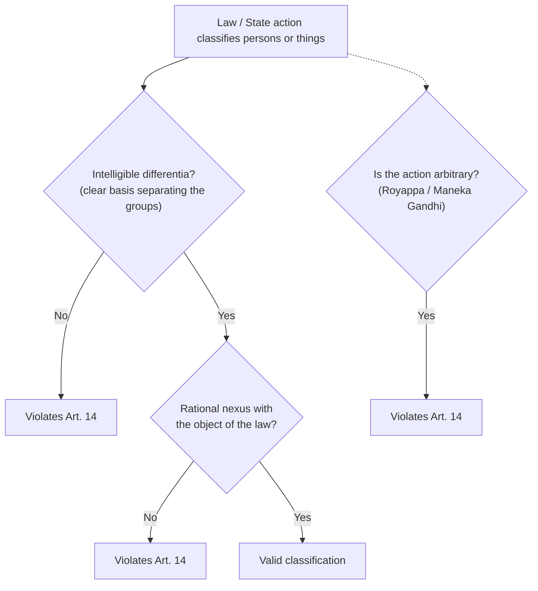

# Paper II · Constitutional Law of India – I (K-1002) · Unit 4
## Right to Equality (Articles 14 to 18) — Part 1: Article 14

> **Last updated:** 2026-10-28 (IST) · **Law stated as on:** 2026-10-28 · **Branch:** `paper/02-constitutional-law`
> **Verify before exam:** citations marked *verify* (checklist at the end).
> **Syllabus line (official):** *Right to Equality (Articles 14 to 18)*. Articles 15–18 are in Unit 5.

**How this unit is examined.** Article 14 is the most examined single Article in this paper. Typical questions: (a) "Discuss the principle of reasonable classification under Art. 14" (long, almost every year); (b) "Arbitrariness as a facet of Art. 14: *Royappa* to *Shayara Bano*" (long); (c) "Equality before law and equal protection of laws: distinguish" (long or short); (d) "Rule of law and its exceptions" (long); (e) short notes on *intelligible differentia*, *rational nexus*, *manifest arbitrariness*, *legitimate expectation*, *equal pay for equal work*, *Art. 361 immunity*. Learn the **classification test in two limbs** and the **arbitrariness line of cases** by heart.

---

## 1. Text and background

> **Art. 14.** *The State shall not deny to any person equality before the law or the equal protection of the laws within the territory of India.*

- **Two phrases, two sources:**
  - **"Equality before the law"**: British origin; **negative** concept: no special privilege to any person; all are subject to the ordinary law and ordinary courts. Roots: Dicey's rule of law.
  - **"Equal protection of the laws"**: American origin (14th Amendment, 1868); **positive** concept: **equal treatment in equal circumstances**, both in privileges conferred and liabilities imposed.
- **Available to "any person"**: citizens, non-citizens, and **artificial persons** (companies, corporations), unlike Arts. 15, 16 and 19.
- **Against the State** (Art. 12), including legislative, executive and administrative action.
- **Why it matters:** Art. 14, Art. 19 and Art. 21 form the **"golden triangle"** (*Maneka Gandhi*, 1978; *Minerva Mills*, 1980).

### 1.1 Dicey's rule of law and the Indian position
**Dicey's three meanings:** (i) **supremacy of regular law** over arbitrary power; (ii) **equality before the law** (every person, whatever rank, subject to ordinary law administered by ordinary courts); (iii) constitution as the result of **ordinary law** (rights come from court decisions).
- **Indian position:** the rule of law is part of the **basic structure** (*Kesavananda*; *Indira Nehru Gandhi v. Raj Narain*, (1975) Supp SCC 1). Unlike Dicey, India accepts **administrative tribunals** (Arts. 323A, 323B; *L. Chandra Kumar v. Union of India*, (1997) 3 SCC 261, which kept High Court review over tribunals), and the Constitution itself is the source of rights.
- ***ADM Jabalpur*** (1976) took a very narrow view of the rule of law (overruled in *Puttaswamy*, 2017).

### 1.2 Exceptions to equality before law
1. **Art. 361:** the **President and Governors** are not answerable to any court for the exercise of official powers; no criminal proceedings during term; **civil proceedings** only after **two months' notice**. The immunity does not shield *mala fide* acts from judicial review (*Rameshwar Prasad v. Union of India*, (2006) 2 SCC 1).
2. **Art. 361A:** protection for reports of legislative proceedings.
3. **Arts. 105, 194:** privileges of Members of Parliament and State Legislatures in respect of speech and votes.
4. **Foreign sovereigns and diplomats** (diplomatic immunity; Diplomatic Relations (Vienna Convention) Act, 1972).
5. **Art. 31C:** laws giving effect to Art. 39(b) and (c) cannot be challenged under Art. 14.
6. **Art. 359:** suspension of the right to move court in an Emergency (not for Arts. 20, 21).

---

## 2. Reasonable classification (the traditional test)

### 2.1 Principle
Art. 14 **does not forbid classification**; it forbids **class legislation**. Aristotle: *treat equals equally and unequals unequally.* A classification is valid only if it passes **two tests**:

> **(i) Intelligible differentia**: the classification must be founded on a differentia that **distinguishes** those grouped together from others left out; **and**
> **(ii) Rational nexus**: that differentia must have a **rational relation to the object** sought to be achieved by the law.

*(Mnemonic: **I-R**: Intelligible differentia, Rational nexus.)*

### 2.2 Principles laid down in *Ram Krishna Dalmia* (a standard list)
***Shri Ram Krishna Dalmia v. Justice S.R. Tendolkar*** AIR 1958 SC 538 (Das C.J.):
1. A law may be constitutional even if it applies to **a single individual** where he is **treated as a class by himself** because of special circumstances.
2. There is a **presumption of constitutionality**; the burden is on the challenger.
3. The legislature understands the needs of its people; the presumption can be rebutted.
4. The legislature may **attack the problem where it is most felt**; it need not address all evils at once.
5. The Court may consider **matters of common knowledge, reports, history** and surrounding circumstances.
6. If nothing appears on the face of the law, the Court may assume that a state of facts justifying the classification existed.
7. The classification need not be **scientifically perfect**; Art. 14 does not require mathematical equality.

### 2.3 Leading cases on classification

| Case | Citation | Holding |
|---|---|---|
| **Chiranjit Lal Chowdhuri v. Union of India** | AIR 1951 SC 41 | Law dealing with one company (Sholapur Spinning & Weaving Co.) valid; a single entity can be a class |
| **State of West Bengal v. Anwar Ali Sarkar** | AIR 1952 SC 75 | West Bengal Special Courts Act, 1950, which allowed the State to refer offences to special courts with a different procedure, held **void**: no guiding principle; classification vague |
| **Kathi Raning Rawat v. State of Saurashtra** | AIR 1952 SC 123 | A similar Saurashtra Act was upheld because its Preamble and context disclosed a policy |
| **Budhan Choudhry v. State of Bihar** | AIR 1955 SC 191 | Classification by age (CrPC) valid; the Court summarised the two-pronged test |
| **Kedar Nath Bajoria v. State of West Bengal** | AIR 1953 SC 404 | Classification justified by the state of affairs; challenger bears burden |
| **State of Kerala v. N.M. Thomas** | (1976) 2 SCC 310 | Reasonable classification for equality in public employment (SC/ST) |
| **Special Courts Bill, In re** | (1979) 1 SCC 380 | Seven-judge Presidential Reference: Special courts for ex-emergency offences valid if the classification is reasonable and has a nexus |
| **D.S. Nakara v. Union of India** | (1983) 1 SCC 305 | Dividing pensioners by the date of retirement into two classes was **arbitrary** and had no rational nexus with the objective of pension; struck down |
| **Subramanian Swamy v. Director, CBI** | (2014) 8 SCC 682 | Section 6A, Delhi Special Police Establishment Act (prior approval for inquiry against senior officers) struck down as **discriminatory**: classification by rank had no nexus with the object of investigating corruption |
| **Indra Sawhney v. Union of India** | 1992 Supp (3) SCC 217 | Reasonable classification and Art. 14 as the foundation for Art. 16 |

---

## 3. The new concept: Art. 14 and arbitrariness

### 3.1 The *Royappa*–*Maneka Gandhi* shift
- ***E.P. Royappa v. State of Tamil Nadu*** (1974) 4 SCC 3 (Bhagwati J.): *"Equality is a dynamic concept with many aspects and dimensions… From a positivistic point of view, equality is antithetic to arbitrariness. In fact equality and arbitrariness are sworn enemies; one belongs to the rule of law in a republic while the other, to the whim and caprice of an absolute monarch."* Any **arbitrary** State action is **unequal**, hence violates Art. 14. (The case concerned the transfer of a Chief Secretary.)
- ***Maneka Gandhi v. Union of India*** (1978) 1 SCC 248: Art. 14 requires that action must be **fair, just and reasonable**, not arbitrary; procedures under Art. 21 must satisfy Arts. 14 and 19. Introduced the **golden triangle**.
- ***Ajay Hasia v. Khalid Mujib*** (1981) 1 SCC 722: Art. 14 strikes at arbitrariness in State action, including in the grant of admission and selection.
- ***R.D. Shetty v. International Airport Authority*** (1979) 3 SCC 489: Government's contractual and licensing power must be exercised **fairly and without discrimination**.

### 3.2 Arbitrariness in contracts, licences and policy
- ***Shrilekha Vidyarthi v. State of U.P.*** (1991) 1 SCC 212: **mass termination of Government counsel** by a change of Government was arbitrary; State action in contract has a **public law** element and is subject to Art. 14.
- ***Mahabir Auto Stores v. Indian Oil Corporation*** (1990) 3 SCC 752: arbitrary termination of dealership struck down. *(verify citation)*
- **Policy decisions**: courts do not interfere unless **arbitrary, irrational or mala fide** (*Netai Bag v. State of West Bengal*, (2000) 8 SCC 262; *verify*).

### 3.3 Can legislation be struck down as "arbitrary"?
- ***State of Andhra Pradesh v. McDowell & Co.*** (1996) 3 SCC 709: **no**; a law cannot be struck down on the ground of arbitrariness alone, only for lack of legislative competence or violation of a fundamental right.
- ***Shayara Bano v. Union of India*** (2017) 9 SCC 1 (Nariman and Lalit JJ.): instant **triple talaq** (*talaq-e-biddat*) was struck down on the ground of **"manifest arbitrariness"**: a law may be struck down under Art. 14 if it is "capricious, irrational and/or without adequate determining principle", or "excessive and disproportionate". The majority view (3:2) on the invalidity of the practice was by Nariman and Lalit JJ. on this ground and by Kurian Joseph J. on the ground that the practice is un-Islamic; Khehar CJ and Nazeer J. dissented. *(Check the exact majority reasoning in the report.)*
- ***Navtej Singh Johar v. Union of India*** (2018) 10 SCC 1: s. 377 IPC, as applied to consensual same-sex relations between adults, held **manifestly arbitrary**, violating Arts. 14, 15, 19, 21.
- ***Joseph Shine v. Union of India*** (2018) 2 SCC 189: s. 497 IPC (adultery) held **arbitrary**: it treated the woman as the husband's property and violated Arts. 14, 15 and 21.
- ***Association for Democratic Reforms v. Union of India*** (15 Feb 2024): the Electoral Bonds Scheme, particularly unlimited corporate donations, was held **manifestly arbitrary** and violative of Art. 19(1)(a) (five-judge bench, unanimous). *(Reported summary; the SC Observer summary does not cite Art. 14 explicitly.)*

---

## 4. Other facets of Art. 14

### 4.1 Natural justice and fairness
Procedural fairness is part of Art. 14 (*A.K. Kraipak v. Union of India*, (1969) 2 SCC 262; *Maneka Gandhi*). *Audi alteram partem* and *nemo judex in causa sua* apply to administrative action.

### 4.2 Legitimate expectation and promissory estoppel
- **Promissory estoppel** against the Government: ***Motilal Padampat Sugar Mills v. State of U.P.*** (1979) 2 SCC 409: the State cannot go back on a promise on which a person has acted to his detriment, unless public interest requires.
- **Legitimate expectation** is a facet of Art. 14: ***Union of India v. Hindustan Development Corporation*** (1993) 3 SCC 499; ***Food Corporation of India v. Kamdhenu Cattle Feed Industries*** (1993) 1 SCC 71. *(verify citations)*

### 4.3 Equal pay for equal work
Not expressly a fundamental right, but derived from Arts. 14, 16 and Art. 39(d): ***Randhir Singh v. Union of India*** (1982) 1 SCC 618; ***State of Punjab v. Jagjit Singh*** (2017) 1 SCC 148 (temporary employees doing the same work as regular employees are entitled to the minimum of the regular pay scale).

### 4.4 No equality in illegality
Art. 14 cannot be invoked to claim **equal treatment in an illegal or wrong act**: ***Chandigarh Administration v. Jagjit Singh*** (1995) 1 SCC 745.

### 4.5 Reverse and "protective" discrimination
Art. 14 permits **special provisions** for disadvantaged groups: Art. 15(3), (4), (5), (6); Art. 16(4), (4A), (6). See Unit 5.

### 4.6 Women and Art. 14
***Anuj Garg v. Hotel Association of India*** (2008) 3 SCC 1; ***Joseph Shine*** (2018); ***Secretary, Ministry of Defence v. Babita Puniya*** (2020) 7 SCC 469 (permanent commission for women officers in the Army). Detailed in Unit 5.

---

## 5. Equality before law v. equal protection of the laws

| Basis | Equality before law | Equal protection of the laws |
|---|---|---|
| Origin | British | American (14th Amendment) |
| Nature | **Negative**: no special privilege | **Positive**: equal treatment in like circumstances |
| Meaning | Same law applies to all; no one above the law | Law must treat like persons alike; classification permitted |
| Aspect | Rule of law | Reasonable classification |
| Example | Art. 361 as a carefully limited exception | Reservation for backward classes |

---

## 6. Criticism and balance

1. **Vagueness of "arbitrariness":** the concept gives judges wide discretion (*McDowell*'s caution; "manifest arbitrariness" in *Shayara Bano* remains debated).
2. **Presumption of constitutionality** can make challenges difficult.
3. **Classification test is flexible** and allows both too much and too little scrutiny; Indian courts have since moved towards a **proportionality** review in rights cases.
4. **Formal v. substantive equality:** Art. 14 alone may preserve existing inequalities; hence Arts. 15(3)–(6), 16(4), 17, 38, 39.
5. **Strengths:** a flexible tool against capricious executive action; the base for the Court's expansion of Arts. 19 and 21.

---

## 7. Current relevance and recent developments

- **Electoral bonds (15 Feb 2024)** shows the arbitrariness doctrine applied to a statutory scheme.
- **Sub-classification (1 Aug 2024):** ***State of Punjab v. Davinder Singh*** (2024 INSC 562, seven judges, 6:1) held sub-classification within SCs permissible under Arts. 14 and 15/16 if backed by quantifiable data (see Unit 5).
- **EWS quota:** *Janhit Abhiyan* (7 Nov 2022, 3:2) held that economic criteria alone are a valid classification and that the 103rd Amendment does not violate the basic structure.
- **Equal treatment in welfare policy:** frequent Art. 14 challenges to State schemes; courts use the "intelligible differentia / rational nexus" test along with arbitrariness.
- **Caution for the exam:** do not describe *McDowell* and *Shayara Bano* as agreeing. The Court has not authoritatively resolved their relationship; say that *Shayara Bano* (2017) is the later view of two judges and that later Constitution Bench decisions applying "manifest arbitrariness" include *Navtej* and *Joseph Shine*.

---

## 8. Quick-revision box

- **Art. 14:** "any person"; equality before law (British, negative) + equal protection (American, positive).
- **Classification test:** **intelligible differentia + rational nexus** (*Anwar Ali Sarkar* 1952; *Dalmia* 1958; *Budhan Choudhry* 1955; *Nakara* 1983).
- **Dalmia principles:** single person may be a class; presumption of constitutionality; burden on challenger; attack the evil where felt; common knowledge.
- **Arbitrariness:** *Royappa* (1974: "equality and arbitrariness are sworn enemies") → *Maneka Gandhi* (1978) → *Ajay Hasia* (1981) → *Shrilekha Vidyarthi* (1991) → *McDowell* (1996: caution) → *Shayara Bano* (2017: manifest arbitrariness) → *Navtej*, *Joseph Shine* (2018) → electoral bonds (2024).
- **Other facets:** natural justice; promissory estoppel (*Motilal Padampat*); legitimate expectation; equal pay (*Randhir Singh*); no equality in illegality (*Jagjit Singh*, 1995).
- **Exceptions:** Art. 361; Arts. 105, 194; foreign diplomats; Art. 31C.

**Examiner keywords:** class legislation, intelligible differentia, rational nexus, presumption of constitutionality, golden triangle, arbitrariness, manifest arbitrariness, legitimate expectation, promissory estoppel, rule of law.

---

## 9. Question bank (model answers)

*Mark bands indicative; confirm your paper pattern (`docs/01-gaps-and-open-questions.md`, A1).*

### Long answers (10–15 marks)

**Q1. Explain the doctrine of reasonable classification under Article 14. What tests must a valid classification satisfy?**
**Introduction:** Art. 14 prohibits class legislation but permits reasonable classification.
**Body:** (1) Text and two phrases. (2) Two tests: intelligible differentia and rational nexus (diagram). (3) *Dalmia* principles. (4) Cases: *Chiranjit Lal*, *Anwar Ali Sarkar*, *Kathi Raning Rawat*, *Budhan Choudhry*, *Nakara*, *Subramanian Swamy*.
**Conclusion:** the test balances legislative freedom with equality; the courts have added a non-arbitrariness requirement.

---

**Q2. "Equality and arbitrariness are sworn enemies." Discuss the development of arbitrariness as a ground of challenge under Article 14.**
**Body:** (1) Traditional classification and its limits. (2) *Royappa* (new concept). (3) *Maneka Gandhi* (golden triangle). (4) *Ajay Hasia*, *R.D. Shetty*, *Shrilekha Vidyarthi*. (5) *McDowell* (limit on striking legislation). (6) *Shayara Bano* (manifest arbitrariness), *Navtej*, *Joseph Shine*, electoral bonds.
**Criticism:** vagueness, judicial subjectivity.

---

**Q3. Distinguish "equality before law" from "equal protection of the laws". What are the exceptions to equality before law?**
*(Use §5 table and §1.2 exceptions: Art. 361, Arts. 105/194, diplomats, Art. 31C.)*

---

**Q4. Explain the rule of law and its place in the Indian Constitution.**
*(Use §1.1: Dicey's three meanings; Indian position; basic structure; *Indira Nehru Gandhi v. Raj Narain*; *ADM Jabalpur* and its overruling; tribunals and *L. Chandra Kumar*.)*

---

**Q5. Discuss the Government's contractual and policy action in the light of Article 14.**
*(Use §3.2 and §4.2: *R.D. Shetty*, *Shrilekha Vidyarthi*, promissory estoppel, legitimate expectation.)*

---

### Short notes (5 marks)

1. **Class legislation v. reasonable classification.**
2. **Intelligible differentia and rational nexus.**
3. **Principles in *Ram Krishna Dalmia*.**
4. **New concept of equality (*Royappa*).**
5. **Manifest arbitrariness (*Shayara Bano*).**
6. **Rule of law (Dicey).**
7. **Article 361: immunity of the President and Governors.**
8. **Promissory estoppel and legitimate expectation.**
9. **Equal pay for equal work.**
10. **No equality in illegality.**
11. **Golden triangle (Arts. 14, 19, 21).**

### Very short answers (2 marks)

| Question | Answer |
|---|---|
| To whom is Art. 14 available? | Any person (citizens, non-citizens, companies). |
| What are the two tests of valid classification? | Intelligible differentia and rational nexus. |
| Which case laid down the principles of classification (single person as a class)? | *Ram Krishna Dalmia v. Justice Tendolkar* (1958). |
| Who said "equality and arbitrariness are sworn enemies"? | Bhagwati J. in *E.P. Royappa* (1974). |
| Which case struck down instant triple talaq? | *Shayara Bano v. Union of India* (2017). |
| Which Article gives immunity to the President and Governors? | Art. 361. |
| What is the "golden triangle"? | Arts. 14, 19 and 21 read together (*Maneka Gandhi*). |
| Which case held that Art. 14 does not apply in illegality? | *Chandigarh Administration v. Jagjit Singh* (1995). |
| Which case held s. 497 IPC arbitrary? | *Joseph Shine v. Union of India* (2018). |

---

## 10. Verification checklist (do before the exam)

- [ ] *Chiranjit Lal* AIR 1951 SC 41 · *Anwar Ali Sarkar* AIR 1952 SC 75 · *Kathi Raning Rawat* AIR 1952 SC 123 · *Budhan Choudhry* AIR 1955 SC 191 · *Kedar Nath Bajoria* AIR 1953 SC 404 · *Dalmia* AIR 1958 SC 538
- [ ] *N.M. Thomas* (1976) 2 SCC 310 · *Special Courts Bill* (1979) 1 SCC 380 · *Nakara* (1983) 1 SCC 305 · *Subramanian Swamy* (2014) 8 SCC 682
- [ ] *Royappa* (1974) 4 SCC 3 (exact wording of the quotation) · *Maneka Gandhi* (1978) 1 SCC 248 · *Ajay Hasia* (1981) 1 SCC 722 · *Shrilekha Vidyarthi* (1991) 1 SCC 212 · *McDowell* (1996) 3 SCC 709
- [ ] *Shayara Bano* (2017) 9 SCC 1: read the separate opinions to state the 3:2 reasoning accurately · *Navtej* (2018) 10 SCC 1 · *Joseph Shine* (2018) 2 SCC 189
- [ ] *Mahabir Auto Stores* (1990) 3 SCC 752 and *Netai Bag* (2000) 8 SCC 262: **my recall of these two citations is the weakest in this file; confirm or drop**
- [ ] *Motilal Padampat* (1979) 2 SCC 409 · *Hindustan Development Corp.* (1993) 3 SCC 499 · *Kamdhenu* (1993) 1 SCC 71 · *Randhir Singh* (1982) 1 SCC 618 · *Jagjit Singh* (2017) 1 SCC 148 · *Chandigarh Administration v. Jagjit Singh* (1995) 1 SCC 745
- [ ] *L. Chandra Kumar* (1997) 3 SCC 261 · *A.K. Kraipak* (1969) 2 SCC 262 · *Rameshwar Prasad* (2006) 2 SCC 1
- [ ] Electoral bonds (15 Feb 2024): whether the Court rested on Art. 14 as well as Art. 19(1)(a)
