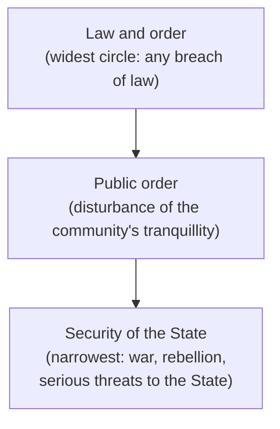

# Paper II · Constitutional Law of India – I (K-1002) · Unit 6
## Right to Freedom of Speech and Expression — Article 19(1)(a)

> **Last updated:** 2026-10-28 (IST) · **Law stated as on:** 2026-10-28 · **Branch:** `paper/02-constitutional-law`
> **Verify before exam:** citations marked *verify*, and the status of the sedition/BNS s. 152 challenge (checklist at the end).
> **Syllabus line (official):** *Right to Freedom of Speech and Expression (Article 19(1)(a))*. The syllabus names only clause (a); a short note on the other freedoms is at the end (§10) because examiners sometimes attach them.

**How this unit is examined.** Typical questions: (a) "Discuss the scope of freedom of speech and expression and the restrictions that can be imposed under Art. 19(2)" (long, the most frequent); (b) "Freedom of the press: is it separate from Art. 19(1)(a)?" (long); (c) "Sedition, hate speech and free speech" (long, topical); (d) "Right to information as part of Art. 19(1)(a)" (short or long); (e) short notes on *prior restraint*, *obscenity (Hicklin to community standards)*, *Shreya Singhal*, *internet shutdowns*, *public order v law and order*, *contempt*, *defamation*. **Structure every answer as: text → scope (what is included) → restrictions (each ground with a case) → tests of reasonableness → recent developments.**

---

## 1. Text and background

> **Art. 19(1)(a).** *All citizens shall have the right to freedom of speech and expression.*
> **Art. 19(2).** *Nothing in sub-clause (a) of clause (1) shall affect the operation of any existing law, or prevent the State from making any law, in so far as such law imposes **reasonable restrictions** on the exercise of the right conferred by the said sub-clause in the interests of the **sovereignty and integrity of India, the security of the State, friendly relations with foreign States, public order, decency or morality**, or in relation to **contempt of court, defamation or incitement to an offence**.*

- **Available only to citizens**, not to foreigners or companies (see Unit 3).
- **Not absolute:** the eight grounds in Art. 19(2) are **exhaustive**.
- **Constituent Assembly:** the original draft listed fewer grounds; courts read them narrowly in the first cases (below), leading to the **First Amendment (1951)**.
- **Philosophy:** Mill's marketplace of ideas; Milton's *Areopagitica*; Holmes J.'s "free trade in ideas" (*Abrams v. United States*, 250 US 616 (1919), dissent); a precondition for democracy and self-realisation.
- **Comparative note:** the US First Amendment has no textual limits (courts apply "clear and present danger" and "imminent lawless action", *Brandenburg v. Ohio*, 395 US 444 (1969)); the Indian text lists permissible restrictions.

### 1.1 Amendments to Art. 19(2)

| Amendment | Change |
|---|---|
| **First Amendment, 1951** (after *Romesh Thappar* and *Brij Bhushan*) | Added **friendly relations with foreign States**, **public order**, **incitement to an offence**; replaced "undermining the security of the State" with "**security of the State**"; inserted the word "**reasonable**" |
| **Sixteenth Amendment, 1963** | Added **sovereignty and integrity of India** |

---

## 2. The first cases: why the First Amendment was needed

- ***Romesh Thappar v. State of Madras*** AIR 1950 SC 124: the Madras Maintenance of Public Order Act banned the circulation of *Cross Roads*. The Court struck it down: "public order" or "public safety" were wider than "undermining the security of the State", the only ground then in Art. 19(2). Freedom of circulation is part of freedom of the press.
- ***Brij Bhushan v. State of Delhi*** AIR 1950 SC 129: **pre-censorship** of the *Organiser* struck down as a prior restraint.
- *The First Amendment (1951) reversed the effect of these cases by adding "public order".*

---

## 3. Scope: what is included in freedom of speech and expression?

| Facet | Leading case(s) | Holding |
|---|---|---|
| **Freedom of the press** (not separate; derived from Art. 19(1)(a)) | *Romesh Thappar*; *Sakal Papers (P) Ltd. v. Union of India* AIR 1962 SC 305; *Bennett Coleman & Co. v. Union of India* (1972) 2 SCC 788; *Indian Express Newspapers v. Union of India* (1985) 1 SCC 641 | Page-price schedule and newsprint quotas that restricted circulation and volume held invalid; tax on newsprint must not be arbitrary; the **press** has no higher right than any citizen, but is the vehicle of public expression |
| **Right to information / right to know** | *State of U.P. v. Raj Narain* (1975) 4 SCC 428; *S.P. Gupta v. Union of India* (1981); *Secretary, Ministry of I&B v. Cricket Association of Bengal* (1995) 2 SCC 161; *Union of India v. Association for Democratic Reforms* (2002) 5 SCC 294; *PUCL v. Union of India* (2003) 4 SCC 399 | Citizens' right to know about public affairs and candidates' antecedents; statutorily secured by the **Right to Information Act, 2005** |
| **Electronic media / airwaves** | *Cricket Association of Bengal* (1995) | Airwaves are **public property**; the right to telecast is part of Art. 19(1)(a), subject to regulation |
| **Commercial speech** (advertisements) | *Tata Press Ltd. v. Mahanagar Telephone Nigam Ltd.* (1995) 5 SCC 139 | Commercial speech, which informs the public, is protected by Art. 19(1)(a) |
| **Right to remain silent / not to speak** | *Bijoe Emmanuel v. State of Kerala* (1986) 3 SCC 615 | Jehovah's Witness children who stood respectfully but did not sing the national anthem could not be expelled |
| **Right to fly the national flag** | *Union of India v. Naveen Jindal* (2004) 2 SCC 510 | An aspect of expression, subject to the Flag Code |
| **Cinema and art** | *K.A. Abbas v. Union of India* (1970) 2 SCC 780; *S. Rangarajan v. P. Jagjivan Ram* (1989) 2 SCC 574; *Bobby Art International v. Om Pal Singh Hoon* (1996) 4 SCC 1; *Viacom 18 Media v. Union of India* (2018) 1 SCC 761 | Pre-censorship of film upheld as reasonable given film's special impact (*Abbas*); the State must protect a certified film from mob threats (*Rangarajan*, *Viacom*) |
| **Opinion and unpopular views** | *S. Khushboo v. Kanniammal* (2010) 5 SCC 600 | Expressing views on pre-marital sex is not an offence; "what is socially unpopular is not criminal" |
| **Peaceful protest and assembly** (with 19(1)(b)) | *Ramlila Maidan Incident, In re* (2012) 5 SCC 1; *Mazdoor Kisan Shakti Sangathan v. Union of India* (2018) 17 SCC 324 | Right to protest peacefully is protected, subject to reasonable regulation |
| **Internet** | *Anuradha Bhasin v. Union of India* (2020) 3 SCC 637 | Freedom of speech and of trade over the internet is protected under Art. 19(1)(a) and (g); indefinite **internet shutdowns** are impermissible; shutdown orders must be **published, necessary, proportionate and temporary** and are subject to judicial review |
| **Not included** | *Communist Party of India (M) v. Bharat Kumar* (1998) 1 SCC 201 | No fundamental right to call a **bandh** (it violates the fundamental rights of others) |

---

## 4. Restrictions under Article 19(2): ground by ground

### 4.1 Sovereignty and integrity of India (16th Amendment, 1963)
Aimed at secessionist speech. **Sedition** (IPC s. 124A) and unlawful-association laws are tested here and under "security of the State" and "public order".

### 4.2 Security of the State and public order

**Three concentric circles** (***Dr. Ram Manohar Lohia v. State of Bihar*** AIR 1966 SC 740):

- Only acts that affect **public order**, not merely **law and order**, can be restricted. Test: whether the act **leads to disturbance of the current of the life of the community** (*Arun Ghosh v. State of West Bengal*, (1970) 1 SCC 98).
- ***Superintendent, Central Prison, Fatehgarh v. Dr. Ram Manohar Lohia*** AIR 1960 SC 633: a law criminalising a speech urging non-payment of irrigation dues was struck down: **no proximate and reasonable nexus** with public order.
- ***S. Rangarajan v. P. Jagjivan Ram*** (1989) 2 SCC 574: the danger must be **"like a spark in a powder keg"**: a **real and imminent** threat, not remote or conjectural; the film cannot be banned because of a hostile audience's threat; the State must protect the speaker.
- ***Shreya Singhal v. Union of India*** (2015) 5 SCC 1: distinction between **discussion, advocacy and incitement**; only **incitement** can be restricted.

### 4.3 Sedition: from IPC s. 124A to BNS s. 152
- ***Kedar Nath Singh v. State of Bihar*** AIR 1962 SC 955: s. 124A valid but confined to acts with **intention or tendency to create disorder or incitement to violence**; mere criticism of Government is not sedition.
- ***Balwant Singh v. State of Punjab*** (1995) 3 SCC 214: casual slogans (e.g., "Khalistan Zindabad") without incitement are not sedition.
- ***Arup Bhuyan v. State of Assam*** (2011) 3 SCC 377: mere membership of a banned organisation is not an offence without incitement/violence.
- ***S.G. Vombatkere v. Union of India*** (order of **11 May 2022**, three judges): the Supreme Court **kept s. 124A IPC in abeyance**: no new FIRs to be registered, pending cases stayed, while the Union considered re-examination.
- **Bharatiya Nyaya Sanhita, 2023 (in force 1 July 2024):** s. 124A was **not retained** as "sedition". **s. 152 BNS** punishes "**acts endangering sovereignty, unity and integrity of India**" (secession, armed rebellion, subversive activities, encouraging separatist feelings), with imprisonment up to life. Critics say it is similarly broad. *(Challenges to the sedition law and to s. 152 were reported pending; I did not verify the latest status. Check before writing.)*

### 4.4 Friendly relations with foreign States
Rarely litigated; covers speech that may jeopardise relations (e.g., propaganda against friendly nations).

### 4.5 Decency or morality; obscenity
- **Hicklin test** (*R v. Hicklin*, (1868) LR 3 QB 360): obscene if it tends to deprave and corrupt those open to such influences. Applied in ***Ranjit D. Udeshi v. State of Maharashtra*** AIR 1965 SC 881 (*Lady Chatterley's Lover*).
- ***K.A. Abbas*** (1970): moral standards of the community; art and obscenity distinguished.
- ***Bobby Art International*** (1996): the film *Bandit Queen*: nudity in context was not obscene.
- ***Aveek Sarkar v. State of West Bengal*** (2014) 4 SCC 257: **abandoned *Hicklin***; adopted the **community standards test**: judge the work as a whole, by contemporary standards, from the viewpoint of an average person.
- **Statutes:** IPC s. 292 (now BNS s. 294); Indecent Representation of Women (Prohibition) Act, 1986; IT Act s. 67.

### 4.6 Contempt of court
- **Contempt of Courts Act, 1971**; Arts. 129 and 215; the 2006 amendment added the defence of **truth** (s. 13).
- ***E.M.S. Namboodiripad v. T.N. Nambiar*** (1970) 2 SCC 325: criticism of judges that lowers authority can be contempt.
- ***Arundhati Roy, In re*** (2002) 3 SCC 343: contempt for scandalising the court.
- ***Prashant Bhushan, In re*** (2021) 1 SCC 745 *(verify)*: convicted in August 2020 for two tweets; a token fine of Re. 1 imposed (31 Aug 2020).

### 4.7 Defamation
- **Criminal defamation** (IPC ss. 499–500, now BNS s. 356) was **upheld** in ***Subramanian Swamy v. Union of India*** (2016) 7 SCC 221 (13 May 2016): reputation is part of Art. 21 and the restriction is reasonable.
- ***R. Rajagopal v. State of Tamil Nadu*** (1994) 6 SCC 632 (*Auto Shankar* case): the press may publish matters in **public records** without liability; public officials cannot sue for defamation over official conduct unless the publication is false or in **reckless disregard of truth**; **prior restraint** of publication is generally impermissible; privacy is part of Art. 21.

### 4.8 Incitement to an offence
Speech that provokes the commission of an offence; closely tied to the **proximity** requirement (*Rangarajan*; *Shreya Singhal*).

### 4.9 Hate speech
- Not a separate ground in Art. 19(2); it is addressed under **public order**, **incitement**, and statutes (IPC ss. 153A, 295A, now BNS ss. 196, 299).
- ***Pravasi Bhalai Sangathan v. Union of India*** (2014) 11 SCC 477: need for effective action against hate speech; referred to the Law Commission (267th Report, 2017).
- ***Amish Devgan v. Union of India*** (2021) 1 SCC 1: hate speech is judged by its **effect on the targeted group**; factors include context, intent and impact.

---

## 5. Test of reasonableness

- **Art. 19(2) uses "reasonable"**: restrictions must be (i) imposed by **law** (not executive fiat), (ii) for one of the **listed grounds**, and (iii) **reasonable**.
- ***Chintaman Rao v. State of M.P.*** AIR 1951 SC 118: a restriction is unreasonable if it is **arbitrary or excessive**.
- ***State of Madras v. V.G. Row*** AIR 1952 SC 196: factors: **nature of the right, underlying purpose of the restriction, extent and urgency of the evil, disproportion, prevailing conditions**; both **substantive** and **procedural** reasonableness are examined.
- **Proportionality:** now the preferred test: ***Modern Dental College v. State of M.P.*** (2016) 7 SCC 353; ***K.S. Puttaswamy*** (2017) 10 SCC 1; ***Anuradha Bhasin*** (2020): (i) legitimate goal, (ii) rational connection, (iii) necessity (least restrictive means), (iv) balance (proportionality *stricto sensu*).
- **Prior restraint:** disfavoured (*Brij Bhushan*; *Rajagopal*), but permitted in cinema (*Abbas*).
- **Vagueness and chilling effect:** laws that are vague or overbroad are struck down (*Shreya Singhal*: s. 66A).

---

## 6. Landmark case study: *Shreya Singhal v. Union of India* (2015) 5 SCC 1

**Facts:** two women were arrested in Maharashtra under s. 66A IT Act for a Facebook post questioning the Mumbai shutdown after Bal Thackeray's death. Petitions challenged ss. 66A, 69A and 79 of the Information Technology Act, 2000.

| Provision | Holding |
|---|---|
| **s. 66A** (punishment for sending offensive messages) | **Struck down** in entirety: vague ("grossly offensive", "annoyance", "inconvenience") and not within Art. 19(2); **chilling effect** |
| **s. 69A** (blocking of websites) | **Upheld**: has procedural safeguards, reasons recorded in writing, subject to judicial review |
| **s. 79** (intermediary liability) | **Read down**: an intermediary must remove content only on **court order or Government notification** relating to Art. 19(2) matters (actual knowledge) |
| **s. 118(d) Kerala Police Act** | Struck down in a connected matter |

The Court drew the line: *"discussion, advocacy"* of even unpopular causes is protected; only *incitement* may be restricted. The Court has since had to deal with continued use of s. 66A by police despite its being struck down (directions in later orders; *verify the latest order*).

---

## 7. *Kaushal Kishor v. State of U.P.* (3 January 2023): no new grounds

(Constitution Bench; citation believed (2023) 4 SCC 1; *verify*). Key holdings (by majority): (i) the grounds in Art. 19(2) are **exhaustive**; **no additional restrictions** can be imposed on free speech on the strength of other grounds (for instance Art. 21 or the "duty to the public"); (ii) a Minister's statement, even on a matter of State affairs, cannot be **vicariously attributed** to the Government; (iii) Arts. 19 and 21 can be enforced **against private parties** as well, and the State has a **positive duty** to protect these rights.

---

## 8. Criticism and balance

1. **Exhaustive but elastic grounds:** "public order" and "security of the State" are broad and used against dissent.
2. **Criminal defamation and sedition-type laws** have a chilling effect (*Subramanian Swamy* upheld criminal defamation).
3. **Executive blocking and shutdowns** (s. 69A IT Act; Telecom shutdown rules) are often secret or disproportionate; *Anuradha Bhasin* required reasons and review.
4. **Hate speech v. free speech:** no clear statutory definition; courts apply context tests.
5. **Platforms and private censorship:** big platforms regulate speech; the reach of Art. 19 against private actors is limited (partly addressed by *Kaushal Kishor*).
6. **Strengths:** a robust body of case law; vagueness doctrine (*Shreya Singhal*); proportionality; protection of art (*Aveek Sarkar*) and the press.

---

## 9. Current relevance and recent developments

- **Electoral bonds (15 Feb 2024):** the five-judge bench unanimously held that the voter's right to information extends to political funding, and that the scheme violated Art. 19(1)(a) (also treated as manifestly arbitrary). It applied the proportionality test.
- **Sedition and BNS s. 152:** the 2022 abeyance order and the 2024 BNS re-enactment (in different form) make this a live issue; check the latest status of the challenges.
- **IT Rules and fact-check units:** the Bombay High Court (Sept 2024) struck down the 2023 amendment to the IT Rules creating a Government "fact check unit" as violating Arts. 14, 19(1)(a), 19(1)(g) *(reported; verify; appeal reported pending)*.
- **Online speech and platforms:** debates over blocking orders, intermediary liability and AI-generated content continue; apply *Shreya Singhal* and *Anuradha Bhasin*.
- **Hate speech and FIRs against comedians, journalists:** the Supreme Court has repeatedly quashed or stayed FIRs for speech where the content was not within Art. 19(2). *(No case cited here; verify specific orders before citing.)*
- **Caution for the exam:** do not say the press has a "special" fundamental right. It is derived from Art. 19(1)(a), subject to the same Art. 19(2).

---

## 10. Appendix: the other freedoms in Art. 19(1) (not named in the CCSU syllabus, but frequently attached)

| Clause | Freedom | Restrictions |
|---|---|---|
| 19(1)(b) | Assemble peaceably and without arms | 19(3): sovereignty and integrity of India; public order |
| 19(1)(c) | Form associations, unions or (97th Amendment, 2011) **co-operative societies** | 19(4): sovereignty and integrity; public order; morality |
| 19(1)(d) | Move freely throughout India | 19(5): interests of the general public; protection of Scheduled Tribes |
| 19(1)(e) | Reside and settle in any part of India | 19(5): same |
| 19(1)(f) | *(Right to acquire, hold and dispose of property: repealed by the 44th Amendment, 1978)* | now Art. 300A |
| 19(1)(g) | Practise any profession, or carry on any occupation, trade or business | 19(6): general public; professional or technical qualifications; State monopoly |

---

## 11. Quick-revision box

- **Art. 19(1)(a)** (citizens). **Art. 19(2)** grounds (8): sovereignty & integrity; security of State; friendly relations; public order; decency or morality; contempt of court; defamation; incitement to an offence.
- **Amendments:** 1st (1951): public order, friendly relations, incitement, "reasonable"; 16th (1963): sovereignty and integrity.
- **Starting cases:** *Romesh Thappar* and *Brij Bhushan* (1950).
- **Scope:** press (*Sakal Papers*, *Bennett Coleman*, *Indian Express*); right to know (*Raj Narain*, *ADR*, *PUCL*, RTI Act); airwaves (*Cricket Association of Bengal*); commercial speech (*Tata Press*); silence (*Bijoe Emmanuel*); flag (*Naveen Jindal*); internet (*Anuradha Bhasin*); not bandh (*Bharat Kumar*).
- **Public order:** *Lohia* (three circles); *Arun Ghosh*; *Rangarajan* ("spark in a powder keg"); *Shreya Singhal* (discussion/advocacy/incitement).
- **Sedition:** *Kedar Nath* (1962); *Vombatkere* (2022 abeyance); BNS s. 152.
- **Obscenity:** *Hicklin* → *Udeshi* (1965) → *Aveek Sarkar* (2014, community standards).
- **Defamation:** *Subramanian Swamy* (2016); *Rajagopal* (1994).
- **Reasonableness:** *Chintaman Rao*, *V.G. Row*; proportionality (*Modern Dental*, *Puttaswamy*, *Anuradha Bhasin*).
- **2023:** *Kaushal Kishor* (no new grounds; horizontal effect). **2024:** electoral bonds.

**Examiner keywords:** marketplace of ideas, prior restraint, chilling effect, vagueness, public order, law and order, proximate nexus, incitement, community standards, proportionality, intermediary liability, horizontal application.

---

## 12. Question bank (model answers)

*Mark bands indicative; confirm your paper pattern (`docs/01-gaps-and-open-questions.md`, A1).*

### Long answers (10–15 marks)

**Q1. Discuss the scope of the right to freedom of speech and expression under Article 19(1)(a). What restrictions can be imposed under Article 19(2)?**
**Introduction:** The right is the foundation of democracy; it is available to citizens and not absolute.
**Body:** (1) Text and 19(2) grounds; amendments. (2) Scope: press, right to know, airwaves, commercial speech, silence, flag, internet, protest (table §3). (3) Restrictions with cases: public order (*Lohia*, *Rangarajan*), sedition, obscenity, contempt, defamation, incitement, hate speech. (4) Tests of reasonableness (*V.G. Row*, proportionality).
**Recent:** *Shreya Singhal*, *Anuradha Bhasin*, *Kaushal Kishor*, electoral bonds.
**Conclusion:** free speech is the rule and restrictions the exception; they must be by law, within 19(2), and proportionate.

---

**Q2. Is freedom of the press a separate fundamental right? Discuss the Supreme Court decisions on press freedom.**
*(Use §3 table: *Romesh Thappar*, *Brij Bhushan*, *Sakal Papers*, *Bennett Coleman*, *Indian Express*; state it is derived from 19(1)(a); add *Rajagopal* on prior restraint; end with *Cricket Association of Bengal* for broadcasting.)*

---

**Q3. Discuss *Shreya Singhal v. Union of India* and its significance for online speech.**
*(Use §6 table. Explain vagueness, chilling effect, discussion/advocacy/incitement, s. 69A, s. 79; link to *Anuradha Bhasin* and the IT Rules debate.)*

---

**Q4. "Sedition and free speech": discuss the law from *Kedar Nath Singh* to the Bharatiya Nyaya Sanhita.**
*(Use §4.3: s. 124A IPC; *Kedar Nath*; *Balwant Singh*; *Vombatkere* (11 May 2022); BNS s. 152. Note the status caveat.)*

---

**Q5. Explain the concepts of "public order", "law and order" and "security of the State" in the context of Art. 19(2).**
*(Use §4.2: diagram, *Lohia*, *Arun Ghosh*, *Rangarajan*.)*

---

**Q6. Discuss obscenity and free speech: from *Ranjit Udeshi* to *Aveek Sarkar*.**
*(Use §4.5.)*

---

### Short notes (5 marks)

1. **Prior restraint (*Brij Bhushan*).**
2. **Right to information as part of Art. 19(1)(a).**
3. **Commercial speech (*Tata Press*).**
4. **Right to silence (*Bijoe Emmanuel*).**
5. **Public order v. law and order.**
6. **Hicklin test and community standards test.**
7. **Contempt of court and free speech.**
8. **Criminal defamation (*Subramanian Swamy*).**
9. **Internet shutdowns (*Anuradha Bhasin*).**
10. **Section 66A IT Act and *Shreya Singhal*.**
11. **Hate speech (*Amish Devgan*).**
12. **Reasonable restrictions: proportionality test.**
13. **Electoral bonds and Art. 19(1)(a).**

### Very short answers (2 marks)

| Question | Answer |
|---|---|
| Is Art. 19(1)(a) available to non-citizens? | No; only to citizens. |
| How many grounds are there in Art. 19(2)? | Eight. |
| Which Amendment added "public order" to Art. 19(2)? | The First Amendment, 1951. |
| Which Amendment added "sovereignty and integrity of India"? | The 16th Amendment, 1963. |
| Which case struck down s. 66A IT Act? | *Shreya Singhal v. Union of India* (2015). |
| Which case introduced the "spark in a powder keg" test? | *S. Rangarajan v. P. Jagjivan Ram* (1989). |
| Is there a fundamental right to call a bandh? | No (*Communist Party of India (M) v. Bharat Kumar*, 1998). |
| Which case abandoned the Hicklin test? | *Aveek Sarkar v. State of West Bengal* (2014). |
| Name the case on internet shutdowns. | *Anuradha Bhasin v. Union of India* (2020). |
| Which provision of the BNS replaced sedition? | Section 152 (acts endangering sovereignty, unity and integrity of India). |

---

## 13. Verification checklist (do before the exam)

- [ ] *Romesh Thappar* AIR 1950 SC 124 · *Brij Bhushan* AIR 1950 SC 129 · *Sakal Papers* AIR 1962 SC 305 · *Bennett Coleman* (1972) 2 SCC 788 · *Indian Express* (1985) 1 SCC 641
- [ ] *Raj Narain* (1975) 4 SCC 428 · *Cricket Association of Bengal* (1995) 2 SCC 161 · *ADR* (2002) 5 SCC 294 · *PUCL* (2003) 4 SCC 399 · *Tata Press* (1995) 5 SCC 139 · *Bijoe Emmanuel* (1986) 3 SCC 615 · *Naveen Jindal* (2004) 2 SCC 510
- [ ] *K.A. Abbas* (1970) 2 SCC 780 · *Rangarajan* (1989) 2 SCC 574 · *Bobby Art* (1996) 4 SCC 1 · *Viacom 18* (2018) 1 SCC 761 · *Khushboo* (2010) 5 SCC 600 · *Ramlila Maidan* (2012) 5 SCC 1 · *MKSS* (2018) 17 SCC 324 · *Bharat Kumar* (1998) 1 SCC 201
- [ ] *Lohia (Bihar)* AIR 1966 SC 740 · *Lohia (Fatehgarh)* AIR 1960 SC 633 · *Arun Ghosh* (1970) 1 SCC 98
- [ ] *Kedar Nath* AIR 1962 SC 955 · *Balwant Singh* (1995) 3 SCC 214 · *Arup Bhuyan* (2011) 3 SCC 377 · *Vombatkere* (11 May 2022; WP(C) 682/2021) · **BNS s. 152 and the status of challenges**
- [ ] *Udeshi* AIR 1965 SC 881 · *Aveek Sarkar* (2014) 4 SCC 257 · *Namboodiripad* (1970) 2 SCC 325 · *Arundhati Roy* (2002) 3 SCC 343 · *Prashant Bhushan* (2021) 1 SCC 745 · *Subramanian Swamy* (2016) 7 SCC 221 · *Rajagopal* (1994) 6 SCC 632
- [ ] *Pravasi Bhalai* (2014) 11 SCC 477 · *Amish Devgan* (2021) 1 SCC 1 · *Chintaman Rao* AIR 1951 SC 118 · *V.G. Row* AIR 1952 SC 196
- [ ] *Shreya Singhal* (2015) 5 SCC 1 (provision-wise holdings) · *Anuradha Bhasin* (2020) 3 SCC 637 · *Kaushal Kishor* (3 Jan 2023; (2023) 4 SCC 1)
- [ ] Bombay High Court on the IT Rules fact-check unit (Sept 2024) and whether any appeal has been decided
- [ ] BNS section numbers (ss. 294, 356, 196, 299) against the Act's text
