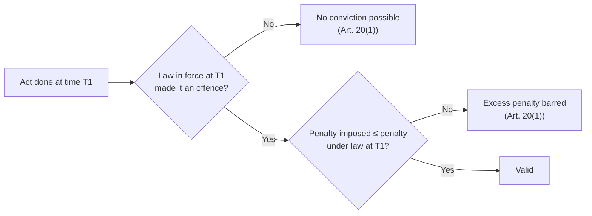

# Paper II · Constitutional Law of India – I (K-1002) · Unit 7
## Protection in Respect of Conviction for Offences — Article 20

> **Last updated:** 2026-10-28 (IST) · **Law stated as on:** 2026-10-28 · **Branch:** `paper/02-constitutional-law`
> **Verify before exam:** citations marked *verify*, and the BNS/BNSS section numbers (checklist at the end).
> **Syllabus line (official):** *Protection in respect of Conviction for offences (Article 20)*

**How this unit is examined.** Typical questions: (a) "Explain the safeguards in Art. 20 against ex post facto laws, double jeopardy and self-incrimination" (long, the standard form); (b) "Discuss the right against self-incrimination (Art. 20(3)) with leading cases" (long); (c) short notes on *ex post facto law*, *double jeopardy*, *testimonial compulsion*, *narco-analysis*. The three clauses are independent; **write each with its elements, cases and limits**. Art. 20 is available to **any person** (citizen or not) and **cannot be suspended** even in an Emergency (Art. 359 proviso).

---

## 1. Text and background

> **Art. 20.** *(1) No person shall be convicted of any offence except for violation of a law in force at the time of the commission of the act charged as an offence, nor be subjected to a penalty greater than that which might have been inflicted under the law in force at the time of the commission of the offence.*
> *(2) No person shall be prosecuted and punished for the same offence more than once.*
> *(3) No person accused of any offence shall be compelled to be a witness against himself.*

- **Origin:** clause (1) from the US Constitution (ex post facto clauses); clause (2) from the US Fifth Amendment (double jeopardy) and the English common-law pleas of *autrefois acquit / autrefois convict*; clause (3) from the Fifth Amendment (privilege against self-incrimination).
- **Nature:** protections available **to any person** (including foreigners and, in some respects, corporations), operative **only in criminal proceedings**, against the **State**.
- **Emergency:** Art. 20 **cannot be suspended** (44th Amendment).
- **Companion statutory provisions:** Evidence/Procedure codes (see §6 for BNS/BNSS equivalents).

---

## 2. Article 20(1): protection against ex post facto laws

### 2.1 Two protections
1. **No conviction** except for violation of a law **in force at the time of the act**.
2. **No penalty greater** than that which might have been inflicted **under the law then in force**.

### 2.2 Scope and limits
- **Applies only to criminal laws** (new offences and enhanced penalties). Retrospective civil or tax laws are not tested under Art. 20(1); they are tested under other Articles (Art. 14, Art. 19, Art. 300A).
- Prohibits **conviction and sentence**, not retrospective **procedure**: no one has a vested right in a mode of trial, so a change in procedure (e.g., trial by a special court) does not offend Art. 20(1) (*Rao Shiv Bahadur Singh v. State of Vindhya Pradesh*, AIR 1953 SC 394; *Kedar Nath Bajoria v. State of West Bengal*, AIR 1953 SC 404).
- **Beneficial retrospective laws** are allowed: a law that reduces punishment or gives a benefit can be applied to earlier offences. ***Ratan Lal v. State of Punjab*** AIR 1965 SC 444: the Probation of Offenders Act, 1958 was applied to an offence committed before it came into force. *(Some books also cite T. Barai v. Henry Ah Hoe, (1983) 1 SCC 177 for the same point; I could not confirm its holding, so verify before citing.)*
- **Preventive detention is not punishment for an offence**, so Art. 20(1) does not govern it (it is governed by Arts. 21 and 22).

### 2.3 Ex post facto law and the new criminal codes
The **Bharatiya Nyaya Sanhita, 2023** (BNS), **Bharatiya Nagarik Suraksha Sanhita, 2023** (BNSS) and **Bharatiya Sakshya Adhiniyam, 2023** (BSA) came into force on **1 July 2024**. Offences committed **before** that date continue to be governed by the **IPC**, so that no one is convicted under the BNS for an earlier act and no one receives a penalty greater than the IPC prescribed. The savings provision is in the repeal and savings section of the BNS (believed to be s. 531; *verify*). Art. 20(1) also explains why any BNS offence that is new (e.g., organised crime, mob lynching, snatching) cannot be applied to pre-July 2024 acts.

---

## 3. Article 20(2): protection against double jeopardy

### 3.1 Elements
A person can invoke Art. 20(2) only if:
1. He has been **prosecuted** (before a court of law or a judicial tribunal; not departmental/administrative proceedings);
2. He has been **punished** (**convicted**; a mere acquittal is outside Art. 20(2), though barred by CrPC/BNSS provisions);
3. For the **same offence** (identity of offence, i.e., same ingredients);
4. **More than once** (a second prosecution and punishment).

### 3.2 Cases

| Case | Citation | Holding |
|---|---|---|
| **Maqbool Hussain v. State of Bombay** | AIR 1953 SC 325 | Confiscation of gold by the **Customs authorities** under the Sea Customs Act was not "prosecution and punishment" in a court; a later prosecution under the Foreign Exchange Regulation Act was not barred. Art. 20(2) requires **proceedings before a judicial tribunal** |
| **S.A. Venkataraman v. Union of India** | AIR 1954 SC 375 | A departmental inquiry under the Public Servants (Inquiries) Act, followed by a criminal trial, is not double jeopardy |
| **State of Bombay v. S.L. Apte** | AIR 1961 SC 578 | The two offences (IPC s. 409 and the Insurance Act) are different if their **ingredients** differ; the bar applies only where the offences are the **same** in ingredients |
| **Kolla Veera Raghav Rao v. Gorantla Venkateswara Rao** | (2011) 2 SCC 703 | Conviction under a special (financial-regulation) statute does not bar a later trial under IPC s. 420 for cheating, because the ingredients differ. *(Verify which statute was involved before naming it.)* |

### 3.3 Difference between Art. 20(2) and the statutory rule
| Basis | Art. 20(2) | Statutory bar (CrPC s. 300; BNSS s. 337, *verify*) |
|---|---|---|
| Source | Constitution | Criminal procedure law |
| Covers | **Prosecution and punishment** (conviction) | **Conviction or acquittal** by a competent court |
| Offence | Same offence | Same offence or offence on the same facts (s. 300(1) read with (2)–(5)) |
| Waiver | Not waivable | A statutory plea (*autrefois acquit / convict*) |
| Suspended in Emergency? | No | N/A |

(Also **General Clauses Act, 1897, s. 26**: where an act is an offence under two or more enactments, the offender may be prosecuted and punished under either, but not twice for the same offence.)

---

## 4. Article 20(3): protection against self-incrimination

### 4.1 Essentials
Art. 20(3) applies when:
1. The person is **accused of an offence** (a formal accusation: FIR/complaint, or at least a person against whom a formal accusation is made; *M.P. Sharma*);
2. He is **compelled** (by physical or mental pressure, threats, inducement);
3. To be a **witness against himself**, i.e., to give **testimony** (oral or documentary that conveys his personal knowledge) that tends to incriminate him.

### 4.2 Leading cases

| Case | Citation | Holding |
|---|---|---|
| **M.P. Sharma v. Satish Chandra** | AIR 1954 SC 300 (eight judges) | Search and seizure under a warrant does **not** violate Art. 20(3): it is not "compelling a person to be a witness"; "to be a witness" includes giving evidence by **oral or documentary** testimony |
| **State of Bombay v. Kathi Kalu Oghad** | AIR 1961 SC 1808 (eleven judges) | Giving **specimen handwriting, signatures, thumb impressions** is **not** testimonial compulsion: "to be a witness" means to furnish **testimony** based on personal knowledge, not to produce material objects. Mere **production of a document** does not violate Art. 20(3) unless the accused is compelled to state facts |
| **Nandini Satpathy v. P.L. Dani** | (1978) 2 SCC 424 | The privilege extends to the **investigation stage** (police interrogation); an accused or even a suspect may **refuse to answer** questions whose answers would tend to incriminate him; a person has the right to **remain silent**; the presence of a lawyer or friend during questioning is recommended; mental pressure, "third-degree" or inducement amounts to compulsion |
| **Selvi v. State of Karnataka** | (2010) 7 SCC 263 (three judges) | **Narco-analysis, polygraph and brain-mapping (BEAP)** administered **involuntarily** violate Art. 20(3) and the right to personal liberty and mental privacy under Art. 21; consent must be informed and voluntary; results obtained with consent have limited evidentiary value |
| **Ritesh Sinha v. State of U.P.** | (2019) 8 SCC 1 | A Magistrate may direct an accused to give a **voice sample**; voice samples are like fingerprints and handwriting, not testimony; no violation of Art. 20(3) |
| **Vijay Madanlal Choudhary v. Union of India** | 2022 SCC OnLine SC 929 | Statements recorded under **s. 50 of the PMLA** by Enforcement Directorate officers do not violate Art. 20(3): the person summoned is not "accused of an offence" at that stage (an ECIR is not an FIR). *(Reported; the correctness of this reasoning is contested; verify and read the report.)* |

### 4.3 What is not covered
- Giving **fingerprints, signatures, handwriting, blood samples, DNA** (physical evidence).
- **Production of documents** that are not statements of personal knowledge.
- **Statements to non-police authorities** where the person is not an "accused".
- **Witnesses** who are not accused (they are protected by the statute, e.g., the Indian Evidence Act s. 132 / BSA corresponding provision).
- The privilege can be **waived** by a person who chooses to testify.

### 4.4 Rights linked to Art. 20(3)
- **Right to silence** (Art. 21; *Selvi*).
- **Presumption of innocence** (a fundamental principle of criminal justice) and the rule that the **burden of proof lies on the prosecution**.
- **Voluntariness of confessions**: confessions to police officers are inadmissible (Evidence Act ss. 25–26, now BSA); *Nandini Satpathy*.
- **Art. 22(1)**: right to consult a lawyer after arrest.

---

## 5. Comparison with the US position

| Aspect | India (Art. 20) | USA |
|---|---|---|
| Ex post facto | Only criminal; text in Art. 20(1) | Art. I, ss. 9–10 prohibit ex post facto laws |
| Double jeopardy | "Prosecuted **and punished**" (conviction) | Fifth Amendment: "put in jeopardy of life or limb" (also protects against retrial after acquittal) |
| Self-incrimination | "Accused of any offence" | "In any criminal case" (witness); *Miranda* warnings |
| Suspension | Not suspendable | N/A |

*(Use as a short comparison; the Indian wording is narrower on double jeopardy, which is why the CrPC/BNSS plea of acquittal matters.)*

---

## 6. Statutory equivalents under the new codes (verify before quoting)

| Subject | Earlier law | New law |
|---|---|---|
| Bar on second trial | CrPC s. 300 | BNSS s. 337 |
| Identification / specimen signatures, handwriting, finger impressions | CrPC s. 311A | BNSS s. 349 (extends to voice samples) |
| Confessions to police | Evidence Act ss. 25–26 | BSA corresponding sections |
| Repeal and savings | IPC s. 5 etc. | BNS repeal and savings (believed s. 531) |

*(These section numbers are from my recall of the 2023 Acts and are flagged for verification against the bare Acts.)*

---

## 7. Criticism and balance

1. **Double jeopardy in India is narrower than in the US:** Art. 20(2) bars a second *prosecution and punishment*; statutory law covers acquittals.
2. **Narrow meaning of "accused" and "witness"** (*Kathi Kalu Oghad*) leaves the privilege weak for physical evidence and in white-collar investigations (PMLA).
3. **Pressure in practice:** custodial interrogation and coerced statements remain a concern despite *Nandini Satpathy* and *D.K. Basu* guidelines.
4. **Scientific evidence:** *Selvi* protects mental privacy, but courts have allowed voice samples and DNA.
5. **Strengths:** a fundamental, non-suspendable protection; strong judicial attention to voluntariness.

---

## 8. Current relevance and recent developments

- **New criminal codes (1 July 2024):** the rule that earlier offences continue under the IPC is an application of Art. 20(1).
- **PMLA statements:** *Vijay Madanlal* (2022) applies Art. 20(3) narrowly; debate on custodial interrogation by agencies continues.
- **Digital evidence and compelled passwords/biometric unlocking** are emerging Art. 20(3) questions. *(No settled Supreme Court rule; do not state one.)*
- **Forensic technologies:** *Selvi* remains the controlling authority on narco-analysis, polygraph and brain-mapping.
- **Caution for the exam:** Art. 20(3) protects only a person **"accused of an offence"**; do not say it protects every person questioned by police (that wider protection comes from *Nandini Satpathy* and the statute, not the text of Art. 20(3)).

---

## 9. Quick-revision box

- **Art. 20:** (1) no ex post facto penal law; no greater penalty; (2) no double prosecution and punishment; (3) no self-incrimination. **Any person**; **not suspendable** in Emergency.
- **20(1):** only criminal; procedure may change (*Rao Shiv Bahadur*, 1953; *Kedar Nath Bajoria*, 1953); beneficial retrospective law allowed (*Ratan Lal*, 1965).
- **20(2):** prosecution + punishment + same offence; **judicial tribunal** required (*Maqbool Hussain*, 1953); *S.L. Apte* (1961: same ingredients); *Kolla Veera Raghav Rao* (2011).
- **20(3):** accused + compulsion + testimony. *M.P. Sharma* (1954: search valid); *Kathi Kalu Oghad* (1961: specimens ok); *Nandini Satpathy* (1978: right to silence in investigation); *Selvi* (2010: narco/polygraph/BEAP); *Ritesh Sinha* (2019: voice); *Vijay Madanlal* (2022: PMLA s. 50).
- **BNS/BNSS:** in force 1 July 2024; pre-July 2024 offences under IPC.

**Examiner keywords:** ex post facto law, penalty, prosecution and punishment, autrefois acquit, testimonial compulsion, personal knowledge, right to silence, narco-analysis, voluntariness.

---

## 10. Question bank (model answers)

*Mark bands indicative; confirm your paper pattern (`docs/01-gaps-and-open-questions.md`, A1).*

### Long answers (10–15 marks)

**Q1. Explain the protection given by Article 20 to persons accused of offences.**
**Introduction:** Art. 20 gives three fundamental protections that apply to any person and cannot be suspended in an Emergency.
**Body:** (1) Art. 20(1): two limbs; criminal laws only; procedure change allowed; beneficial retrospective laws (*Ratan Lal*); BNS/IPC savings. (2) Art. 20(2): four elements; *Maqbool Hussain*, *Venkataraman*, *Apte*, *Kolla Veera*. (3) Art. 20(3): elements; *M.P. Sharma*, *Kathi Kalu Oghad*, *Nandini Satpathy*, *Selvi*, *Ritesh Sinha*.
**Conclusion:** Art. 20 balances State power with the dignity of the accused.

---

**Q2. Discuss the right against self-incrimination under Art. 20(3). Does it extend to narco-analysis and polygraph tests?**
*(Use §4: elements, case table, *Selvi*. Cover what is excluded (handwriting, DNA, voice) and the link to Art. 21.)*

---

**Q3. What is meant by double jeopardy? Distinguish Art. 20(2) from the plea of *autrefois acquit*.**
*(Use §3.1–§3.3 table.)*

---

**Q4. "Art. 20(1) protects against ex post facto laws only in criminal matters." Discuss.**
*(Use §2: scope, procedure v. substance, beneficial laws, the 2024 criminal codes.)*

---

### Short notes (5 marks)

1. **Ex post facto law.**
2. **Doctrine of double jeopardy.**
3. **Prosecution and punishment (*Maqbool Hussain*).**
4. **Testimonial compulsion (*Kathi Kalu Oghad*).**
5. **Right to silence (*Nandini Satpathy*).**
6. **Narco-analysis, polygraph and brain mapping (*Selvi*).**
7. **Voice samples and Art. 20(3) (*Ritesh Sinha*).**
8. **Art. 20 and the new criminal codes.**

### Very short answers (2 marks)

| Question | Answer |
|---|---|
| To whom is Art. 20 available? | To any person (citizen or non-citizen). |
| Can Art. 20 be suspended in an Emergency? | No. |
| Which clause protects against double jeopardy? | Art. 20(2). |
| Is a retrospective law that reduces punishment barred by Art. 20(1)? | No; beneficial retrospective laws are allowed. |
| Which case held that specimen handwriting does not violate Art. 20(3)? | *State of Bombay v. Kathi Kalu Oghad* (1961). |
| Which case extended the privilege to police interrogation? | *Nandini Satpathy v. P.L. Dani* (1978). |
| Which case dealt with narco-analysis? | *Selvi v. State of Karnataka* (2010). |
| Does departmental inquiry bar a criminal trial under Art. 20(2)? | No (not a prosecution before a court). |

---

## 11. Verification checklist (do before the exam)

- [ ] *Rao Shiv Bahadur Singh* AIR 1953 SC 394 · *Kedar Nath Bajoria* AIR 1953 SC 404 · *Ratan Lal* AIR 1965 SC 444 · *T. Barai* (1983) 1 SCC 177 (holding unconfirmed)
- [ ] *Maqbool Hussain* AIR 1953 SC 325 · *Venkataraman* AIR 1954 SC 375 · *S.L. Apte* AIR 1961 SC 578 · *Kolla Veera Raghav Rao* (2011) 2 SCC 703
- [ ] *M.P. Sharma* AIR 1954 SC 300 · *Kathi Kalu Oghad* AIR 1961 SC 1808 · *Nandini Satpathy* (1978) 2 SCC 424 · *Selvi* (2010) 7 SCC 263 · *Ritesh Sinha* (2019) 8 SCC 1 · *Vijay Madanlal Choudhary* (27 Jul 2022; SCC cite)
- [ ] BNS repeal and savings section number (believed s. 531) · BNSS s. 337 and s. 349 · BSA equivalents of Evidence Act ss. 25–26 and 132
- [ ] General Clauses Act, 1897, s. 26
- [ ] 44th Amendment text of Art. 359(1) proviso (Arts. 20 and 21)
