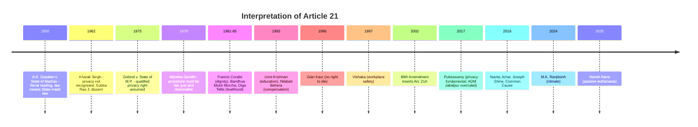

# Paper II · Constitutional Law of India – I (K-1002) · Unit 8
## Right to Life and Personal Liberty (Article 21) and Right to Education (Article 21A)

> **Last updated:** 2026-10-28 (IST) · **Law stated as on:** 2026-10-28 · **Branch:** `paper/02-constitutional-law`
> **Verify before exam:** citations marked *verify*; the *Harish Rana* (2026) details and the DPDP Act commencement dates (checklist at the end).
> **Syllabus lines (official):** *Right to life and personal liberty (Article 21)*; *Right to education (Article 21A)*.

**How this unit is examined.** This is the **most-asked unit of the paper**. Typical questions: (a) "Article 21 is the heart of the Fundamental Rights. Discuss with reference to the expanding scope of the right to life" (long, near-certain); (b) "Explain *Maneka Gandhi v. Union of India* and the change from *A.K. Gopalan*" (long); (c) "Right to privacy after *Puttaswamy*" (long); (d) "Right to die: *Gian Kaur* to *Common Cause*" (long or short); (e) "Right to education: Art. 21A and the RTE Act, 2009" (long or short); (f) short notes on *procedure established by law v. due process*, *golden triangle*, *rarest of rare*, *custodial violence*, *right to speedy trial*, *environment*. **Always show the movement: narrow reading (*Gopalan*) → wide reading (*Maneka*) → a source of new rights (dignity, livelihood, health, privacy, environment, education).**

---

## 1. Text and background

> **Art. 21.** *No person shall be deprived of his life or personal liberty except according to procedure established by law.*
> **Art. 21A** *(inserted by the Constitution (Eighty-sixth Amendment) Act, 2002).* *The State shall provide free and compulsory education to all children of the age of six to fourteen years in such manner as the State may, by law, determine.*

- Available to **every person** (citizen and non-citizen). It is a protection against the **State** (Art. 12), though *Kaushal Kishor* (2023) allows enforcement against private actors in suitable cases (Unit 3).
- **Cannot be suspended** during an Emergency (Art. 359(1) proviso, 44th Amendment, 1978), overruling in effect *ADM Jabalpur*.
- **Drafting history:** the Drafting Committee's draft read "due process of law"; after consultation (including a visit by B.N. Rau to the US) the Assembly adopted "**procedure established by law**" (Japanese Constitution model), expecting greater certainty and deference to legislation. Ambedkar defended the change as a compromise.
- **Two limbs:** (i) "life" and "personal liberty"; (ii) "except according to procedure established by law".

---

## 2. Evolution: from a narrow guarantee to a source of new rights

### 2.1 Stage one: *A.K. Gopalan v. State of Madras* AIR 1950 SC 27

- **Facts:** Gopalan was detained under the Preventive Detention Act, 1950. He argued that Arts. 19, 21 and 22 must be read together and that the law must be reasonable and in accordance with natural justice.
- **Holding (majority):** "procedure established by law" means procedure **prescribed by a validly enacted law**; "law" means **State-made law**, not the principles of natural justice; Art. 21 is **separate** from Art. 19; the **"watertight compartments"** theory: each Fundamental Right is a separate code. Fazl Ali J. dissented, preferring the due process view.
- **Effect:** a statute depriving a person of liberty could be valid even if the procedure was unfair, so long as it was properly enacted.

### 2.2 Intermediate: *Kharak Singh* and *Gobind*
- ***Kharak Singh v. State of U.P.*** AIR 1963 SC 1295: night domiciliary visits struck down as violating personal liberty; surveillance by shadowing upheld; the majority held privacy is not a fundamental right, but Subba Rao J. (dissent) read privacy into Art. 21.
- ***Gobind v. State of M.P.*** (1975) 2 SCC 148: regulations permitting domiciliary visits upheld as they had statutory backing, but the Court assumed a **limited fundamental right to privacy**, subject to a compelling State interest.

### 2.3 The turning point: *Maneka Gandhi v. Union of India* (1978) 1 SCC 248

- **Facts:** the petitioner's passport was impounded under s. 10(3)(c) of the Passports Act, 1967 "in the public interest" without a hearing; the reasons were not disclosed.
- **Holdings (seven judges; P.N. Bhagwati J. leading):**
  1. **Art. 21 and Arts. 14 and 19 are interconnected** ("golden triangle"): a law depriving a person of personal liberty must satisfy **Art. 14** (non-arbitrary), **Art. 19** (if it affects a freedom) and **Art. 21**.
  2. **"Procedure established by law" must be right, just and fair**, not arbitrary, fanciful or oppressive; otherwise no procedure at all. This imported substantive due process by interpretation.
  3. **Natural justice** (*audi alteram partem*) is part of fair procedure; the right to travel abroad is part of "personal liberty".
  4. **Personal liberty** has the widest amplitude; Art. 19 restrictions apply wherever the effect is direct and inevitable on a freedom (the "direct effect" test, overruling the *Gopalan* approach). 
  5. The Government's undertaking to give a post-decisional hearing was accepted; the order was upheld on that basis.
- **Effect:** *Gopalan* was effectively overruled; every Article 21 right since flows from this fair-procedure reading.

### 2.4 Is "due process" now India's standard?

| Aspect | *Gopalan* (1950) | *Maneka Gandhi* (1978) | USA (due process) |
|---|---|---|---|
| Meaning of "law" | Any enacted law | A law that is fair, just, reasonable | A law that is reasonable and fair |
| Role of Art. 14 and 19 | Separate; not applicable to Art. 21 | A law must satisfy all three | N/A |
| Natural justice | Not required | Implied | Required |
| Court's review | Only competence of the legislature | Substantive and procedural fairness | Substantive and procedural |

---

## 3. "Life" and "personal liberty": what they mean

- **Life** is **more than animal existence**: it means the right to live with **human dignity** and all that goes with it (*Munn v. Illinois* (US) quoted in *Kharak Singh*; applied in *Francis Coralie Mullin v. Administrator, Union Territory of Delhi* (1981) 1 SCC 608: the right to "the bare necessities of life such as adequate nutrition, clothing and shelter" and to express oneself in diverse forms).
- **Personal liberty** is wide enough to include rights beyond freedom from physical restraint (*Maneka Gandhi*; *Kharak Singh*).
- **"Procedure established by law"** = a law, validly enacted, prescribing a fair procedure (*Maneka*).
- **Depriving requires State action** (Art. 12), subject to *Kaushal Kishor*.

---

## 4. Rights read into Article 21 (case table)

*Learn at least one leading case per head; examiners reward a list of heads with cases.*

### 4.1 Dignity, bodily integrity and personal autonomy

| Right | Leading case(s) | Holding |
|---|---|---|
| **Human dignity** | *Francis Coralie Mullin* (1981) 1 SCC 608 | Life means life with dignity; includes nutrition, shelter, reading, writing, interacting with family (prisoner's interview rights) |
| **Freedom from bonded labour** | *Bandhua Mukti Morcha v. Union of India* (1984) 3 SCC 161 | Bonded labourers have a right to be identified and rehabilitated; right to live with dignity includes protection of health, strength and freedom from exploitation |
| **Freedom from torture, cruel or degrading treatment** | *Sunil Batra v. Delhi Administration* (1978) 4 SCC 494 (*Batra I*); (1980) 3 SCC 488 (*Batra II*); *Prem Shankar Shukla v. Delhi Administration* (1980) 3 SCC 526 | Prisoners retain fundamental rights; solitary confinement and bar fetters are unconstitutional; **handcuffing** is not permissible without compelling reasons |
| **Right of women to dignity at work** | *Vishaka v. State of Rajasthan* (1997) 6 SCC 241 | Sexual harassment violates Arts. 14, 15, 19(1)(g) and 21; the Court laid down the **Vishaka Guidelines** under Art. 32 until legislation, later replaced by the **Sexual Harassment of Women at Workplace (Prevention, Prohibition and Redressal) Act, 2013** |
| **Reproductive choice and bodily autonomy** | *Suchita Srivastava v. Chandigarh Administration* (2009) 9 SCC 1 | A woman's right to make reproductive choices is part of personal liberty |
| **Gender identity** | *National Legal Services Authority (NALSA) v. Union of India* (2014) 5 SCC 438 | Recognition of transgender persons as a third gender; self-identified gender is part of dignity and autonomy under Arts. 14, 15, 16, 19 and 21 |
| **Sexual orientation** | *Navtej Singh Johar v. Union of India* (2018) 10 SCC 1 | IPC s. 377 read down: **consensual same-sex conduct between adults** is not an offence; constitutional morality prevails over social morality |
| **Decisional autonomy in marriage** | *Shafin Jahan v. Asokan K.M.* (2018) 16 SCC 368 (*Hadiya*); *Shakti Vahini v. Union of India* (2018) 7 SCC 192 | The choice of a partner is protected; guidelines against honour killings |
| **Adultery** | *Joseph Shine v. Union of India* (2019) 3 SCC 39 | IPC s. 497 struck down (arbitrary, discriminatory, treats the wife as property) |
| **Same-sex marriage** | *Supriyo v. Union of India* (17 Oct 2023) | No fundamental right to marry; the Special Marriage Act not read down; the Court recorded the Government's statement of a committee on rights of queer couples *(verify citation and the later review dismissal)* |

### 4.2 Privacy

| Case | Citation | Holding |
|---|---|---|
| ***M.P. Sharma*** (1954) and ***Kharak Singh*** (1962) | AIR 1954 SC 300; AIR 1963 SC 1295 | No fundamental right to privacy (later overruled **to that extent**) |
| ***Gobind*** | (1975) 2 SCC 148 | Limited privacy right |
| ***R. Rajagopal v. State of T.N.*** | (1994) 6 SCC 632 | Privacy is part of Art. 21; right to be left alone (also Unit 6) |
| ***PUCL v. Union of India*** | (1997) 1 SCC 301 | **Telephone tapping** infringes privacy; procedural safeguards laid down |
| ***Justice K.S. Puttaswamy (Retd.) v. Union of India*** | (2017) 10 SCC 1 (nine judges; **24 August 2017**) | **Privacy is a fundamental right** under Art. 21 (and Arts. 14 and 19); *M.P. Sharma* and *Kharak Singh* overruled to the extent they held otherwise; ***ADM Jabalpur*** declared wrongly decided. **Three-part test** for any intrusion: (i) **legality** (a law), (ii) **legitimate aim**, (iii) **proportionality**. Privacy includes **informational privacy, bodily integrity, autonomy, decisional privacy** |
| ***Puttaswamy (II)*** (Aadhaar) | (2019) 1 SCC 1 (26 Sept 2018) | Aadhaar upheld for welfare and PAN-linking; **s. 57** (use by private entities) struck down; use as a condition for bank accounts and mobile SIMs held impermissible; applied proportionality |

**Statute:** the **Digital Personal Data Protection Act, 2023** (assent 11 Aug 2023) and the **DPDP Rules, 2025** (notified in November 2025). As reported by law-firm sources: the Data Protection Board and definitions took effect on **13 Nov 2025**, consent-manager provisions follow on **12 Nov 2026**, and the main obligations on data fiduciaries (notice, consent, children's data, rights of data principals) on **12 May 2027**. *(Dates from secondary sources; confirm in the Gazette.)*

### 4.3 Procedure, liberty and the criminal process

| Right | Leading case(s) | Holding |
|---|---|---|
| **Speedy trial** | *Hussainara Khatoon v. State of Bihar* (1980) 1 SCC 81; *A.R. Antulay v. R.S. Nayak* (1992) 1 SCC 225 | Undertrial prisoners languishing for years: speedy trial is part of Art. 21; *Antulay* laid down guiding principles (no fixed time bar) |
| **Free legal aid** | *M.H. Hoskot v. State of Maharashtra* (1978) 3 SCC 544; *Khatri v. State of Bihar* (1981) 1 SCC 627 | Free legal aid is part of fair procedure; the State must inform the accused; also Art. 39A |
| **Protection against arbitrary arrest** | *Joginder Kumar v. State of U.P.* (1994) 4 SCC 260; *Arnesh Kumar v. State of Bihar* (2014) 8 SCC 273 | Arrest is not routine; police must justify arrest; guidelines under the old CrPC s. 41 |
| **Custodial violence** | *D.K. Basu v. State of West Bengal* (1997) 1 SCC 416 | Detailed **arrest/detention guidelines** (memo of arrest, medical examination every 48 hours, informing a relative, etc.) |
| **Compensation for violation** | *Rudul Sah v. State of Bihar* (1983) 4 SCC 141; *Bhim Singh v. State of J&K* (1985) 4 SCC 677; *Nilabati Behera v. State of Orissa* (1993) 2 SCC 746 | Compensation under **public law** (Arts. 32 and 226) for violation of Art. 21, independent of a tort suit |
| **Bail and liberty** | *Satender Kumar Antil v. CBI* (2022) 10 SCC 51 | Bail is the rule, jail the exception; guidelines on categories of offences |
| **Death penalty** | *Bachan Singh v. State of Punjab* (1980) 2 SCC 684; *Machhi Singh v. State of Punjab* (1983) 3 SCC 470; *Mithu v. State of Punjab* (1983) 2 SCC 277; *Shatrughan Chauhan v. Union of India* (2014) 3 SCC 1 | Death penalty valid but only in the **"rarest of rare"** cases with special reasons (*Bachan Singh*, Constitution Bench); mandatory death penalty (IPC s. 303) **struck down** (*Mithu*); **unexplained delay** in deciding a mercy petition is a ground for commutation (*Shatrughan Chauhan*, following *T.V. Vatheeswaran* (1983) 2 SCC 68) |
| **Bulldozer demolitions** | *In re: Directions in the matter of demolition of structures* (13 Nov 2024) | Guidelines against demolition of the accused's property without due notice and hearing; right to shelter is part of Art. 21 *(verify the case title and citation)* |

### 4.4 Livelihood, shelter, health and social rights

| Right | Leading case(s) | Holding |
|---|---|---|
| **Livelihood** | *Olga Tellis v. Bombay Municipal Corporation* (1985) 3 SCC 545 | Right to life includes right to livelihood; pavement dwellers cannot be evicted without notice and a reasonable opportunity; no one can waive a fundamental right |
| **Shelter** | *Chameli Singh v. State of U.P.* (1996) 2 SCC 549 | Shelter is part of the right to life |
| **Health and emergency medical care** | *Parmanand Katara v. Union of India* (1989) 4 SCC 286; *Paschim Banga Khet Mazdoor Samity v. State of W.B.* (1996) 4 SCC 37; *Consumer Education & Research Centre v. Union of India* (1995) 3 SCC 42 | Duty to provide immediate medical aid; State hospitals cannot refuse emergency treatment; workers' health protected |
| **Right to food** | *PUCL v. Union of India* (Writ Petition (Civil) 196/2001), interim orders | Mid-day meal and food-security entitlements enforced via Art. 21 and DPSPs; later the National Food Security Act, 2013 |
| **Environment** | *Subhash Kumar v. State of Bihar* (1991) 1 SCC 598; *M.C. Mehta v. Union of India* (1987) 1 SCC 395 (Oleum Gas); *Vellore Citizens' Welfare Forum v. Union of India* (1996) 5 SCC 647 | Right to a wholesome environment and pollution-free water and air; **absolute liability**; **precautionary principle**, **polluter pays** and **sustainable development** adopted |
| **Climate** | *M.K. Ranjitsinh v. Union of India* (21 March 2024; 2024 INSC 280) | A **right against the adverse effects of climate change** is recognised as flowing from Arts. 14 and 21 (Great Indian Bustard case) |
| **Right to digital access** | *Amar Jain v. Union of India* (30 April 2025) | Access to digital services (e-KYC for persons with disabilities and acid-attack survivors) read as part of Art. 21 *(reported; verify citation)* |

### 4.5 The right to die?

| Case | Citation | Holding |
|---|---|---|
| ***P. Rathinam v. Union of India*** | (1994) 3 SCC 394 | IPC s. 309 (attempt to suicide) struck down; right to life includes right *not* to live |
| ***Gian Kaur v. State of Punjab*** | (1996) 2 SCC 648 (Constitution Bench) | *Rathinam* **overruled**: the "right to life" does **not** include a right to die; abetment of suicide (s. 306) and attempt (s. 309) valid; the right to die with **dignity** (natural process in terminal illness) is part of the right to live with dignity, which is different from unnatural extinction |
| ***Aruna Shanbaug v. Union of India*** | (2011) 4 SCC 454 | **Passive euthanasia** permitted by High Court-monitored procedure in exceptional cases; active euthanasia not allowed |
| ***Common Cause v. Union of India*** | (2018) 5 SCC 1 (Constitution Bench; **9 March 2018**) | **Right to die with dignity** is part of Art. 21; passive euthanasia and **advance directives (living wills)** are valid; guidelines laid down |
| ***Common Cause*** (modification) | **24 January 2023** | The procedure simplified (e.g., two witnesses; a notary or gazetted officer attestation; medical-board composition eased) |
| ***Harish Rana v. Union of India*** | **11 March 2026** (reported as 2026 INSC 222) | **First application** of the framework to allow withdrawal of life support from a man in a persistent vegetative state for over 13 years; **clinically assisted nutrition** (PEG feeding) treated as **medical treatment** that can be withdrawn on the medical boards' unanimous view; court urged Parliament to legislate on end-of-life care *(reported by secondary sources; verify the report, bench and directions)* |

**Statute:** the Mental Healthcare Act, 2017, s. 115 presumes **severe stress** in a person attempting suicide and requires care, not punishment; **BNS** has no direct equivalent to IPC s. 309 (s. 226 deals only with attempts to compel or restrain a public servant). *(Verify the BNS provision.)*

---

## 5. Limits on Article 21

- **Deprivation is allowed by a valid law with fair procedure:** arrest, imprisonment, preventive detention, death penalty (rarest of rare), quarantine and public-health measures. Bodily integrity limits compulsion: in *Jacob Puliyel v. Union of India* (2022) the Supreme Court held that no one can be forced to be vaccinated and that restrictions on access to shared resources based on vaccination status were disproportionate at that time *(verify citation: believed (2022) 7 SCC 1)*.
- **Art. 21 and Art. 22:** arrest and preventive detention are governed by Art. 22 in addition to Art. 21; the two are read together (Art. 22 is not named in the CCSU syllabus; short note below in §10).
- **Public emergency:** Art. 21 **cannot** be suspended (Art. 359(1) proviso).
- **Horizontal effect:** *Kaushal Kishor* (2023): State has a positive duty to protect Art. 21 even against private action; Art. 21 itself can be enforced against private actors in some cases.

---

## 6. Case study: *ADM Jabalpur v. Shivkant Shukla* (1976) 2 SCC 521 and its overruling

- **Facts:** during the Emergency (1975–77), the right to move courts to enforce Arts. 14, 21 and 22 was suspended by Presidential Order under Art. 359. The question was whether a detenu could challenge detention by habeas corpus.
- **Holding (4:1):** no; Art. 21 was the **sole repository** of the right to life, and with its enforcement suspended, no writ of habeas corpus could be sought. **H.R. Khanna J.** dissented: the State had no power to deprive life or liberty without the authority of law.
- **Later:** the 44th Amendment (1978) made Arts. 20 and 21 **non-suspendable**; **Puttaswamy (2017)** declared ADM Jabalpur "**wrongly decided**" and **overruled** it; Khanna J.'s dissent was vindicated (Chandrachud J. in *Puttaswamy*: the judgment was "seriously flawed").

---

## 7. Article 21A: right to education

### 7.1 Background and development
- **Original scheme:** education was a **Directive Principle** (Art. 45: free and compulsory education for children until 14, within ten years of the Constitution) and Art. 41 (right to education within economic capacity). Art. 51A(k) (added 2002) makes it a duty of parents.
- ***Mohini Jain v. State of Karnataka*** (1992) 3 SCC 666: the right to education is a fundamental right flowing from the right to life; capitation fees unconstitutional.
- ***Unni Krishnan J.P. v. State of A.P.*** (1993) 1 SCC 645 (five judges): the right to free education exists **up to age 14**; beyond that it is subject to the State's economic capacity (Arts. 41, 45); the scheme on private professional colleges was later overruled in *T.M.A. Pai Foundation* (2002) 8 SCC 481.
- **86th Amendment Act, 2002:** (i) **inserted Art. 21A**; (ii) **substituted Art. 45** (now: State to provide **early childhood care and education to children below six**); (iii) **added Art. 51A(k)** (parent or guardian to provide opportunities for education to a child aged 6–14).
- **Commencement:** Art. 21A operates through law; the **Right of Children to Free and Compulsory Education Act, 2009** (RTE Act) came into force on **1 April 2010**.

### 7.2 RTE Act, 2009: main features

| Provision | Content |
|---|---|
| **Coverage** | Children aged **6–14**; free and compulsory elementary education in a **neighbourhood school** (s. 3) |
| **Free education** | No fee, charge or expenses that prevent a child from completing elementary education |
| **Duties** | Appropriate Government and local authority must provide schools, free education and ensure admission, attendance and completion (ss. 6, 8, 9) |
| **Private unaided schools** | Reserve **25%** of seats in Class I (or entry class) for children from weaker and disadvantaged groups, reimbursed by the State (s. 12(1)(c)) |
| **No screening / capitation** | Prohibition on capitation fees and screening procedures (s. 13) |
| **No detention / expulsion** | Originally, no child could be held back or expelled until completion of elementary education (s. 16); the **2019 amendment** allows States to permit holding back in Classes V and VIII after a re-examination |
| **Teachers and norms** | Pupil–teacher ratio, qualifications (TET), infrastructure norms in the Schedule |
| **School management committees** | Local community involvement (s. 21) |
| **Grievance** | Local authority; National and State Commissions for Protection of Child Rights (ss. 31–32) |

### 7.3 Case law on Art. 21A and the RTE Act

| Case | Citation | Holding |
|---|---|---|
| ***Society for Unaided Private Schools of Rajasthan v. Union of India*** | (2012) 6 SCC 1 | Upheld the RTE Act, including the 25% quota, as applied to **private unaided non-minority schools** and aided schools; minority schools and unaided minority schools held outside its scope |
| ***Pramati Educational and Cultural Trust v. Union of India*** | (2014) 8 SCC 1 (Constitution Bench) | RTE Act (and Art. 21A) does **not apply to minority schools** (aided or unaided); upheld Art. 15(5) which allows reservations in private unaided institutions (other than minorities') |
| ***Anjuman Ishaat-e-Taleem Trust v. State of Maharashtra*** | Order of **1 Sept 2025** (two-judge bench; Datta and Masih JJ.) | As reported: the Court questioned the **blanket exclusion of minority institutions** from the RTE Act in *Pramati* as sweeping and not reasoned, and referred that question to a **larger bench**; the 'TET mandatory for teachers' direction was also reported. Reconsideration of *Pramati* is therefore **pending** *(secondary sources; verify the order and the present status)* |
| ***T.M.A. Pai Foundation v. State of Karnataka*** | (2002) 8 SCC 481 | Right to establish educational institutions (Art. 19(1)(g), 26, 30); no right to charge capitation fees |
| ***Unni Krishnan*** | (1993) 1 SCC 645 | Education a fundamental right up to 14 |

### 7.4 Criticism and gaps
1. The right covers only **6–14** years; children **below 6** and **15–18** are not covered (Art. 45 is a DPSP; the NEP 2020 envisages a wider foundational stage).
2. Implementation: teacher vacancies, infrastructure gaps, quality of learning (ASER-type findings).
3. The 25% quota: delayed reimbursements; disputes on "neighbourhood" and eligibility.
4. Exclusion of minority institutions (*Pramati*).
5. Strengths: justiciable right, statutory framework, constitutional recognition of education as a duty of the State and parents.

*(Check the latest National Education Policy, 2020 implementation reports and any Supreme Court directions on RTE quota reimbursements before the exam.)*

---

## 8. Criticism and balance (Article 21)

1. **Judicial law-making:** many "rights" have been created by courts; critics call this overreach, supporters see it as necessary where legislatures fail.
2. **Unenforceable economic rights:** the right to livelihood, shelter, health and food are enforceable only in part; DPSPs are being converted by interpretation.
3. **Preventive detention and special laws** (UAPA, PMLA): liberty is curtailed by stringent bail conditions; Art. 21 balancing is case-specific.
4. **Delay:** undertrial prisoners remain in jail; speedy trial remains aspirational.
5. **Strengths:** *Maneka Gandhi* made the Constitution's liberty guarantee substantive; Art. 21 became the vehicle for PIL, environmental and social justice.

---

## 9. Current relevance and recent developments

- **Privacy and data protection:** DPDP Act and Rules (phased; main obligations from 12 May 2027, as reported); the Act's exemptions for the State and the RTI amendment (s. 44(3)) are contested.
- **Climate right:** *M.K. Ranjitsinh* (March 2024) adds a climate dimension to Art. 21.
- **Right to die with dignity:** *Harish Rana* (March 2026, as reported) is the first case implementing the *Common Cause* framework; legislation on end-of-life care is still absent.
- **Digital access:** *Amar Jain* (April 2025, as reported).
- **Demolition guidelines (Nov 2024):** shelter and due process.
- **Criminal law reform:** BNSS provisions on arrest, custody and trial timelines interact with Art. 21 (verify details before writing).
- **Marital rape exception:** the challenge to the exception in the penal law (now BNS s. 63, exception 2) is pending before the Supreme Court *(verify status)*.
- **Caution for the exam:** do not say Art. 21 *explicitly* lists these rights. They were read in by interpretation.

---

## 10. Appendix: Article 22 (not named in the CCSU syllabus, but frequently attached)

| Clause | Content |
|---|---|
| **22(1)–(2)** | Rights of an **arrested person**: informed of grounds, consult and be defended by a lawyer of choice, **produced before a magistrate within 24 hours** (excluding travel time) |
| **22(3)** | The above do **not** apply to an **enemy alien** or a person arrested under a **preventive detention** law |
| **22(4)–(7)** | **Preventive detention:** detention beyond **three months** needs an **Advisory Board** (persons qualified to be High Court judges) unless Parliament prescribes otherwise; grounds to be communicated; right to make a representation |
| **Note** | The 44th Amendment (1978) proposed shortening to two months but has **not** been brought into force *(verify)* |

---

## 11. Quick-revision box

- **Art. 21:** "procedure established by law"; every **person**; **not suspendable**; State action (Art. 12).
- **Cases in order:** *Gopalan* (1950, literal) → *Kharak Singh* (1962) → *Gobind* (1975) → ***Maneka Gandhi* (1978, fair, just, reasonable; golden triangle 14-19-21)** → *Sunil Batra* (1978) → *Francis Coralie* (1981 dignity) → *Olga Tellis* (1985 livelihood) → *Unni Krishnan* (1993) → *Gian Kaur* (1996) → *Vishaka* (1997) → **Art. 21A (2002)** → *Puttaswamy* (2017) → *Navtej*, *Joseph Shine*, *Common Cause* (2018) → *M.K. Ranjitsinh* (2024) → *Harish Rana* (2026).
- **Rights under Art. 21:** dignity; livelihood; shelter; health; clean environment; privacy; speedy trial; free legal aid; protection from torture and custodial violence; compensation; education; right to die with dignity (passive euthanasia).
- **Death penalty:** *Bachan Singh* (1980, rarest of rare); *Machhi Singh* (1983); *Mithu* (1983: s. 303 IPC struck down); *Shatrughan* (2014: delay).
- **Privacy test (*Puttaswamy*):** legality, legitimate aim, proportionality.
- **Art. 21A:** 6–14; 86th Amendment 2002; RTE Act 2009 (in force 1 Apr 2010); 25% quota; *Pramati* (2014) excludes minority schools.
- **Gian Kaur (1996):** no right to die; *Common Cause* (2018): passive euthanasia and living will valid.

**Examiner keywords:** procedure established by law, due process, golden triangle, fair, just and reasonable, human dignity, expanding horizon, public interest litigation, absolute liability, precautionary principle, informational privacy, constitutional morality, rarest of rare, passive euthanasia, living will, neighbourhood school.

---

## 12. Question bank (model answers)

> **The model answers for this unit are in the [`question-bank/`](question-bank/README.md) folder**, written for the real CCSU pattern (confirmed on all 20 papers, Dec 2022–2025): Section A, 4 marks, ≤ 75 words; Section B, 10 marks, ≤ 200 words; Section C, 20 marks, "in detail". The marks and word limits earlier shown in this file were guesses and have been removed. Every rubric in the bank is my own; the university publishes no marking scheme. Cases: [`leading-cases-digest.md`](question-bank/leading-cases-digest.md) (this unit: cases 47, 48, 49, 50, 51, 52, 53, 54, 55, 56, 57, 58). Mock papers: [1](question-bank/mock-exam-1.md), [2](question-bank/mock-exam-2.md), [3](question-bank/mock-exam-3.md).

**Section C (20 marks)**

- [C-13](question-bank/section-c-part-2-units-6-8.md#c-13) Expanding horizons of the right to life and personal liberty (Art. 21) *(topic asked: Dec 2024 Q10; Dec 2023 Q8; Dec 2025 Q10)*
- [C-14](question-bank/section-c-part-2-units-6-8.md#c-14) Right to life means life with human dignity *(topic asked: Dec 2025 Q10)*
- [C-15](question-bank/section-c-part-2-units-6-8.md#c-15) Environment protection and Article 21 *(topic asked: Dec 2023 Q10; Dec 2022 Q9)*
- [C-16](question-bank/section-c-part-2-units-6-8.md#c-16) The right to privacy
- [C-17](question-bank/section-c-part-2-units-6-8.md#c-17) Right to education: Art. 21A and the RTE Act, 2009 *(topic asked: Dec 2023 Q13; Dec 2024 Q4)*

**Section B (10 marks)**

- [B-06](question-bank/section-b-part-1.md#b-06) Extended interpretation of Article 21 *(topic asked: Dec 2023 Q8)*
- [B-30](question-bank/section-b-part-2.md#b-30) *Maneka Gandhi v. Union of India* (1978)
- [B-31](question-bank/section-b-part-2.md#b-31) The right to privacy: *K.S. Puttaswamy v. Union of India* (2017)
- [B-32](question-bank/section-b-part-2.md#b-32) Right to die and euthanasia
- [B-33](question-bank/section-b-part-3.md#b-33) Right to education: Article 21A and the RTE Act, 2009 *(topic asked: Dec 2023 Q13; Dec 2024 Q4)*
- [B-47](question-bank/section-b-part-3.md#b-47) Environment protection and Article 21 *(topic asked: Dec 2023 Q10; Dec 2022 Q9)*

**Section A (4 marks), 16 answers**

- [A-09](question-bank/section-a-part-1.md#a-09) Right to Education
- [A-64](question-bank/section-a-part-2.md#a-64) "Procedure established by law" and "due process"
- [A-65](question-bank/section-a-part-2.md#a-65) The golden triangle (Arts. 14, 19 and 21)
- [A-66](question-bank/section-a-part-2.md#a-66) Right to livelihood
- [A-67](question-bank/section-a-part-2.md#a-67) Right to privacy
- [A-68](question-bank/section-a-part-2.md#a-68) Speedy trial and free legal aid
- [A-69](question-bank/section-a-part-2.md#a-69) Right to shelter
- [A-70](question-bank/section-a-part-2.md#a-70) Right to health and medical aid
- [A-71](question-bank/section-a-part-2.md#a-71) Right to die
- [A-72](question-bank/section-a-part-2.md#a-72) *Unni Krishnan v. State of A.P.* (1993)
- [A-73](question-bank/section-a-part-2.md#a-73) The 25% quota under the RTE Act
- [A-74](question-bank/section-a-part-2.md#a-74) Death penalty and Article 21
- [A-75](question-bank/section-a-part-2.md#a-75) Right to a clean environment
- [A-76](question-bank/section-a-part-2.md#a-76) Absolute liability
- [A-141](question-bank/section-a-part-4.md#a-141) Article 22: protection against arrest and detention
- [A-142](question-bank/section-a-part-4.md#a-142) Preventive detention (Art. 22(4)–(7))

---

## 13. Verification checklist (do before the exam)

- [ ] *Gopalan* AIR 1950 SC 27 · *Kharak Singh* AIR 1963 SC 1295 · *Gobind* (1975) 2 SCC 148 · *Maneka Gandhi* (1978) 1 SCC 248 · *ADM Jabalpur* (1976) 2 SCC 521
- [ ] *Sunil Batra* (1978) 4 SCC 494 and (1980) 3 SCC 488 · *Prem Shankar Shukla* (1980) 3 SCC 526 · *Francis Coralie* (1981) 1 SCC 608 · *Bandhua Mukti Morcha* (1984) 3 SCC 161 · *Olga Tellis* (1985) 3 SCC 545 · *Vishaka* (1997) 6 SCC 241
- [ ] *Hussainara Khatoon* (1980) 1 SCC 81 · *Antulay* (1992) 1 SCC 225 · *Hoskot* (1978) 3 SCC 544 · *Khatri* (1981) 1 SCC 627 · *Joginder Kumar* (1994) 4 SCC 260 · *Arnesh Kumar* (2014) 8 SCC 273 · *D.K. Basu* (1997) 1 SCC 416 · *Rudul Sah* (1983) 4 SCC 141 · *Bhim Singh* (1985) 4 SCC 677 · *Nilabati Behera* (1993) 2 SCC 746 · *Satender Antil* (2022) 10 SCC 51
- [ ] *Bachan Singh* (1980) 2 SCC 684 · *Machhi Singh* (1983) 3 SCC 470 · *Mithu* (1983) 2 SCC 277 · *Shatrughan Chauhan* (2014) 3 SCC 1 · *Vatheeswaran* (1983) 2 SCC 68
- [ ] *Chameli Singh* (1996) 2 SCC 549 · *Parmanand Katara* (1989) 4 SCC 286 · *Paschim Banga* (1996) 4 SCC 37 · *CERC* (1995) 3 SCC 42 · *Subhash Kumar* (1991) 1 SCC 598 · *M.C. Mehta (Oleum)* (1987) 1 SCC 395 · *Vellore* (1996) 5 SCC 647 · *M.K. Ranjitsinh* (21 Mar 2024; 2024 INSC 280)
- [ ] *Puttaswamy* (2017) 10 SCC 1 (24 Aug 2017) · *Puttaswamy II* (2019) 1 SCC 1 (26 Sept 2018) · *PUCL (tapping)* (1997) 1 SCC 301 · *Rajagopal* (1994) 6 SCC 632
- [ ] *Navtej* (2018) 10 SCC 1 · *Joseph Shine* (2019) 3 SCC 39 · *NALSA* (2014) 5 SCC 438 · *Shafin Jahan* (2018) 16 SCC 368 · *Shakti Vahini* (2018) 7 SCC 192 · *Suchita Srivastava* (2009) 9 SCC 1 · *Supriyo* (17 Oct 2023)
- [ ] *Rathinam* (1994) 3 SCC 394 · *Gian Kaur* (1996) 2 SCC 648 · *Aruna Shanbaug* (2011) 4 SCC 454 · *Common Cause* (2018) 5 SCC 1 and 24 Jan 2023 modification · **Harish Rana (11 Mar 2026; 2026 INSC 222)**: read the judgment
- [ ] *Mohini Jain* (1992) 3 SCC 666 · *Unni Krishnan* (1993) 1 SCC 645 · *T.M.A. Pai* (2002) 8 SCC 481 · *Society for Unaided Private Schools* (2012) 6 SCC 1 · *Pramati* (2014) 8 SCC 1 · RTE (Amendment) Act, 2019 (detention in Classes V and VIII)
- [ ] DPDP Act, 2023 and DPDP Rules, 2025 commencement dates (13 Nov 2025; 12 Nov 2026; 12 May 2027)
- [ ] *Amar Jain* (30 Apr 2025) · demolition guidelines (13 Nov 2024) · *Jacob Puliyel* (2022) 7 SCC 1 · marital rape challenge status · BNS s. 226 on attempt to suicide · Art. 22 and the 44th Amendment status
