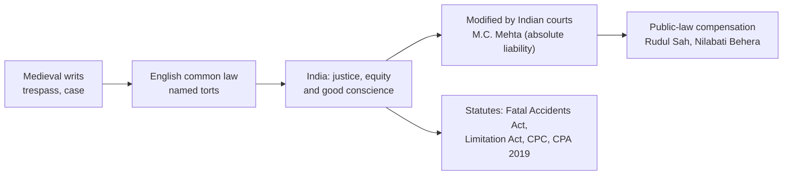

# Paper III · Law of Torts including Consumer Protection Law (K-1003) · Unit 1
## Torts and tortious liability: nature, constituents, fault, damage without injury, parties, strict and absolute liability

> **Last updated:** 2026-10-29 (IST) · **Law stated as on:** 2026-10-28 · **Branch:** `paper/03-law-of-torts`
> **Verify before exam:** case citations in §6 and the "current developments" in §8 (checklist at the end).
> **Syllabus line (official):** *Torts and tortious liability — definition, nature, characteristics; constituents of tort; fault; damnum sine injuria / injuria sine damno; mental element (malice, negligence, motive); who may sue and who may not be sued; strict and absolute liability.*

**How this unit has been examined (December 2022–2025).** 14 of the 52 previous questions came from this unit:

- Dec 2025 Q9 (20): "The mere causing of actual loss to another is not necessarily a tort but the mere wrong without any actual loss is a… → [C-02](question-bank/section-c-part-1-units-1-2.md#c-02)
- Dec 2025 Q13 (20): Discuss the rule laid down in Rylands vs Fletcher. Are there any exceptions to this rule? Discuss. → [C-04](question-bank/section-c-part-1-units-1-2.md#c-04)
- Dec 2024 Q2 (4): What do you understand by 'Pigeon Hole Theory'? → [A-07](question-bank/section-a-part-1-units-1-2.md#a-07)
- Dec 2024 Q4 (4): Explain 'Damnum Sine Injuria'. → [A-10](question-bank/section-a-part-1-units-1-2.md#a-10)
- Dec 2024 Q5 (4): What do you mean by 'Strict Liability'? → [A-24](question-bank/section-a-part-1-units-1-2.md#a-24)
- Dec 2024 Q9 (20): The mere causing of actual loss to another is not necessarily a tort but the mere wrong without any actual loss is a… → [C-02](question-bank/section-c-part-1-units-1-2.md#c-02)
- Dec 2023 Q1 (4): Define Tort and point out its main characteristics. → [A-02](question-bank/section-a-part-1-units-1-2.md#a-02)
- Dec 2023 Q5 (4): Give reasons for award of unliquidated damages in Torts. → [A-14](question-bank/section-a-part-1-units-1-2.md#a-14)
- Dec 2023 Q7 (10): Briefly explain the maxim "Injuria Sine Damnum" with the help of relevant decided case-laws. [sic — printed as "Injur… → [B-05](question-bank/section-b-part-1-units-1-2.md#b-05)
- Dec 2022 Q2 (4): What is the difference between tort and crime? → [A-05](question-bank/section-a-part-1-units-1-2.md#a-05)
- Dec 2022 Q5 (4): On what principle the maxim Damnum Sine Injuria underlies? → [A-11](question-bank/section-a-part-1-units-1-2.md#a-11)
- Dec 2022 Q6 (10): When a right to action for a tort comes to an end or discharged? → [B-07](question-bank/section-b-part-1-units-1-2.md#b-07)
- Dec 2022 Q7 (10): Explain the difference between tort and contract. → [B-02](question-bank/section-b-part-1-units-1-2.md#b-02)
- Dec 2022 Q8 (10): What are necessary conditions of liability for foreign tort? → [B-08](question-bank/section-b-part-1-units-1-2.md#b-08)

*Source: the transcribed papers in [`docs/past-papers/paper-3-law-of-torts.md`](../../docs/past-papers/paper-3-law-of-torts.md). Unit assignment is by the main topic of the question. Topic frequency across all units is in the [question-bank README](question-bank/README.md#frequency).*

---

## 1. Background: where the law of torts comes from

1. **Word and idea.** *Tort* comes from the Latin *tortum*, "twisted" or "wrong", through Norman French. A tort is a civil wrong that the law redresses by compensation, not by punishment.
2. **English origin.** The law grew out of the medieval writs of **trespass** and **trespass on the case**, issued by the King's courts. A plaintiff had to fit his complaint into a recognised form of action. That is why, even today, the law is a list of named torts (trespass, nuisance, defamation, negligence, deceit and so on) and not a single rule.
3. **Reception in India.** India has **no Torts Code**. Courts in the Presidency towns applied English common law "as modified by Indian conditions" under the rule of *justice, equity and good conscience* (the same phrase that appears in the older Regulations and Letters Patent). After 1950 the Supreme Court has said that English rules are followed where they suit Indian conditions and are changed where they do not. The clearest example is *M.C. Mehta v. Union of India* (1987), which refused to import the exceptions to *Rylands v. Fletcher* wholesale and created the Indian rule of **absolute liability**.
4. **Statutes that touch tort law.** Indian statutes cover parts of the field: the **Fatal Accidents Act, 1855** (dependants' claim for wrongful death); the **Limitation Act, 1963** (time limits for suits in tort); **Code of Civil Procedure, 1908**, ss. 79–82 and O. XXVII (suits by and against the Government); **Art. 300** of the Constitution; the **Motor Vehicles Act, 1988**; the **Public Liability Insurance Act, 1991**; the **National Green Tribunal Act, 2010**; the **Consumer Protection Act, 2019** (Unit 5) and the criminal law on defamation (**BNS 2023, s. 356**, replacing IPC ss. 499–500).
5. **Constitutional tort.** Since the 1980s the Supreme Court and the High Courts also award **compensation as a public-law remedy** for violation of fundamental rights (Art. 32 and Art. 226): *Rudul Sah* (1983), *Nilabati Behera* (1993), *D.K. Basu* (1997). Many students call this "constitutional tort". It is not a tort in the strict sense, because it is against the State and is not the same as a civil suit for damages, but it has filled the gap left by the sovereign-immunity rule (Unit 3).

---

## 2. Definition, nature and characteristics of tort

### 2.1 Definitions (name the writer, the book and the idea)

| Writer | Definition (in substance) | Comment |
|---|---|---|
| **Salmond** (*Law of Torts*) | A civil wrong for which the remedy is a common-law action for **unliquidated damages**, and which is not **exclusively** the breach of a contract or the breach of a trust or other merely equitable obligation | Defines by remedy; tells us what a tort is *not* |
| **Winfield** (*Province of the Law of Tort*, 1931) | Tortious liability arises from the breach of a **duty primarily fixed by law**; such duty is towards persons generally and its breach is redressible by an action for unliquidated damages | Stresses that the duty is imposed by law, not by agreement |
| **Fraser** | An infringement of a **right *in rem*** of a private individual giving a right of compensation at the suit of the injured party | Right against the whole world, as against a right *in personam* in contract |
| **Limitation Act, 1963, s. 2(m)** | "Tort" means a civil wrong which is not exclusively a breach of contract or the breach of a trust | The only statutory definition in India |

### 2.2 Characteristics (the points to write in four lines)

1. A tort is a **civil wrong**, not a crime.
2. The duty broken is **fixed by law** and is owed to people **in general**, not to a particular person as in contract.
3. The remedy is an action for **unliquidated damages** (an amount decided by the court). Injunction and specific restitution are also available.
4. The wrong is **not exclusively** a breach of contract, trust or other equitable obligation.
5. The **injured person** (and not the State) starts the proceedings.
6. Liability can arise **without** a mental element (strict and absolute liability), and in some torts **malice** is the gist (malicious prosecution).

### 2.3 Tort distinguished from crime, contract and breach of trust

| Point | Tort | Crime | Contract |
|---|---|---|---|
| Nature of wrong | Private wrong to a person | Public wrong to society | Breach of a promise |
| Duty | Fixed by law, owed to people in general | Fixed by law, owed to the State | Created by the parties, owed to a party |
| Parties | Injured person v. wrongdoer | State v. accused | Promisee v. promisor |
| Remedy | Unliquidated damages (also injunction) | Punishment: imprisonment, fine, community service | Damages (often liquidated), specific performance |
| Mental element | Not always required | Usually *mens rea* | Not relevant |
| Compromise | Plaintiff can forgive or settle freely | Compoundable only in listed cases | Parties can settle |
| Codification | Mostly uncodified | Codified (BNS, 2023) | Codified (Contract Act, 1872) |

*The same act can be both a tort and a crime* (e.g. assault, defamation, negligent driving causing death), and the injured person may use the civil and the criminal remedy. The same act can also be a tort and a breach of contract (e.g. negligence by a doctor treating a paying patient); *Henderson v. Merrett Syndicates* (1995) allows the plaintiff to choose the more favourable action †.

### 2.4 Theories: "law of torts" or "law of tort"? (the *pigeon-hole* question)

| Theory | Who | Idea | Authority |
|---|---|---|---|
| **Pigeon-hole theory** | **Salmond** (strictly, Salmond's *Law of Torts* is "the law of torts") | There is only a list of torts. If the wrong does not fit an existing "pigeon-hole" (trespass, nuisance, defamation etc.) it is **not actionable** | The writs system; *Mogul Steamship v. McGregor* (1889) |
| **General principle theory** | **Winfield** ("law of tort") | Any harm caused by a person without lawful justification is actionable; the named torts are only examples | *Donoghue v. Stevenson* (1932) created a new tort, and *Rookes v. Barnard* (1964) recognised intimidation; *Wilkinson v. Downton* (1897) |

**Position today.** Courts follow neither theory in full. Existing torts are extended step by step to new facts (*Donoghue v. Stevenson*; *Hedley Byrne*; *Rylands v. Fletcher*; the Indian extension in *M.C. Mehta*). Writers say the law is "a list of torts that grows". The question is set in the exam as the **pigeon-hole theory** (Dec 2024 A2).

---

## 3. Constituents of a tort

Every tort has three elements. A claim fails if any one is missing.

1. **A wrongful act or omission** by the defendant. The act must be one that the law forbids (or an omission of a duty that the law imposes). A *lawful* act, however harmful, is not a tort.
2. **A legal duty owed to the plaintiff**, and breach of it. The duty must be **recognised by the law**, not just moral or social. (*Bourhill v. Young* (1943): no duty to a bystander who was not within reasonable range of harm.)
3. **Legal damage** to the plaintiff: invasion of a **legal right**. Two kinds:
   - **Actionable *per se*** (without proof of damage): trespass, libel, assault, battery, false imprisonment. Here the law presumes damage.
   - **Actionable only on proof of damage**: negligence, nuisance (private), deceit, and slander (English rule; the Indian position is discussed in Unit 4C).

*Legal remedy.* A fourth element is often mentioned: **a remedy** (*ubi jus ibi remedium*): where there is a right there is a remedy. Remedies are in §5.

### 3.1 Wrongful act and omission

- A person is liable for an **omission** only if he was **under a duty to act** (e.g. an occupier of premises, an employer, a doctor, a person who has created a danger). There is no general duty to rescue a stranger under Anglo-Indian tort law. *Stovin v. Wise* (1996) refused liability for a failure to act by an authority that had only a power.
- **Act of a third party.** A person is generally not liable for the wrongful act of another unless the law makes him so (vicarious liability, Unit 3).

### 3.2 Damnum sine injuria and injuria sine damno

| | ***Damnum sine injuria*** | ***Injuria sine damno*** |
|---|---|---|
| Meaning | **Damage** (loss of money, comfort, custom, health) **without legal injury** (no right of the plaintiff invaded) | **Legal injury** (violation of a legal right) **without actual damage** |
| Result | **Not actionable** | **Actionable *per se*** (the plaintiff gets at least nominal damages) |
| Underlying principle | Losses caused by lawful competition or the lawful use of one's own property are the price of living in society | Every legal right is protected; the court looks to the *right*, not the loss |
| Leading cases | *Gloucester Grammar School Case* (1410) (a rival school did not wrong the first); *Mogul Steamship Co. v. McGregor, Gow & Co.* (1889, 1892) (trade combination to drive out a rival); *Allen v. Flood* (1898); *Bradford Corporation v. Pickles* (1895) (water under one's own land); *Chasemore v. Richards* (1859) | *Ashby v. White* (1703) (voter wrongly refused: remedy for violation of voting right though his candidate won); *Marzetti v. Williams* (1830) (bank wrongly dishonoured a cheque; nominal damages); *Constantine v. Imperial Hotels* (1944) |
| Indian cases | *Ushaben v. Bhagyalaxmi Chitra Mandir* (1978, Gujarat HC): the film *Jai Santoshi Maa* offended religious sentiments; loss of feeling is not the violation of a legal right | *Bhim Singh v. State of J&K* (1985): the MLA's detention was unlawful, and compensation was awarded; the wrong itself is the injury |

*Test (write this).* Ask two questions: (i) **was a legal right of the plaintiff invaded?** (ii) **did the plaintiff suffer actual loss?** Only the first decides liability. The second decides the amount.

### 3.3 Remedies and extinction of liability (see C-06, B-07, B-10)

- **Judicial remedies:** damages (nominal, contemptuous, general, special, aggravated, exemplary), injunction (prohibitory, mandatory, interim), specific restitution of property.
- **Extra-judicial remedies:** self-defence, re-entry on land, recaption of goods, abatement of nuisance, distress damage feasant, expulsion of trespasser.
- **How a right of action ends (Dec 2022 B6):** (i) death of a party (*actio personalis moritur cum persona*), subject to the **Indian Succession Act, 1925, s. 306**; (ii) waiver or acquiescence; (iii) accord and satisfaction; (iv) release; (v) judgment (the cause merges into the judgment, res judicata); (vi) limitation (Limitation Act, 1963, Schedule: one year for false imprisonment, malicious prosecution, libel and slander, with the starting point stated in each Article ‡; the residuary Art. 113 gives three years †; Art. 82 gives two years for a claim under the Fatal Accidents Act †; s. 22 treats a continuing wrong as giving a fresh period at every moment †); (vii) the statutory bar.
- **Foreign tort (Dec 2022 B8):** English rule in *Phillips v. Eyre* (1870) and *Boys v. Chaplin* (1971): the act must be (a) a tort if done at home and (b) actionable in the place where done. See B-08.

---

## 4. Fault and the mental element

### 4.1 Fault, intention, negligence, recklessness

| Concept | Meaning | Example |
|---|---|---|
| **Intention** | Desire to bring about the consequence, or knowledge that it is certain | Trespass, assault, battery, false imprisonment, deceit, malicious prosecution |
| **Negligence** | Failure to take reasonable care when there was a duty | Careless driving, a surgeon's lapse |
| **Recklessness** | Foreseeing a risk and going on regardless | Deceit (*Derry v. Peek*: "reckless, careless whether it be true or false") |
| **Strict liability** | Liability without proof of intention or negligence | *Rylands v. Fletcher*; keeping dangerous animals; liability for hazardous industries |

**Fault** is therefore the general basis of tort liability ("no liability without fault" in negligence), but the law has long recognised **liability without fault** in some areas. The movement in India is **towards stricter liability** for hazardous enterprises (*M.C. Mehta*), motor accidents (no-fault compensation under the Motor Vehicles Act) and consumer law (product liability, CPA 2019 Ch. VI).

### 4.2 Malice and motive

| Term | Meaning | Effect on liability |
|---|---|---|
| **Motive** | The reason that drives a person to act | Generally **irrelevant** to liability: a lawful act is not made unlawful by a bad motive (*Bradford Corporation v. Pickles*, 1895; *Allen v. Flood*, 1898) |
| **Malice in law** | A wrongful act done intentionally without just cause or excuse (*Bromage v. Prosser*, 1825) | Required in some torts (e.g. conspiracy); implied from the act |
| **Malice in fact** (actual malice, spite) | Improper motive: spite, ill-will, a desire to injure | **Relevant** in a few torts: **malicious prosecution**, **defamation** (defeats qualified privilege and fair comment), **conspiracy** (*Quinn v. Leathem*, 1901), **nuisance** (*Christie v. Davey*, 1893: spiteful noise was a nuisance; *Hollywood Silver Fox Farm v. Emmett*, 1936) |

*Exception to the rule:* where an act is done with the **sole** purpose of injuring, the law may turn a lawful act into a wrong (*Christie v. Davey*; contrast *Bradford Corporation v. Pickles*, where the defendant had also a legal right to the water and the bad motive did not matter).

---

## 5. Remedies (summary table)

| Remedy | When | Notes |
|---|---|---|
| **Nominal damages** | Violation of a right without loss | *Ashby v. White* |
| **Contemptuous damages** | Plaintiff has a right but the claim is trivial or unworthy | A very small coin; costs may be refused |
| **General damages** | Presumed or non-quantifiable loss (pain, reputation) | Left to the court |
| **Special damages** | Actual, quantifiable loss (medical bills, lost wages) | Must be pleaded and proved |
| **Aggravated damages** | Where the defendant's conduct (insolence, malice) increased the injury to feelings | Compensatory |
| **Exemplary (punitive) damages** | To punish and deter | *Rookes v. Barnard* (1964) allowed it in three cases (oppressive acts by government servants; calculated profit; statute). Indian courts award exemplary compensation in public-law claims (*Nilabati Behera*) |
| **Injunction** | To restrain a continuing or threatened wrong | Prohibitory or mandatory; Specific Relief Act, 1963, ss. 36–42 |
| **Specific restitution** | Recovery of specific property (*detinue*; in India under the Specific Relief Act, 1963, s. 7 for movables) | |

**Why damages in tort are "unliquidated".** The amount is not fixed beforehand by agreement, so it must be assessed by the court from the facts: pain, loss of earning, reputation harmed. This is the main contrast with the liquidated damages of contract (Contract Act, s. 74). See A-14.

---

## 6. Who may sue and who may not be sued

### 6.1 General rule

Any person can sue and be sued in tort. The exceptions below are **limits of capacity** and **immunities**. A defendant who is not liable personally may still make another (a master, the State) liable; that is Unit 3.

| Class | Position |
|---|---|
| **Minor (infant)** | Can sue through a **next friend**. Can be sued for his own torts, if old enough to understand the nature of the act (the question is one of fact, not age alone). He is **not liable** if the claim is a disguised action on a contract (e.g. fraud in getting the contract) |
| **Person of unsound mind** | Can sue through a guardian. Liable for torts committed, unless the state of mind is such that the particular tort cannot be committed (e.g. one that requires malice or a particular intent). Indian view: liable, with unsoundness considered in assessing damages († textbook) |
| **Corporation** | Can sue and be sued in its **own name**. Liable for the torts of its servants (vicarious liability) and for the acts of its directing officers in the course of the company's business. For torts that need a state of mind (malicious prosecution, deceit), the state of mind of the person who directs the company's action is attributed to the company |
| **Husband and wife** | Each can sue the other under the modern law; the **common-law unity** has gone. In India each spouse is a separate person (personal laws may add rules). A husband is **not** liable for his wife's torts merely because of marriage |
| **Trade unions, firms, clubs** | Registered trade unions can sue and be sued under the **Trade Unions Act, 1926**; partners are jointly and severally liable for the torts of a partner in the ordinary course of business (Indian Partnership Act, 1932, ss. 25–26) |
| **State / Government** | Can be sued under Art. 300 and CPC ss. 79–80 (two months' notice under s. 80); sovereign immunity is limited. See **Unit 3** |
| **Foreign sovereigns and ambassadors** | Immune from suit unless consent is given (CPC s. 86; Diplomatic Relations (Vienna Convention) Act, 1972) |
| **Alien enemies** | Cannot sue without licence, but can be sued |
| **Judges and magistrates** | Not liable for judicial acts done in good faith (Judicial Officers' Protection Act, 1850, s. 1; *Anowar Hussain v. Ajoy Kumar Mukherjee*, 1965) |
| **Convicts and insolvents** | A convict can sue for civil wrongs. In insolvency, claims connected with the debtor's property vest in the official assignee or receiver, while claims for purely personal injury stay with the debtor † |
| **Joint tortfeasors / dead persons** | See Unit 3 and §3.3 |

### 6.2 Who may sue on behalf of another (representative suits)

- **Fatal Accidents Act, 1855, s. 1A:** the **spouse, parent and child** of the deceased may sue for a death caused by a wrongful act, neglect or default, and the compensation is shared as the court directs.
- **Motor Vehicles Act, 1988, s. 166:** the legal representatives of the deceased can claim before the Motor Accidents Claims Tribunal.
- **Consumer Protection Act, 2019, s. 35:** consumer, recognised association, class (with permission), Central or State Government.
- **Public interest litigation:** persons can invoke Art. 32/226 for a class of persons who cannot sue (*Bandhua Mukti Morcha*, 1984).

---

## 7. Strict liability and absolute liability

### 7.1 *Rylands v. Fletcher* (1868)

**Facts.** Rylands (the defendant) employed independent contractors to build a reservoir on his land to supply a mill. Under the land there were old mine shafts and passages that the contractors failed to find and seal. When the reservoir was filled, the water burst through, flooded the plaintiff Fletcher's coal mine and caused heavy damage. There was no negligence on the part of Rylands.

**Exchequer Chamber (Blackburn J., 1866).** "The person who for his own purposes brings on his lands and collects and keeps there anything likely to do mischief if it escapes, must keep it in at his peril, and, if he does not do so, is *prima facie* answerable for all the damage which is the natural consequence of its escape." **House of Lords (1868; Lord Cairns)** affirmed and added that the use of land must be **non-natural**.

**Essentials**
1. Something **dangerous** (likely to do mischief if it escapes) was **brought, collected and kept** by the defendant on his land: water, gas, electricity, fire, explosives, noxious fumes, vibrations, rusty wire, flagpole etc.
2. **Non-natural use of land** (*Rickards v. Lothian*, 1913: not an ordinary use; special use bringing increased danger to others and not merely the ordinary use or such as is proper for the general benefit of the community). In *Read v. J. Lyons* (1947) the House of Lords required **escape** to a place outside the defendant's control. In *Transco v. Stockport MBC* (2003) the House of Lords restated the rule: ordinary use of land includes a normal water pipe.
3. **Escape** from the defendant's land or from the area under his control to a place outside (*Read v. Lyons*, 1947: an explosion in a munitions factory injured a government inspector inside the factory; no escape, no liability).
4. **Damage** (natural consequence). *Cambridge Water Co. v. Eastern Counties Leather* (1994): **foreseeability of the type of damage** is required, bringing the rule closer to nuisance. *Transco* (2003) said the rule is a species of nuisance and not a separate tort.

**Exceptions (write these seven)**
1. **Act of God** (*Nichols v. Marsland*, 1876: an extraordinary rainfall, no human foresight could have prevented the artificial lakes from bursting).
2. **Consent of the plaintiff**: express or implied (e.g. a common source of water for the benefit of both: *Carstairs v. Taylor*, 1871).
3. **Default of the plaintiff**: an injury caused by plaintiff's own acts (*Ponting v. Noakes*, 1894: a horse reached over the defendant's fence and ate poisonous yew leaves).
4. **Act of a stranger** (a third party over whom the defendant had no control): *Box v. Jubb* (1879) (a stranger emptied his reservoir into the defendant's). Contrast *Northwestern Utilities v. London Guarantee*.
5. **Statutory authority** (*Green v. Chelsea Waterworks*, 1894: a water main burst; the company was authorised to lay it and was not negligent).
6. **Natural use of land** (water in ordinary household use; *Rickards v. Lothian*).
7. **Common benefit of both** (the source of danger was maintained for the common benefit of plaintiff and defendant).

### 7.2 The Indian position: absolute liability

- **Before 1987.** Indian courts followed *Rylands v. Fletcher* with its exceptions (e.g. *Madras Railway Co. v. Zamindar of Carvetnagaram*, 1874, a decision on a broken tank, was one of the earliest in India: the rule was applied with allowance for Indian conditions, especially irrigation tanks; † confirm in book).
- **Oleum gas leak (*M.C. Mehta v. Union of India*, (1987) 1 SCC 395; AIR 1987 SC 1086).** Oleum gas escaped from a unit of Shriram Foods and Fertilisers Industries in Delhi in December 1985; one person died and many were affected. The Court (Bhagwati C.J.) held that the *Rylands* rule belongs to an era before industrial hazards and need not be followed. It laid down the rule of **absolute liability**: an enterprise engaged in a **hazardous or inherently dangerous activity** that harms anyone **owes an absolute and non-delegable duty** to the community to ensure no harm; if harm results it is **absolutely liable** to compensate; the **exceptions of *Rylands v. Fletcher* do not apply**; and **the larger and more prosperous the enterprise, the greater the compensation** (so that it has a deterrent effect).
- **Bhopal.** After the Union Carbide gas leak (2–3 December 1984) the Union of India took power to sue on behalf of victims by the **Bhopal Gas Leak Disaster (Processing of Claims) Act, 1985**. The case was settled in 1989 by the Supreme Court for **US $470 million** (*Union Carbide Corporation v. Union of India*, (1989) 1 SCC 674; the settlement was upheld, with questions on criminal liability left open, in (1991) 4 SCC 584). A curative petition by the Union for more money was dismissed on 14 March 2023 (date from memory †).
- **Statutory strict liability.**
  - **Public Liability Insurance Act, 1991**: **no-fault** relief for victims of an accident in handling a hazardous substance; owner must take insurance; the Collector awards relief (s. 3 and s. 4).
  - **National Green Tribunal Act, 2010** (ss. 15, 17): relief and compensation for victims of pollution and environmental damage; **s. 17(3): no-fault liability** where death, injury or damage to property results from an accident in a hazardous activity.
  - **Motor Vehicles Act, 1988**, as amended in 2019 (provisions in force from 1 April 2022): fixed no-fault compensation of **₹5 lakh for death and ₹2.5 lakh for grievous hurt** under the new s. 164, which replaced the structured-formula s. 163A and its Second Schedule ‡ (LiveLaw summary of the commencement; confirm the section numbers in the Act).
  - **Consumer Protection Act, 2019, Ch. VI**: product liability (Unit 5).
- **Later extension.** *Indian Council for Enviro-Legal Action v. Union of India* (1996) held that the *polluter pays* principle and absolute liability apply to a hazardous industry (Bichhri case); *Vellore Citizens' Welfare Forum v. Union of India* (1996) accepted the **precautionary principle**; *M.C. Mehta (Kanpur tanneries; Taj Trapezium)*. 

### 7.3 Strict liability and absolute liability compared (Dec 2024 A5, Dec 2025 C13)

| Point | Strict liability (*Rylands*, 1868) | Absolute liability (*M.C. Mehta*, 1987) |
|---|---|---|
| Source | English House of Lords | Supreme Court of India |
| Scope | Non-natural use of land; dangerous thing that escapes | Hazardous or inherently dangerous industry or activity; **escape not essential** (wider) |
| Exceptions | Seven recognised exceptions | **None**: no defence of Act of God or third-party act |
| Duty | Keep the thing in at one's peril | Absolute and non-delegable duty to the community |
| Measure of damages | Actual damage | Compensation correlated with the capacity of the enterprise (deterrent) |
| Plaintiff | Occupier of land who suffers | Any person harmed |
| Position today | Treated in England as a species of nuisance (*Transco*, 2003) | Law in India for hazardous industries |

### 7.4 Other cases of strict liability (one line each)
- Keeping **dangerous animals** (the *scienter* rule; in England now the Animals Act, 1971).
- Breach of a **statutory duty** where the statute gives a private right of action.
- **Vicarious liability**: the master is liable without personal fault (Unit 3).
- **Product liability** under the Consumer Protection Act, 2019 (Unit 5) and no-fault compensation under the Motor Vehicles Act (above).

---

## 8. Current developments (to November 2026)

1. **Public-law compensation** continues alongside civil suits. The Supreme Court repeats that it does not replace the civil remedy (*Nilabati Behera*; *D.K. Basu*).
2. **The three Indian criminal codes** (BNS, BNSS, BSA) came into force on 1 July 2024. For tort the relevant changes are the **defamation section (BNS s. 356)** with its new punishment of **community service** (Unit 4C), and the **death by negligence section (BNS s. 106)** (Unit 4A).
3. **Hazardous industry.** After the Visakhapatnam gas leak (LG Polymers, 7 May 2020) the **National Green Tribunal** applied absolute liability and ordered an interim deposit († amount from memory; verify). That case followed *M.C. Mehta*.
4. **Carbon and climate.** *M.K. Ranjitsinh v. Union of India* (2024) recognised a right against the adverse effects of climate change under Arts. 14 and 21 († citation and date: check).
5. **Digital torts.** Online defamation, privacy and data torts are decided by extending the old rules; **K.S. Puttaswamy v. Union of India** (2017) recognised privacy as a fundamental right. The **Digital Personal Data Protection Act, 2023** now gives a statutory remedy for data breaches († check the date of full commencement).

---

## 9. Comparison tables and quick-revision box

**Tort v. contract (Dec 2022 B7)**

| Point | Tort | Contract |
|---|---|---|
| Duty | Fixed by law; owed to the world | Created by agreement; owed to the other party |
| Privity | No privity needed | Privity of contract needed (exceptions exist) |
| Damages | Unliquidated | Liquidated or unliquidated (ss. 73–74) |
| Motive | Sometimes relevant | Irrelevant |
| Age | A minor may be liable | A minor's contract is void (*Mohori Bibee*, 1903) |
| Proof of loss | Not always | Needed for substantial damages |
| Overlap | Both may arise from the same facts | |

**Quick-revision box (write these from memory)**
- Salmond: civil wrong, unliquidated damages, not exclusively contract or trust.
- Winfield: duty primarily fixed by law, towards persons generally, damages unliquidated.
- Three elements: wrongful act/omission; legal duty and breach; legal damage.
- *Damnum sine injuria*: *Gloucester Grammar School*, *Mogul Steamship*, *Ushaben*. *Injuria sine damno*: *Ashby v. White*, *Marzetti v. Williams*, *Bhim Singh*.
- Motive: irrelevant (*Pickles*, *Allen v. Flood*), except *Christie v. Davey*-type malice.
- *Rylands*: dangerous thing + non-natural use + escape + damage; seven exceptions.
- *M.C. Mehta* (1987): absolute liability for hazardous activity, no exceptions, deterrent compensation.
- Limitation: one year for false imprisonment, malicious prosecution, libel and slander (Arts. 73–76) ‡.

---

## 10. Question bank (model answers)

> **The model answers for this unit are in the [`question-bank/`](question-bank/README.md) folder**, written for the real CCSU pattern (confirmed on all 20 papers, Dec 2022–2025): Section A, 4 marks, ≤ 75 words; Section B, 10 marks, ≤ 200 words; Section C, 20 marks, "in detail". Every rubric in the bank is my own; the university publishes no marking scheme. Cases and statutes: [`cases-and-statutes-digest.md`](question-bank/cases-and-statutes-digest.md) (case entries for this unit: 1–17). Mock papers: [1](question-bank/mock-exam-1.md), [2](question-bank/mock-exam-2.md), [3](question-bank/mock-exam-3.md).

**Section C (20 marks)**

- [C-01](question-bank/section-c-part-1-units-1-2.md#c-01) Define tort. Discuss its nature and characteristics, and distinguish it from crime and contract
- [C-02](question-bank/section-c-part-1-units-1-2.md#c-02) "The mere causing of actual loss to another is not necessarily a tort, but the mere wrong without any actual loss is a tort." Explain with decided cases *(set Dec 2025 Q9; Dec 2024 Q9)*
- [C-03](question-bank/section-c-part-1-units-1-2.md#c-03) Discuss the mental element in tort: fault, intention, negligence, malice and motive
- [C-04](question-bank/section-c-part-1-units-1-2.md#c-04) Discuss the rule in *Rylands v. Fletcher*. Are there any exceptions to the rule? Discuss *(set Dec 2025 Q13)*
- [C-05](question-bank/section-c-part-1-units-1-2.md#c-05) Who may sue and who may not be sued for a tort? Discuss the capacity of parties
- [C-06](question-bank/section-c-part-1-units-1-2.md#c-06) Remedies in tort; how the right of action ends; and liability for a foreign tort

**Section B (10 marks)**

- [B-01](question-bank/section-b-part-1-units-1-2.md#b-01) Distinguish between tort and crime
- [B-02](question-bank/section-b-part-1-units-1-2.md#b-02) Explain the difference between tort and contract *(set Dec 2022 Q7)*
- [B-03](question-bank/section-b-part-1-units-1-2.md#b-03) Define tort. What are its essential elements?
- [B-04](question-bank/section-b-part-1-units-1-2.md#b-04) Explain *damnum sine injuria* with decided cases
- [B-05](question-bank/section-b-part-1-units-1-2.md#b-05) Briefly explain the maxim *injuria sine damno* with the help of decided cases *(set Dec 2023 Q7)*
- [B-06](question-bank/section-b-part-1-units-1-2.md#b-06) Explain the "pigeon-hole" theory of torts. Is the law of torts a list of torts or a general principle?
- [B-07](question-bank/section-b-part-1-units-1-2.md#b-07) When does a right of action for a tort come to an end or get discharged? *(set Dec 2022 Q6)*
- [B-08](question-bank/section-b-part-1-units-1-2.md#b-08) What are the necessary conditions of liability for a foreign tort? *(set Dec 2022 Q8)*
- [B-09](question-bank/section-b-part-1-units-1-2.md#b-09) Distinguish between malice and motive in the law of torts
- [B-10](question-bank/section-b-part-1-units-1-2.md#b-10) Discuss the remedies available in an action for tort. What are the kinds of damages?
- [B-11](question-bank/section-b-part-1-units-1-2.md#b-11) Who may sue and be sued for a tort? Discuss the capacity of parties
- [B-12](question-bank/section-b-part-1-units-1-2.md#b-12) State and explain the rule in *Rylands v. Fletcher*
- [B-13](question-bank/section-b-part-1-units-1-2.md#b-13) What are the exceptions to the rule in *Rylands v. Fletcher*?
- [B-14](question-bank/section-b-part-1-units-1-2.md#b-14) Explain the rule of absolute liability. How does it differ from strict liability?

**Section A (4 marks), 30 answers**

- [A-01](question-bank/section-a-part-1-units-1-2.md#a-01) Meaning of "tort"
- [A-02](question-bank/section-a-part-1-units-1-2.md#a-02) Define tort and state its main characteristics *(set Dec 2023 Q1)*
- [A-03](question-bank/section-a-part-1-units-1-2.md#a-03) Winfield's definition
- [A-04](question-bank/section-a-part-1-units-1-2.md#a-04) Salmond's definition
- [A-05](question-bank/section-a-part-1-units-1-2.md#a-05) Difference between tort and crime *(set Dec 2022 Q2)*
- [A-06](question-bank/section-a-part-1-units-1-2.md#a-06) Difference between tort and contract
- [A-07](question-bank/section-a-part-1-units-1-2.md#a-07) Pigeon-hole theory *(set Dec 2024 Q2)*
- [A-08](question-bank/section-a-part-1-units-1-2.md#a-08) Elements of a tort
- [A-09](question-bank/section-a-part-1-units-1-2.md#a-09) Legal damage; torts actionable *per se
- [A-10](question-bank/section-a-part-1-units-1-2.md#a-10) *Damnum sine injuria *(set Dec 2024 Q4)*
- [A-11](question-bank/section-a-part-1-units-1-2.md#a-11) Principle underlying *damnum sine injuria *(set Dec 2022 Q5)*
- [A-12](question-bank/section-a-part-1-units-1-2.md#a-12) *Injuria sine damno
- [A-13](question-bank/section-a-part-1-units-1-2.md#a-13) *Ubi jus ibi remedium
- [A-14](question-bank/section-a-part-1-units-1-2.md#a-14) Reasons for unliquidated damages in tort *(set Dec 2023 Q5)*
- [A-15](question-bank/section-a-part-1-units-1-2.md#a-15) Kinds of damages
- [A-16](question-bank/section-a-part-1-units-1-2.md#a-16) Injunction
- [A-17](question-bank/section-a-part-1-units-1-2.md#a-17) *Actio personalis moritur cum persona
- [A-18](question-bank/section-a-part-1-units-1-2.md#a-18) Foreign tort
- [A-19](question-bank/section-a-part-1-units-1-2.md#a-19) Malice in law and malice in fact
- [A-20](question-bank/section-a-part-1-units-1-2.md#a-20) Motive in tort
- [A-21](question-bank/section-a-part-1-units-1-2.md#a-21) Fault, intention, negligence and recklessness
- [A-22](question-bank/section-a-part-1-units-1-2.md#a-22) Minors and persons of unsound mind
- [A-23](question-bank/section-a-part-1-units-1-2.md#a-23) Corporations, the State and foreign sovereigns
- [A-24](question-bank/section-a-part-1-units-1-2.md#a-24) Strict liability *(set Dec 2024 Q5)*
- [A-25](question-bank/section-a-part-1-units-1-2.md#a-25) The rule in *Rylands v. Fletcher
- [A-26](question-bank/section-a-part-1-units-1-2.md#a-26) Non-natural use of land
- [A-27](question-bank/section-a-part-1-units-1-2.md#a-27) Exceptions to *Rylands v. Fletcher
- [A-28](question-bank/section-a-part-1-units-1-2.md#a-28) Absolute liability
- [A-29](question-bank/section-a-part-1-units-1-2.md#a-29) *M.C. Mehta v. Union of India* (1987)
- [A-30](question-bank/section-a-part-1-units-1-2.md#a-30) Bhopal gas leak (1984)

---

## 11. Verification checklist (do before the exam)

- [ ] Limitation Act, 1963, s. 2(m) and Arts. 72–78 (periods for torts)
- [ ] *M.C. Mehta v. Union of India* (1987) 1 SCC 395; *Union Carbide Corpn. v. Union of India* (1989) 1 SCC 674 and (1991) 4 SCC 584
- [ ] *Ushaben v. Bhagyalaxmi Chitra Mandir* AIR 1978 Guj 13 · *Bhim Singh v. State of J&K* (1985) 4 SCC 677
- [ ] *Transco v. Stockport* [2003] UKHL 61 · *Cambridge Water* [1994] 2 AC 264
- [ ] Indian Succession Act, 1925, s. 306 (survival of causes of action)
- [ ] Public Liability Insurance Act, 1991; NGT Act, 2010, s. 17(3)
- [ ] Curative petition on Bhopal compensation: result and date
- [ ] Whether your teacher/textbook treats slander as actionable *per se* in India (Unit 4C)
