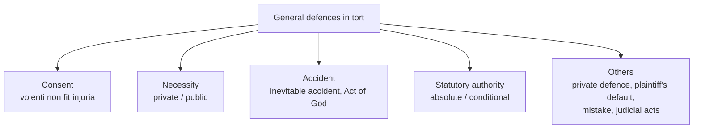

# Paper III · Law of Torts including Consumer Protection Law (K-1003) · Unit 2
## Justifications in tort: volenti non fit injuria, necessity, inevitable accident and Act of God, statutory authority (and other defences)

> **Last updated:** 2026-10-29 (IST) · **Law stated as on:** 2026-10-28 · **Branch:** `paper/03-law-of-torts`
> **Verify before exam:** case citations in §7 and the "current developments" in §8 (checklist at the end).
> **Syllabus line (official):** *Justifications in tort — volenti non fit injuria; necessity; inevitable accident and Act of God; statutory authority.*

**How this unit has been examined (December 2022–2025).** 4 of the 52 previous questions came from this unit:

- Dec 2025 Q5 (4): Define inevitable accident. → [A-36](question-bank/section-a-part-1-units-1-2.md#a-36)
- Dec 2025 Q6 (10): Harm suffered voluntarily is not actionable but mere knowledge of the risk is not enough for the application of this… → [B-15](question-bank/section-b-part-1-units-1-2.md#b-15)
- Dec 2024 Q6 (10): Explain the distinction between "Inevitable accident and act of god." → [B-18](question-bank/section-b-part-1-units-1-2.md#b-18)
- Dec 2023 Q9 (20): "It is the 'Consent' which is the basis of doctrine of Volenti non fit Injuria and not knowledge of the risk." Elucid… → [C-07](question-bank/section-c-part-1-units-1-2.md#c-07)

*Source: the transcribed papers in [`docs/past-papers/paper-3-law-of-torts.md`](../../docs/past-papers/paper-3-law-of-torts.md). Unit assignment is by the main topic of the question. Topic frequency across all units is in the [question-bank README](question-bank/README.md#frequency).*

---

## 1. Background: what a "defence" does in tort

1. A plaintiff proves the three elements of a tort (act, duty and breach, damage: Unit 1). The defendant may still escape liability by pleading a **defence** (also called a *justification* or *excuse*): a fact or rule that makes the act lawful or removes the defendant's responsibility.
2. The defences are of two kinds:
   - **Justifications**, where the act was lawful in the circumstances (consent, necessity, private defence, statutory authority).
   - **Excuses**, where the act was wrongful in itself but the defendant was not to blame (inevitable accident, Act of God, mistake).
3. The **burden of proof** is on the defendant who pleads the defence. The plaintiff's case must first be made out.
4. Contributory negligence (Unit 4A) is treated in many books as a "defence", but it does not defeat the claim. It **reduces** the damages. The CCSU syllabus lists only the four defences above, which the previous papers confirm (volenti: Dec 2023 C9, Dec 2025 B6; inevitable accident and Act of God: Dec 2024 B6, Dec 2025 A5; statutory authority: not yet asked directly).

---

## 2. *Volenti non fit injuria* ("to a willing person no injury is done")

### 2.1 Rule and rationale

A person who **voluntarily and with full knowledge agrees to run the risk** of harm cannot complain when the harm happens. The act is justified by consent. It rests on the idea of autonomy and fair play: the plaintiff made his choice.

### 2.2 Two forms
1. **Consent to an act that would otherwise be a tort** (e.g. a boxing match, a surgical operation, a tackle in a football match).
2. **Consent to the risk of negligence or an unsafe situation** (e.g. a passenger who knowingly accepts a lift from a drunk driver: the law is strict about this, see below).

### 2.3 Essentials
1. **Knowledge of the risk** (the plaintiff must know the *nature and extent* of the risk).
2. **Free and voluntary assent** to the risk, not mere knowledge, and not assent under pressure of a duty, an emergency or economic compulsion.
3. The act must be **within the scope of the consent**. Consent to one act, or one risk, is not consent to a different or greater one.
4. The consent must be that of a person with **capacity** (not a child, not a person of unsound mind) and **not obtained by fraud** (*R v. Williams* (1923): a singing teacher who persuaded a girl that intercourse was a voice-training exercise obtained no consent; the same principle applies to civil wrongs).

### 2.4 The leading rule: consent, not mere knowledge (Dec 2023 C9, Dec 2025 B6)

| Case | Facts | Held |
|---|---|---|
| **Smith v. Baker & Sons** [1891] AC 325 | The plaintiff drilled rock in a cutting. A crane swung heavy stones over his head. He knew of the danger and complained. A stone fell and injured him. The employer was negligent | **Not volenti.** Knowledge of the risk is not the same as agreement to run it. The maxim is *volenti non fit injuria*, not *scienti*. The plaintiff continued working because he had to earn a living, not because he consented to the employer's negligence |
| **Thomas v. Quartermaine** (1887) 18 QBD 685 † | A brewery worker was injured when he fell into a vat of boiling liquid while working with a danger he knew of | The older case that is usually set against *Smith v. Baker*. It is cited for the statement that the maxim applies where the plaintiff has really accepted the risk, and mere knowledge of danger is not a defence by itself |
| **Dann v. Hamilton** [1939] 1 KB 509 | The plaintiff accepted a lift from a driver she knew was drunk. The driver crashed and she was injured | **Not volenti.** Knowing that the driver was drunk did not mean she consented to the risk of injury; the defence failed and she recovered damages. (Today the court would also consider contributory negligence.) |
| **Nettleship v. Weston** [1971] 2 QB 691 | A friend agreed to teach the defendant to drive after confirming that she was insured. On the third lesson the defendant crashed into a lamp post and injured him | **Not volenti** unless the plaintiff expressly agrees to waive his claim. The learner's standard of care is that of a competent driver. Contributory negligence reduced damages by 50% |
| **I.C.I. v. Shatwell** [1965] AC 656 | Two shot-firers deliberately broke safety rules and tested a detonator without taking cover. One was injured and sued the employer, who was vicariously liable for the other | **Volenti** succeeded. The plaintiff had himself joined in the breach and knew and accepted the risk |
| **Hall v. Brooklands Auto-Racing Club** [1933] 1 KB 205 | A spectator at a motor race was injured when a car left the track | **Volenti** (or no breach): a spectator accepts the inherent risks of the sport |
| **Wooldridge v. Sumner** [1963] 2 QB 43 | A photographer at a horse show was knocked down by a horse that was ridden too fast | No liability if the rider acted in the "agony of the moment" without reckless disregard for spectators' safety; a spectator accepts risks, but not those which come from reckless disregard |
| **Condon v. Basi** [1985] 1 WLR 866 | A footballer broke a leg in a bad tackle | Player liable, because the tackle fell below the standard of a reasonable player in that league; sport does not remove the duty |

### 2.5 Exceptions: where the defence does not work
1. **Rescue cases.** A person who is hurt while rescuing someone in danger caused by the defendant's wrong does not "consent" to the risk. The law says "danger invites rescue" (Cardozo J., *Wagner v. International Railway*, 1921). *Haynes v. Harwood* [1935] 1 KB 146 (a police constable who stopped a runaway horse, injured; the owner's servant had left it unattended); *Baker v. T.E. Hopkins & Son* [1959] 1 WLR 966 (a doctor died trying to save workmen overcome by fumes in a well); *Chadwick v. British Railways Board* [1967] 1 WLR 912 (nervous shock to rescuer). A rescuer who acts rashly may bear a share of the blame (contributory negligence).
2. **Unfair exclusion of liability.** An attempt to exclude liability for death or personal injury caused by negligence cannot be made by a notice (English Unfair Contract Terms Act, 1977, s. 2(1); in India the Contract Act, s. 23 and the unfair-contract provisions of the CPA 2019 point the same way †).
3. **Compulsion or duty.** An employee who works in dangerous conditions for his wages is not volenti (*Smith v. Baker*; *Bowater v. Rowley Regis Corporation* [1944] KB 476: a carter who was ordered to drive a vicious horse was not volenti).
4. **Statutory duty and criminal acts.** Consent cannot make lawful an act that the law forbids for the protection of the public (e.g. a fight with intent to harm).
5. **Medical treatment without informed consent.** Consent must be informed: *Samira Kohli v. Dr. Prabha Manchanda* (2008) 2 SCC 1 (the Supreme Court held that a surgeon who carries out an additional procedure not authorised by consent, without an emergency, commits battery) † and see Unit 4A.
6. **Unborn and minors.** A child's consent is not enough where she cannot appreciate the risk.

### 2.6 Volenti and contributory negligence

| Point | *Volenti* | Contributory negligence |
|---|---|---|
| Effect | **Complete defence** (the claim fails) | **Reduces** damages (apportionment) |
| Basis | Plaintiff agreed to the risk | Plaintiff failed to take reasonable care for his own safety |
| Plaintiff's knowledge | Full knowledge of the risk and assent | Need not know the risk; he need only be careless |
| Modern attitude | Narrow: courts prefer contributory negligence (*Dann*; *Nettleship*) | The usual route |

### 2.7 Volenti in India
Indian courts accept the maxim but apply it narrowly, mostly in cases of sport, employment and medical procedures. In motor accident claims the courts prefer to apportion blame (Unit 4A). For medical operations the leading Indian rule on consent is *Samira Kohli* (2008) †; for sports there is no leading Supreme Court case that I could confirm, so English cases (*Condon v. Basi*) are used.

---

## 3. Necessity

### 3.1 Meaning
An act that would otherwise be a tort is justified if it was done **to prevent a greater harm** to oneself, to another or to the public, and the harm prevented was **greater** than the harm caused. Necessity is a justification, not an excuse, but it is **narrowly applied**.

### 3.2 Kinds
- **Private necessity**: to save the defendant's own property or person, or another's (*Cope v. Sharpe (No. 2)* [1912] 1 KB 496: the defendant entered the plaintiff's land and set fire to heather to stop the spread of a fire to the adjoining property he was protecting; he was held not liable because the act was necessary and reasonable; *Mouse's Case* (1608) 12 Co Rep 63: when a ferry was in danger in a storm, a casket was thrown overboard to save the passengers' lives, and the thrower was held not liable).
- **Public necessity**: to protect the community (pulling down a house to stop the spread of a fire; destroying infected animals).
- **Medical necessity**: treating an unconscious patient without consent where treatment is urgent and in the patient's interest (*Re F* [1990] 2 AC 1).

### 3.3 Limits (cases that refuse the plea)
| Case | Result |
|---|---|
| ***Southwark LBC v. Williams*** [1971] Ch 734 | Homeless squatters who occupied vacant council houses could not plead necessity: if the plea is allowed, "no man's house will be safe" |
| ***Esso Petroleum Co. v. Southport Corporation*** [1956] AC 218 † | A tanker ran aground. The captain discharged oil to save the ship and crew, and the oil fouled the foreshore. The House of Lords held the owners not liable because the stranding was not due to negligence; the case shows that necessity is not a defence where the danger was caused by the defendant's own fault |
| ***Leigh v. Gladstone*** (1909) | Forcible feeding of a suffragette prisoner was justified by the duty to preserve life (an example of public necessity) † |

### 3.4 Necessity and private defence in India
Indian criminal law provides for necessity (IPC s. 81; **BNS s. 19** †) and for the right of private defence of the body and property (IPC ss. 96–106; **BNS ss. 34–44** †). These provisions are not tort law, but courts use them to decide what is reasonable. The two ideas differ: **necessity** is a response to a danger from natural forces or a third party, where an innocent person's property may be harmed; **private defence** is a response to a wrongful attack by the person against whom the defence is directed.

### 3.5 Private defence in tort
Reasonable force may be used to defend one's person, property or another's. The force must be **proportionate**; spring-guns and traps for trespassers are unlawful (*Bird v. Holbrook* (1828), a spring-gun injured a trespasser who had entered a walled garden to look for a stray peahen; the defendant was liable). Mistaken belief in danger: the test is whether the belief was reasonable (*Ashley v. Chief Constable of Sussex* [2008] UKHL 25 †).

---

## 4. Inevitable accident and Act of God

### 4.1 Inevitable accident
**Meaning.** An accident that **could not have been avoided by the exercise of ordinary care, caution and skill** (Stephen's definition, adopted in the cases). It means "not avoidable by a reasonable man", not "absolutely unavoidable".

| Case | Facts | Held |
|---|---|---|
| ***Stanley v. Powell*** [1891] 1 QB 86 | A member of a shooting party fired at a pheasant; the bullet glanced off a tree and wounded a beater | No liability: the accident was inevitable; trespass requires intention or negligence |
| ***Brown v. Kendall*** (1850) 60 Mass 292 | Two dogs were fighting. The defendant tried to separate them and, in raising his stick, hit the plaintiff in the eye | Not liable if he used ordinary care in a lawful act; Shaw C.J. held that the plaintiff must show want of due care |
| ***Holmes v. Mather*** (1875) LR 10 Ex 261 | The defendant's horses bolted after being frightened by a barking dog; the driver tried but failed to stop them and the plaintiff was injured | No liability, as the driver had done what a reasonable man would do |

**A person's sudden illness** at the wheel may be inevitable accident (*Mansfield v. Weetabix* [1998] 1 WLR 1263: a driver who did not know he was hypoglycaemic was not negligent), but not if he knew of the risk of blackouts and still drove.

### 4.2 Act of God
**Meaning.** An operation of **natural forces** (storm, flood, earthquake, lightning, unprecedented rainfall) **which no human foresight or prudence could reasonably have been expected to anticipate**, without human intervention (the classic statement is in *Nugent v. Smith* (1876), a carrier's case †).

**Essentials**
1. The event is due to the operation of **natural forces**, with no human agency.
2. It is **extraordinary**, not one that could have been anticipated by a reasonable man. Ordinary storms or floods that are known to happen in that place are not Act of God.
3. It could **not be prevented by reasonable precautions**.

**Cases:** *Nichols v. Marsland* (1876) 2 Ex D 1 (an unprecedented storm broke down artificial lakes made by the defendant; no liability under *Rylands*; the jury found that the rain was "an Act of God", beyond anything that could reasonably be anticipated); *Greenock Corporation v. Caledonian Railway* [1917] AC 556 (a very heavy rainfall flooded the plaintiff's land because the defendant had changed the course of a stream; held the rainfall was not Act of God, because the damage was caused by the defendant's own works and the rain was something it ought to have provided for) †.

### 4.3 Inevitable accident v. Act of God (Dec 2024 B6)

| Point | Inevitable accident | Act of God |
|---|---|---|
| Relation | The **wider** category (genus) | A **species** of inevitable accident |
| Cause | May be human or natural: the actions of people, a sudden fit, a machine's hidden defect | **Natural forces only**; no human cause |
| Foresight | Could not have been avoided by reasonable care | Could not have been foreseen at all by human foresight |
| Test | Ordinary care, caution and skill | Extraordinary natural event; unforeseeable |
| Examples | *Stanley v. Powell*; *Holmes v. Mather* | *Nichols v. Marsland*; a cyclone of exceptional strength |
| Effect | No liability (no fault) | No liability; exception to *Rylands* and to a carrier's strict liability |
| Defence under strict liability | Not recognised under *Rylands* in general; not under absolute liability | Recognised in *Rylands*; **not** recognised under *M.C. Mehta* |

*Indian note.* At common law a common carrier is an insurer of the goods except for loss caused by Act of God or the enemies of the State. In India the **Carriers Act, 1865** governs the carrier's liability; s. 9 says the owner of the goods need not prove the carrier's negligence †.

---

## 5. Statutory authority

### 5.1 Rule
An act **authorised by a statute** is not a tort even if it causes damage that would otherwise be actionable. The remedy, if any, is the compensation that the statute gives. Parliament's authority overrides private rights. The authority is of two kinds:

| Kind | Meaning | Effect |
|---|---|---|
| **Absolute (mandatory)** | The statute **orders** the act (or authorises it in a way that makes harm inevitable) | Complete defence, provided there is no negligence |
| **Conditional (permissive)** | The statute only **permits** the act, leaving the manner to the authority | The defence applies **only if** the authority took reasonable care and used the least harmful way; it is not a defence to negligence or to a nuisance that could be avoided |

### 5.2 Cases
- ***Vaughan v. Taff Vale Railway*** (1860) 5 H & N 679: sparks from the engine of a railway company set fire to the plaintiff's woods. The company had statutory power to run engines and had used every precaution. No liability.
- ***Hammersmith & City Railway v. Brand*** (1869) LR 4 HL 171: vibrations from running trains lessened the value of the plaintiff's house. No compensation, because the statute authorised the railway and gave no right of action.
- ***Metropolitan Asylum District v. Hill*** (1881) 6 App Cas 193: managers built a smallpox hospital in a residential area under a general power. The plaintiffs complained of the risk of infection. The House of Lords held that a **permissive** power does not authorise a nuisance; an injunction issued.
- ***Geddis v. Proprietors of Bann Reservoir*** (1878) 3 App Cas 430: statutory authority is no defence for **negligence**.
- ***Allen v. Gulf Oil Refining*** [1981] AC 1001: the Act authorised the construction of a refinery. The nuisance it caused was an inevitable result of the use authorised, so the action failed.
- **Indian cases.** *Municipal Council, Ratlam v. Vardhichand* AIR 1980 SC 1622: a statutory body cannot plead lack of funds to excuse a failure to perform its duty to remove a nuisance (sewage). The Indian courts have in other cases held a statutory body liable for negligence in carrying out its statutory work (e.g. *Municipal Corporation of Delhi v. Subhagwanti*, AIR 1966 SC 1750: the clock tower collapsed; the corporation was liable, because it had a duty to maintain it). 
- **Contrast with the Constitution.** A statute that infringes a fundamental right is void (Art. 13), so statutory authority is no defence against a claim for violation of the Constitution.

### 5.3 Summary of the rule
(i) The act must be **authorised** by the statute; (ii) the authority must have used **due care** and chosen the method that causes **least harm** (for a permissive power); (iii) the statute may or may not give **compensation**; and (iv) the defence does not cover acts beyond the authority.

---

## 6. Other defences (short notes)

| Defence | Rule | Example or case |
|---|---|---|
| **Plaintiff's default** | The plaintiff's own wrong is the cause; he cannot recover | *Ponting v. Noakes* (Unit 1); contributory negligence (Unit 4A) |
| **Mistake** | Generally **not** a defence in tort (honest belief does not justify an interference) | *Hollins v. Fowler* (1875): an innocent purchaser of cotton was liable in conversion; *Consolidated Co. v. Curtis* (1892) (auctioneer) |
| **Private defence** | See §3.5 | *Bird v. Holbrook* |
| **Parental and quasi-parental authority** | A parent or teacher may use reasonable force to correct a child | Corporal punishment is now restricted by the Right of Children to Free and Compulsory Education Act, 2009, s. 17 † |
| **Judicial and quasi-judicial acts** | Judges are not liable for acts done in the exercise of judicial functions in good faith | Judicial Officers' Protection Act, 1850, s. 1; *Anowar Hussain v. Ajoy Kumar Mukherjee* AIR 1965 SC 1651 |
| **Executive acts and public officers** | Protection for acts done in good faith in official duty; notice requirements | CPC s. 80; BNSS s. 218 (earlier CrPC s. 197) † |
| **Acts of State** | Acts of the State against foreigners outside its territory are not justiciable in municipal courts | *Secretary of State v. Kamachee Boye Sahiba* (1859) † |
| **Limitation / lapse of time** | The remedy is barred | Limitation Act, 1963 |

---

## 7. Cases at a glance (use the digest for facts and holdings)

| Topic | Cases |
|---|---|
| Volenti | *Smith v. Baker* (1891); *Dann v. Hamilton* (1939); *Nettleship v. Weston* (1971); *I.C.I. v. Shatwell* (1965); *Hall v. Brooklands* (1933); *Haynes v. Harwood* (1935); *Baker v. Hopkins* (1959); *Bowater v. Rowley Regis* (1944); *Samira Kohli* (2008) |
| Necessity | *Cope v. Sharpe (No. 2)* (1912); *Mouse's Case* (1608); *Southwark LBC v. Williams* (1971); *Re F* (1990); *Esso v. Southport* (1956) |
| Inevitable accident | *Stanley v. Powell* (1891); *Brown v. Kendall* (1850); *Holmes v. Mather* (1875); *Mansfield v. Weetabix* (1998) |
| Act of God | *Nichols v. Marsland* (1876); *Greenock v. Caledonian Rly* (1917) |
| Statutory authority | *Vaughan v. Taff Vale* (1860); *Hammersmith Rly v. Brand* (1869); *Metropolitan Asylum v. Hill* (1881); *Geddis v. Bann Reservoir* (1878); *Allen v. Gulf Oil* (1981); *Ratlam* (1980) |

---

## 8. Current developments (to November 2026)

1. **Consent in medicine.** Informed consent remains the rule (*Samira Kohli*, 2008). The Supreme Court has also recognised the right to refuse treatment (living wills in *Common Cause v. Union of India*, 2018, as modified in January 2023) †.
2. **Sport and risk.** The courts still use *Condon v. Basi*; no Supreme Court authority on volenti in sport was found.
3. **Disaster law.** The Disaster Management Act, 2005 gives authorities wide powers in a disaster; acts done in good faith under it carry statutory protection (s. 73 †).
4. **Absolute liability.** In hazardous industry the defences of Act of God and the act of a third party are excluded (*M.C. Mehta*, Unit 1). Many questions on inevitable accident and Act of God are therefore best answered with a note on this exclusion.

---

## 9. Comparison tables and quick-revision box

**Justification v. excuse.** Justification: the act is lawful (consent, necessity, private defence, statutory authority). Excuse: the act is wrong but the defendant is not to blame (inevitable accident, Act of God, mistake).

**Quick-revision box**
- *Volenti* = knowledge **plus** free assent (*Smith v. Baker*); not available to rescuers, and not for negligent driving by a drunk driver (*Dann*).
- Necessity: greater harm avoided; *Cope v. Sharpe*; refused in *Southwark v. Williams*.
- Inevitable accident = not avoidable by ordinary care (*Stanley v. Powell*); Act of God = natural forces, extraordinary, unforeseeable (*Nichols v. Marsland*).
- Statutory authority: absolute v. conditional; no defence to negligence (*Geddis*); no defence to a nuisance that can be avoided (*Metropolitan Asylum*).
- Strict liability (Rylands) allows Act of God; absolute liability (M.C. Mehta) does not.

---

## 10. Question bank (model answers)

> **The model answers for this unit are in the [`question-bank/`](question-bank/README.md) folder**, written for the real CCSU pattern (confirmed on all 20 papers, Dec 2022–2025): Section A, 4 marks, ≤ 75 words; Section B, 10 marks, ≤ 200 words; Section C, 20 marks, "in detail". Every rubric in the bank is my own; the university publishes no marking scheme. Cases and statutes: [`cases-and-statutes-digest.md`](question-bank/cases-and-statutes-digest.md) (case entries for this unit: 18–28). Mock papers: [1](question-bank/mock-exam-1.md), [2](question-bank/mock-exam-2.md), [3](question-bank/mock-exam-3.md).

**Section C (20 marks)**

- [C-05](question-bank/section-c-part-1-units-1-2.md#c-05) Who may sue and who may not be sued for a tort? Discuss the capacity of parties
- [C-07](question-bank/section-c-part-1-units-1-2.md#c-07) "It is the *consent* which is the basis of the doctrine of *volenti non fit injuria*, and not knowledge of the risk." Elucidate with decided cases *(set Dec 2023 Q9)*
- [C-08](question-bank/section-c-part-1-units-1-2.md#c-08) Discuss the defences of necessity, private defence and statutory authority in an action for tort
- [C-09](question-bank/section-c-part-1-units-1-2.md#c-09) Distinguish inevitable accident from Act of God. Discuss both as defences in an action for tort

**Section B (10 marks)**

- [B-15](question-bank/section-b-part-1-units-1-2.md#b-15) "Harm suffered voluntarily is not actionable, but mere knowledge of the risk is not enough for the application of this rule." Discuss *(set Dec 2025 Q6)*
- [B-16](question-bank/section-b-part-1-units-1-2.md#b-16) What are the exceptions to *volenti non fit injuria*?
- [B-17](question-bank/section-b-part-1-units-1-2.md#b-17) Explain necessity and private defence as defences in tort
- [B-18](question-bank/section-b-part-1-units-1-2.md#b-18) Explain the distinction between inevitable accident and Act of God *(set Dec 2024 Q6)*
- [B-19](question-bank/section-b-part-1-units-1-2.md#b-19) Explain the defence of statutory authority
- [B-20](question-bank/section-b-part-1-units-1-2.md#b-20) Write short notes on other defences in tort: plaintiff's default, mistake, act of a stranger and judicial acts

**Section A (4 marks), 10 answers**

- [A-31](question-bank/section-a-part-1-units-1-2.md#a-31) *Volenti non fit injuria
- [A-32](question-bank/section-a-part-1-units-1-2.md#a-32) Knowledge is not consent
- [A-33](question-bank/section-a-part-1-units-1-2.md#a-33) Rescue cases
- [A-34](question-bank/section-a-part-1-units-1-2.md#a-34) Necessity
- [A-35](question-bank/section-a-part-1-units-1-2.md#a-35) Private defence
- [A-36](question-bank/section-a-part-1-units-1-2.md#a-36) Inevitable accident *(set Dec 2025 Q5)*
- [A-37](question-bank/section-a-part-1-units-1-2.md#a-37) Act of God
- [A-38](question-bank/section-a-part-1-units-1-2.md#a-38) Statutory authority
- [A-39](question-bank/section-a-part-1-units-1-2.md#a-39) Plaintiff's default; mistake
- [A-40](question-bank/section-a-part-1-units-1-2.md#a-40) Judicial acts

---

## 11. Verification checklist (do before the exam)

- [ ] *Smith v. Baker* [1891] AC 325 · *Dann v. Hamilton* [1939] 1 KB 509 · *Nettleship v. Weston* [1971] 2 QB 691 · *I.C.I. v. Shatwell* [1965] AC 656
- [ ] *Haynes v. Harwood* [1935] 1 KB 146 · *Baker v. T.E. Hopkins* [1959] 1 WLR 966
- [ ] *Nichols v. Marsland* (1876) 2 Ex D 1 · *Greenock Corporation* [1917] AC 556
- [ ] *Stanley v. Powell* [1891] 1 QB 86 · *Holmes v. Mather* (1875) LR 10 Ex 261 · *Brown v. Kendall* (1850) 60 Mass 292
- [ ] *Metropolitan Asylum District v. Hill* (1881) 6 App Cas 193 · *Allen v. Gulf Oil* [1981] AC 1001
- [ ] *Samira Kohli* (2008) 2 SCC 1 · *Municipal Council, Ratlam* AIR 1980 SC 1622 · *Municipal Corporation of Delhi v. Subhagwanti* AIR 1966 SC 1750
- [ ] BNS ss. 19 and 34–44 (earlier IPC ss. 81 and 96–106); BNSS s. 218; Disaster Management Act, 2005, s. 73
- [ ] Carriers Act, 1865, ss. 8–9 (carrier's liability; owner need not prove negligence)
