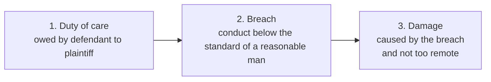

# Paper III · Law of Torts including Consumer Protection Law (K-1003) · Unit 4A
## Specific torts (1): Negligence, including nervous shock, res ipsa loquitur, contributory negligence and professional negligence

> **Last updated:** 2026-10-28 (IST) · **Law stated as on:** 2026-10-28 · **Branch:** `paper/03-law-of-torts`
> **Verify before exam:** case citations in §9 and the "current developments" in §10 (checklist at the end).
> **Syllabus line (official):** *Specific torts — negligence; nuisance; trespass; defamation.* Unit 4 is split here into 4A (negligence), 4B (nuisance, trespass and other torts) and 4C (defamation).

**How this unit is examined.** (filled in by the generator)

---

## 1. Background

1. **Two meanings of "negligence".** (i) A **state of mind**: carelessness, the opposite of intention (a *mental element* in other torts and in crime). (ii) An **independent tort**: breach of a legal duty to take care, resulting in damage. The law of torts is mostly about the second meaning.
2. **Growth.** Before 1932 there were separate duties of care in particular settings (carriers, innkeepers, occupiers). *Donoghue v. Stevenson* (1932) stated a **general principle** of the duty of care. Negligence is now the most important tort and the source of most claims: road accidents, medical negligence, defective products, workplace injuries, building collapse, negligent statements.
3. **Indian sources.** The English common law, as adapted by Indian courts, together with: the **Motor Vehicles Act, 1988** (claims tribunals), the **Fatal Accidents Act, 1855**, the **Employees' Compensation Act, 1923**, the **Consumer Protection Act, 2019** (medical negligence as "deficiency in service"; Unit 5) and the criminal law on negligence (**BNS ss. 106, 125, 281**, formerly IPC ss. 304A, 336–338, 279 †).

---

## 2. Definition and the two theories (Dec 2022 C12, A1)

### 2.1 Definitions
- **Alderson B., *Blyth v. Birmingham Waterworks Co.* (1856) 11 Ex 781:** "Negligence is the omission to do something which a reasonable man, guided upon those considerations which ordinarily regulate the conduct of human affairs, would do, or doing something which a prudent and reasonable man would not do."
- **Winfield & Jolowicz:** "the breach of a legal duty to take care which results in damage, undesired by the defendant, to the plaintiff."
- **Salmond:** negligence is the breach of a duty to take care; the word is used both for a type of conduct and for a mental element.

### 2.2 The two rival theories

| | **Subjective theory** | **Objective theory** |
|---|---|---|
| Idea | Negligence is a **state of mind**: culpable carelessness or inadvertence (not thinking of the consequence) | Negligence is a **type of conduct**: failure to attain the standard of the reasonable man; the defendant's state of mind is irrelevant |
| Supporters | **Austin**; earlier **Salmond**; criminal-law writers | **Winfield**, **Pollock**, **Holmes**, and the modern approach; *Vaughan v. Menlove* (1837) |
| Test | Was the defendant actually careless? | Did he fall below the standard of the reasonable man? |
| Effect | A person who did his honest best but fell short is not negligent | A person of low ability is still negligent if he falls below the standard (*Vaughan v. Menlove*: "the best of his judgment" is not enough) |
| Criticism | Confuses negligence with mental attitude; cannot explain **wilful** neglect (a person who knows the risk and does nothing is not "inadvertent"); makes proof difficult | Ignores the individual; may be harsh on those of limited capacity (a learner driver) |

**Position.** The courts apply the **objective** test (the reasonable man), and the tort of negligence is a breach of a duty. The subjective view survives in the description of negligence as a mental element in crime (BNS ss. 106, 281).

---

## 3. Essentials of the tort (Dec 2022 A1)

### 3.1 Duty of care

| Stage | Case and test |
|---|---|
| Early | *Heaven v. Pender* (1883): duty arises where a person would be in danger unless he exercised ordinary care |
| General principle | ***Donoghue v. Stevenson*** [1932] AC 562: a friend bought Mrs Donoghue a bottle of ginger beer from a café. The opaque bottle contained the decomposed remains of a snail, and she became ill. She had no contract with the café or manufacturer. The House of Lords held (3:2) that a manufacturer owes a duty to the **ultimate consumer**. Lord Atkin's **neighbour principle**: "You must take reasonable care to avoid acts or omissions which you can reasonably foresee would be likely to injure your neighbour"; neighbours are "persons who are so closely and directly affected by my act that I ought reasonably to have them in contemplation" |
| Two-stage test | *Anns v. Merton LBC* [1978] AC 728: proximity then policy. Overruled by *Murphy v. Brentwood DC* [1991] 1 AC 398 |
| Present test | ***Caparo Industries v. Dickman*** [1990] 2 AC 605: (i) **foreseeability** of damage; (ii) **proximity** between the parties; (iii) it is **fair, just and reasonable** to impose a duty. Later courts proceed **incrementally** by analogy with decided cases (*Robinson v. Chief Constable of West Yorkshire* [2018] UKSC 4) |
| Negligent misstatement | ***Hedley Byrne v. Heller & Partners*** [1964] AC 465: liability for careless advice where there is a **special relationship** and an **assumption of responsibility**, even without a contract. The bank's disclaimer protected it, but the House laid down the rule |
| Pure economic loss | *Spartan Steel v. Martin & Co.* [1973] QB 27: a contractor cut an electric cable, stopping the plaintiff's factory; loss of profit on the melt in progress was recoverable (physical damage), but not for the period of lost production. Economic loss alone is generally not recoverable |
| Some recognised duty relationships | Manufacturer and consumer; driver and road users; doctor and patient; employer and employee (safe plant, place, system and staff: *Wilsons & Clyde Coal v. English* [1938] AC 57); occupier and visitor; solicitor and client; professional adviser and client; teacher and pupil |

**India.** The Indian courts accept the *Donoghue* principle. The Supreme Court has held that a person owes a duty to take reasonable care towards those he can reasonably foresee will be affected (e.g. *Municipal Corporation of Delhi v. Subhagwanti* (1966), a municipal body and a dangerous structure; *M.S. Grewal v. Deep Chand Sood* (2001) 8 SCC 151 †, a school and the students in its charge on an excursion; *Jacob Mathew* (2005), doctors). Statutory duties (e.g. under the Motor Vehicles Act) can also found a negligence action.

### 3.2 Breach: the standard of care
The standard is that of the **reasonable man** (*"the man on the Clapham omnibus"*): *Vaughan v. Menlove* (1837) (a farmer built a haystack that heated up and caught fire; "he did his best" was no defence); *Glasgow Corporation v. Muir* [1943] AC 448 (Lord Macmillan).

| Factor | Case |
|---|---|
| **Probability of harm** | *Bolton v. Stone* [1951] AC 850: a cricket ball hit out of the ground (about six times in thirty years) injured a passer-by. The risk was so small that a reasonable man need not guard against it |
| **Gravity of harm** | *Paris v. Stepney BC* [1951] AC 367: a one-eyed mechanic lost his remaining eye; the employer should have given him goggles because the harm to him would be graver |
| **Cost and practicability of precautions** | *Latimer v. A.E.C.* [1953] AC 643: factory floor flooded and slippery; sawdust spread; the employer did all that was reasonable |
| **Social utility** | *Watt v. Hertfordshire CC* [1954] 1 WLR 835: a fireman was hurt in an emergency lifting a heavy jack; the risk was justified by the aim of saving life |
| **Skilled persons** | *Bolam v. Friern Hospital Management Committee* [1957] 1 WLR 582: a doctor is not negligent if he acts in accordance with a practice accepted as proper by a **responsible body** of medical opinion. *Bolitho v. City & Hackney HA* [1998] AC 232: the opinion must also be **logical** |
| **Learners and children** | *Nettleship v. Weston* [1971]: a learner driver must reach the standard of a competent driver. A child is judged by the standard of a child of that age (*Mullin v. Richards* [1998]) |

### 3.3 Damage: causation and remoteness
- **Causation in fact: the "but for" test.** *Barnett v. Chelsea & Kensington HMC* [1969] 1 QB 428: a hospital casualty doctor sent away a man who had been poisoned by arsenic; he died. He would have died even if treated. No liability, because the negligence was not the cause. Where several causes contribute: *Bonnington Castings v. Wardlaw* [1956] AC 613 (material contribution); *Fairchild v. Glenhaven Funeral Services* [2002] UKHL 22 (material increase of risk, mesothelioma).
- **Intervening act (*novus actus interveniens*).** A fresh, independent act of a third party or of the plaintiff that breaks the chain of causation: *Scott v. Shepherd* (1773) (the squib case; the intervening acts were natural responses to danger and did not break the chain); *McKew v. Holland & Hannen & Cubitts* [1969] 3 All ER 1621 (the plaintiff's unreasonable act broke the chain).
- **Remoteness of damage.** *Re Polemis* [1921] 3 KB 560 (a plank dropped into a ship's hold caused a spark and the ship burned; all **direct** consequences are recoverable, foreseeable or not) was replaced by ***The Wagon Mound (No. 1)*** [1961] AC 388 (oil spilled in Sydney harbour; sparks from welding set it alight and burned the wharf; **only damage of a kind that was reasonably foreseeable** is recoverable). *The Wagon Mound (No. 2)* [1967] 1 AC 617: a risk that is real, even if small, must be guarded against when the cost is small. *Hughes v. Lord Advocate* [1963] AC 837: boys played with a paraffin lamp near a manhole; an explosion burned them; the **kind** of harm (burns) was foreseeable, though not the way it happened. The **thin-skull (egg-shell skull) rule**: you take your victim as you find him: *Smith v. Leech Brain* [1962] 2 QB 405.

### 3.4 Proof of negligence: *res ipsa loquitur* (Dec 2024 A3, Dec 2023 A2)

**Meaning.** "The thing speaks for itself." In some accidents the fact of the accident itself is evidence of negligence, so the plaintiff need not prove how the defendant was negligent.

**Cases:** ***Byrne v. Boadle*** (1863) 2 H & C 722: a barrel of flour fell from the defendant's warehouse window and hit a passer-by. The court held the accident itself was evidence of negligence. ***Scott v. London & St Katherine Docks*** (1865) 3 H & C 596 (Erle C.J.): sugar bags fell from a crane; "where the thing is shown to be under the management of the defendant or his servants, and the accident is such as in the ordinary course of things does not happen if those who have the management use proper care, it affords reasonable evidence, in the absence of explanation by the defendants, that the accident arose from want of care."

**Conditions**
1. The thing causing the harm was under the **control** of the defendant or his servants.
2. The accident is of a kind that **ordinarily does not happen** without negligence.
3. The **cause is unknown** to the plaintiff (or there is no explanation by the defendant).

**Effect.** It shifts the **evidential burden** to the defendant to explain how the accident happened without negligence. It does not (normally) shift the legal burden of proof (*Henderson v. Henry E. Jenkins* [1970] AC 282). It does not apply where the facts are fully known.

**Indian cases.** *Municipal Corporation of Delhi v. Subhagwanti* AIR 1966 SC 1750 (the clock tower in Chandni Chowk, Delhi, fell and killed people; the doctrine applied to the Corporation, which was in control; it failed to show it had inspected the structure); *Syad Akbar v. State of Karnataka* AIR 1979 SC 1848 † (the limits of the doctrine: it does not apply once the cause is known); *Shyam Sunder v. State of Rajasthan* AIR 1974 SC 890 † (the Supreme Court accepted the doctrine in India). The doctrine has also been applied in medical negligence (*V. Kishan Rao*, 2010) and motor claims.

### 3.5 Contributory negligence

- **Rule.** The plaintiff's damage is partly his own fault; his damages are **reduced** in proportion to his share of responsibility. Older common law made it a complete bar (*Butterfield v. Forrester* (1809) 11 East 60: the plaintiff rode violently at dusk and hit a pole the defendant had left across the road).
- **Mitigation of the old rule.** *Davies v. Mann* (1842) 10 M & W 546 (the *donkey case*): the plaintiff left his donkey in the road with forefeet tied. The defendant's wagon, going too fast, ran it down. The defendant was held liable because he had the **last opportunity** to avoid the accident. The Law Reform (Contributory Negligence) Act, 1945 (UK, s. 1) replaced the all-or-nothing rule by **apportionment**. *British Columbia Electric Rly v. Loach* [1916] 1 AC 719 and *Swadling v. Cooper* [1931] AC 1 narrowed the "last opportunity" rule.
- **Indian law.** There is no general statute; Indian courts follow the English rule that contributory negligence **reduces** damages and apportion the blame; it is not a bar (the Supreme Court has applied apportionment in motor-accident cases). Seat-belt and helmet cases: *Froom v. Butcher* [1976] QB 286 (25% reduction for not wearing a seat-belt); *Capps v. Miller* [1989] 1 WLR 839 (10% for an unfastened helmet); India: MV Act s. 129 (protective headgear) and s. 138(3) with the Central Motor Vehicles Rules (seat-belts) †.
- **Children and rescuers.** A child is judged by the standard of his age (*Gough v. Thorne* [1966] 1 WLR 1387). A rescuer's rashness may be reduced (*Chadwick v. BRB*).
- **Contributory negligence v. composite negligence.** In composite negligence two or more defendants contribute; in contributory negligence the plaintiff contributes (Unit 3).

**The horse problem (Dec 2025 B7).** See [B-31](question-bank/section-b-part-3-unit-4a.md#b-31) for the worked answer.

---

## 4. Nervous shock (psychiatric injury) (Dec 2023 C12, Dec 2024 B8)

**Meaning.** A recognisable **psychiatric illness** (not mere grief, fright or distress) caused by a sudden shock to the nervous system from what the plaintiff sees or hears, such as an accident to another person.

**Development of the law**
1. ***Victorian Railways Commissioners v. Coultas*** (1888) 13 App Cas 222 (PC): the plaintiff was frightened by a near-collision at a level crossing; no recovery for fright alone (too remote).
2. ***Dulieu v. White*** [1901] 2 KB 669: a barmaid, who was pregnant, was frightened when the defendant's horse-van crashed into the pub, and she became seriously ill. Recovery allowed for shock caused by **fear for her own safety**.
3. ***Hambrook v. Stokes Bros*** [1925] 1 KB 141: a mother saw a runaway lorry going down the hill where her children were; she feared for them and later heard that one was injured; she died. Recovery allowed for fear for **others** (children).
4. ***Bourhill v. Young*** [1943] AC 92: a pregnant fishwife heard (but did not see) a motorcycle collision; she later saw blood on the road, and claimed shock. No recovery: the rider owed no duty to someone outside the area of foreseeable harm; a person of **normal fortitude** is the test.
5. ***McLoughlin v. O'Brian*** [1983] 1 AC 410: the mother heard of a road accident to her family and saw them in hospital about two hours later, still in a state of shock. Recovery allowed, as she came on the **immediate aftermath**.
6. ***Alcock v. Chief Constable of South Yorkshire*** [1992] 1 AC 310 (Hillsborough): relatives who watched football disaster on TV or identified bodies later were denied. The House laid down **control mechanisms** for a secondary victim: (i) a **close tie of love and affection** with the victim (presumed for parent-child and spouses); (ii) **proximity in time and space** to the event or its immediate aftermath; (iii) perception by the plaintiff's **own unaided senses** (live broadcast is not enough); (iv) a **sudden shock** and a recognised psychiatric illness.
7. ***Page v. Smith*** [1996] AC 155: the distinction between **primary victims** (within the zone of physical danger; need only show that some personal injury was foreseeable) and **secondary victims**. *White v. Chief Constable of South Yorkshire* [1999] 2 AC 455: police officers at Hillsborough were not primary victims, and not rescuers; claims failed.
8. ***Wilkinson v. Downton*** [1897] 2 QB 57: a practical joker told a woman that her husband had broken both his legs; she became ill. Liability for the **intentional** infliction of nervous shock.
9. **Employment stress:** *Walker v. Northumberland CC* [1995] 1 All ER 737; *Hatton v. Sutherland* [2002] EWCA Civ 76.

**India.** The Indian courts apply the same tests where a claim is brought, but I did not find a leading Supreme Court decision on nervous shock as a head of tort (†). In motor-accident and death claims Indian tribunals award compensation for **loss of consortium** and other non-pecuniary heads (*National Insurance Co. v. Pranay Sethi* (2017) 16 SCC 680; *Magma General Insurance v. Nanu Ram* (2018) 18 SCC 130).

---

## 5. Professional and medical negligence

| Point | Law |
|---|---|
| **Standard** | A professional must show the skill that an ordinary competent member of the profession would show: *Bolam* (1957); *Bolitho* (1998). Not the highest skill, but ordinary skill; a mere error of judgment or a failed treatment is not negligence |
| **Three duties of a doctor** | Duty of care in deciding whether to take the case, in deciding what treatment to give, and in administering the treatment: *Dr. Laxman Balkrishna Joshi v. Dr. Trimbak Bapu Godbole* AIR 1969 SC 128 |
| **Civil liability** | *Poonam Verma v. Ashwin Patel* (1996) 4 SCC 332 (a person practising a system of medicine in which he is not qualified is negligent *per se* †); *Spring Meadows Hospital v. Harjol Ahluwalia* (1998) 4 SCC 39 (parents may claim; hospital liable); *Samira Kohli v. Dr. Prabha Manchanda* (2008) 2 SCC 1 (consent); *Martin F. D'Souza v. Mohd. Ishfaq* (2009) 3 SCC 1 (guidelines on prior expert opinion); *V. Kishan Rao v. Nikhil Super Speciality Hospital* (2010) 5 SCC 513 (*res ipsa loquitur* may apply; the direction in *Martin D'Souza* for expert opinion in every case was held not to be binding) †; *Kusum Sharma v. Batra Hospital* (2010) 3 SCC 480 (principles) |
| **Criminal liability** | *Jacob Mathew v. State of Punjab* (2005) 6 SCC 1: for a doctor to be prosecuted for causing death by negligence the negligence must be **gross** (a high degree of negligence, recklessness); an investigating officer should get a credible opinion from a competent doctor before proceeding. *Dr. Suresh Gupta v. Govt. of NCT of Delhi* (2004) 6 SCC 422. **BNS s. 106(1)** carries up to five years' imprisonment, but a **registered medical practitioner** who causes death by a negligent act in a medical procedure faces up to **two years** ‡ |
| **Hospitals** | A hospital is vicariously liable for its doctors and nurses (Unit 3). *Savita Garg v. Director, National Heart Institute* (2004) 8 SCC 56 † |
| **Consumer law** | Medical services for payment are "service": *Indian Medical Association v. V.P. Shantha* (1995) 6 SCC 651 (Unit 5). The Supreme Court asked in 2024 for the question to be reconsidered by a larger bench ‡ |

---

## 6. Other duties of care (one line each)
- **Employer:** to provide competent staff, safe plant, a safe place and a safe system (*Wilsons & Clyde Coal v. English*).
- **Occupier:** to take reasonable care of visitors' safety. India has no statute (England: Occupiers' Liability Acts, 1957 and 1984); common-law principles apply.
- **Manufacturer:** *Donoghue v. Stevenson*; Indian statutory product liability under the CPA 2019 (Unit 5).
- **Driver:** the Motor Vehicles Act and the rules of the road; claims before the Motor Accidents Claims Tribunal.
- **Public authorities:** a duty arises when they act, or when a statute creates a duty (the *Ratlam* case; *Subhagwanti*).

---

## 7. Remedies and limitation
Damages for personal injury (pain and suffering, loss of earnings, medical expense, loss of amenities), for death (Fatal Accidents Act, 1855; MV Act s. 166), and for property. Limitation: tort claims not covered by a special Article fall under the residuary Art. 113 (three years †); a motor claim has a six-month limit under the 2019 amendment (the new s. 166(3); in force from 1 April 2022 ‡, subject to condonation †).

---

## 8. Comparison tables

**Negligence v. nuisance v. trespass**

| | Negligence | Nuisance | Trespass |
|---|---|---|---|
| Interest protected | Person, property, economic interest | Use and enjoyment of land | Possession of land, goods; body |
| Damage | Essential | Essential (private) | Not needed (actionable *per se*) |
| Mental element | Carelessness | Not essential | Direct, intentional or negligent act |
| Nature of act | Breach of duty of care | Unreasonable interference, continuing | Direct interference |

**Negligence v. strict liability**: negligence needs fault and a duty; strict liability needs none (Unit 1).

**Quick-revision box**
- Definition: *Blyth v. Birmingham Waterworks*. Theories: subjective (Austin/early Salmond) v. objective (Winfield).
- Elements: duty (Donoghue; Caparo), breach (reasonable man; Bolton; Paris; Latimer; Bolam), damage (but-for; Wagon Mound).
- *Res ipsa loquitur*: *Byrne v. Boadle*; *Scott*; conditions; Indian: *Subhagwanti*.
- Contributory negligence: reduces damages (1945 Act; India: apportion); *Davies v. Mann*; *Froom v. Butcher*.
- Nervous shock: Coultas → Dulieu → Hambrook → Bourhill → McLoughlin → Alcock → Page → White.
- Medical: Bolam, Bolitho; Laxman Joshi; Jacob Mathew (gross negligence); BNS s. 106(1) two-year proviso for RMPs.

---

## 9. Cases at a glance
*Blyth* (1856) · *Vaughan v. Menlove* (1837) · *Donoghue* (1932) · *Caparo* (1990) · *Hedley Byrne* (1964) · *Bolton v. Stone* (1951) · *Paris* (1951) · *Latimer* (1953) · *Watt* (1954) · *Bolam* (1957) · *Bolitho* (1998) · *Barnett* (1969) · *Wagon Mound* (1961) · *Hughes* (1963) · *Smith v. Leech Brain* (1962) · *Byrne v. Boadle* (1863) · *Scott* (1865) · *Butterfield* (1809) · *Davies v. Mann* (1842) · *Dulieu* (1901) · *Hambrook* (1925) · *Bourhill* (1943) · *McLoughlin* (1983) · *Alcock* (1992) · *Page v. Smith* (1996) · *Laxman Joshi* (1969) · *Jacob Mathew* (2005) · *Subhagwanti* (1966).

---

## 10. Current developments (to November 2026)

1. **BNS s. 106** (death by negligence) with the **two-year** proviso for registered medical practitioners, and s. 106(2) for hit-and-run (up to ten years) ‡, replaced IPC s. 304A from 1 July 2024.
2. **Motor Vehicles (Amendment) Act, 2019** (provisions in force from 1 April 2022 ‡): fixed no-fault compensation of ₹5 lakh/₹2.5 lakh; the hit-and-run scheme compensation of ₹2 lakh for death and ₹50,000 for injury (s. 161) ‡; a six-month limit for claim petitions (s. 166(3)) ‡; the claim survives the claimant's death (s. 166(5)) ‡.
3. **Doctors and the Consumer Protection Act.** In *D.K. Gandhi* (2024) the Supreme Court excluded advocates from "service" and said *V.P. Shantha* should be reconsidered by a larger bench ‡. Notice was issued on 10 February 2026 on a petition to exclude qualified doctors from the Act ‡. Until a larger bench decides, *Shantha* remains the law for doctors. Check for later orders.
4. **England.** *Paul v. Royal Wolverhampton NHS Trust* [2024] UKSC 1 declined to extend secondary-victim claims to relatives who witnessed a death caused by medical negligence † (check).

---

## 11. Question bank (model answers)

(filled in by the generator)

---

## 12. Verification checklist (do before the exam)

- [ ] *Donoghue* [1932] AC 562 · *Caparo* [1990] 2 AC 605 · *Hedley Byrne* [1964] AC 465 · *Bolam* [1957] 1 WLR 582 · *Bolitho* [1998] AC 232
- [ ] *Wagon Mound (No. 1)* [1961] AC 388 · *Hughes* [1963] AC 837 · *Barnett* [1969] 1 QB 428
- [ ] *Byrne v. Boadle* (1863) 2 H & C 722 · *Scott v. London & St Katherine Docks* (1865) 3 H & C 596 · *Subhagwanti* AIR 1966 SC 1750 · *Syad Akbar* AIR 1979 SC 1848 · *Shyam Sunder* AIR 1974 SC 890
- [ ] *Dulieu* [1901] 2 KB 669 · *Hambrook* [1925] 1 KB 141 · *Bourhill* [1943] AC 92 · *McLoughlin* [1983] 1 AC 410 · *Alcock* [1992] 1 AC 310 · *Page v. Smith* [1996] AC 155
- [ ] *M.S. Grewal v. Deep Chand Sood* (2001) 8 SCC 151 · *Laxman Joshi* AIR 1969 SC 128 · *Jacob Mathew* (2005) 6 SCC 1 · *V. Kishan Rao* (2010) 5 SCC 513 · *Poonam Verma* (1996) 4 SCC 332
- [ ] *Pranay Sethi* (2017) 16 SCC 680 · *Magma v. Nanu Ram* (2018) 18 SCC 130
- [ ] BNS ss. 106, 125, 281 against the Act; MV Act ss. 129, 138(3), 161, 164, 166
- [ ] Any larger-bench decision on *V.P. Shantha*
