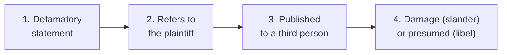
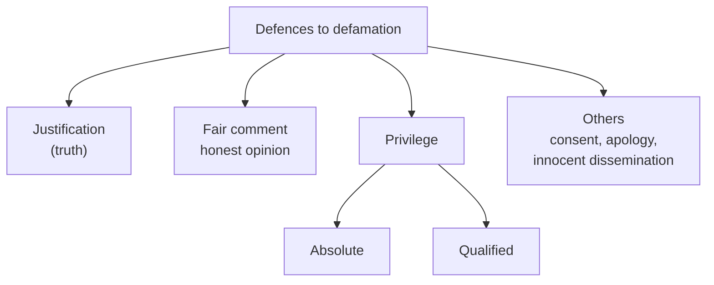

# Paper III · Law of Torts including Consumer Protection Law (K-1003) · Unit 4C
## Specific torts (3): Defamation: libel and slander, essentials, innuendo, defences and the criminal law (BNS s. 356)

> **Last updated:** 2026-10-29 (IST) · **Law stated as on:** 2026-10-28 · **Branch:** `paper/03-law-of-torts`
> **Verify before exam:** case citations in §9, the BNS section numbers in §6, and the "current developments" in §10 (checklist at the end).
> **Syllabus line (official):** *Specific torts — negligence; nuisance; trespass; defamation.*

**How this unit has been examined (December 2022–2025).** 6 of the 52 previous questions came from this unit:

- Dec 2025 Q1 (4): Difference between Libel and Slander. → [A-103](question-bank/section-a-part-4-units-4b-4c.md#a-103)
- Dec 2025 Q10 (20): (Problem) A says of a book published by Z — Z's book is foolish; Z must be a weak man. Z's book is indecent; Z must b… → [C-20](question-bank/section-c-part-4-units-4b-4c.md#c-20)
- Dec 2024 Q11 (20): Discuss the ingredients of the tort of defamation. What defence are available in an action for Defamation? Discuss. → [C-19](question-bank/section-c-part-4-units-4b-4c.md#c-19)
- Dec 2023 Q4 (4): What is meant by "Innuendo"? Explain by giving examples. → [A-104](question-bank/section-a-part-4-units-4b-4c.md#a-104)
- Dec 2023 Q13 (20): Define Defamation and point out its essentials. What defences are available to a tort feasor in case of Defamation? → [C-19](question-bank/section-c-part-4-units-4b-4c.md#c-19)
- Dec 2022 Q13 (20): Explain in detail certain essential conditions of liability of a person for defamation. → [C-19](question-bank/section-c-part-4-units-4b-4c.md#c-19)

*Source: the transcribed papers in [`docs/past-papers/paper-3-law-of-torts.md`](../../docs/past-papers/paper-3-law-of-torts.md). Unit assignment is by the main topic of the question. Topic frequency across all units is in the [question-bank README](question-bank/README.md#frequency).*

---

## 1. Background

1. **What is protected.** Defamation protects **reputation**: the good opinion that others have of a person. The law balances two interests: the individual's reputation and the **freedom of speech** (Art. 19(1)(a)). The Constitution lists "defamation" in Art. 19(2) as a ground on which speech may be restricted.
2. **Reputation and Art. 21.** In *Subramanian Swamy v. Union of India* (2016) 7 SCC 221 the Supreme Court held that reputation is a facet of the right to life and personal liberty under Art. 21, and upheld the criminal law of defamation (IPC ss. 499–500) as a reasonable restriction.
3. **Two remedies.** (i) **Civil**: an action in tort for damages, mostly governed by the English common law (uncodified in India); (ii) **criminal**: the offence under **BNS s. 356** (replacing IPC ss. 499–502 from 1 July 2024). A person may pursue both.
4. **Limitation.** One year for libel (from publication) and for slander (from the words spoken, or from the special damage if the words are not actionable in themselves): Limitation Act, 1963, Arts. 75–76 ‡.

---

## 2. Definition

- **Winfield & Jolowicz:** the publication of a statement which tends to lower a person in the estimation of **right-thinking members of society generally**, or which tends to make them **shun or avoid** that person.
- **Lord Atkin, *Sim v. Stretch*** [1936] 2 All ER 1237: "Would the words tend to lower the plaintiff in the estimation of right-thinking members of society generally?"
- **BNS s. 356(1) (earlier IPC s. 499):** whoever, by words (spoken or intended to be read), by signs or by visible representations, makes or publishes any imputation concerning any person **intending to harm, or knowing or having reason to believe that the imputation will harm, the reputation** of that person, defames that person. The BNS wording adds **electronic means** †. **Explanations:** (1) an imputation about a deceased person is defamation if it would harm his reputation if he were living and is intended to hurt the feelings of his family or relatives; (2) an imputation about a company, association or collection of persons; (3) an imputation in the form of an alternative or expressed ironically; (4) no imputation harms reputation unless it directly or indirectly, in the estimation of others, lowers the moral or intellectual character of that person, or lowers his character in respect of his caste or calling, or lowers his credit, or causes it to be believed that his body is in a loathsome state or a state generally considered disgraceful.

---

## 3. Libel and slander (Dec 2025 A1)

| Point | **Libel** | **Slander** |
|---|---|---|
| Form | **Permanent** form: writing, printing, picture, effigy, film, statue (also broadcast and online text) | **Transient** form: spoken words, gestures |
| English civil law | Actionable **without proof of damage** (*per se*) | Actionable only on proof of **special damage**, except in four cases below |
| Criminal liability | A crime in England; in India both are crimes (BNS s. 356) | Not a crime in English common law; in India an offence under s. 356 |
| Reason for the difference | Permanence and wider spread | Transience; greater risk of misunderstanding |
| Examples | A newspaper article, a letter, a cartoon, a social-media post | A speech, a remark in a conversation |

**Slander actionable without special damage (English law).** (i) imputation of a **crime punishable with imprisonment**; (ii) imputation of a **loathsome and contagious disease**; (iii) imputation of **unchastity to a woman** (Slander of Women Act, 1891); (iv) words calculated to disparage a person in his **office, profession, calling, trade or business** (Defamation Act, 1952, s. 3). *In England the Slander of Women Act, 1891 and s. 3 of the 1952 Act were repealed by the Defamation Act, 2013, s. 14 †; Indian textbooks still state the older list.*

**Broadcasts and films.** Defamatory matter in a broadcast is treated as **libel** (Defamation Act, 1952, s. 1; Theatres Act, 1968); a talking film is libel (*Youssoupoff v. MGM* (1934) 50 TLR 581 †).

**India.** The English distinction has not been settled by a Supreme Court decision that I could find. Some Indian courts have applied the English rule; many Indian writers say that in India both libel and slander are actionable *per se* (†). For the examination, state the English distinction and then add that the position in India is not uniform, citing your textbook.

---

## 4. Essentials of defamation (Dec 2023 C13, Dec 2024 C11, Dec 2022 C13)

### 4.1 The statement must be defamatory
- It must tend to **lower the plaintiff in the estimation of right-thinking people**, expose him to **hatred, contempt or ridicule**, or cause him to be **shunned** or avoided, or injure him in his office, trade or profession.
- The meaning is what **the ordinary reasonable reader** would take from the words, not what the writer intended. Intention to defame is **not** required in civil law (*Hulton v. Jones*).
- **Innuendo** (Dec 2023 A4): words that appear harmless but, because of **extrinsic facts** known to the audience, carry a defamatory meaning.
  - **True (legal) innuendo:** the hidden meaning arises from facts known to those to whom the words are published; the plaintiff must **plead and prove** those facts. *Tolley v. J.S. Fry & Sons* [1931] AC 333 (a caricature of an amateur golfer in a chocolate advertisement suggested that he sold his amateur status for money); *Cassidy v. Daily Mirror* [1929] 2 KB 331 (a photograph of Mr C and "Miss X, whose engagement is announced" led friends to think that Mrs C, who was his wife, was not married, and so was defamed).
  - **False (popular) innuendo:** an inference that an ordinary reader would draw from the words themselves (*Lewis v. Daily Telegraph* [1964] AC 234: a report that the fraud squad was inquiring into a company's affairs; the House of Lords explained how an ordinary reader may infer more than the words literally say).
  - The test of meaning: *Jones v. Skelton* [1963] 1 WLR 1362 (Lord Morris).

### 4.2 The statement must refer to the plaintiff
- The question is whether the words would reasonably be understood by sensible readers as referring to him, even if he is not named (*Newstead v. London Express* [1940] 1 KB 377).
- **No intention to refer to him is needed**: *Hulton v. Jones* [1910] AC 20 (a newspaper wrote about "Artemus Jones", a church-warden at Peckham, who was fictitious, as the author thought; a real barrister of that name sued and won). *Morgan v. Odhams Press* [1971] 1 WLR 1239.
- **Defamation of a class**: a statement about a **class** does not defame each member unless the class is small enough, or the words point to him (*Knupffer v. London Express* [1944] AC 116). BNS s. 356 (Explanation 2) deals with companies and associations.
- A **dead person** cannot be defamed in civil law (the cause of action dies; Succession Act s. 306); the criminal law has Explanation 1.

### 4.3 Publication
- The statement must be **communicated to at least one person other than the plaintiff**. A statement made only to the plaintiff is not published (but could be an insult).
- Dictating to a **typist** is publication (*Pullman v. Hill* [1891] 1 QB 524). A letter opened by a third party in the ordinary course can be published by the writer. If the defendant knows that a letter in a language the plaintiff does not read will be read by others, it is published (*Mahendra Ram v. Harnandan Prasad* AIR 1958 Pat 445 †).
- **Repetition** is a new publication; each sale of a newspaper is a new publication (*Duke of Brunswick v. Harmer* (1849)).
- **Publishing on the internet** is publication at the place where it is read or downloaded (*Dow Jones v. Gutnick* (2002) 210 CLR 575 †).

### 4.4 Damage
**Libel** is presumed to cause damage. **Slander** needs special damage unless it falls within one of the four exceptions (§3).

---

## 5. Defences (Dec 2023 C13, Dec 2024 C11)

### 5.1 Justification (truth)
- In **civil law**, truth is a **complete defence**, however malicious the motive: the defendant must prove that the statement was **substantially true** (*Alexander v. North Eastern Rly* (1865): the sting must be true; minor inaccuracy does not defeat it). If he pleads truth and fails, the damages may be **aggravated**.
- In **criminal law**, truth is a defence only if the publication was **for the public good** (BNS s. 356, Exception 1).

### 5.2 Fair comment
Comment (honest opinion) on a **matter of public interest**, based on **facts that are true or privileged**, made **honestly**, **without malice**. *Campbell v. Spottiswoode* (1863); *Kemsley v. Foot* [1952] AC 345; the comment must be recognisable as opinion, not as a statement of fact. An opinion that would be defamatory in itself can be justified if it is a fair inference from the facts. Indian criminal law: Exceptions 2, 3 and 6 to s. 499 (public servants' conduct; public questions; public performances).

**Merits of a public performance (the Z's-book problem, Dec 2025 C10):** Exception 6: it is not defamation to express in good faith any opinion respecting the merits of any performance which its author has submitted to the judgment of the public, or respecting the character of the author **so far as his character appears in that performance, and no further**. Illustration: "A says of a book published by Z — *Z's book is foolish; Z must be a weak man. Z's book is indecent; Z must be a man of impure mind.* A is within the exception, if he says this in good faith, in so far as the opinion which he expresses respects Z's character only so far as it appears in Z's book, and no further." But if A says, "I am not surprised that Z's book is foolish and indecent, for he is a weak man and a libertine", A is **not** within the exception, because his opinion of Z's character is not founded on Z's book. See the worked answer [C-20](question-bank/section-c-part-4-units-4b-4c.md#c-20).

### 5.3 Privilege
**Absolute privilege** (no liability even if the statement is false and malicious)
1. **Parliament and State legislatures:** statements by members in the House (Arts. 105(2), 194(2)).
2. **Judicial proceedings:** statements by judges, advocates, parties and witnesses in the course of the proceeding; Judicial Officers' Protection Act, 1850.
3. **State communications:** statements by one officer of State to another in the course of duty (*Chatterton v. Secretary of State for India* [1895] 2 QB 189).
4. **Fair and accurate reports** of proceedings of Parliament and State legislatures, published in good faith (Art. 361A †; *Wason v. Walter* (1868) LR 4 QB 73).
5. Communications between husband and wife (not usually relied on in India).

**Qualified privilege** (protected if made honestly and without malice; defeated by **malice**: *Horrocks v. Lowe* [1975] AC 135)
1. **Duty and interest:** a communication made in discharge of a legal, social or moral duty, or to protect one's own interest, to a person with a corresponding duty or interest (*Toogood v. Spyring* (1834); *Adam v. Ward* [1917] AC 309). Indian Exceptions 8 (accusation to an authorised person), 9 (protection of one's interests), 10 (caution).
2. **Fair and accurate reports of judicial proceedings** (Exception 4; Contempt of Courts Act, 1971, s. 4); **reports of public meetings**.
3. **Reynolds privilege / public-interest defence.** *Reynolds v. Times Newspapers* [2001] 2 AC 127: a publication on a matter of public concern is protected if the journalism was **responsible** (Lord Nicholls' ten factors). In England this has been replaced by the **public interest defence** (Defamation Act, 2013, s. 4). Indian courts have not adopted it formally; they cite *Rajagopal* (below).

### 5.4 Other defences and matters
- **Consent** of the plaintiff.
- **Apology and offer of amends** (an apology is taken into account in mitigation of damages; in England a statutory offer of amends exists under the Defamation Act, 1996, ss. 2–4 †).
- **Innocent dissemination** (a newsvendor or distributor who did not know and had no reason to think the matter was defamatory: *Emmens v. Pottle* (1885)); internet intermediaries: IT Act, 2000, s. 79 (*Google India v. Visakha Industries* (2020) 4 SCC 162 †).
- **Mere vulgar abuse** is not defamatory (words uttered in the heat of anger that no sensible person would believe).
- **No defence:** that the defendant only repeated what others said (the repetition rule).

### 5.5 Indian authorities
- ***R. Rajagopal v. State of Tamil Nadu*** (1994) 6 SCC 632: a convict's autobiography; the Court held that the press may publish matters of **public record**, and that a **public official** cannot sue for defamation for publication relating to his official conduct unless the publication is shown to be false and made with reckless disregard for truth (the *New York Times v. Sullivan* standard, partly adopted) †; privacy is a part of Art. 21.
- ***Subramanian Swamy v. Union of India*** (2016) 7 SCC 221: upheld IPC ss. 499–500 and CrPC s. 199 as reasonable restrictions under Art. 19(2).

### 5.6 Remedies
Damages: **general** (presumed), **special** (proved), **aggravated**, **exemplary** (rare); **injunction** (interim injunctions against publication are given very sparingly because of free speech: *Bonnard v. Perryman* [1891] 2 Ch 269 †); retraction and apology; declaration.

---

## 6. Criminal defamation: BNS s. 356 (replacing IPC ss. 499–502)

| Point | IPC (till 30 June 2024) | BNS, 2023 (from 1 July 2024) |
|---|---|---|
| Definition | s. 499 | **s. 356(1)** (definition, four Explanations; ten Exceptions) † |
| Punishment | s. 500: simple imprisonment up to **two years**, or fine, or both | **s. 356**: simple imprisonment up to **two years**, or fine, or both, or **community service** ‡ |
| Printing or engraving defamatory matter | s. 501 | separate paragraph of s. 356 (same punishment) ‡† |
| Sale of printed defamatory matter | s. 502 | separate paragraph of s. 356 ‡† |
| Procedure | CrPC s. 199 (complaint by the person aggrieved) | BNSS (corresponding section) † |

**The ten Exceptions** (to the definition; the same in IPC s. 499 and BNS s. 356): (1) imputation of truth which the public good requires; (2) public conduct of public servants; (3) conduct of any person touching a public question; (4) reports of proceedings of courts; (5) merits of a case decided in court, or conduct of witnesses and others concerned; (6) merits of a public performance; (7) censure passed in good faith by a person having lawful authority over another; (8) accusation made in good faith to an authorised person; (9) imputation made in good faith for the protection of the interests of the person making it or another; (10) caution conveyed in good faith to one person against another.

*Source for the BNS structure: the text of s. 356 as summarised on 28 October 2026 ‡; section-level numbering of the printing and sale paragraphs is not confirmed.*

---

## 7. Comparison tables

**Defamation v. malicious falsehood (injurious falsehood)**

| | Defamation | Malicious falsehood |
|---|---|---|
| Protects | Reputation | Economic interest (trade, property) |
| Falsity | Presumed; defendant must prove truth | Plaintiff must prove falsity and malice |
| Damage | Libel presumed | Special damage must be shown |

**Civil and criminal defamation**

| | Civil (tort) | Criminal (BNS s. 356) |
|---|---|---|
| Intent | Not required | Intention to harm or knowledge/reason to believe harm will result |
| Truth | Complete defence | Defence only if for the public good |
| Remedy | Damages, injunction | Imprisonment up to two years, fine, community service |
| Slander | Special damage needed (English rule) | Slander also an offence |

**Quick-revision box**
- Definition: tends to lower in the estimation of right-thinking people (*Sim v. Stretch*).
- Essentials: defamatory statement; refers to plaintiff; published; damage (slander).
- Libel = permanent form, actionable *per se*; slander = transient, special damage (four exceptions).
- Innuendo: true (extrinsic facts; *Tolley*, *Cassidy*) v. false (*Lewis*).
- Defences: justification (truth), fair comment, absolute and qualified privilege, consent, apology, innocent dissemination.
- Criminal law: BNS s. 356; two years or fine or both or community service; ten Exceptions.
- *Subramanian Swamy* (2016): criminal defamation upheld; reputation is part of Art. 21.

---

## 8. Cases at a glance
*Sim v. Stretch* (1936) · *Hulton v. Jones* (1910) · *Knupffer* (1944) · *Tolley v. Fry* (1931) · *Cassidy* (1929) · *Lewis v. Daily Telegraph* (1964) · *Pullman v. Hill* (1891) · *Mahendra Ram* (1958) · *Adam v. Ward* (1917) · *Reynolds* (2001) · *Horrocks v. Lowe* (1975) · *Campbell v. Spottiswoode* (1863) · *Kemsley v. Foot* (1952) · *Rajagopal* (1994) · *Subramanian Swamy* (2016).

---

## 9. Current developments (to November 2026)

1. **BNS s. 356** replaced IPC ss. 499–502 on 1 July 2024 and added **community service** as an alternative punishment ‡.
2. **Calls to decriminalise defamation.** On 22 September 2025, in a hearing on a petition by the Foundation for Independent Journalism (which runs The Wire) against a summons in a defamation complaint by a former JNU professor, Justice M.M. Sundresh orally observed that "the time has come to decriminalise all this" ‡. This was an observation in a hearing and the Court only issued notice; the law in *Subramanian Swamy* (2016) is unchanged until a larger bench or Parliament acts (date and bench from news reports; check).
3. **Online defamation.** Courts grant take-down and injunction orders against social-media posts; intermediaries rely on s. 79 of the IT Act. *Shreya Singhal v. Union of India* (2015) struck down s. 66A of the IT Act.
4. **England.** The Defamation Act, 2013 requires "serious harm" (s. 1) and created the honest opinion, truth and public-interest defences (ss. 2–4); the Supreme Court explained "serious harm" in *Lachaux v. Independent Print* [2019] UKSC 27 †.

---

## 10. Question bank (model answers)

> **The model answers for this unit are in the [`question-bank/`](question-bank/README.md) folder**, written for the real CCSU pattern (confirmed on all 20 papers, Dec 2022–2025): Section A, 4 marks, ≤ 75 words; Section B, 10 marks, ≤ 200 words; Section C, 20 marks, "in detail". Every rubric in the bank is my own; the university publishes no marking scheme. Cases and statutes: [`cases-and-statutes-digest.md`](question-bank/cases-and-statutes-digest.md) (case entries for this unit: 71–78). Mock papers: [1](question-bank/mock-exam-1.md), [2](question-bank/mock-exam-2.md), [3](question-bank/mock-exam-3.md).

**Section C (20 marks)**

- [C-19](question-bank/section-c-part-4-units-4b-4c.md#c-19) Define defamation and discuss its essentials. What defences are available in an action for defamation? *(set Dec 2024 Q11; Dec 2023 Q13; Dec 2022 Q13)*
- [C-20](question-bank/section-c-part-4-units-4b-4c.md#c-20) (Problem) A says of a book published by Z: "Z's book is foolish; Z must be a weak man. Z's book is indecent; Z must be a man of impure mind." Can A be held liable for making a defamatory statement against Z? *(set Dec 2025 Q10)*

**Section B (10 marks)**

- [B-46](question-bank/section-b-part-4-units-4b-4c.md#b-46) Distinguish between libel and slander
- [B-47](question-bank/section-b-part-4-units-4b-4c.md#b-47) What is "innuendo"? Explain with examples
- [B-48](question-bank/section-b-part-4-units-4b-4c.md#b-48) Explain justification and fair comment as defences in defamation
- [B-49](question-bank/section-b-part-4-units-4b-4c.md#b-49) Explain absolute and qualified privilege in defamation
- [B-50](question-bank/section-b-part-4-units-4b-4c.md#b-50) Explain criminal defamation under BNS s. 356. Was it upheld in *Subramanian Swamy*?

**Section A (4 marks), 9 answers**

- [A-102](question-bank/section-a-part-4-units-4b-4c.md#a-102) Defamation
- [A-103](question-bank/section-a-part-4-units-4b-4c.md#a-103) Libel and slander *(set Dec 2025 Q1)*
- [A-104](question-bank/section-a-part-4-units-4b-4c.md#a-104) Innuendo *(set Dec 2023 Q4)*
- [A-105](question-bank/section-a-part-4-units-4b-4c.md#a-105) Justification (truth)
- [A-106](question-bank/section-a-part-4-units-4b-4c.md#a-106) Fair comment
- [A-107](question-bank/section-a-part-4-units-4b-4c.md#a-107) Absolute privilege
- [A-108](question-bank/section-a-part-4-units-4b-4c.md#a-108) Qualified privilege
- [A-109](question-bank/section-a-part-4-units-4b-4c.md#a-109) Criminal defamation: BNS s. 356
- [A-110](question-bank/section-a-part-4-units-4b-4c.md#a-110) Publication in defamation

---

## 11. Verification checklist (do before the exam)

- [ ] *Subramanian Swamy* (2016) 7 SCC 221 · *Rajagopal* (1994) 6 SCC 632 · *Mahendra Ram* AIR 1958 Pat 445
- [ ] *Sim v. Stretch* [1936] 2 All ER 1237 · *Hulton v. Jones* [1910] AC 20 · *Knupffer* [1944] AC 116 · *Tolley* [1931] AC 333 · *Cassidy* [1929] 2 KB 331 · *Lewis* [1964] AC 234
- [ ] *Adam v. Ward* [1917] AC 309 · *Reynolds* [2001] 2 AC 127 · *Horrocks v. Lowe* [1975] AC 135 · *Kemsley v. Foot* [1952] AC 345
- [ ] BNS s. 356: confirm the sub-section numbers for the printing and sale paragraphs and the exact wording about electronic means
- [ ] Articles 105(2), 194(2), 361A of the Constitution; Limitation Act, 1963, Arts. 75–76
- [ ] Whether your textbook treats slander as actionable *per se* in India
- [ ] The September 2025 observation on decriminalisation: any later order
