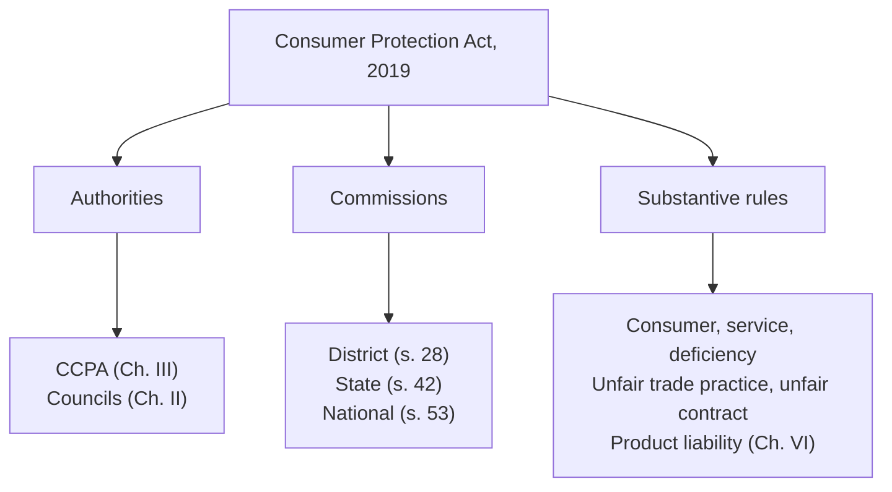

# Paper III · Law of Torts including Consumer Protection Law (K-1003) · Unit 5
## Consumer Protection Act, 2019: consumer, service, contract of service and for service, deficiency, Commissions, complaint, product liability, CCPA

> **Last updated:** 2026-10-28 (IST) · **Law stated as on:** 2026-10-28 · **Branch:** `paper/03-law-of-torts`
> **Verify before exam:** section numbers in the Act, the pecuniary limits (§6.2), case citations in §11 and the "current developments" in §12 (checklist at the end).
> **Syllabus line (official):** *Consumer Protection Act — consumer: definition and concept; contract of service and contract for service; enforcement of consumer rights.*
> **Naming.** The Dec 2022 paper still uses the **old** names ("District Consumer Disputes Redressal **Forum**") from the 1986 Act. The 2019 Act calls them **Commissions** (District, State, National). Write the name used in the question, and add the new name in brackets.

**How this unit is examined.** (filled in by the generator)

---

## 1. Background

1. **Why a consumer law.** In a sale a seller is better informed and stronger than the buyer, and a civil suit or a tort action (negligence, deceit, nuisance) is slow and costly. The Consumer Protection Act gives a **cheap, quick, summary remedy** through special Commissions that are not bound by every technicality of the Code of Civil Procedure.
2. **Sources.** The **UN Guidelines for Consumer Protection** (1985); the **Consumer Protection Act, 1986** (three-tier forums; amended in 1991, 1993 and 2002); the **Consumer Protection Act, 2019**, which repealed the 1986 Act. The 2019 Act received assent on 9 August 2019, and most of it came into force on **20 July 2020**; the provisions on the Central Consumer Protection Authority came into force with effect from **24 July 2020** ‡ (PIB release of 2 August 2023, for the CCPA date; the 20 July date is from the notification as I recall it †).
3. **What the 2019 Act added** (the points to write in an answer):
   - a wider definition of **consumer** (online and offline purchases, teleshopping, direct selling, multi-level marketing: s. 2(7), Explanation (b)) ‡;
   - the **Central Consumer Protection Authority (CCPA)** to protect consumers' rights as a class, to act against unfair trade practices and false or misleading advertisements, and to order recall of goods (Ch. III, ss. 10–27) ‡;
   - a chapter on **product liability** (Ch. VI, ss. 82–87) ‡;
   - **unfair contracts** (s. 2(46)) and **unfair trade practices** (s. 2(47)), including disclosure of personal information given in confidence ‡;
   - **mediation** (s. 37; ss. 74–81) ‡;
   - **e-filing** and **video-conference** hearings; **territorial jurisdiction where the complainant resides or works for gain** (s. 34(2)(d)) ‡;
   - revised **pecuniary limits** (and later by rules, §6.2) and **tougher penalties** (ss. 88–91);
   - **Consumer Protection Councils** (central, State, district: ss. 3–8) as advisory bodies.

---

## 2. "Consumer": definition and concept (s. 2(7))

### 2.1 The two limbs

| Limb | A consumer is a person who… |
|---|---|
| **(i) Goods** | **buys any goods** for a consideration which has been paid, promised, partly paid and partly promised, or under a system of deferred payment; and includes any **user** of such goods other than the buyer, **when the use is with the approval of the buyer** ‡ |
| **(ii) Services** | **hires or avails of any service** for a consideration on the same terms; and includes any **beneficiary** of such service other than the person who hires it, **when the service is availed with the approval of the first person** ‡ |

### 2.2 Exclusions
- A person who obtains goods **for resale** or for any **commercial purpose** is not a consumer.
- A person who avails of a service **for any commercial purpose** is not a consumer ‡.
- **Explanation (a):** "commercial purpose" does **not** include the use by a person of goods bought and used by him **exclusively for the purpose of earning his livelihood by means of self-employment** ‡.
- **Explanation (b):** "buys any goods" and "hires or avails of any services" include **offline or online transactions** through electronic means, teleshopping, direct selling or multi-level marketing ‡.

### 2.3 Cases on "commercial purpose"
- ***Laxmi Engineering Works v. P.S.G. Industrial Institute*** (1995) 3 SCC 583: whether a purchase is for a "commercial purpose" is a **question of fact**; the Supreme Court looked at the **dominant purpose**. Goods bought for large-scale profit-making are for a commercial purpose; a purchase for **self-employment to earn a livelihood** is not. The 1993 amendment's Explanation (now in s. 2(7)) reflects this ‡†.
- ***Cheema Engineering Services v. Rajan Singh*** (1997) 1 SCC 131 †: a person who bought machinery to earn his livelihood by self-employment was a consumer.
- ***Lilavati Kirtilal Mehta Medical Trust v. Unique Shanti Developers*** (2019) † and other housing and loan cases: the courts ask whether the purchase has a **close and direct nexus** with a profit-generating activity.
- **Beneficiary / third-party.** ***Spring Meadows Hospital v. Harjol Ahluwalia*** (1998) 4 SCC 39 (parents of a child patient could claim; the child was a consumer); ***Savita Garg v. Director, National Heart Institute*** (2004) 8 SCC 56 (the parent could complain; the hospital as a necessary party).

### 2.4 Who may file a complaint (s. 2(5), s. 35(1))
A consumer; a **recognised consumer association**; one or more consumers having the **same interest** (with the Commission's permission: representative or class complaint); the **Central or State Government**; the CCPA; a **legal heir** or representative of a deceased consumer; the **parent or guardian** of a minor ‡ (s. 35(1)).

---

## 3. "Service" (s. 2(42)) and "deficiency" (s. 2(11)) and "defect" (s. 2(10))

### 3.1 Service
"Service" means **service of any description which is made available to potential users**, including banking, financing, insurance, transport, processing, **supply of electrical or other energy**, **telecom**, boarding or lodging or both, **housing construction**, entertainment, amusement, or the purveying of news or other information. It **does not include** (a) the rendering of service **free of charge**, or (b) services under a **contract of personal service** ‡.

### 3.2 Deficiency (s. 2(11))
"Any fault, imperfection, shortcoming or inadequacy in the quality, nature and manner of performance which is required to be maintained by or under any law, or has been undertaken to be performed by a person in pursuance of a contract or otherwise in relation to any service". It includes **(i)** any act of **negligence or omission or commission** by such person which causes loss or injury to the consumer, and **(ii)** **deliberate withholding of relevant information** from the consumer ‡. (Dec 2023 A3, Dec 2025 C11.)

### 3.3 Defect in goods (s. 2(10))
"Any fault, imperfection or shortcoming in the **quality, quantity, potency, purity or standard** which is required to be maintained by or under any law or is claimed by the trader in any manner whatsoever in relation to any goods" ‡.

| | **Defect** (goods) | **Deficiency** (services) |
|---|---|---|
| Subject | Goods | Services |
| Nature | Fault in quality, quantity, potency, purity, standard | Fault in quality, nature, manner of performance |
| Source of the standard | Law, or the trader's claim | Law, contract, or otherwise undertaken |
| Includes | – | Negligence; deliberate withholding of information |
| Relief | s. 39(1)(a)–(c) (remove defect, replace, refund) | s. 39(1)(f) (remove deficiency), compensation |

### 3.4 Cases on service and deficiency (Dec 2025 C11)

| Case | Holding |
|---|---|
| ***Lucknow Development Authority v. M.K. Gupta*** (1994) 1 SCC 243 | A development authority that builds or allots houses and sites performs a **service** (housing construction); delay, defects and **harassment** by its officers are deficiency. The Commission may award **compensation** and ask for it to be recovered from the officer responsible |
| ***Indian Medical Association v. V.P. Shantha*** (1995) 6 SCC 651 | **Medical services for payment are "service"**. The Court divided doctors' services into: (a) **free of charge** to all patients (excluded); (b) **paid** by all (included); (c) **free for some, paid by others** (included for all, since the charging patients pay for the system). Services under a **contract of personal service** (employer-employee) are excluded. Hospitals and doctors in private practice are within the Act |
| ***Spring Meadows Hospital v. Harjol Ahluwalia*** (1998) 4 SCC 39 | Negligence by a nursing home in treating a child; parents entitled to compensation; the hospital is liable for its doctors' negligence |
| ***Charan Singh v. Healing Touch Hospital*** (2000) 7 SCC 668 † | A hospital is liable only for **negligence** that is shown; the Commission must assess whether there was actually a lack of skill or care; compensation should be reasonable |
| ***Ghaziabad Development Authority v. Balbir Singh*** (2004) 5 SCC 65 † | Compensation for delay in giving possession of a flat may include interest and for **mental agony**, and the Commission may set a realistic sum |
| ***Bangalore Development Authority v. Syndicate Bank*** (2007) 6 SCC 711 † | The services of a statutory authority in **allotting sites** are "service"; the court examined the difference between a service and a sovereign or regulatory function |
| ***Regional Director, ESIC v. Francis De Costa*** (1996) 6 SCC 1 † | The medical benefit under the Employees' State Insurance scheme is **not** a service for consideration, because the employee contributes under a statute |
| ***General Manager, Telecom v. M. Krishnan*** (2009) 8 SCC 481 | Disputes about telephone bills were for arbitration under s. 7B of the Telegraph Act, not for the consumer forum. The 2019 Act now names **telecom** as a service (s. 2(42)), so check whether this still holds † |
| ***Bar of Indian Lawyers v. D.K. Gandhi PS National Institute of Communicable Diseases*** (2024 INSC 410) | Services of **advocates** are not "service" under the Act, because the legal profession is *sui generis* and the relationship is one of personal service; the Court suggested that *V.P. Shantha* be considered by a **larger bench** ‡ |
| ***Imperia Structures v. Anil Patni*** (2020) 10 SCC 783 | A buyer may still go to the consumer forum despite the Real Estate (Regulation and Development) Act, 2016 (the remedies are concurrent) |
| ***Pioneer Urban Land & Infrastructure v. Govindan Raghavan*** (2019) 5 SCC 725; ***Ireo Grace Realtech v. Abhishek Khanna*** (2021) 3 SCC 241 | One-sided clauses in a builder-buyer agreement are an **unfair contract/unfair trade practice**; the buyer cannot be bound to wait indefinitely and may get a refund with interest |

---

## 4. Contract *of* service and contract *for* service (Dec 2023 B6, Dec 2025 A3)

### 4.1 Distinction
| Point | Contract **of** service (master-servant; personal service) | Contract **for** services (independent contractor) |
|---|---|---|
| Relation | Employer and **employee** | Client and **independent contractor** |
| Control | Employer controls **what and how** | Client controls only the **result** |
| Remuneration | Wages or salary | Fee for the job |
| Risk, tools, hiring | Employer's | The contractor's own |
| Tort liability | **Employer vicariously liable** for the employee's torts | **Not liable** for the contractor's torts (with exceptions) |
| Examples | A bank clerk, a driver in the employer's firm, a hospital's salaried nurse | A builder, a plumber hired for a job, an architect, a doctor in private practice, a taxi hired for a trip |
| Under the Consumer Protection Act | **Excluded** from "service" (s. 2(42): "contract of personal service") | **Included** if a consideration is paid |

### 4.2 Tests (Unit 3)
Control test (*Dharangadhara*; *Shivanandan Sharma*); integration test; multiple/economic reality test (*Ready Mixed Concrete*; *Silver Jubilee Tailoring House*).

### 4.3 Why the distinction matters in the Consumer Protection Act
The words "contract of personal service" mean a contract of **service** (employee-employer). An employee cannot complain against his employer of a deficiency in the employer's service (which is employment law). A client who engages a contractor under a contract **for** services can complain. This was the basis of *V.P. Shantha* (the doctor in private practice works under a contract *for* services, while the hospital's salaried doctor treating a patient works under a contract *of* service with the hospital and the hospital is the service provider). In *D.K. Gandhi* (2024) the Supreme Court regarded the advocate's relation with the client as a contract of personal service because of the client's control, a reasoning that is likely to be re-examined by a larger bench ‡†.

---

## 5. Consumer rights and Consumer Protection Councils

- **Consumer rights (s. 2(9)):** (i) protection against marketing of goods, products or services **hazardous** to life and property; (ii) **information** about quality, quantity, potency, purity, standard and price; (iii) **access** to a variety of goods at competitive prices; (iv) to be **heard** and to have consumer interests considered at appropriate forums; (v) **redressal** against unfair or restrictive trade practices or unscrupulous exploitation; (vi) **consumer awareness** ‡. (Memory aid: *safety, information, choice, hearing, redress, awareness*. President Kennedy's 1962 message to the US Congress named the first four rights of safety, information, choice and being heard; the UN Guidelines of 1985 widened the list.)
- **Councils:** Central Consumer Protection Council (s. 3), State Councils (s. 7) and District Councils (s. 8): advisory bodies to promote and protect consumer rights †.

---

## 6. Consumer Disputes Redressal Commissions (enforcement)

### 6.1 Structure and composition (Dec 2022 A4, Dec 2024 B7)

| Level | Section | Composition | Qualifications of the President (Rules, 2020) † |
|---|---|---|---|
| **District Commission** (formerly District Forum) | s. 28 | **President** and **not less than two other members**; one member must be a **woman** (rules) | A person who is, or has been, or is qualified to be, a **District Judge** ‡ |
| **State Commission** | s. 42 | **President** and **not less than four** members | A **sitting or retired High Court Judge** ‡ |
| **National Commission** | s. 53 | **President** and **not less than four** members | A sitting or retired **Supreme Court Judge** † |

Members of the District and State Commissions must be at least 35 and 40 years old respectively, with the experience set out in the Rules; the **term is four years or up to age 65** (whichever is earlier), with re-appointment possible ‡ (summary of the Qualification Rules, 2020).

*The old District Forum under the 1986 Act:* a President (a person who is or has been a District Judge) and two other members (one a woman) †. Use this if the question asks for the "District Consumer Disputes Redressal Forum" and add that the 2019 Act has renamed it.

### 6.2 Pecuniary jurisdiction (by the value of **consideration paid**)

| Commission | Under the Consumer Protection Act, 2019 (original limits) | Under the Consumer Protection (Jurisdiction of the District Commission, the State Commission and the National Commission) Rules, 2021 (from 30 December 2021) ‡ |
|---|---|---|
| District | up to ₹1 crore (s. 34(1)) | **up to ₹50 lakh** |
| State | above ₹1 crore up to ₹10 crore (s. 47(1)(a)) | **above ₹50 lakh up to ₹2 crore** |
| National | above ₹10 crore (s. 58(1)(a)) | **above ₹2 crore** |

The value is the **consideration paid**, not the compensation claimed ‡. Complaints against **unfair contracts** go to the State Commission up to ₹10 crore and to the National Commission above ₹10 crore (statutory limits; I did not find a change in the 2021 Rules †).

### 6.3 Territorial jurisdiction (s. 34(2)) ‡
The complaint may be filed where (a) the opposite party (or each of several) ordinarily resides, carries on business, has a branch office or personally works for gain; (b) any one of several opposite parties does, with the Commission's permission; (c) the **cause of action arises**, wholly or in part; or (d) the **complainant resides or personally works for gain**.

### 6.4 Procedure in outline (ss. 35–38) ‡
1. Complaint with prescribed fee (no fee up to ₹5 lakh †); can be filed **electronically**.
2. Admissibility decided within **21 days** (deemed admitted if not decided); the Commission cannot reject without hearing the complainant (s. 36).
3. **Mediation** may be proposed (s. 37; ss. 74–81).
4. Notice to the opposite party within 21 days; the opposite party must reply within **30 days**, extendable by **15 days** (s. 38).
5. Evidence by **affidavit and documents**; testing of goods in a laboratory (45 days).
6. The Commission has the powers of a **civil court** for summoning, discovery, affidavits, commissions and so on (s. 38(9)); it may pass **interim orders**.
7. Decision in **three months** (five months if testing is needed) (s. 38(7)).
8. **Final order** (s. 39).

### 6.5 Reliefs (s. 39(1)) ‡
Remove the defect; replace the goods; **return the price** with interest; **compensation** for loss or injury (and **punitive damages** in appropriate cases); product liability compensation; remove the deficiency; **discontinue the unfair or restrictive trade practice**; stop manufacture or sale of **hazardous goods**; pay a sum (at least 25% of the value of the goods or services sold) for the benefit of consumers who cannot be identified; **corrective advertisement**; **costs**.

### 6.6 Limitation, review, appeal, enforcement
| Step | Rule |
|---|---|
| **Limitation (s. 69)** | **Two years** from the date on which the cause of action arose; delay may be condoned for sufficient cause, with reasons recorded ‡ |
| **Review (ss. 40, 50, 60)** | For an error apparent on the face of the record; by the Commission itself, on its own motion or on application within **30 days** ‡ |
| **Appeal, District → State (s. 41)** | Within **45 days**; the appellant must deposit **50%** of the amount ordered ‡ |
| **Appeal, State → National (s. 51)** | Within **30 days**, with **50%** deposit; second appeals only on a **substantial question of law** ‡ |
| **Appeal, National → Supreme Court (s. 67)** | Within **30 days**, with **50%** deposit ‡ |
| **Mediated settlement** | No appeal against an order passed on a mediated settlement ‡ |
| **Enforcement (s. 71)** | As a decree under Order XXI of the CPC ‡ |
| **Non-compliance (s. 72)** | Imprisonment of **one month to three years**, or a fine of **₹25,000 to ₹1 lakh**, or both; the Commission has the powers of a first-class Magistrate ‡ |

### 6.7 Writing a complaint (Dec 2024 C13; Dec 2022 C10)
A complaint is a **written statement**, drafted like a plaint, in simple language. **Contents (in this order):**
1. **Heading**: "Before the District Consumer Disputes Redressal Commission, [place]" (or the State Commission).
2. **Cause title**: Complaint No. __ of 20__; name, address of the **complainant**; name, address of the **opposite party** (manufacturer, seller, service provider).
3. **Jurisdiction** (pecuniary and territorial; s. 34(2) or s. 47) and **limitation** (s. 69).
4. **Facts**, in numbered paragraphs, in order of time: purchase or hiring; payment (bill, receipt, invoice, policy); defect or deficiency; complaints made; **legal notice**; reply (or none).
5. **Cause of action**: date and place.
6. **Legal grounds**: defect (s. 2(10)) or deficiency (s. 2(11)); unfair trade practice (s. 2(47)), etc.
7. **Reliefs (prayer)** under s. 39: refund or replacement; compensation for loss, mental agony and harassment; costs; interest.
8. **Valuation and fee**: the value of consideration paid, and the fee payable.
9. **Verification** and **affidavit** by the complainant; **list of documents** (bill, warranty, correspondence, notice, postal receipts) attached as annexures; copies for each opposite party; **signature** of the complainant (or authorised agent/advocate).
10. **Filing**: in person, by post, or **electronically** (e-Daakhil; the Government has since moved to the e-Jagriti platform †).

For the **State Commission** the complaint is the same, but the value must exceed ₹50 lakh (up to ₹2 crore, under the 2021 Rules ‡), or it is an **appeal** from a District Commission order under s. 41 (a memorandum of appeal with a certified copy of the order, grounds of appeal, and proof of deposit of 50%).

A model complaint format with sample paragraphs is in [C-24](question-bank/section-c-part-5-unit-5.md#c-24).

---

## 7. Unfair trade practice, restrictive trade practice and unfair contract

- **Unfair trade practice (s. 2(47))** ‡: a trade practice that, to promote the sale, use or supply of any goods or services, adopts an **unfair method or deceptive practice**. Heads: **false or misleading statements** (about standard, quality, grade, model, sponsorship, approval, warranties, price comparisons, disparaging other's goods); **bargain-price advertisements** not genuinely offered; **gifts, prizes and contests** with no intention to provide; **supply of goods not meeting safety standards**; **hoarding or destruction** of goods to raise prices; **spurious goods**; **failure to issue a bill or receipt**; **refusal to take back defective goods or refund** within the stipulated time (or 30 days if none); **disclosure of personal information given in confidence** (except as permitted by law).
- **Restrictive trade practice (s. 2(41))** †: a trade practice that tends to impose unjustified cost or restrictions on consumers, such as delay in supplying goods, tie-in conditions, or requiring the consumer to buy additional goods or services.
- **Unfair contract (s. 2(46))** ‡: a contract between a manufacturer, trader or service provider and a consumer, having terms which cause **significant change in the rights of the consumer**, such as excessive security deposits, disproportionate penalties, refusing premature repayment with the penalty, **unilateral termination without reasonable cause**, one-sided assignment, unreasonable charges.

---

## 8. Product liability (Chapter VI, ss. 82–87) ‡

- **Meaning (s. 2(34)):** the responsibility of a **product manufacturer, product service provider or product seller** to compensate for any harm caused to a consumer by a defective product manufactured or sold or by a deficiency in the services relating to the product ‡.
- **Who is who (ss. 2(36)–(38))** ‡: **product manufacturer** (makes the product or parts, assembles, puts its own mark on another's product, etc.); **product seller** (sells, distributes, leases, packages, labels, etc., in the course of business); **product service provider** (provides any service in respect of a product).
- **Product liability action (s. 83):** a complaint for compensation for harm. **Harm** includes damage to property (other than the product itself), personal injury or illness, mental agony, and loss; it does not include harm to the product itself or a mere failure of contract †.
- **Manufacturer's liability (s. 84)** †: where the product has (a) a **manufacturing defect**; (b) a **design defect**; (c) a deviation from **manufacturing specifications**; (d) does not conform to the **express warranty**; or (e) does not contain **adequate instructions of correct usage** to prevent harm, or **adequate warnings** about substantial dangers. (Under s. 84(2) the manufacturer is liable even if he was not negligent or fraudulent in making the express warranty †.)
- **Service provider's liability (s. 85)** †: faulty or imperfect service; inadequate instructions or warnings; negligence, omission or conscious withholding; non-conformity with an express warranty or contract.
- **Seller's liability (s. 86)** †: only if the seller exercised substantial control over design, testing, manufacture, packaging or labelling; altered or modified the product; made an independent express warranty; the manufacturer is unknown/not traceable or outside the jurisdiction; or the seller failed to exercise reasonable care in assembling, inspecting or maintaining, or to pass on a warning.
- **Exceptions (s. 87)** †: the product misused, altered or modified by the complainant; the manufacturer gave adequate warning and the user ignored it; sophisticated users and certain bulk purchasers.
- **Compare with tort:** product liability in tort rests on negligence (*Donoghue v. Stevenson*). The Act makes the manufacturer **liable for defect** (a form of strict liability) in the Commissions, a faster forum.

---

## 9. Central Consumer Protection Authority (CCPA) (Chapter III, ss. 10–27) ‡

- **Established** under s. 10 by the Central Government (with effect from **24 July 2020**) to regulate matters relating to **violation of consumers' rights**, **unfair trade practices** and **false or misleading advertisements** that are prejudicial to the interests of the public and consumers, and to promote, protect and enforce the rights of consumers **as a class**. It has a Chief Commissioner and other Commissioners and an **Investigation Wing** headed by a Director-General (s. 15).
- **Powers and functions (ss. 18–22):** inquire or investigate (on complaint or on its own); **class action**; **order recall** of unsafe goods, **reimbursement** of prices, **discontinuation** of practices; issue **safety notices**; **s. 21:** direct the discontinuation or modification of a **misleading advertisement** and impose **penalty** on a manufacturer or endorser (up to ₹10 lakh, and up to ₹50 lakh for a subsequent contravention) and **prohibit an endorser** from endorsing (up to one year; three years for a subsequent contravention) †; **search and seizure** (s. 22).
- **Appeal:** to the National Commission (s. 24).
- **Subordinate instruments:** Consumer Protection (**E-Commerce**) Rules, 2020 ‡ (duties of marketplace and inventory e-commerce entities: display seller details, grievance officer, no unfair practices); Guidelines for **Prevention of Misleading Advertisements and Endorsements for Misleading Advertisements**, 2022 (notified 9 June 2022) ‡; Guidelines for **Prevention and Regulation of Dark Patterns**, 2023 †; Direct Selling Rules, 2021 †.
- **Offences (ss. 88–93)** †: non-compliance with the Authority's direction (imprisonment up to six months, or fine up to ₹20 lakh, or both); false or misleading advertisement (imprisonment up to **two years** and fine up to **₹10 lakh**; **five years and ₹50 lakh** for a subsequent offence); manufacturing/selling goods with **adulterants** (s. 90) and **spurious goods** (s. 91), with penalties rising to imprisonment for life if death results.

---

## 10. Mediation (s. 37; Chapter V, ss. 74–81) ‡
The Commission may, at the first hearing, direct the parties to try **mediation** if they consent in writing within five days; a **Consumer Mediation Cell** attached to each Commission with a panel of mediators (the Consumer Protection (Mediation) Rules, 2020 †); a settlement is recorded and the Commission passes an order; **no appeal** lies against an order passed on a mediated settlement.

---

## 11. Cases at a glance
*Laxmi Engineering* (1995) · *Lucknow DA v. M.K. Gupta* (1994) · *IMA v. V.P. Shantha* (1995) · *Spring Meadows* (1998) · *Savita Garg* (2004) · *Charan Singh* (2000) · *Ghaziabad DA* (2004) · *Bangalore DA* (2007) · *Imperia Structures* (2020) · *Pioneer Urban* (2019) · *Ireo Grace* (2021) · *Bar of Indian Lawyers v. D.K. Gandhi* (2024).

---

## 12. Current developments (to November 2026)

1. **Pecuniary limits** were revised by the **Consumer Protection (Jurisdiction of the District Commission, the State Commission and the National Commission) Rules, 2021** (press release of 30 December 2021): **District up to ₹50 lakh; State above ₹50 lakh up to ₹2 crore; National above ₹2 crore**, by consideration paid ‡.
2. **Advocates outside the Act.** *D.K. Gandhi* (14 May 2024) ‡. The same judgment recommended that *V.P. Shantha* (doctors) be re-examined by a larger bench ‡. On **10 February 2026** a bench led by the Chief Justice (with Justices Bagchi and Anjaria) issued notice on an Article 32 petition by the Association of Healthcare Providers (India) and another seeking to exclude medical professionals from s. 2(42) ‡. No larger-bench decision has been found; until then *V.P. Shantha* stands.
3. **Consumer Protection (Amendment) Bill, 2025** (Bill No. 39 of 2025), introduced in the Lok Sabha on **5 December 2025**, concerned with unfair practices in digital marketplaces by expanding a definition in s. 2; its status was shown as "under deliberation" ‡†. It has not become law as far as I could confirm.
4. **Digital markets.** The E-Commerce Rules, 2020, the 2022 guidelines on misleading advertisements and the 2023 dark-patterns guidelines † are the main tools; the CCPA has issued notices to platforms.
5. **Real estate.** The Supreme Court allows buyers to choose between RERA and the consumer forum (*Imperia Structures*, 2020).

---

## 13. Comparison tables and quick-revision box

**Consumer Protection Act, 1986 v. 2019**

| | 1986 | 2019 |
|---|---|---|
| Fora | District Forum, State Commission, National Commission | District, State, National **Commissions** |
| Authority | None | **CCPA** |
| Product liability | Not a separate chapter | Chapter VI |
| Mediation | No | Yes (s. 37; Ch. V) |
| E-commerce | Not covered by text | Covered (online transactions; E-Commerce Rules) |
| Unfair contract | Limited | Defined (s. 2(46)); State/National jurisdiction |
| Complainant's place | Opposite party's place | Also **where the complainant resides or works** |
| Limits (original) | ₹20 lakh / ₹1 crore / above ₹1 crore (1986 Act as amended 2002) † | ₹1 crore / ₹10 crore / above, then revised in 2021 to ₹50 lakh / ₹2 crore / above ‡ |

**Quick-revision box**
- Consumer = buyer of goods or hirer of services for consideration (not resale or commercial purpose; self-employment livelihood is not "commercial").
- Service excludes free service and contract of personal service (contract *of* service). Contract *for* services is included.
- Deficiency = fault/inadequacy in service, including negligence and withholding of information. Defect = fault in goods.
- District ≤ ₹50 lakh; State ₹50 lakh–₹2 crore; National > ₹2 crore (2021 Rules). Limitation two years. Appeals 45/30/30 days with 50% deposit. Decision in 3 months.
- Penalty for non-compliance: one month–three years, or ₹25,000–₹1 lakh, or both.
- CCPA from 24 July 2020: class action, recall, penalties on misleading ads.

---

## 14. Question bank (model answers)

(filled in by the generator)

---

## 15. Verification checklist (do before the exam)

- [ ] Sections 2(5), 2(6), 2(7), 2(9), 2(10), 2(11), 2(28), 2(34), 2(36)–(38), 2(41), 2(42), 2(46), 2(47), 34, 35, 36, 37, 38, 39, 41, 47, 51, 58, 67, 69, 71, 72, 74–81, 82–87, 88–93 against the Act on India Code
- [ ] Consumer Protection (Jurisdiction…) Rules, 2021 (₹50 lakh / ₹2 crore); the unfair-contract limit (₹10 crore) after 2021
- [ ] Consumer Protection (Consumer Disputes Redressal Commissions) Rules, 2020 (fees; qualifications; number of members) and Consumer Commission Procedure Regulations, 2020
- [ ] *Laxmi Engineering* (1995) 3 SCC 583 · *Cheema Engineering* (1997) 1 SCC 131 · *Lilavati* (2019) · *M.K. Gupta* (1994) 1 SCC 243 · *V.P. Shantha* (1995) 6 SCC 651 · *Spring Meadows* (1998) 4 SCC 39 · *Savita Garg* (2004) 8 SCC 56
- [ ] *Charan Singh* (2000) 7 SCC 668 · *Ghaziabad DA* (2004) 5 SCC 65 · *Bangalore DA* (2007) 6 SCC 711 · *ESIC v. Francis De Costa* (1996) 6 SCC 1 · *M. Krishnan* (2009) 8 SCC 481
- [ ] *Imperia Structures* (2020) 10 SCC 783 · *Pioneer Urban* (2019) 5 SCC 725 · *Ireo Grace* (2021) 3 SCC 241
- [ ] *D.K. Gandhi* 2024 INSC 410 and the status of the reference on doctors; any 2026 order after notice of 10 February
- [ ] Status of the Consumer Protection (Amendment) Bill, 2025 (No. 39 of 2025)
- [ ] E-Commerce Rules, 2020; Misleading Advertisements Guidelines, 2022 (9 June 2022); Dark Patterns Guidelines, 2023 (date); Mediation Rules, 2020
- [ ] Penalty amounts in ss. 21, 88–91; exceptions in s. 87
